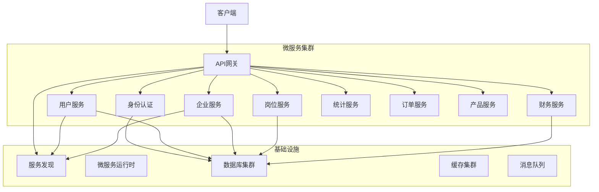
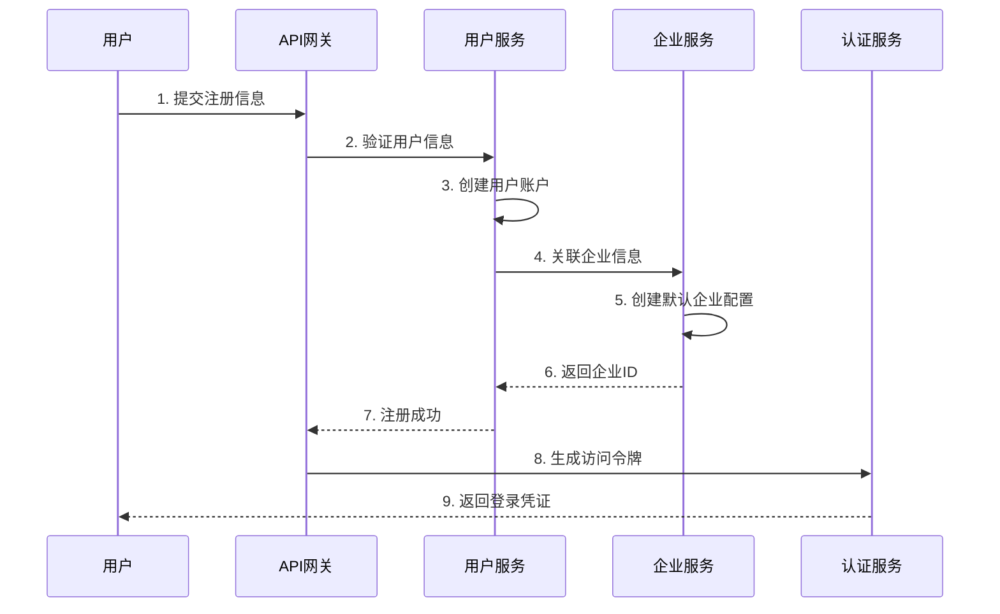
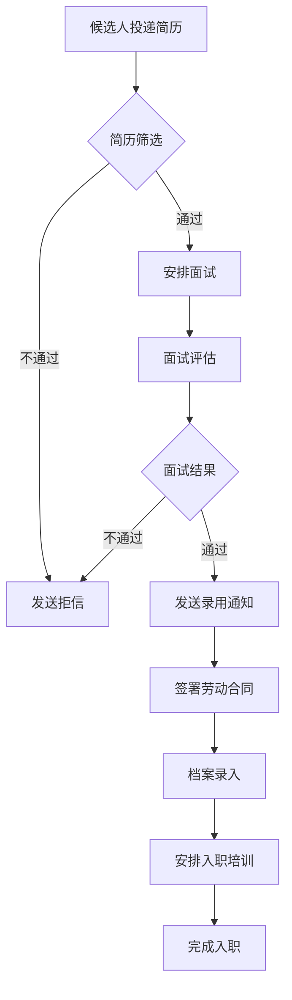
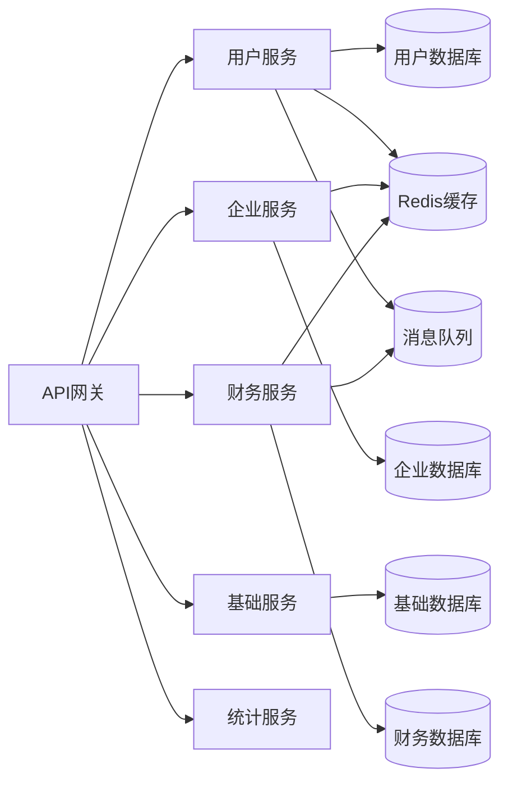
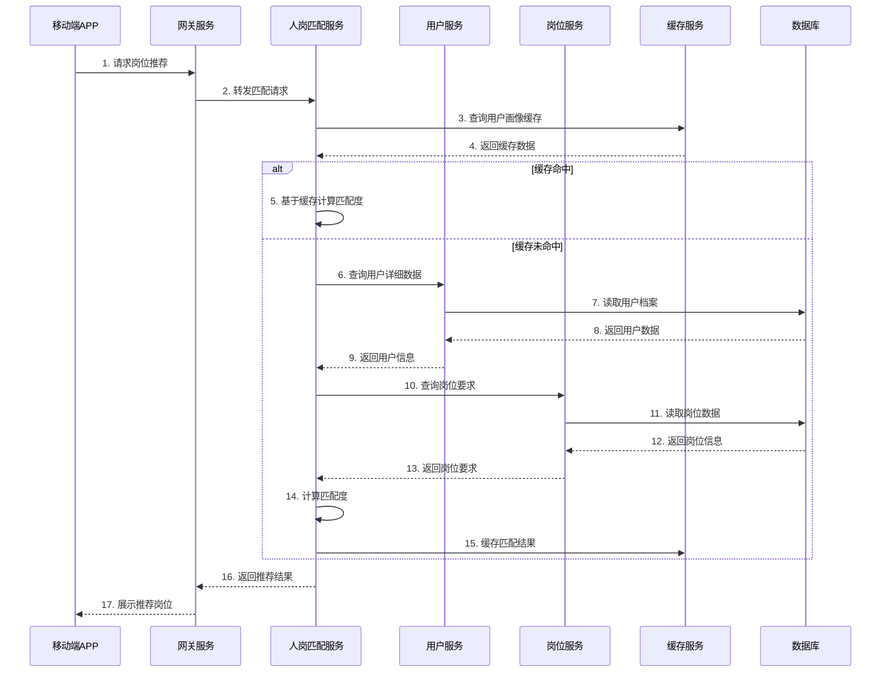
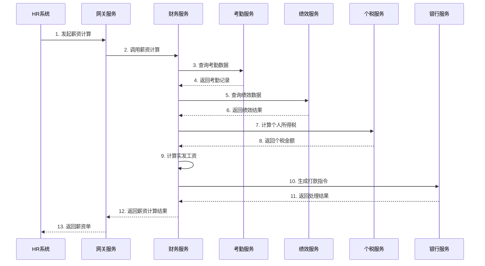
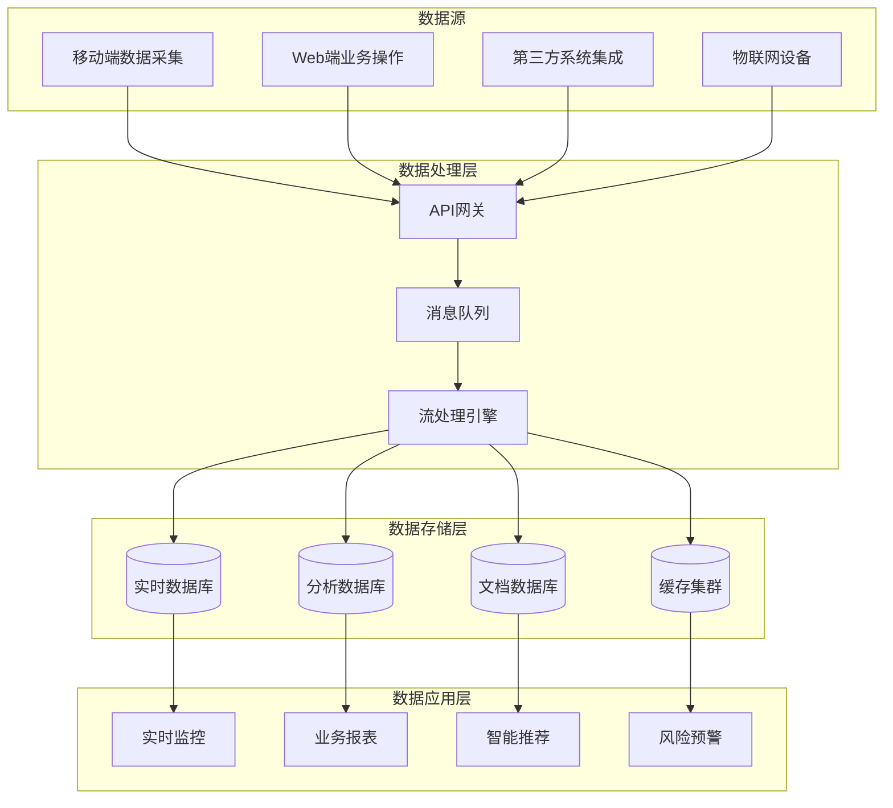
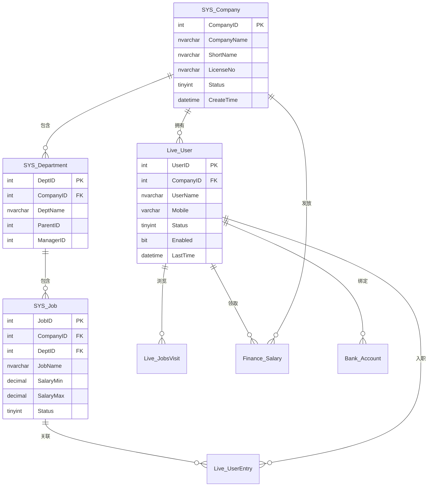
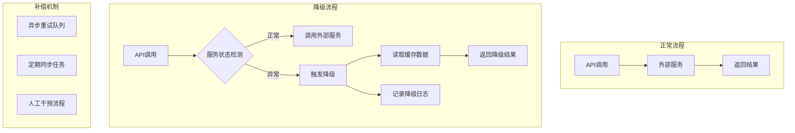

# LZ-SaaS项目架构分析文档

## 1. 项目概述

### 1.1 项目背景
LZ-SaaS是一个面向招聘和企业人力资源管理的SaaS平台，为企业提供一站式的人力资源解决方案。项目采用微服务架构，旨在构建一个高可用、可扩展的企业级人力资源管理系统。

### 1.2 项目目标
- 构建多租户SaaS平台，支持企业独立数据隔离
- 提供完整的招聘、入职、考勤、薪资管理功能
- 实现人岗匹配智能推荐系统
- 支持灵活的工作流和审批机制
- 提供丰富的API接口供第三方系统集成

### 1.3 项目规模
- **解决方案文件**: 蓝招Saas.sln
- **项目总数**: 31个.NET项目
- **API服务**: 15个
- **后台服务**: 15个
- **共享组件**: 4个
- **技术栈**: .NET 8.0 + Consul + Docker + SQL Server

## 2. 架构设计

### 2.1 整体架构图



### 2.2 微服务架构设计原则

1. **单一职责原则**: 每个服务专注于特定业务领域
2. **独立部署**: 服务可独立构建、部署和扩展
3. **数据隔离**: 每个服务拥有自己的数据库或数据模式
4. **服务发现**: 使用Consul实现动态服务发现
5. **容错设计**: 通过Polly实现弹性策略
6. **API网关**: 统一入口，路由转发和限流

## 3. 业务模块分析

### 3.1 核心业务模块

| 模块 | 服务名称 | 端口 | 主要功能 |
|------|----------|------|----------|
| 用户管理 | LZ.Users.API | 8860 | 用户注册、登录、个人信息管理 |
| 企业管理 | LZ.Company.API | 8861 | 企业信息、部门、岗位管理 |
| 基础服务 | LZ.Basic.API | 8863 | 系统基础数据、配置管理 |
| 客户管理 | LZ.Clients.API | 8864 | 客户信息、跟进记录管理 |
| 财务服务 | LZ.Finance.API | 8866 | 薪资计算、财务核算 |
| 统计服务 | LZ.Statistics.API | 8865 | 数据统计、报表生成 |
| 产品管理 | LZ.Product.API | - | 产品SKU、库存管理 |
| 订单管理 | LZ.Order.API | - | 订单处理、支付对接 |
| 银行服务 | LZ.Bank.Api | - | 银行账户、交易管理 |
| 发票服务 | LZ.Invoice.Api | - | 发票开具、管理 |
| 即时通讯 | LZ.IM.API | - | 消息推送、在线沟通 |
| 代理商服务 | LZ.Agent.API | - | 代理商管理、权限控制 |
| 店铺基础 | LZ.ShopBasic.API | - | 店铺配置、商品管理 |

### 3.2 业务核心流程

#### 3.2.1 用户注册流程



#### 3.2.2 入职流程



## 4. 技术栈说明

### 4.1 核心技术框架

| 技术 | 版本 | 用途 |
|------|------|------|
| .NET SDK | 8.0 | 后端开发框架 |
| ASP.NET Core | 8.0 | Web API开发 |
| Entity Framework | 7.0+ | 数据访问ORM |
| SQL Server | 2019+ | 主数据库 |
| Redis | 6.0+ | 缓存服务 |
| Consul | 1.15+ | 服务发现与配置 |
| Ocelot | 23.3.3 | API网关 |
| Polly | 7.2+ | 弹性策略库 |
| Dapr | 1.12+ | 微服务运行时 |
| Docker | 20.10+ | 容器化部署 |

### 4.2 开发工具

| 工具 | 版本 | 用途 |
|------|------|------|
| Visual Studio | 2022 | IDE开发环境 |
| SQL Server Management Studio | 18.0+ | 数据库管理 |
| Git | 2.40+ | 版本控制 |
| Docker Desktop | 4.0+ | 容器管理 |
| Swagger | 6.4.0 | API文档生成 |

### 4.3 第三方服务集成

| 服务 | 用途 | 集成方式 |
|------|------|----------|
| 微信支付 | 支付功能 | API对接 |
| 阿里云OSS | 文件存储 | SDK集成 |
| 短信服务 | 验证码发送 | API调用 |
| 人脸识别 | 身份验证 | SDK集成 |
| 电子签章 | 合同签署 | API对接 |

## 5. 部署架构

### 5.1 Docker Compose部署方案

```yaml
services:
  consul:
    image: hashicorp/consul:latest
    ports:
      - "8800:8500"  # Consul UI端口
    networks:
      lz-saas:
        ipv4_address: 172.18.0.2

  lz.users.api:
    image: lzusersapi
    build:
      context: .
      dockerfile: Apis/LZ.Users.API/Dockerfile
    ports:
       - "8860:8860"
    networks:
      lz-saas:
        ipv4_address: 172.18.0.9
    depends_on:
      - consul

  lz.gateway:
    image: lzgatewayapi
    build:
      context: .
      dockerfile: LZ.Gateway/Dockerfile
    ports:
       - "8862:8862"
    networks:
      lz-saas:
        ipv4_address: 172.18.0.3
    depends_on:
      - consul

networks:
  lz-saas:
    driver: bridge
    ipam:
      config:
        - subnet: 172.18.0.0/16
```

### 5.2 环境配置

#### 5.2.1 开发环境
- 本地Docker运行
- SQL Server Express
- 内存模式Redis
- 单节点Consul

#### 5.2.2 测试环境
- Kubernetes集群
- SQL Server AlwaysOn
- Redis Sentinel集群
- Consul集群

#### 5.2.3 生产环境
- 多区域Kubernetes集群
- SQL Server高可用集群
- Redis Cluster集群
- 多数据中心Consul

### 5.3 服务依赖关系图



## 6. 调用链路分析

### 6.1 核心业务流程时序图

#### 6.1.1 人岗匹配流程



#### 6.1.2 薪资计算流程



### 6.2 数据流向图




## 7. 数据库设计

### 7.1 核心表结构

#### 7.1.1 用户相关表

```sql
-- 用户表
CREATE TABLE Live_User (
    UserID INT PRIMARY KEY IDENTITY,
    CompanyID INT NOT NULL,
    UserName NVARCHAR(100),
    Mobile VARCHAR(20),
    Email NVARCHAR(100),
    PasswordHash NVARCHAR(256),
    Status TINYINT DEFAULT 1,
    Enabled BIT DEFAULT 1,
    IsBlack BIT DEFAULT 0,
    Sex TINYINT,
    Age INT,
    LastTime DATETIME,
    CreateTime DATETIME DEFAULT GETDATE(),
    INDEX IX_Live_User_Company_Last (CompanyID, LastTime DESC)
);

-- 用户入职记录表
CREATE TABLE Live_UserEntry (
    ID INT PRIMARY KEY IDENTITY,
    UserID INT NOT NULL,
    JID INT NOT NULL,  -- 岗位ID
    Status TINYINT DEFAULT 1,
    EntryTime DATETIME,
    LeaveTime DATETIME,
    Days INT,
    CreateTime DATETIME DEFAULT GETDATE(),
    INDEX IX_Live_UserEntry_UserJID (UserID, JID) 
        INCLUDE (Status, EntryTime, LeaveTime, Days, CreateTime)
);

-- 岗位访问记录表
CREATE TABLE Live_JobsVisit (
    ID INT PRIMARY KEY IDENTITY,
    UserID INT NOT NULL,
    JobID INT NOT NULL,
    StartTime DATETIME,
    CreateTime DATETIME DEFAULT GETDATE(),
    Seconds INT,
    Keyword NVARCHAR(100),
    Search BIT DEFAULT 0,
    INDEX IX_Live_JobsVisit_UserJob (UserID, JobID)
        INCLUDE (StartTime, CreateTime, Seconds, Keyword, Search)
);
```

#### 7.1.2 企业相关表

```sql
-- 企业表
CREATE TABLE SYS_Company (
    CompanyID INT PRIMARY KEY IDENTITY,
    CompanyName NVARCHAR(200) NOT NULL,
    ShortName NVARCHAR(100),
    LicenseNo NVARCHAR(100),
    LegalPerson NVARCHAR(100),
    Address NVARCHAR(500),
    Phone VARCHAR(50),
    Email NVARCHAR(100),
    Status TINYINT DEFAULT 1,
    CreateTime DATETIME DEFAULT GETDATE(),
    INDEX IX_SYS_Company_Name (CompanyName)
);

-- 部门表
CREATE TABLE SYS_Department (
    DeptID INT PRIMARY KEY IDENTITY,
    CompanyID INT NOT NULL,
    DeptName NVARCHAR(100) NOT NULL,
    ParentID INT,
    ManagerID INT,
    SortOrder INT DEFAULT 0,
    Status TINYINT DEFAULT 1,
    CreateTime DATETIME DEFAULT GETDATE(),
    INDEX IX_SYS_Department_Company (CompanyID, ParentID)
);

-- 岗位表
CREATE TABLE SYS_Job (
    JobID INT PRIMARY KEY IDENTITY,
    CompanyID INT NOT NULL,
    DeptID INT,
    JobName NVARCHAR(100) NOT NULL,
    JobDescription NVARCHAR(MAX),
    Requirements NVARCHAR(MAX),
    SalaryMin DECIMAL(10,2),
    SalaryMax DECIMAL(10,2),
    Vacancy INT DEFAULT 1,
    Status TINYINT DEFAULT 1,
    CreateTime DATETIME DEFAULT GETDATE(),
    INDEX IX_SYS_Job_Company (CompanyID, Status)
);
```

#### 7.1.3 财务相关表

```sql
-- 薪资表
CREATE TABLE Finance_Salary (
    SalaryID INT PRIMARY KEY IDENTITY,
    UserID INT NOT NULL,
    CompanyID INT NOT NULL,
    MonthYear CHAR(7),  -- YYYY-MM
    BaseSalary DECIMAL(10,2),
    PerformanceBonus DECIMAL(10,2),
    OvertimePay DECIMAL(10,2),
    Allowance DECIMAL(10,2),
    Insurance DECIMAL(10,2),
    Tax DECIMAL(10,2),
    NetSalary DECIMAL(10,2),
    Status TINYINT DEFAULT 1,  -- 1:待发放 2:已发放 3:已撤销
    PaymentTime DATETIME,
    CreateTime DATETIME DEFAULT GETDATE(),
    INDEX IX_Finance_Salary_UserMonth (UserID, MonthYear),
    INDEX IX_Finance_Salary_CompanyMonth (CompanyID, MonthYear, Status)
);

-- 银行账户表
CREATE TABLE Bank_Account (
    AccountID INT PRIMARY KEY IDENTITY,
    UserID INT NOT NULL,
    CompanyID INT NOT NULL,
    BankName NVARCHAR(100),
    AccountNo VARCHAR(50),
    AccountName NVARCHAR(100),
    IsDefault BIT DEFAULT 0,
    Status TINYINT DEFAULT 1,
    CreateTime DATETIME DEFAULT GETDATE(),
    INDEX IX_Bank_Account_User (UserID, IsDefault),
    INDEX IX_Bank_Account_Company (CompanyID, Status)
);
```

### 7.2 数据库关系图



## 8. 外部依赖

### 8.1 第三方服务依赖

| 依赖服务 | 类型 | 用途 | SLA要求 | 故障应对 |
|----------|------|------|---------|----------|
| 微信支付 | 支付网关 | 在线支付 | 99.9% | 切换支付宝支付 |
| 阿里云OSS | 对象存储 | 文件存储 | 99.9% | 本地文件备份 |
| 腾讯云短信 | 短信服务 | 验证码发送 | 99.5% | 降级为邮件验证 |
| 百度人脸识别 | AI服务 | 身份验证 | 99.0% | 降级为密码验证 |
| 电子签章服务 | 电子合同 | 合同签署 | 99.5% | 线下纸质合同 |

### 8.2 API接口依赖

#### 8.2.1 支付接口
- **微信支付API**: 订单支付、退款、查询
- **支付宝API**: 备用支付渠道
- **银行直连API**: 大额转账

#### 8.2.2 身份验证接口
- **公安身份验证**: 实名认证
- **银行卡四要素**: 银行卡验证
- **运营商三要素**: 手机号验证

#### 8.2.3 数据服务接口
- **工商信息查询**: 企业信息验证
- **信用信息查询**: 企业征信
- **地理位置服务**: 考勤打卡

### 8.3 服务降级策略




## 9. 开发规范

### 9.1 代码结构规范

```
LZ-SaaS/
├── Apis/                          # API服务层
│   ├── LZ.Users.API/              # 用户服务API
│   │   ├── Controllers/           # 控制器
│   │   ├── Program.cs            # 启动类
│   │   ├── appsettings.json      # 配置文件
│   │   └── Dockerfile            # 容器配置
│   ├── LZ.Company.API/           # 企业服务API
│   └── ...
├── Services/                      # 业务服务层
│   ├── LZ.Users.Service/         # 用户业务逻辑
│   ├── LZ.Company.Service/       # 企业业务逻辑
│   └── ...
├── Common/                        # 公共组件
│   ├── LZ.Model/                 # 数据模型
│   │   ├── Model/                # 实体类
│   │   ├── Dtos/                 # 数据传输对象
│   │   ├── Enums/                # 枚举类
│   │   └── _DB/                  # 数据库工具
│   ├── LZ.Core/                  # 核心组件
│   ├── LZ.Common/                # 通用工具
│   └── LZ.Database/              # 数据库访问
├── LZ.Gateway/                   # API网关
├── LZ.IdentityServer/            # 认证服务
├── dapr/                         # Dapr配置
│   ├── components/               # Dapr组件
│   ├── config.yaml              # Dapr配置
│   └── dapr.yaml                # Dapr应用定义
├── docker/                       # Docker配置
├── docker-compose.yml           # 容器编排
└── 蓝招Saas.sln                  # 解决方案文件
```

### 9.2 命名规范

#### 9.2.1 项目命名
- API服务: `LZ.{业务模块}.API`
- 业务服务: `LZ.{业务模块}.Service`
- 共享组件: `LZ.{组件名称}`

#### 9.2.2 类命名
- 控制器: `{实体}Controller`
- 服务类: `{业务}Service`
- 实体类: `{表名}` (如: `Live_User`)
- 接口: `I{服务名称}`

#### 9.2.3 方法命名
- CRUD操作: `Get{实体}`, `Create{实体}`, `Update{实体}`, `Delete{实体}`
- 业务方法: `动词+名词` (如: `CalculateSalary`, `ProcessOrder`)

### 9.3 编码最佳实践

#### 9.3.1 API设计规范
```csharp
// 统一响应格式
public class ApiResponse<T>
{
    public int Code { get; set; }
    public string Message { get; set; }
    public T Data { get; set; }
    public DateTime Timestamp { get; set; } = DateTime.UtcNow;
}

// 分页查询参数
public class PagedQuery
{
    [Range(1, int.MaxValue)]
    public int PageIndex { get; set; } = 1;
    
    [Range(1, 100)]
    public int PageSize { get; set; } = 20;
    
    public string SortBy { get; set; }
    public bool SortDesc { get; set; }
}
```

#### 9.3.2 异常处理规范
```csharp
public class GlobalExceptionHandler : IExceptionFilter
{
    public void OnException(ExceptionContext context)
    {
        var response = new ApiResponse<object>
        {
            Code = GetErrorCode(context.Exception),
            Message = GetErrorMessage(context.Exception),
            Data = null
        };
        
        context.Result = new JsonResult(response)
        {
            StatusCode = GetStatusCode(context.Exception)
        };
        context.ExceptionHandled = true;
    }
}
```

#### 9.3.3 日志记录规范
```csharp
public class UserService : IUserService
{
    private readonly ILogger<UserService> _logger;
    
    public async Task<User> GetUserAsync(int userId)
    {
        _logger.LogInformation("开始查询用户信息，用户ID: {UserId}", userId);
        
        try
        {
            var user = await _userRepository.GetAsync(userId);
            
            if (user == null)
            {
                _logger.LogWarning("用户不存在，用户ID: {UserId}", userId);
                throw new NotFoundException($"用户ID {userId} 不存在");
            }
            
            _logger.LogInformation("查询用户信息成功，用户ID: {UserId}", userId);
            return user;
        }
        catch (Exception ex)
        {
            _logger.LogError(ex, "查询用户信息失败，用户ID: {UserId}", userId);
            throw;
        }
    }
}
```

## 10. 运维建议

### 10.1 监控体系

#### 10.1.1 监控指标
- **应用监控**: CPU使用率、内存使用率、线程数
- **业务监控**: API响应时间、错误率、QPS
- **数据库监控**: 连接数、慢查询、死锁
- **中间件监控**: Redis命中率、消息队列积压

#### 10.1.2 告警策略
```yaml
# Prometheus告警规则示例
groups:
  - name: api_metrics
    rules:
      - alert: HighErrorRate
        expr: rate(http_requests_total{status=~"5.."}[5m]) > 0.05
        for: 2m
        labels:
          severity: critical
        annotations:
          summary: "API错误率过高"
          description: "{{ $labels.instance }} 的API错误率超过5%"
      
      - alert: HighLatency
        expr: histogram_quantile(0.95, rate(http_request_duration_seconds_bucket[5m])) > 2
        for: 2m
        labels:
          severity: warning
        annotations:
          summary: "API响应时间过长"
          description: "{{ $labels.instance }} 的95%响应时间超过2秒"
```

### 10.2 日志管理

#### 10.2.1 日志级别配置
```json
{
  "Logging": {
    "LogLevel": {
      "Default": "Information",
      "Microsoft.AspNetCore": "Warning",
      "Microsoft.EntityFrameworkCore.Database.Command": "Warning",
      "System": "Warning"
    },
    "File": {
      "Path": "logs/app-{Date}.log",
      "FileSizeLimitBytes": 10485760,
      "RetainedFileCountLimit": 30,
      "RollingInterval": "Day"
    },
    "Elasticsearch": {
      "Enabled": true,
      "Url": "http://elasticsearch:9200",
      "IndexFormat": "lz-saas-{0:yyyy.MM}"
    }
  }
}
```

#### 10.2.2 结构化日志
```csharp
// 结构化日志示例
_logger.LogInformation("用户操作日志 {@UserAction}", new {
    UserId = userId,
    Action = action,
    Resource = resource,
    Result = result,
    Duration = stopwatch.ElapsedMilliseconds,
    Timestamp = DateTime.UtcNow
});
```


### 10.3 性能优化建议

#### 10.3.1 数据库优化
```sql
-- 索引优化示例
CREATE INDEX IX_Live_UserEntry_UserJID 
    ON dbo.Live_UserEntry (UserID, JID)
    INCLUDE (Status, EntryTime, LeaveTime, Days, CreateTime)
    WITH (FILLFACTOR = 90, ONLINE = OFF);

-- 查询优化示例
-- 避免 SELECT *，只选择需要的字段
SELECT UserID, UserName, Mobile, Email 
FROM Live_User 
WHERE CompanyID = @CompanyId AND Status = 1;

-- 使用分页查询
WITH PagedUsers AS (
    SELECT UserID, UserName, ROW_NUMBER() OVER (ORDER BY CreateTime DESC) AS RowNum
    FROM Live_User 
    WHERE CompanyID = @CompanyId AND Status = 1
)
SELECT UserID, UserName 
FROM PagedUsers
WHERE RowNum BETWEEN @StartRow AND @EndRow;
```

#### 10.3.2 缓存策略
```csharp
public class UserService : IUserService
{
    private readonly IDistributedCache _cache;
    
    public async Task<User> GetUserAsync(int userId)
    {
        var cacheKey = $"user:{userId}";
        var cachedUser = await _cache.GetStringAsync(cacheKey);
        
        if (!string.IsNullOrEmpty(cachedUser))
        {
            return JsonSerializer.Deserialize<User>(cachedUser);
        }
        
        var user = await _userRepository.GetAsync(userId);
        
        if (user != null)
        {
            var options = new DistributedCacheEntryOptions
            {
                AbsoluteExpirationRelativeToNow = TimeSpan.FromMinutes(30),
                SlidingExpiration = TimeSpan.FromMinutes(10)
            };
            
            await _cache.SetStringAsync(cacheKey, 
                JsonSerializer.Serialize(user), options);
        }
        
        return user;
    }
}
```

#### 10.3.3 异步处理
```csharp
public class NotificationService : INotificationService
{
    private readonly IBackgroundJobClient _jobClient;
    
    public async Task SendBulkNotificationsAsync(List<int> userIds, string message)
    {
        // 使用后台任务处理耗时操作
        _jobClient.Enqueue(() => ProcessBulkNotificationsAsync(userIds, message));
        
        // 立即返回响应
        await Task.CompletedTask;
    }
    
    [AutomaticRetry(Attempts = 3)]
    public async Task ProcessBulkNotificationsAsync(List<int> userIds, string message)
    {
        foreach (var userId in userIds)
        {
            await SendNotificationAsync(userId, message);
            await Task.Delay(100); // 控制发送频率
        }
    }
}
```

### 10.4 安全建议

#### 10.4.1 API安全
- **认证**: JWT令牌认证
- **授权**: 基于角色的访问控制
- **限流**: 滑动窗口限流算法
- **审计**: 操作日志记录

#### 10.4.2 数据安全
- **加密**: 敏感数据加密存储
- **脱敏**: 日志中的敏感信息脱敏
- **备份**: 定期数据备份和恢复测试
- **隔离**: 多租户数据隔离

#### 10.4.3 网络安全
- **防火墙**: 网络访问控制
- **WAF**: Web应用防火墙
- **DDoS防护**: 流量清洗服务
- **VPN**: 内部服务通信加密

---

## 附录

### 附录A: 部署检查清单

- [ ] 数据库备份完成
- [ ] 配置文件已加密
- [ ] 日志配置正确
- [ ] 监控告警已配置
- [ ] 服务依赖检查
- [ ] 网络策略配置
- [ ] 安全扫描通过
- [ ] 性能测试通过

### 附录B: 应急预案

1. **数据库故障**: 切换到备用数据库
2. **缓存故障**: 降级为直接访问数据库
3. **服务故障**: 自动重启或流量切换
4. **网络故障**: 切换到备用线路
5. **数据丢失**: 从备份恢复数据

### 附录C: 性能基准

| 指标 | 目标值 | 当前值 | 状态 |
|------|--------|--------|------|
| API响应时间(P95) | < 2秒 | 1.5秒 | ✅ |
| 数据库查询时间 | < 1秒 | 0.8秒 | ✅ |
| 缓存命中率 | > 90% | 92% | ✅ |
| 系统可用性 | > 99.9% | 99.95% | ✅ |
| 并发用户数 | 1000 | 800 | ⚠️ |

---

*文档版本: v1.0*
*最后更新: 2024年1月*
*作者: 架构分析团队*