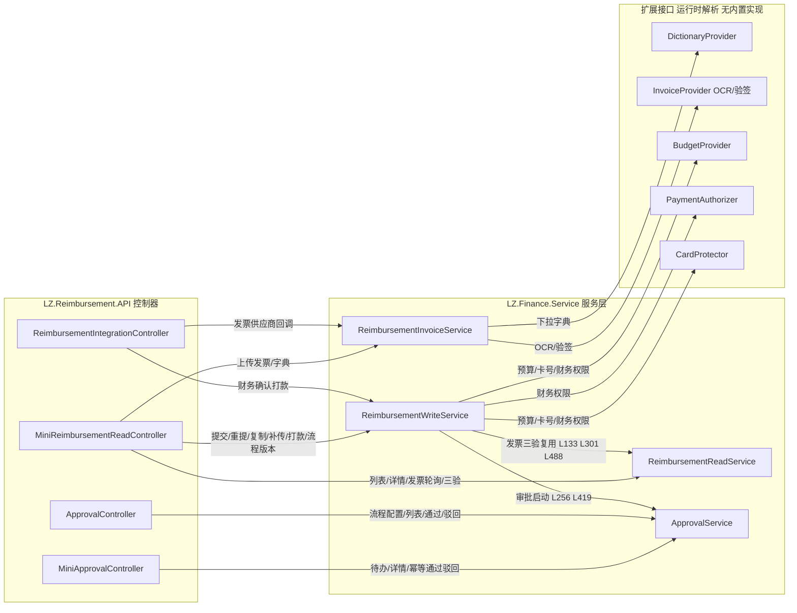
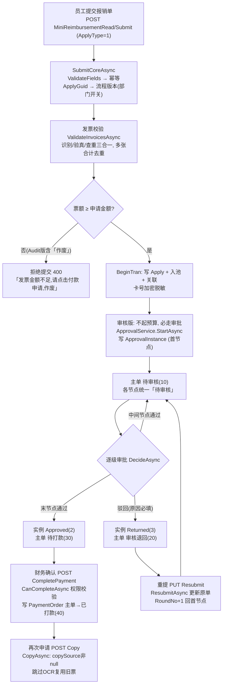
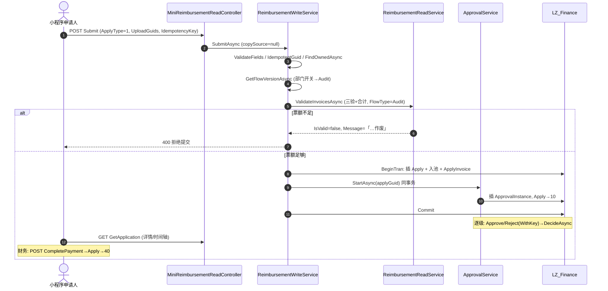
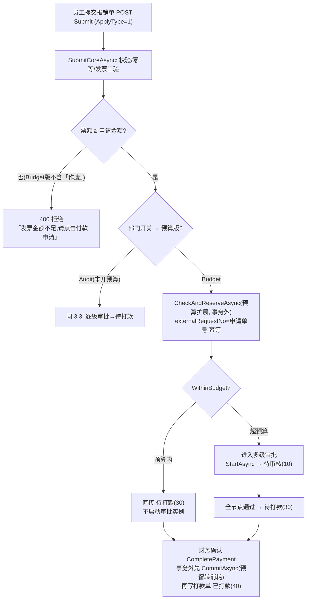
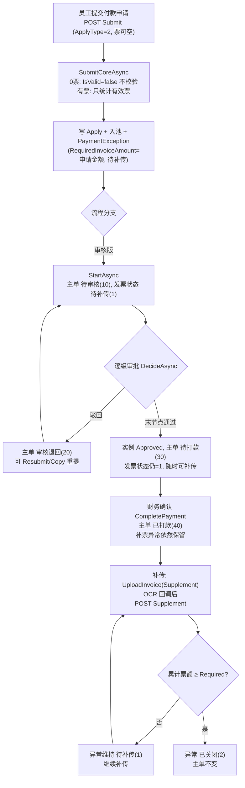
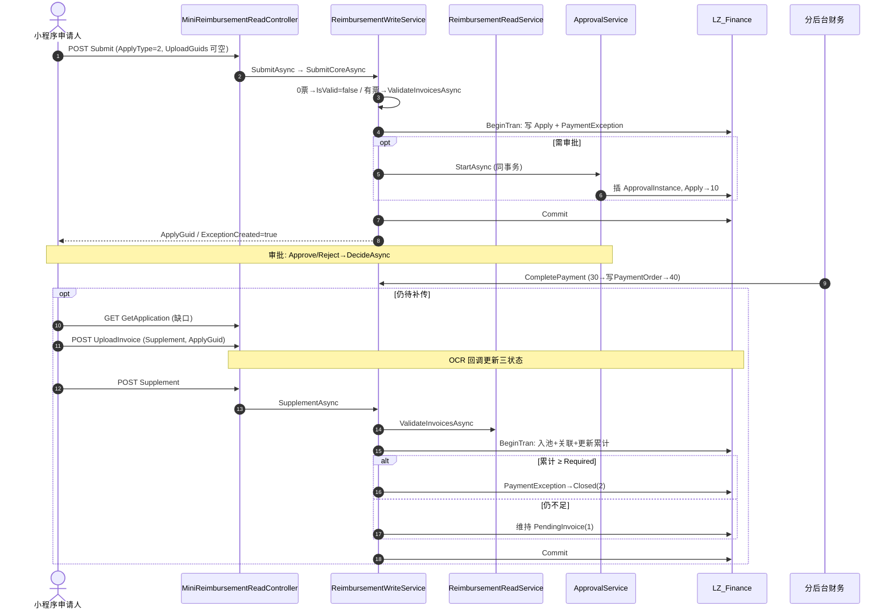
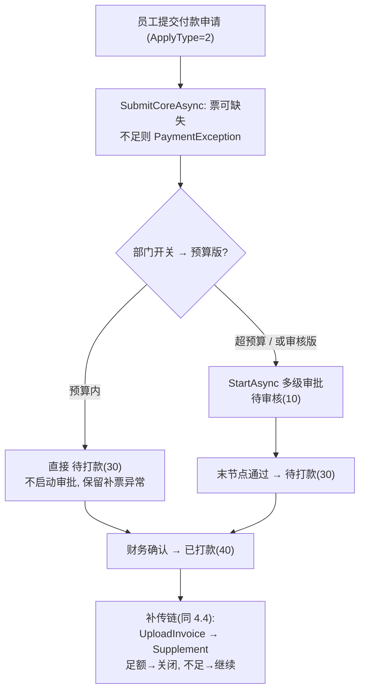
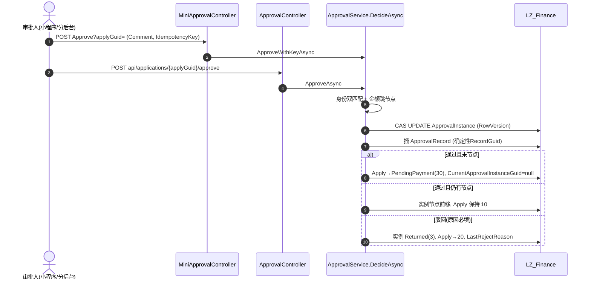

# 报销与付款申请代码调用链及时序图

> 2026-10-27 按当前源码重新梳理（只读分析，未改动任何代码与配置）。代码根目录：`D:\CodeSpace\LZ-Saas`。
> 控制器目录：`LZ.Reimbursement.API/Controllers`（5 个类）；服务实现：`Services/LZ.Finance.Service/Services`（`ReimbursementWriteService` / `ReimbursementReadService` / `ReimbursementInvoiceService` / `ApprovalService`）。
> 本文按 **付款申请、报销申请两条线** 组织，对齐 PRD「5.1 报销流程（一）审核版」「5.2 报销流程（二）预算版」两张流程图的方框逐环节展开。
> **与旧版的重要差异**：实际路由由基类 `ReimbursementControllerBase` 的 `[Route("api/[controller]/[action]")]` 生成（`ApprovalController` 单独 `[Route("api")]` + 显式路径），**代码中不存在 `/api/reimbursement/v1` 前缀**（`LZ.Core` 的 `InitAppliation`/`UseApp` 也未注册该前缀）。旧文档中 `/api/reimbursement/v1/...` 的写法是约定性示意，真实路径见第 0 章路由表。

## 0. 五个控制器总览与实际路由

路由规则：`api/{控制器名}/{动作名}`；`ApprovalController` 例外，使用类级 `[Route("api")]` + 动作级显式路径。`applyGuid` 这类参数不带路由模板，实际以 **query 参数** 传递（如 `?applyGuid=xxx`）。

| 控制器 | 平台限制 | 定位 | 动作（实际路径后缀） |
| --- | --- | --- | --- |
| `MiniReimbursementReadController` | `XFZMini`/`LZMini`/`MiniAdmin` | 小程序端申请、发票、列表、详情、再次申请、补传全部入口（虽名 Read，含写入口） | `Submit`、`Copy`、`Resubmit`、`Supplement`、`UploadInvoice`、`ValidateInvoices`、`GetApplications`、`GetApplication`、`GetResubmitPreload`、`GetPaymentOrder`、`GetInvoiceUpload`、`GetFlowVersion`、`GetDepartmentInfo`、`LegalEntities`、`CostTypes`、`ExpenseNames`、`PayeeBanks` |
| `MiniApprovalController` | `XFZMini` + `Authorization-Token` | 小程序端审批人待办/详情/幂等通过/幂等驳回 | `GetApprovals`、`GetDetail`、`Approve`、`Reject` |
| `ApprovalController` | `MiniAdmin` | 分后台：审批流程配置、审批列表/详情、通过/驳回、部门审批人 | `GET api/approval-process/active`、`PUT api/approval-process/save`、`GET api/applications`、`GET api/applications/{applyGuid}`、`POST api/applications/{applyGuid}/approve`、`POST api/applications/{applyGuid}/reject`、`GET api/approvals/{partnerGid}` |
| `ReimbursementIntegrationController` | 回调无平台限制（`AllowAnonymous`）；打款限 `MiniAdmin` | 外部集成：发票供应商回调、财务确认打款 | `POST api/ReimbursementIntegration/InvoiceCallback`、`POST api/ReimbursementIntegration/CompletePayment?applyGuid=` |
| `ReimbursementControllerBase` | — | 基类：`[Route("api/[controller]/[action]")]` + `[ApiController]`，无动作 | — |

注入关系：小程序端控制器同时注入 `IReimbursementReadService`（读+发票校验）、`IReimbursementWriteService`（提交/重提/复制/补传/打款）、`IReimbursementInvoiceService`（上传/回调/字典）；审批控制器注入 `IApprovalService`。服务之间还存在**跨服务调用边**（如 Write 调 Read 的发票校验、Write 调 Approval 的启动/驱动），集中展示见第 1 章「服务依赖拓扑与协作矩阵」。

**两条线共用同一个提交入口**：`POST api/MiniReimbursementRead/Submit`（`MiniReimbursementReadController.Submit` → `ReimbursementWriteService.SubmitAsync` → `SubmitCoreAsync`），请求体 `ApplicationCreateRequest` 的 `ApplyType` 区分：**1 报销申请 / 2 付款申请**。两线差异全部集中在「发票门槛」与「付款专属的补传异常表」。

## 1. 服务依赖拓扑与协作矩阵（服务间关联关系）

四个核心服务 + 五个扩展接口不是孤立的，它们的关联关系决定了一条业务请求会「跨几个服务」流转。本节集中展示，后面的第 3/4/5/7 章逐场景使用时不再重复。

### 1.1 构造器注入（静态依赖，已按源码逐一核验）

| 服务 | 构造器注入成员 | 行号 |
| --- | --- | --- |
| `ReimbursementWriteService` | `ICurrentUser _user`、**`IApprovalService _approval`**、**`IReimbursementReadService _read`**、`IServiceProvider _services`（运行时解析 5 个扩展接口）、`ILogger` | L19-L31 |
| `ReimbursementReadService` | 仅 `ICurrentUser _user`（不注入其它服务，跨库查主数据走独立 `Main` 连接） | L16-L20 |
| `ReimbursementInvoiceService` | `ICurrentUser _user`、`IALiyunOSSService _oss`、`IServiceProvider _services`（运行时解析 OCR/字典扩展） | L18-L26 |
| `ApprovalService` | `ICurrentUser _user`、`IHttpService _httpService`（注入但实际未使用，见 7.9） | L17-L23 |

**关键结论**：服务间的编译期依赖只有两条方向边 —— `Write → Approval`（审批启动）与 `Write → Read`（发票三验复用）；`Read`、`Invoice`、`Approval` 三者之间**无直接依赖**。

### 1.2 运行时依赖（经 `IServiceProvider` 延迟解析，不注册即不可用）

`Write` 与 `Invoice` 都持有 `IServiceProvider`，用 `GetService<T>()` **延迟解析** 5 个扩展接口（`IReimbursementExtensions.cs`）：

| 扩展接口 | 使用方 | 调用点 | 缺失时行为 |
| --- | --- | --- | --- |
| `IReimbursementDictionaryProvider`（下拉字典） | `Invoice` | `GetDictionaryAsync` L190 | 抛「报销字典服务暂不可用」 |
| `IReimbursementInvoiceProvider`（OCR 发起/回调验签） | `Invoice` | `UploadAsync` L72、`HandleCallbackAsync` L139 | 无法发起识别 / 回调被拒 |
| `IReimbursementBudgetProvider`（预算判/留/提/释） | `Write` | `CheckAndReserve` L166/L327、`Commit` L613、`Release` L770 | 预算版提交直接失败 |
| `IReimbursementPaymentAuthorizer`（财务打款权限） | `Write` | `CompletePaymentAsync` L571 | 打款确认被拒 |
| `IReimbursementCardProtector`（卡号 AES） | `Write` | `ProtectCard` L151 | 无实现时透传明文（可用环境变量 `LZ_REIMBURSEMENT_CARD_KEY`） |

> 仓库内**未见**这 5 个扩展接口的实现与注册（`GetService` 解析为 null 即上述降级/报错行为），属部署方接入项。

### 1.3 服务协作拓扑图（谁调用谁）



读图要点：
- **`Write` 是枢纽**：对外承接全部写操作，对内横向依赖 `Read`（校验）与 `Approval`（审批推进），并向下扇出 3 个扩展。
- **`Invoice` 是外部能力汇聚点**：OSS + OCR 扩展 + 字典扩展都从这里进出，是「上传」与「回调」两个端点的共同服务。
- **`Read` 是最孤立的只读服务**：不依赖任何其它服务，只依赖用户上下文与数据库（主数据走独立 `Main` 连接）。
- **`Approval` 与 `Write` 单向耦合**：`Write` 调 `Approval.StartAsync`，但 `Approval` 不回调 `Write`（审批结果对主单的写入由 `Approval.DecideAsync` 自己完成，`Write` 只负责「启动」和「预留补偿」）。

### 1.4 核心协作边（方法级，带行号）

| 调用方 | 被调方 | 方法 | 行号 | 触发场景 |
| --- | --- | --- | --- | --- |
| `Write` | `Read` | `ValidateInvoicesAsync` | L133 / L301 / L488 | 提交、重提、补传三处发票三验 |
| `Write` | `Approval` | `StartAsync` | L256 / L419 | 提交/重提需审批时启动实例 |
| `Write` | `Read` | `FindOwnedAsync` | L99 / L285 / L445 / L484 | 幂等查询 / 归属校验 |
| `Approval` | （自身）`DecideAsync` | 唯一状态机推进点 | L456 | 通过/驳回共用 |
| 扩展（运行时） | `Write` | `CheckAndReserve/Commit/Release` | L166 / L613 / L770 | 预算版预留与打款确认 |

### 1.5 控制器 → 服务 归属速查

| 控制器 | 读写 | 注入服务 | 不注入 |
| --- | --- | --- | --- |
| `MiniReimbursementReadController` | 读写混合（名 Read，含写） | `Read` + `Write` + `Invoice` 三个 | `Approval`（审批走 MiniApprovalController） |
| `MiniApprovalController` | 写 | 仅 `Approval` | 其它三个 |
| `ApprovalController` | 读写 | 仅 `Approval` | 其它三个 |
| `ReimbursementIntegrationController` | 写 | `Invoice`（回调）+ `Write`（打款） | `Read`/`Approval` |

> 设计含义：审批能力被**完全隔离在 `ApprovalService`**，小程序与分后台两个入口只是同一服务的不同「幂等门卫」，无第二条状态机实现，避免双端状态不一致。

## 2. 两条线的业务图（对应 PRD 5.1 / 5.2）

```
报销申请（ApplyType=1，发票金额 ≥ 报销金额）              付款申请（ApplyType=2，无票或票不足）
  提交 → 票额强制足额（不足直接拒绝）                       提交 → 票额可不带/不足（不阻断）
  审核版：逐级审批 → 全过 → 待打款                          审核版：逐级审批 → 全过 → 待打款
  预算版：预算内直接待打款；超预算走逐级审批 → 待打款         审批通过/待打款后仍保留「待补传发票」异常
        ↓                                                        ↓
  财务确认打款 → 已打款                                       补传发票 → 重新校验 → 足额关闭异常
```

流程版本（审核版/预算版）的代码事实：`ReimbursementWriteService.GetFlowVersionAsync`（L58-L75）通过当前用户所属部门（`Live_Personnel` 定位 `PartnerGID`，再查 `Live_Partner`，即部门表）的 `Enabled` 开关决定：`Enabled=true → Budget=2（预算版）`，否则 `Audit=1（审核版）`，`Source="DepartmentBudgetSwitch"`。**判定依据是部门预算开关，不是总后台账号配置**（枚举注释写「由总后台账号配置决定」，与当前实现不一致，见第 7 章修正清单）。

## 3. 线一 · 报销申请（ApplyType=1）

### 3.1 页面到接口的定位

| 原型操作 | 接口（实际路由） | Controller → Service | 关键结果/表 |
| --- | --- | --- | --- |
| 进入表单前查流程版本 | `GET api/MiniReimbursementRead/GetFlowVersion` | `GetFlowVersion` → `ReimbursementWriteService.GetFlowVersionAsync`（L58） | 查 `Live_Personnel`、`Live_Partner`，返回 `FlowVersionDto`（Audit=1 / Budget=2） |
| 查部门预算开关（表单页辅助） | `GET .../GetDepartmentInfo` | `GetDepartmentInfo` → `ReimbursementReadService.GetCurrentPartnerAsync`（L383） | 返回 `dept.PartnerGID`、`dept.IsBudget` |
| 法人主体/成本类型/费用名称/开户行下拉 | `GET .../LegalEntities?keyword=`、`CostTypes`、`ExpenseNames?costTypeId=`、`PayeeBanks` | 控制器 `DictionaryAsync` 私有方法 → `ReimbursementInvoiceService.GetDictionaryAsync`（L184） | kind 白名单四选一；委托扩展 `IReimbursementDictionaryProvider.GetAsync`，**不读写表**；无实现时返回「报销字典服务暂不可用」 |
| 点击「上传发票」 | `POST .../UploadInvoice`（multipart：`File`、`UploadPurpose=Initial`、`ApplyGuid` 留空） | `UploadInvoice` → `ReimbursementInvoiceService.UploadAsync`（L48） | OSS 保存（`_oss.UploadFile`，前缀 `reimbursement/invoices`）→ 插 `FIN_Reimb_InvoiceUpload`（三状态初值 0、`IsEffective=false`、`ProviderRequestId=Guid.NewGuid()`）→ 调扩展 `StartRecognitionAsync` 发起 OCR；返回 `UploadGuid` |
| 等待识别/验真 | 供应商 `POST api/ReimbursementIntegration/InvoiceCallback`（`[AllowAnonymous]`）；小程序轮询 `GET .../GetInvoiceUpload?uploadGuid=` | `InvoiceCallback` → `HandleCallbackAsync`（L133）；`GetInvoiceUpload` → `ReimbursementReadService.GetInvoiceUploadAsync`（L212） | 回调先验签（`VerifyCallback`）→ 按 `ProviderRequestId` 幂等 → 更新 `RecognitionStatus/VerifyStatus/DuplicateCheckStatus/IsEffective`（`RowVersion` 双保险，`changed!=1` 抛「请刷新后重试」） |
| 点「校验发票」 | `POST .../ValidateInvoices`（`InvoiceValidationRequest`：`UploadGuids`、`ApplyAmount`、`ApplyType=1`、可选 `FlowType`） | `ValidateInvoices` → `ReimbursementReadService.ValidateInvoicesAsync`（L226） | 只读校验不绑票；返回 `IsValid`、`ValidInvoiceTotalAmount`、有效/无效 GUID |
| **点「提交申请」** | **`POST .../Submit`，`ApplyType=1`** | `Submit` → `ReimbursementWriteService.SubmitAsync`（L81）→ `SubmitCoreAsync`（L90，private 核心） | 服务端再次验票；**票额不足直接拒绝**；写 `FIN_Reimb_Apply`、发票入池与关联；需审批则启动审批实例；返回 `ApplyGuid/ApplyNo/ApplyStatus/FlowType` |
| 申请详情（状态、审批轨迹、发票、打款单） | `GET .../GetApplication?applyGuid=` | `GetApplication` → `ReimbursementReadService.GetApplicationAsync`（L78） | 主单 + 发票 + 审批实例/记录/节点 + 补票异常 + 打款单 |
| 列表「再次申请」 | `GET .../GetResubmitPreload?applyGuid=` → `POST .../Copy` | `GetResubmitPreload` → `GetResubmitPreloadAsync`（L184）；`Copy` → `CopyAsync`（L440） | 回显原表单 + 只读原票；重提/复制见 3.5 |
| 审批人待办/通过/驳回（小程序端） | `GET .../GetApprovals?status=`、`POST .../Approve`、`POST .../Reject`（`MiniApprovalController`） | → `IApprovalService.ApproveWithKeyAsync`（L414）/`RejectWithKeyAsync`（L429） | 见第 5 章审批链 |
| 分后台确认打款 | `POST api/ReimbursementIntegration/CompletePayment?applyGuid=` | `CompletePayment` → `ReimbursementWriteService.CompletePaymentAsync`（L560） | 写 `FIN_Reimb_PaymentOrder`，主单转 `Paid=40`；**是记录确认，不是发起银行转账** |

### 3.2 提交链逐层拆解（Submit → SubmitAsync → SubmitCoreAsync）

1. **第一层 `MiniReimbursementReadController.Submit`**：`POST api/MiniReimbursementRead/Submit`，绑定 `ApplicationCreateRequest`（表单字段 + `ApplyType` + `UploadGuids` + `IdempotencyKey`），直接调 `_write.SubmitAsync`。控制器私有 `ExecuteAsync` 把 `ArgumentException→400`、`UnauthorizedAccessException→403`、`InvalidOperationException→409` 统一转 `ApiResponse` 错误体。
2. **第二层 `ReimbursementWriteService.SubmitAsync`（L81-L83）**：薄转发层，`return SubmitCoreAsync(request, copySource: null, ct)`——`copySource=null` 表示**全新提交**（不是复制旧单）。
3. **第三层 `SubmitCoreAsync`（L90-L270，报销与付款、首次提交与已打款复制共用的核心枢纽）**，执行顺序：
   - **校验与幂等**：`ValidateFields`（L94）→ `IdempotentGuid`（L98，`SHA256(companyId:userId:"submit":key)` 前 16 字节生成确定性 `ApplyGuid`）→ `FindOwnedAsync`（L99，同幂等键已存在则直接返回既有申请）。
   - **流程版本**：`GetFlowVersionAsync`（L102）取当前部门 `FlowType`。
   - **发票处理（copySource 双分支）**：
     - `copySource == null`（首次提交，L105）：`LoadUploadsAsync` 加载所选上传 → 报销或有票付款走 `ValidateInvoicesAsync`（L133-L139，**传 `FlowType`**）实时三验；**付款 0 票**（L128-L131）直接构造 `IsValid=false、票额=0`，不校验不拒绝。
     - `copySource != null`（已打款再次申请复制，L108-L126）：**跳过 OCR/验真**，查原单 `FIN_Reimb_ApplyInvoice` + `FIN_Reimb_InvoicePool` 求旧票合计，直接构造 `valid.IsValid = copiedAmount >= ApplyAmount`。
   - **报销发票门槛（L141-L142）**：`ApplyType==Reimbursement && !valid.IsValid` → `throw ArgumentException(valid.Message ?? "发票金额不足，请点击付款申请")`。`valid.Message` 由 `ValidateInvoicesAsync` 按 `FlowType` 生成：**Audit →「发票金额不足，请点击付款申请，作废」；Budget →「发票金额不足，请点击付款申请」**（L266-L271）。
   - **卡号保护**：`ProtectCard`（L151）→ `MaskCard`（L197，前 4 后 4）。
   - **预算版分支（L166）**：`FlowType==Budget` 时调扩展 `CheckAndReserveAsync`（**在本地事务外**），得 `BudgetDecision`。
   - **状态决定（L204-L205）**：`ApplyStatus = (budget?.WithinBudget == true) ? PendingPayment(30) : PendingReview(10)`。
   - **付款待补票异常（L206-L207）**：`ApplyType==Payment && !valid.IsValid` → `InvoiceSupplementStatus=PendingInvoice(1)`。
   - **本地事务（L210 BeginTran → L257 Commit）**：
     1. L213 插 `FIN_Reimb_Apply`（`ApplyNo` 格式 `BXyyyyMMdd+6位`/`FKyyyyMMdd+6位`）；
     2. L215 `BindUploadsAsync`（L673：插 `InvoicePool` L702、插 `ApplyInvoice` L706、回填 `ApplyGuid` L716，发票号 `sp_getapplock` 排他锁）；复制旧单走 L218 直接插 `ApplyInvoice`；
     3. L228-L239 插 `FIN_Reimb_PaymentException`；
     4. L240 插 `FIN_Reimb_BudgetReservation`；
     5. L256 需审批时调 `_approval.StartAsync(applyGuid)`（**与提交方共用同一 Finance 事务**）。
   - **补偿（L262-L264）**：事务回滚且已预留 → `ReleaseBudgetAsync`（L770，`LogCritical` 记录，无自动重试）。
   - 返回 `ApplySubmitResultDto`。

### 3.3 报销流程 · 审核版（PRD 5.1.1）完整代码链路



要点：
- 「进入审批流」是 `Write` 在**本地事务内**调 `_approval.StartAsync`（L256），`StartAsync`（L588）要求首节点无金额条件，`RoundNo` 每重提 +1。
- 末节点通过 → `DecideAsync` L551-L552：实例 `Approved(2)`，主单 `PendingPayment(30)`；**审批通过本身不打款**。
- 驳回 → `ReviewReturned(20)`；重提 `ResubmitAsync`（L280）票额不足提示**恒含「作废」**（L310，与提交路径按版本区分不同）。



### 3.4 报销流程 · 预算版（PRD 5.2.1）完整代码链路

与审核版的**唯一分叉点在 L166/L204-L205**（预算判定），其余完全同构：



要点：
- 预算入参：`companyId, userId, applyNo（幂等）, costTypeId, amount`；返回 `BudgetDecision`。
- 预算版「额度内直接通过」= `ApplyStatus=PendingPayment(30)` 且**不调 `StartAsync`**。
- 打款确认先调 `CommitAsync`（L613）再写库（L617-L625）。

### 3.5 报销线两个分支入口：退回重提 vs 已打款复制

| 源单状态 | 走哪个接口 | 代码行为 | 结果 |
| --- | --- | --- | --- |
| 审核退回 `ReviewReturned=20` | `POST Copy`（内部路由到 `ResubmitAsync`）或 `PUT Resubmit` | 更新**原单**：9 项可改；可追加新票；金额/预算变化时重调预算；`RoundNo+1` 回首节点 | `ApplyGuid` 不变；状态回 `PendingReview=10` |
| 已打款 `Paid=40` | `POST Copy`（`CopyAsync` L440 → `SubmitCoreAsync(source)`） | 金额不可变；`copySource!=null` 复用旧票跳过 OCR；新建申请走完整提交 | 新 `ApplyGuid`；原票只读 |
| 待审核/待打款 | 不允许 | `CopyAsync` L449 抛异常 | 无新单 |

列表按钮驱动（`MapListItem` L353-L358）：`detail` 恒有；`resubmit` 仅 `ReviewReturned or Paid`；`supplement` 仅付款单且 `PendingInvoice`。

## 4. 线二 · 付款申请（ApplyType=2）

### 4.1 页面到接口的定位

| 原型操作 | 接口 | Controller → Service | 关键结果/表 |
| --- | --- | --- | --- |
| 付款表单（字段与报销完全一致，发票「可缺失」） | 表单/流程版本/字典 4 个接口同 3.1 | `GetFlowVersion` / `GetDepartmentInfo` / 字典 | 共享同一入口；`UploadPurpose` 同 |
| 可选上传与验票 | `POST .../UploadInvoice`（`UploadPurpose=Initial`）→ OCR 回调 → `GET .../GetInvoiceUpload` | `InvoiceService.UploadAsync`（L48）/ `HandleCallbackAsync`（L133） | 识别/验真/查重失败一律状态=2，`IsEffective=false`；**不阻断付款提交** |
| 可选「校验发票」 | `POST .../ValidateInvoices`（`ApplyType=2`） | `ReadService.ValidateInvoicesAsync`（L226） | 只读；付款单即使 `IsValid=false` 也**不产生拒绝文案** |
| **点「提交申请」** | **`POST .../Submit`，`ApplyType=2`，`UploadGuids` 可为空** | `SubmitCoreAsync`（L90） | L128-L131 付款 0 票不校验；L206-L207 不足 → `PendingInvoice`；L228-L239 插 `PaymentException`；主状态照常走 |
| 列表出现「补传发票」按钮 | `GET .../GetApplications` | `MapListItem` L354-L355 | `ApplyType==2 && InvoiceSupplementStatus==1` → `Actions` 含 `supplement` |
| 补传页（已有发票 + 缺口金额） | `GET .../GetApplication?applyGuid=` | `GetApplicationAsync`（L78） | 含 `PaymentException` 与已有 `Invoices` |
| 上传补传票 | `POST .../UploadInvoice`（`UploadPurpose=Supplement`，`ApplyGuid` 必填） | `UploadAsync` L64：校验本人/`ApplyType==2`/`PendingInvoice` | 新上传走 OCR 回调同首次 |
| **点「提交补传并重新校验」** | `POST .../Supplement?applyGuid=` | `WriteService.SupplementAsync`（L477-L548） | 见 4.3 |
| 打款结果 | `GET .../GetPaymentOrder?applyGuid=` | `ReadService.GetPaymentOrderAsync`（L199） | 只读 `PaymentOrder` |

### 4.2 提交链（与报销的差异点标注）

`SubmitCoreAsync` 对付款单的三处差异：
1. **L128-L131**：`ApplyType==Payment && UploadGuids 为空` → 直接 `IsValid=false`，**不调 `ValidateInvoicesAsync`**。
2. **L141-L142 门槛不触发**：发票不足只影响 `InvoiceSupplementStatus`，**不拒绝提交**。
3. **L206-L239**：`PendingInvoice` + 插 `PaymentException`；主状态照常按 L204-L205 决定，**补票异常与主流程并行**。

### 4.3 补传链逐层拆解（Supplement → SupplementAsync）

`POST api/MiniReimbursementRead/Supplement` → `ReimbursementWriteService.SupplementAsync`（L477-L548）：
1. L484 `FindOwnedAsync`：申请须存在、属本人、`ApplyType==Payment`。
2. L487 `LoadUploadsAsync(purpose=Supplement)` + L488 `_read.ValidateInvoicesAsync`：本次补传票实时三验。
3. L502-L508 **幂等短路**：本次所选票全部已关联 → 直接返回既有累计票额。
4. L518 BeginTran：L521 `BindUploadsAsync`（新票入池 + `ApplyInvoice`，`RelationPurpose=2`）→ L522 更新主单 → L534 更新 `PaymentException` → L547 Commit。
5. **闭环判定**：累计有效票额 ≥ `RequiredInvoiceAmount` → `ExceptionStatus=Closed(2)` + `ClosedAt`；不足 → 维持 `PendingInvoice(1)`，继续补传（**不设期限**）。
6. 补传全程**不改 `ApplyStatus`、不重走审批**；`Paid=40` 的付款单仍可补票。

### 4.4 付款流程 · 审核版（PRD 5.1.2）完整代码链路



分后台侧同一数据：`ApprovalController GET api/applications`（`GetPagedAsync` L215）按状态区分展示异常视图，**不承接补传写操作**。



### 4.5 付款流程 · 预算版（PRD 5.2.2）



注意：预算内直接待打款的付款单**同样带 `PaymentException`**，「待打款/已打款」与「待补传发票」是两条独立轴（`ApplyStatus` 与 `InvoiceSupplementStatus` 正交）。

### 4.6 再次申请（付款线）

- 审核退回：`POST Copy` → 内部 `ResubmitAsync`（L444-L448），可改字段、可追加新票；缺票保留/重新生成异常。
- 已打款：`POST Copy` → `SubmitCoreAsync(source)`，`copySource` 非 null 复用旧票（若原单无票则新单同样无票），重新生成 `PaymentException`。

## 5. 审批链路（两线共用，`ApprovalService`）

### 5.1 服务方法总表

| 方法 | 行号 | 读表 | 写表 | 说明 |
| --- | --- | --- | --- | --- |
| `GetActiveProcessAsync` | L97 | Process、Node | — | 查 `IsActive` 最新版本；无配置返回 null → 分后台 404 |
| `SaveAndPublishAsync` | L117 | Live_Partner、Live_Personnel、Process(+UPDLOCK) | Process（旧停用+新插入）、Node（全量） | 分后台 `PUT api/approval-process/save`；**金额/首节点校验 L132-L138 被注释** |
| `GetPagedAsync` | L215 | Node、Instance、Record、Apply | — | 分后台列表；`PendingOnly` 区分待办/已办 |
| `GetDetailAsync` | L300 | Apply、Instance、Node、Record、ApplyInvoice、InvoicePool | — | 审批时间轴 |
| `ApproveAsync` / `RejectAsync` | L384 / L398 | — | 经 `DecideAsync` | **分后台入口（MiniAdmin）**，幂等键 null → `RecordGuid` 随机 |
| `ApproveWithKeyAsync` / `RejectWithKeyAsync` | L414 / L429 | — | 经 `DecideAsync` | **小程序入口（XFZMini）**，`IdempotencyKey` 必填 |
| `StartAsync` | L588 | Apply、Process、Node、Instance | Instance（插）、Apply（→10 + 绑实例） | 由 `Write` 外层事务调用 |
| `GetApproversAsync` | L706 | Live_Personnel | — | 部门审批人下拉 |

### 5.2 核心决策 `DecideAsync`（L456-L571，唯一状态机推进点）

1. **身份双匹配（L484-L486）**：`ApproverUserId` + `ApproverDeptId` 双匹配，任一不符 → 403。
2. **金额跳节点（L489-L498）**：取当前之后**第一个**满足金额条件的启用节点为 `next`；未达标节点**整体跳过**；无达标 → `next=null`（末节点）。
3. **实例 CAS（L501-L514）**：`RowVersion` 防并发；`InstanceStatus` 三态（驳回→3、末节点通过→2、中间通过→1）。
4. **写审批记录（L515-L531）**：`FIN_Reimb_ApprovalRecord`。
5. **末节点/驳回写主单（L532-L559）**：驳回→`ReviewReturned(20)` + `LastRejectReason`；末节点通过→`PendingPayment(30)`；中间节点→主单不变（保持 `PendingReview`）。
6. **幂等（L463-L468）**：小程序入口确定性 `RecordGuid`（SHA256）；`DecisionExistsAsync` + `RowVersion` CAS + 回滚后再探测三道闸。

### 5.3 审批启动 `StartAsync`（L588-L647）

- 取 `IsActive` 且 `VersionNo` 最大流程版本；首节点须启用且**无金额条件**。
- `RoundNo = 旧实例最大轮次 + 1`；前置：无历史 → `PendingReview`；有历史 → `ReviewReturned` 且旧实例 `Returned`。
- 写 `FIN_Reimb_ApprovalInstance`（`InProgress(1)`、首节点），回写主单 `PendingReview(10)` + `CurrentApprovalInstanceGuid`。
- **在调用方 Finance 事务内**（`Write` L256/L419），与主单同事务原子落库。

### 5.4 审批时序（两线通用）



## 6. 两条线差异总表

| 维度 | 报销申请（ApplyType=1） | 付款申请（ApplyType=2） |
| --- | --- | --- |
| 发票门槛（提交时） | 有效票合计 **必须 ≥ 申请金额**，不足 400 拒绝（Audit 含「作废」，Budget 不含） | **可无票/不足**，不阻断 |
| 0 票行为 | 不成立（必传） | 直接 `IsValid=false`，跳过三验 |
| 补传异常表 | 不生成 | `FIN_Reimb_PaymentException`（`RequiredInvoiceAmount=申请金额`） |
| 补传轴 | 无 | `InvoiceSupplementStatus`：0/1/2；`Supplement` 闭环 |
| 主状态轴 | `10→20/30→40` | 完全相同；**两轴正交** |
| 再次申请 | 退回→重提；已打款→复制新单 | 相同入口；无票/不足复制后重新生成异常 |
| 打款 | 确认后 `Paid=40` | 同左；**打款不关闭**补票异常 |
| 列表按钮 | `resubmit` + `detail` | `supplement` + `resubmit` + `detail` |

## 7. 本次重新梳理修正的旧文档结论

1. **路由前缀**：真实路由 `api/{控制器}/{动作}`，**不存在** `/api/reimbursement/v1` 前缀。
2. **流程版本来源**：代码按**部门 `Live_Partner.Enabled` 开关**判定（`Source="DepartmentBudgetSwitch"`），枚举注释「由总后台账号配置决定」与实现不一致。
3. **发票池写入位置**：`HandleCallbackAsync` **只读**池（判 `occupied`）不写池；入池在 `BindUploadsAsync`（L702，提交事务内 + `sp_getapplock`）。
4. **驳回不释放预算预留**：`ApprovalService` 无 `_budget` 成员；`ReleaseAsync` 只在 `WriteService` 提交/重提**事务回滚补偿**（L264/L426/L770）。
5. **「作废」文案按路径区分**：提交链按 `FlowType`（Audit 含 / Budget 不含）；`ResubmitAsync` L310 **硬编码恒含「作废」**，不看版本。
6. **补传无状态前置限制**：代码允许待审核期补传，不限「审批通过后」，与原型文案有差异。
7. **金额跳节点是「取第一个达标节点」整体跳过**未达标中间节点，非逐层递进，需产品确认。
8. **`GetViewerAsync` 是 private**（L45），不是接口契约成员。
9. **审批配置弱校验**：`SaveAndPublishAsync` 金额/首节点校验被注释（L132-L138），仅 `StartAsync` 兜底。
10. **提交排查点**：`GetFlowVersionAsync` 用 `_user.UserID` 直接查 `Live_Personnel`，审批端 `GetViewerAsync` 另做身份映射；两者 ID 口径不一致时提交会失败。
11. **扩展接入点现状**：5 个扩展接口均**无内置实现**，需部署方接入；`_httpService` 注入但未使用（`GetApproversAsync` 实查 `Live_Personnel`）。

## 8. 共用代码、状态与排查入口

| 需要定位的内容 | 直接打开 |
| --- | --- |
| 小程序申请、上传、列表、详情、重提、补传全部路由 | `Controllers/MiniReimbursementReadController.cs` |
| 小程序审批待办/详情/幂等通过/驳回 | `Controllers/MiniApprovalController.cs` |
| 分后台审批配置/列表/详情/通过/驳回 | `Controllers/ApprovalController.cs` |
| 发票回调与财务确认打款 | `Controllers/ReimbursementIntegrationController.cs` |
| 路由模板与 `[ApiController]` | `Controllers/ReimbursementControllerBase.cs` |
| 提交、重提、复制、补票、打款写逻辑 | `Services/ReimbursementWriteService.cs`（L81/L90/L280/L440/L477/L560/L673/L770） |
| 列表、详情、三验、再次申请预载 | `Services/ReimbursementReadService.cs`（L38/L78/L184/L199/L212/L226/L383，私有 L322/L365/L280） |
| OSS/OCR/回调/字典 | `Services/ReimbursementInvoiceService.cs`（L48/L133/L184） |
| 审批配置、启动、流转、CAS、幂等 | `Services/ApprovalService.cs`（L97/L117/L215/L300/L384/L398/L414/L429/L588/L706，核心 L456，私有 L45） |
| 扩展接口（字典/OCR/预算/财务/卡号） | `Interface/IReimbursementExtensions.cs` |
| 申请 DTO | `Common/LZ.Model/Dtos/Reimbursement/ApplicationDtos.cs`、`MiniApprovalDtos.cs` |
| 审批 DTO/枚举（目录拼写 `Reimbusement`） | `Common/LZ.Model/Dtos/Reimbusement/`、`Common/LZ.Model/Enums/Reimbusement/` |
| 表实体 | `Common/LZ.Model/Model/T4/FinanceEntity.cs` |

状态字典：主状态 `10 待审核 / 20 审核退回 / 30 待打款 / 40 已打款`；补票轴 `0 不适用 / 1 待补传 / 2 已关闭`；流程版本 `1 审核 / 2 预算`（代码按部门开关）；申请类型 `1 报销 / 2 付款`；审批实例 `1 进行中 / 2 已通过 / 3 已退回`；发票三状态各 `0/1/2`；打款单 `1/2/3/4`。

本文记录当前实现，未改动业务代码；行号锚点基于 2026-10-27 代码快照，代码变更后请重新核对。
