# 费用报销与付款申请服务开发设计文档

## 文档信息

| 项目   | 内容                           |
| ---- | ---------------------------- |
| 文档名称 | 费用报销与付款申请服务开发设计文档            |
| 文档版本 | v1.0                         |
| 编制日期 | 2026-10-16                   |
| 业务依据 | 《付款报销审核流程产品需求文档》第 2～5 部分     |
| 架构依据 | 《LZ-SaaS项目架构分析文档》            |
| 开发范围 | 后端分后台、总后台；不包含职喜智能体小程序前端      |
| 服务形态 | 独立微服务、独立 SQL Server 数据库      |
| 核心原则 | 本文件是开发落地基线；未写入本文件的业务规则不得自行扩展 |

> 本文档已经按 PRD v2.4 的业务结论重新梳理。原开发稿中与 PRD 不一致的“补票 30 天期限、超期惩罚、固定三级审批、预算账户自建、多费用明细、复杂发票字段、自动跳过审批人”等内容不作为本次开发需求。

---

## 目录

1. [范围、边界与已确认规则](#1-范围边界与已确认规则)
2. [业务分析与流程闭环](#2-业务分析与流程闭环)
3. [服务架构与项目结构](#3-服务架构与项目结构)
4. [数据库设计（SQL Server）](#4-数据库设计sql-server)
5. [表关系图与关联字段](#5-表关系图与关联字段)
6. [实体类设计](#6-实体类设计)
7. [DTO、服务接口与接口设计](#7-dto服务接口与接口设计)
8. [关键业务算法与事务边界](#8-关键业务算法与事务边界)
9. [流程图、时序图与状态机](#9-流程图时序图与状态机)
10. [测试与验收要点](#10-测试与验收要点)
11. [AI 开发执行边界](#11-ai-开发执行边界)
12. [附录：需求追踪矩阵](#12-附录需求追踪矩阵)

---

## 1. 范围、边界与已确认规则

### 1.1 本次开发范围

本次只新增“费用报销与付款申请”独立服务及其独立数据库，支持以下后端能力：

1. 分后台提交报销申请。
2. 分后台提交付款申请。
3. 分后台配置审核流程：审批层级、节点顺序、每层审批人、每层金额触发条件。
4. 分后台审批报销申请与付款申请。
5. 分后台查看申请记录、申请详情和当前状态。
6. 分后台上传发票、补传发票、查看补传状态。
7. 分后台按状态展示需要补传发票的付款申请异常清单。
8. 财务执行打款并记录打款结果。
9. 总后台配置账号的报销类型：`审核` 或 `预算`。
10. 预算版调用现有系统预算能力，不新建预算账户体系和预算配置体系。

### 1.2 明确不包含的内容

| 不包含项             | 说明                                 |
| ---------------- | ---------------------------------- |
| 职喜智能体小程序前端       | 本次只设计后端接口；小程序端不纳入开发范围              |
| 申请草稿/暂存          | PRD 明确本版不引入草稿、暂存                   |
| 补票期限             | 不设置截止日期、不提醒、不逾期、不处罚                |
| 员工信誉扣分           | 不在本版范围                             |
| 部分报销、部分打款        | PRD 未定义；本设计按单笔全额申请、全额打款处理          |
| 多费用明细            | PRD 只定义 9 项提交字段，不增加主表 + 明细表结构      |
| 发票代码、购销方、税额等扩展字段 | PRD 明确只提取“发票号码、价税合计金额”用于业务校验       |
| 固定审批层级           | 不固定为主管、部门经理、总经理三级；节点数量和顺序均可配置      |
| 审批人自动跳过、离职兜底     | 不在 PRD 确认范围内，不擅自实现                 |
| 直接驳回至任意中间节点      | 驳回后只进入“审核退回”；再次提交必须从首节点重新审批        |
| 通知方式             | PRD 暂未确定，本版只维护数据状态，不擅自接入短信、公众号等通知  |
| “再次申请”功能         | PRD 归属小程序；本次不考虑小程序，因此不设计该接口        |
| 独立预算账户配置         | 预算额度由现有系统按“法人主体 + 成本类型 + 费用名称”自动带出 |
| 修改其他业务模块         | 不允许改动用户、企业、财务、基础数据等既有模块的业务逻辑和数据库   |

### 1.3 总后台边界

总后台在本需求中只有一项能力：

| 能力   | 可选值       | 作用                       |
| ---- | --------- | ------------------------ |
| 账号配置 | `审核`、`预算` | 决定该账号的报销申请与付款申请走审核版还是预算版 |

“审核”和“预算”是账号配置字段的枚举值，不是两个独立菜单，也不是可以在总后台执行的业务流程。

总后台不得提供、修改或代替以下能力：

- 审核流程配置。
- 报销申请或付款申请提交。
- 报销申请或付款申请审批。
- 发票上传、补传。
- 审核申请管理。
- 补传状态查看。
- 异常统计。

### 1.4 分后台边界

分后台承载：

- 报销申请/付款申请提交与管理。
- 审批操作。
- 审核流程配置。
- 发票上传与补传。
- 补传状态查看。
- 异常统计清单。
- 财务打款操作。

### 1.5 已确认业务规则汇总

| 规则主题        | 最终结论                      |
| ----------- | ------------------------- |
| 两类申请字段      | 报销申请与付款申请均使用同一组 9 项字段     |
| 流程版本决定人     | 由总后台账号配置决定，不按申请类型单独选择     |
| 报销申请前置条件    | 发票有效金额合计必须 ≥ 报销金额         |
| 付款申请容错      | 允许无发票或发票不足，审批完成后保留待补传发票   |
| 发票提取字段      | 只提取“发票号码、价税合计金额”          |
| 多张发票        | 采用合计金额与申请金额比对             |
| 识别失败        | 统一提示“再次上传即可”，并按未上传发票处理    |
| 真伪校验失败      | 统一提示“再次上传即可”，并按未上传发票处理    |
| 重复上传失败      | 统一提示“再次上传即可”，并按未上传发票处理    |
| 审核版报销金额不足提示 | “发票金额不足，请点击付款申请，作废”       |
| 预算版报销金额不足提示 | “发票金额不足，请点击付款申请”          |
| 付款申请补传校验    | 补传后重新执行真伪校验、重复校验、金额合计校验   |
| 补传金额不足      | 保持待补传发票状态，继续上传            |
| 补传金额满足      | 关闭待补传发票状态/异常关闭            |
| 审批节点        | 动态配置，无固定数量、无固定顺序          |
| 审批人绑定       | 每个节点绑定“部门 + 人员”           |
| 金额条件        | 可配置是否开启，默认关闭；开启后默认阈值 5000 |
| 驳回          | 驳回原因必填                    |
| 驳回重提        | 修改后重新提交，从审批流程首节点重新开始      |
| 状态名称        | 待审核、审核退回、待打款、已打款、待补传发票    |
| 审批层级状态      | 不拆分为待主管、待经理、待总经理；统一为“待审核” |
| 列表筛选        | 状态、费用名称、申请时间              |
| 异常统计        | 只按状态区分展示，不计算数量、金额、占比、趋势   |
| 状态同步        | 所有端侧状态实时一致；本次只建设后端数据状态    |
| 表单项来源       | 法人主体、成本类型等参考现有项目字段规范      |

---

## 2. 业务分析与流程闭环

### 2.1 两类申请

| 申请类型 | 代码  | 适用条件        | 发票要求         | 审批后处理                   |
| ---- | ---:| ----------- | ------------ | ----------------------- |
| 报销申请 | 1   | 发票金额 ≥ 报销金额 | 提交时必须满足金额条件  | 审批完成后进入待打款              |
| 付款申请 | 2   | 无发票或发票不足    | 允许提交时不满足金额条件 | 审批完成后仍保留待补传发票，后续补传并重新校验 |

两类申请共用：

- 同一组 9 项字段。
- 同一套发票上传能力。
- 同一套审核流程配置。
- 同一套状态体系和审批记录规则。
- 同一套列表筛选规则。

### 2.2 9 项提交字段

| 序号  | 字段名称    | 数据含义         | 必填  |
| ---:| ------- | ------------ | --- |
| 1   | 法人主体    | 报销或付款归属的法人主体 | 是   |
| 2   | 成本类型    | 费用所属成本类型     | 是   |
| 3   | 费用名称    | 本次费用名称       | 是   |
| 4   | 收款单位    | 收款方名称或户名     | 是   |
| 5   | 收款单位所属行 | 收款单位开户银行     | 是   |
| 6   | 收款单位卡号  | 收款单位银行账号     | 是   |
| 7   | 费用用途    | 费用使用用途       | 是   |
| 8   | 备注      | 补充说明         | 否   |
| 9   | 报销金额    | 与发票价税合计金额比对  | 是   |

实现要求：

- `报销金额` 必须大于 0，最多保留两位小数。
- 法人主体、成本类型、费用名称从现有基础数据或现有业务规范取值；本服务保存业务 ID 和名称快照。
- 收款单位卡号属于敏感字段，数据库只保存加密值，接口返回只返回掩码。
- 付款申请也使用“报销金额”字段名，不新增“付款金额”字段，避免两端语义漂移。

### 2.3 流程版本选择

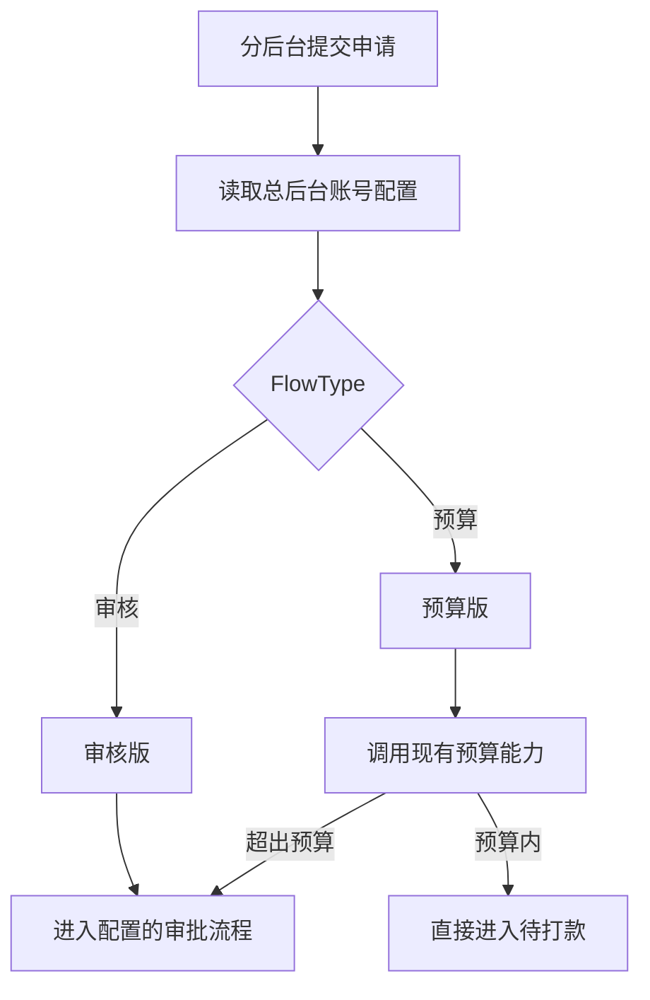

关键约束：

1. 账号配置必须在提交时存在且启用。
2. 找不到账号配置时，提交失败，不默认落入审核版或预算版。
3. 提交时将 `FlowType` 快照写入申请主表；后续修改账号配置不影响已提交的在途单据。
4. 预算额度来源、判定口径不在本服务实现；本服务只调用现有预算能力并记录本地预留流水。

### 2.4 报销申请流程

#### 2.4.1 审核版

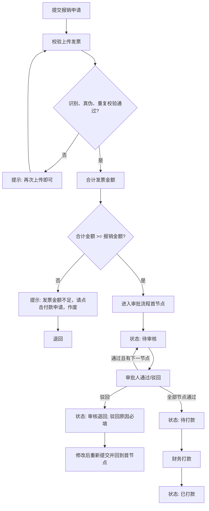

#### 2.4.2 预算版

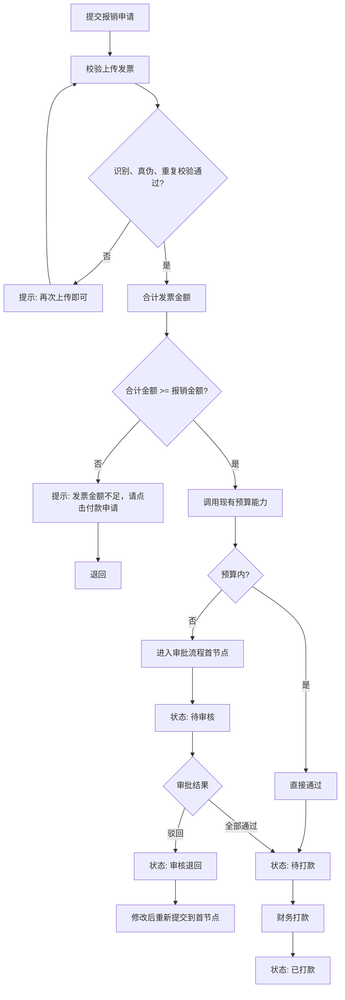

### 2.5 付款申请流程

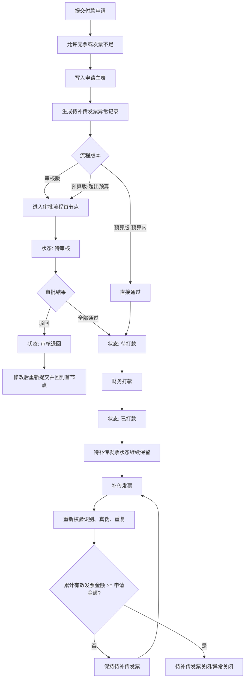

付款申请的核心不是“审批完就一定没有异常”，而是：

- 审批流程和付款流程可以正常结束。
- 发票补充状态作为独立状态继续保留。
- 只有补传金额满足后，待补传发票状态才关闭。

### 2.6 发票上传与校验

#### 2.6.1 第三方回调

发票识别、真伪校验依赖第三方识别插件回调。本服务不承担 OCR 插件算法，只负责：

1. 保存上传文件。
2. 调用插件或接收插件回调。
3. 校验回调签名和幂等性。
4. 提取并保存以下两个业务字段：
   - 发票号码。
   - 价税合计金额。
5. 执行真伪校验和重复上传校验。
6. 计算同一申请下全部有效发票的价税合计金额。

#### 2.6.2 校验失败处理

| 场景       | 用户提示                                     | 业务处理            |
| -------- | ---------------------------------------- | --------------- |
| 识别失败     | 再次上传即可                                   | 认定为未上传发票        |
| 真伪校验失败   | 再次上传即可                                   | 认定为未上传发票        |
| 重复上传     | 再次上传即可                                   | 认定为未上传发票        |
| 报销申请金额不足 | 审核版：发票金额不足，请点击付款申请，作废；预算版：发票金额不足，请点击付款申请 | 退回，阻断进入审批/预算判定  |
| 付款申请金额不足 | 不提示“作废”                                  | 允许提交，生成待补传发票异常  |
| 补传后金额仍不足 | 保持待补传发票状态                                | 允许继续上传          |
| 补传后金额满足  | 待补传发票关闭/异常关闭                             | 更新申请发票合计金额并关闭异常 |

#### 2.6.3 发票唯一性与并发

- 以“租户 + 发票号码”建立唯一索引。
- 同一发票号码一旦成功进入发票池，不得再次关联到其他申请。
- 并发上传、重复提交时，依赖数据库唯一约束兜底。
- 捕获唯一索引冲突后转为“重复上传”，提示“再次上传即可”。

### 2.7 审批流程配置与执行

审批流程配置是分后台的基础配置能力，适用于本服务内的报销申请和付款申请。

配置内容：

1. 审批层级数量。
2. 节点顺序。
3. 每层审批人。
4. 每层金额触发条件。

审批人规则：

- 每个节点绑定“部门 + 人员”。
- 审批操作时，当前用户必须匹配当前节点的审批人。
- 不在本版实现自动跳过、离职自动转派、申请人本人自动跳过。

金额触发规则：

- `AmountConditionEnabled = false` 时，节点始终进入。
- `AmountConditionEnabled = true` 时，按配置的运算符和阈值判断是否进入。
- 默认关闭。
- 开启后默认阈值 5000。
- 建议首个节点必须无条件进入，避免提交后无审批人可处理。

审批操作：

| 操作   | 必填项           | 结果                              |
| ---- | ------------- | ------------------------------- |
| 通过   | 审批意见可选        | 若存在满足条件的下一节点，流转下一节点；否则申请状态改为待打款 |
| 驳回   | 驳回原因必填        | 申请状态改为审核退回；原审批实例结束              |
| 驳回重提 | 按原业务字段修改后重新提交 | 新建一轮审批实例，从首节点重新开始               |

### 2.8 状态模型

PRD 的 5 个状态名称必须完全保留：

1. 待审核。
2. 审核退回。
3. 待打款。
4. 已打款。
5. 待补传发票。

为同时表达“付款申请已打款但仍待补传发票”，本设计使用两个状态字段：

| 字段                      | 作用      | 枚举               |
| ----------------------- | ------- | ---------------- |
| ApplyStatus             | 申请主流程状态 | 待审核、审核退回、待打款、已打款 |
| InvoiceSupplementStatus | 补传发票状态  | 不适用、待补传发票、已关闭    |

展示规则：

- 两个状态分别返回中文字段名称。
- 当付款申请的 `InvoiceSupplementStatus = 待补传发票` 时，列表和详情必须同时展示该状态。
- 不新增“待主管审核、待经理审核”等状态。
- 不新增“超期未补传”状态。

### 2.9 异常统计

本版“异常统计”是分后台的待补传发票清单视图，不是报表能力。

固定口径：

- 数据范围：存在待补传发票异常的付款申请。
- 展示方式：按 `InvoiceSupplementStatus` 区分展示。
- 筛选条件：状态、费用名称、申请时间。
- 数据逻辑：无数量统计、无金额汇总、无占比、无趋势、无报表导出要求。

### 2.10 现有能力依赖

| 依赖能力        | 本服务使用方式                       | 禁止事项                     |
| ----------- | ----------------------------- | ------------------------ |
| 用户、部门、角色    | 通过当前登录上下文和外部 ID 引用            | 不在报销库重复建设用户/部门/权限主数据     |
| 账号报销类型配置    | 总后台维护，本服务读取                   | 不在总后台增加预算额度配置            |
| 预算查询与占用     | 通过 `IBudgetProvider` 适配现有预算能力 | 不在本服务重建预算计算口径            |
| 发票 OCR/真伪插件 | 通过回调适配器接收结果                   | 不修改插件算法，不扩展 PRD 未要求的提取字段 |
| 文件存储        | 使用现有 OSS/文件服务                 | 不在报销库存二进制文件              |
| 登录认证        | 使用现有网关/身份体系                   | 不新增独立账号体系                |
| 财务打款        | 本服务记录打款结果和流水号                 | 不直连银行，除非后续单独确认           |

### 2.11 需求覆盖核对

| PRD 主题           | 本设计覆盖位置     |
| ---------------- | ----------- |
| 账号配置决定审核版/预算版    | 2.3、3.4、7.4 |
| 两类申请字段一致         | 2.1、2.2、6.2 |
| 发票真伪、重复、金额校验     | 2.6、8.4     |
| 多张发票合计           | 2.6、8.4     |
| 审核流程动态配置         | 2.7、6.2、7.3 |
| 审批人=部门+人员        | 2.7、4.4、6.2 |
| 金额条件默认关闭、默认 5000 | 1.5、2.7、4.4 |
| 状态名称统一           | 2.8、9.3     |
| 付款申请补传闭环         | 2.5、8.5     |
| 异常统计仅按状态展示       | 2.9、7.4     |
| 申请列表筛选           | 7.4         |
| 总后台仅账号配置         | 1.3、3.4、7.4 |
| 不设补票期限           | 1.2、2.5、8.5 |

---

## 3. 服务架构与项目结构

### 3.1 服务定位

新增独立服务：

| 项目     | 建议名称                           | 说明                 |
| ------ | ------------------------------ | ------------------ |
| API 服务 | `LZ.Reimbursement.API`         | 分后台、总后台接口入口        |
| 业务服务   | `LZ.Reimbursement.Service`     | 报销、发票、审批、付款、异常业务逻辑 |
| 数据模型   | `LZ.Model.Model.Reimbursement` | EF Core 实体         |
| DTO    | `LZ.Model.Dtos.Reimbursement`  | 请求、响应、查询 DTO       |
| 枚举     | `LZ.Model.Enums.Reimbursement` | 状态、类型、动作枚举         |
| 数据库    | `LZ_Reimbursement`             | 独立 SQL Server 数据库  |

建议网关路由前缀：

```text
/api/reimbursement/{**catch-all}
```

建议容器端口：

```text
8867
```

端口如与最终部署方案冲突，以部署配置为准，但业务服务不得与其他服务共用数据库。

### 3.2 分层与目录结构

```text
Apis/
└── LZ.Reimbursement.API/
    ├── Controllers/
    │   ├── ReimbursementApplicationController.cs
    │   ├── InvoiceUploadController.cs
    │   ├── InvoiceCallbackController.cs
    │   ├── ApprovalProcessController.cs
    │   ├── PaymentExceptionController.cs
    │   └── AccountConfigController.cs
    ├── Program.cs
    └── appsettings.json

Services/
└── LZ.Reimbursement.Service/
    ├── Applications/
    ├── Invoices/
    ├── Approvals/
    ├── Payments/
    ├── Exceptions/
    ├── AccountConfigs/
    └── Budgets/

Common/
└── LZ.Model/
    ├── Model/Reimbursement/
    ├── Dtos/Reimbursement/
    └── Enums/Reimbursement/
```

### 3.3 技术约束

| 项目   | 约定                                                           |
| ---- | ------------------------------------------------------------ |
| .NET | .NET 8.0                                                     |
| Web  | ASP.NET Core 8.0                                             |
| ORM  | Entity Framework Core，遵循架构文档既有 ORM 约定；不要使用当前旧稿中的 SqlSugar 示例 |
| 数据库  | SQL Server 2019+                                             |
| 服务发现 | Consul                                                       |
| 网关   | Ocelot                                                       |
| 弹性   | HttpClient + Polly 或现有 Dapr 调用方式                             |
| 响应   | 统一 `ApiResponse<T>`                                          |
| 分页   | 统一 `PagedQuery`                                              |
| 日志   | `ILogger<T>`，沿用项目结构化日志规范                                     |
| 异常   | 统一全局异常过滤器，业务错误返回业务错误码                                        |
| 认证   | 使用现有身份认证和网关校验                                                |
| 多租户  | 所有业务表必须有 `TenantId`，查询必须带租户条件                                |

### 3.4 组件关系

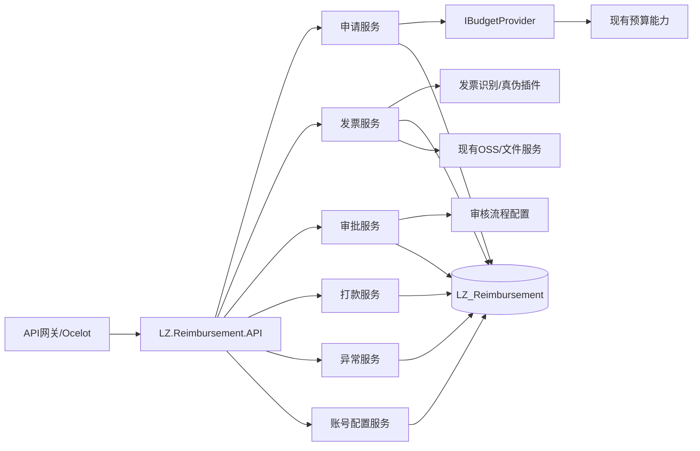

### 3.5 事务和一致性原则

1. 同一数据库内使用 EF Core 显式事务。
2. 不在数据库事务中同步调用外部预算服务、插件或 OSS。
3. 跨服务调用使用幂等键：建议使用 `ApplyNo`、`UploadId`、`ExternalRequestNo`。
4. 审批状态更新必须使用乐观并发或条件更新，防止同一节点重复审批。
5. 发票唯一性使用数据库唯一索引兜底，不能只在应用层查重。
6. 发票插件回调必须按 `ProviderRequestId` 幂等。
7. 打款接口必须按 `IdempotencyKey` 幂等。
8. 配置变更只影响新提交的申请；在途申请使用已快照的流程版本。
9. 不建立跨数据库外键。

### 3.6 服务职责拆分

| 服务                                 | 主要职责                       |
| ---------------------------------- | -------------------------- |
| `IReimbursementApplicationService` | 提交、详情、列表、审核退回后的修改重提        |
| `IInvoiceProcessingService`        | 上传、回调、识别、真伪、防重、金额汇总        |
| `IApprovalProcessConfigService`    | 审批流程版本与节点配置                |
| `IApprovalWorkflowService`         | 启动审批实例、通过、驳回、计算下一节点        |
| `IPaymentService`                  | 财务打款、支付单和支付状态              |
| `IPaymentExceptionService`         | 生成待补传发票异常、重算补传金额、关闭异常、异常清单 |
| `IAccountConfigService`            | 总后台账号报销类型配置                |
| `IBudgetProvider`                  | 适配现有预算系统，不实现预算口径           |
| `INumberGenerator`                 | 生成申请号、支付单号                 |

---

## 4. 数据库设计（SQL Server）

### 4.1 数据库命名与规则

- 数据库：`LZ_Reimbursement`。
- 表名：`Reimbursement_{业务对象}`。
- 字段名：PascalCase。
- 主键统一使用 `BIGINT IDENTITY(1,1)`，账号/用户等外部 ID 按现有项目类型使用 `INT`。
- 金额统一使用 `DECIMAL(18,2)`。
- 时间统一使用 `DATETIME`，默认值为 `GETDATE()`。
- 并发控制使用 `ROWVERSION`。
- 所有业务表保存 `TenantId`。
- 删除策略采用业务状态或停用标记，不物理删除历史业务数据。

### 4.2 表清单

| 序号  | 表名                                | 用途           | 是否本服务主数据   |
| ---:| --------------------------------- | ------------ | ---------- |
| 1   | `Reimbursement_AccountConfig`     | 总后台账号报销类型配置  | 是          |
| 2   | `Reimbursement_Apply`             | 报销/付款申请主表    | 是          |
| 3   | `Reimbursement_InvoiceUpload`     | 发票上传尝试记录     | 是          |
| 4   | `Reimbursement_InvoicePool`       | 成功发票全局池与防重   | 是          |
| 5   | `Reimbursement_ApplyInvoice`      | 申请与发票关联      | 是          |
| 6   | `Reimbursement_ApprovalProcess`   | 审批流程版本主表     | 是          |
| 7   | `Reimbursement_ApprovalNode`      | 审批节点及金额条件    | 是          |
| 8   | `Reimbursement_ApprovalInstance`  | 申请审批实例       | 是          |
| 9   | `Reimbursement_ApprovalRecord`    | 审批操作记录       | 是          |
| 10  | `Reimbursement_BudgetReservation` | 本服务预算调用与预留审计 | 否，预算源在现有系统 |
| 11  | `Reimbursement_PaymentException`  | 待补传发票异常      | 是          |
| 12  | `Reimbursement_PaymentOrder`      | 打款单与银行流水     | 是          |

### 4.3 状态枚举字典

#### 4.3.1 ApplyType：申请类型

| 值   | 名称   |
| ---:| ---- |
| 1   | 报销申请 |
| 2   | 付款申请 |

#### 4.3.2 FlowType：流程版本

| 值   | 名称  |
| ---:| --- |
| 1   | 审核  |
| 2   | 预算  |

#### 4.3.3 ApplyStatus：申请主状态

| 值   | 名称   | 说明             |
| ---:| ---- | -------------- |
| 10  | 待审核  | 当前审批节点等待处理     |
| 20  | 审核退回 | 任一节点驳回，等待修改后重提 |
| 30  | 待打款  | 审批通过或预算内直接通过   |
| 40  | 已打款  | 打款成功           |

#### 4.3.4 InvoiceSupplementStatus：待补传发票状态

| 值   | 名称    | 说明          |
| ---:| ----- | ----------- |
| 0   | 不适用   | 不需要补传       |
| 1   | 待补传发票 | 付款申请异常未关闭   |
| 2   | 已关闭   | 补传金额满足，异常关闭 |

#### 4.3.5 发票上传状态

| 字段                   | 值     | 名称            |
| -------------------- | -----:| ------------- |
| RecognitionStatus    | 0/1/2 | 待识别/识别成功/识别失败 |
| VerifyStatus         | 0/1/2 | 待验真/验真成功/验真失败 |
| DuplicateCheckStatus | 0/1/2 | 待查重/查重通过/重复上传 |
| IsEffective          | 0/1   | 无效/有效         |

#### 4.3.6 ApprovalInstanceStatus

| 值   | 名称  |
| ---:| --- |
| 1   | 进行中 |
| 2   | 已通过 |
| 3   | 已退回 |

#### 4.3.7 ApprovalAction

| 值   | 名称  |
| ---:| --- |
| 1   | 通过  |
| 2   | 驳回  |

#### 4.3.8 PaymentStatus

| 值   | 名称   |
| ---:| ---- |
| 1   | 待打款  |
| 2   | 打款中  |
| 3   | 打款成功 |
| 4   | 打款失败 |

#### 4.3.9 PaymentExceptionStatus

| 值   | 名称    |
| ---:| ----- |
| 1   | 待补传发票 |
| 2   | 已关闭   |

#### 4.3.10 BudgetCheckResult / BudgetReservationStatus

| 字段                | 值       | 名称              |
| ----------------- | -------:| --------------- |
| CheckResult       | 1/2/3   | 预算内/超预算/调用失败    |
| ReservationStatus | 0/1/2/3 | 未预留/已预留/已提交/已释放 |

### 4.4 SQL Server 建库建表脚本

以下脚本可直接作为首版数据库脚本基线。执行前请确认目标实例、数据库名和文件路径符合部署环境。

```sql
SET ANSI_NULLS ON;
SET QUOTED_IDENTIFIER ON;
GO

IF DB_ID(N'LZ_Reimbursement') IS NULL
BEGIN
    CREATE DATABASE [LZ_Reimbursement];
END;
GO

USE [LZ_Reimbursement];
GO

/* =========================================================
   1. 总后台账号报销类型配置
   ========================================================= */
CREATE TABLE dbo.Reimbursement_AccountConfig
(
    Id              BIGINT IDENTITY(1,1) NOT NULL,
    TenantId        NVARCHAR(50) NOT NULL,
    AccountId       INT NOT NULL,
    UserId          INT NOT NULL,
    FlowType        TINYINT NOT NULL,
    IsEnabled       BIT NOT NULL CONSTRAINT DF_AccountConfig_IsEnabled DEFAULT(1),
    CreatedBy       INT NULL,
    CreatedAt       DATETIME NOT NULL CONSTRAINT DF_AccountConfig_CreatedAt DEFAULT(GETDATE()),
    UpdatedBy       INT NULL,
    UpdatedAt       DATETIME NULL,
    RowVersion      ROWVERSION NOT NULL,
    CONSTRAINT PK_Reimbursement_AccountConfig PRIMARY KEY CLUSTERED (Id),
    CONSTRAINT CK_AccountConfig_FlowType CHECK (FlowType IN (1, 2))
);
GO

CREATE UNIQUE INDEX UX_AccountConfig_Tenant_Account
    ON dbo.Reimbursement_AccountConfig(TenantId, AccountId);
GO

CREATE INDEX IX_AccountConfig_Tenant_User
    ON dbo.Reimbursement_AccountConfig(TenantId, UserId, IsEnabled);
GO

/* =========================================================
   2. 报销/付款申请主表
   ========================================================= */
CREATE TABLE dbo.Reimbursement_Apply
(
    Id                          BIGINT IDENTITY(1,1) NOT NULL,
    TenantId                    NVARCHAR(50) NOT NULL,
    ApplyNo                     VARCHAR(32) NOT NULL,
    ApplyType                   TINYINT NOT NULL,
    FlowType                    TINYINT NOT NULL,
    AccountConfigId              BIGINT NOT NULL,
    ApplicantId                 INT NOT NULL,
    ApplicantName               NVARCHAR(100) NOT NULL,
    ApplicantDeptId             INT NULL,
    ApplicantDeptName           NVARCHAR(100) NULL,

    LegalEntityId               INT NOT NULL,
    LegalEntityName             NVARCHAR(200) NOT NULL,
    CostTypeId                  INT NOT NULL,
    CostTypeName                NVARCHAR(100) NOT NULL,
    ExpenseName                 NVARCHAR(200) NOT NULL,

    PayeeName                   NVARCHAR(200) NOT NULL,
    PayeeBankName               NVARCHAR(200) NOT NULL,
    PayeeBankCardNoEncrypted    VARBINARY(512) NOT NULL,
    PayeeBankCardNoMasked       VARCHAR(32) NOT NULL,

    ExpensePurpose              NVARCHAR(500) NOT NULL,
    Remark                      NVARCHAR(1000) NULL,
    ApplyAmount                 DECIMAL(18,2) NOT NULL,
    InvoiceTotalAmount          DECIMAL(18,2) NOT NULL CONSTRAINT DF_Apply_InvoiceTotalAmount DEFAULT(0),

    ApplyStatus                 TINYINT NOT NULL CONSTRAINT DF_Apply_ApplyStatus DEFAULT(10),
    InvoiceSupplementStatus     TINYINT NOT NULL CONSTRAINT DF_Apply_InvoiceSupplementStatus DEFAULT(0),
    CurrentApprovalInstanceId   BIGINT NULL,

    SubmittedAt                 DATETIME NOT NULL CONSTRAINT DF_Apply_SubmittedAt DEFAULT(GETDATE()),
    CreatedBy                   INT NOT NULL,
    CreatedAt                   DATETIME NOT NULL CONSTRAINT DF_Apply_CreatedAt DEFAULT(GETDATE()),
    UpdatedBy                   INT NULL,
    UpdatedAt                   DATETIME NULL,
    RowVersion                  ROWVERSION NOT NULL,

    CONSTRAINT PK_Reimbursement_Apply PRIMARY KEY CLUSTERED (Id),
    CONSTRAINT CK_Apply_ApplyType CHECK (ApplyType IN (1, 2)),
    CONSTRAINT CK_Apply_FlowType CHECK (FlowType IN (1, 2)),
    CONSTRAINT CK_Apply_Amount CHECK (ApplyAmount > 0),
    CONSTRAINT CK_Apply_InvoiceTotalAmount CHECK (InvoiceTotalAmount >= 0),
    CONSTRAINT CK_Apply_ApplyStatus CHECK (ApplyStatus IN (10, 20, 30, 40)),
    CONSTRAINT CK_Apply_InvoiceSupplementStatus CHECK (InvoiceSupplementStatus IN (0, 1, 2)),
    CONSTRAINT FK_Apply_AccountConfig FOREIGN KEY (AccountConfigId)
        REFERENCES dbo.Reimbursement_AccountConfig(Id)
);
GO

CREATE UNIQUE INDEX UX_Apply_Tenant_ApplyNo
    ON dbo.Reimbursement_Apply(TenantId, ApplyNo);
GO

CREATE INDEX IX_Apply_List
    ON dbo.Reimbursement_Apply(TenantId, ApplyStatus, ExpenseName, SubmittedAt DESC)
    INCLUDE (ApplyNo, ApplyType, FlowType, ApplicantId, ApplicantName, ApplyAmount, InvoiceSupplementStatus, CurrentApprovalInstanceId);
GO

CREATE INDEX IX_Apply_Applicant
    ON dbo.Reimbursement_Apply(TenantId, ApplicantId, SubmittedAt DESC);
GO

/* =========================================================
   3. 发票上传尝试记录
   ========================================================= */
CREATE TABLE dbo.Reimbursement_InvoiceUpload
(
    Id                      BIGINT IDENTITY(1,1) NOT NULL,
    TenantId                NVARCHAR(50) NOT NULL,
    ApplyId                 BIGINT NULL,
    UploadPurpose           TINYINT NOT NULL,
    FileUrl                 NVARCHAR(1000) NOT NULL,
    FileType                NVARCHAR(20) NOT NULL,
    OriginalFileName        NVARCHAR(255) NULL,

    RecognitionStatus       TINYINT NOT NULL CONSTRAINT DF_InvoiceUpload_RecognitionStatus DEFAULT(0),
    InvoiceNumber           NVARCHAR(50) NULL,
    TotalAmount             DECIMAL(18,2) NULL,
    VerifyStatus            TINYINT NOT NULL CONSTRAINT DF_InvoiceUpload_VerifyStatus DEFAULT(0),
    DuplicateCheckStatus    TINYINT NOT NULL CONSTRAINT DF_InvoiceUpload_DuplicateCheckStatus DEFAULT(0),
    IsEffective             BIT NOT NULL CONSTRAINT DF_InvoiceUpload_IsEffective DEFAULT(0),
    FailureCode             NVARCHAR(50) NULL,
    FailureMessage           NVARCHAR(500) NULL,
    ProviderRequestId        NVARCHAR(100) NULL,

    UploadUserId            INT NOT NULL,
    UploadedAt              DATETIME NOT NULL CONSTRAINT DF_InvoiceUpload_UploadedAt DEFAULT(GETDATE()),
    CallbackAt              DATETIME NULL,
    RowVersion              ROWVERSION NOT NULL,

    CONSTRAINT PK_Reimbursement_InvoiceUpload PRIMARY KEY CLUSTERED (Id),
    CONSTRAINT FK_InvoiceUpload_Apply FOREIGN KEY (ApplyId)
        REFERENCES dbo.Reimbursement_Apply(Id),
    CONSTRAINT CK_InvoiceUpload_Purpose CHECK (UploadPurpose IN (1, 2)),
    CONSTRAINT CK_InvoiceUpload_RecognitionStatus CHECK (RecognitionStatus IN (0, 1, 2)),
    CONSTRAINT CK_InvoiceUpload_VerifyStatus CHECK (VerifyStatus IN (0, 1, 2)),
    CONSTRAINT CK_InvoiceUpload_DuplicateCheckStatus CHECK (DuplicateCheckStatus IN (0, 1, 2)),
    CONSTRAINT CK_InvoiceUpload_TotalAmount CHECK (TotalAmount IS NULL OR TotalAmount >= 0)
);
GO

CREATE INDEX IX_InvoiceUpload_Tenant_Apply
    ON dbo.Reimbursement_InvoiceUpload(TenantId, ApplyId, UploadPurpose, UploadedAt DESC);
GO

CREATE UNIQUE INDEX UX_InvoiceUpload_ProviderRequest
    ON dbo.Reimbursement_InvoiceUpload(TenantId, ProviderRequestId)
    WHERE ProviderRequestId IS NOT NULL;
GO

/* =========================================================
   4. 成功发票池，用于全局防重
   ========================================================= */
CREATE TABLE dbo.Reimbursement_InvoicePool
(
    Id                  BIGINT IDENTITY(1,1) NOT NULL,
    TenantId            NVARCHAR(50) NOT NULL,
    InvoiceNumber       NVARCHAR(50) NOT NULL,
    TotalAmount         DECIMAL(18,2) NOT NULL,
    SourceUploadId      BIGINT NOT NULL,
    CreatedAt           DATETIME NOT NULL CONSTRAINT DF_InvoicePool_CreatedAt DEFAULT(GETDATE()),

    CONSTRAINT PK_Reimbursement_InvoicePool PRIMARY KEY CLUSTERED (Id),
    CONSTRAINT FK_InvoicePool_SourceUpload FOREIGN KEY (SourceUploadId)
        REFERENCES dbo.Reimbursement_InvoiceUpload(Id),
    CONSTRAINT CK_InvoicePool_TotalAmount CHECK (TotalAmount >= 0)
);
GO

CREATE UNIQUE INDEX UX_InvoicePool_Tenant_InvoiceNumber
    ON dbo.Reimbursement_InvoicePool(TenantId, InvoiceNumber);
GO

CREATE UNIQUE INDEX UX_InvoicePool_SourceUpload
    ON dbo.Reimbursement_InvoicePool(SourceUploadId);
GO

/* =========================================================
   5. 申请与发票关联
   ========================================================= */
CREATE TABLE dbo.Reimbursement_ApplyInvoice
(
    Id                  BIGINT IDENTITY(1,1) NOT NULL,
    TenantId            NVARCHAR(50) NOT NULL,
    ApplyId             BIGINT NOT NULL,
    InvoiceId           BIGINT NOT NULL,
    RelationPurpose     TINYINT NOT NULL,
    RelatedAt           DATETIME NOT NULL CONSTRAINT DF_ApplyInvoice_RelatedAt DEFAULT(GETDATE()),

    CONSTRAINT PK_Reimbursement_ApplyInvoice PRIMARY KEY CLUSTERED (Id),
    CONSTRAINT FK_ApplyInvoice_Apply FOREIGN KEY (ApplyId)
        REFERENCES dbo.Reimbursement_Apply(Id),
    CONSTRAINT FK_ApplyInvoice_Invoice FOREIGN KEY (InvoiceId)
        REFERENCES dbo.Reimbursement_InvoicePool(Id),
    CONSTRAINT CK_ApplyInvoice_Purpose CHECK (RelationPurpose IN (1, 2))
);
GO

CREATE UNIQUE INDEX UX_ApplyInvoice_Apply_Invoice
    ON dbo.Reimbursement_ApplyInvoice(TenantId, ApplyId, InvoiceId);
GO

CREATE UNIQUE INDEX UX_ApplyInvoice_Invoice
    ON dbo.Reimbursement_ApplyInvoice(TenantId, InvoiceId);
GO

CREATE INDEX IX_ApplyInvoice_Apply
    ON dbo.Reimbursement_ApplyInvoice(TenantId, ApplyId, RelationPurpose);
GO

/* =========================================================
   6. 审批流程版本
   ========================================================= */
CREATE TABLE dbo.Reimbursement_ApprovalProcess
(
    Id              BIGINT IDENTITY(1,1) NOT NULL,
    TenantId        NVARCHAR(50) NOT NULL,
    ProcessName     NVARCHAR(100) NOT NULL,
    VersionNo       INT NOT NULL,
    IsActive        BIT NOT NULL CONSTRAINT DF_ApprovalProcess_IsActive DEFAULT(1),
    CreatedBy       INT NOT NULL,
    CreatedAt       DATETIME NOT NULL CONSTRAINT DF_ApprovalProcess_CreatedAt DEFAULT(GETDATE()),
    PublishedAt     DATETIME NULL,
    RowVersion      ROWVERSION NOT NULL,

    CONSTRAINT PK_Reimbursement_ApprovalProcess PRIMARY KEY CLUSTERED (Id),
    CONSTRAINT CK_ApprovalProcess_VersionNo CHECK (VersionNo > 0)
);
GO

CREATE UNIQUE INDEX UX_ApprovalProcess_Tenant_Version
    ON dbo.Reimbursement_ApprovalProcess(TenantId, VersionNo);
GO

CREATE UNIQUE INDEX UX_ApprovalProcess_Tenant_Active
    ON dbo.Reimbursement_ApprovalProcess(TenantId)
    WHERE IsActive = 1;
GO
/* =========================================================
   7. 审批节点与金额条件
   ========================================================= */
CREATE TABLE dbo.Reimbursement_ApprovalNode
(
    Id                      BIGINT IDENTITY(1,1) NOT NULL,
    TenantId                NVARCHAR(50) NOT NULL,
    ProcessId               BIGINT NOT NULL,
    NodeSeq                 INT NOT NULL,
    NodeName                NVARCHAR(100) NOT NULL,
    ApproverDeptId          INT NOT NULL,
    ApproverDeptName        NVARCHAR(100) NOT NULL,
    ApproverUserId          INT NOT NULL,
    ApproverUserName        NVARCHAR(100) NOT NULL,
    AmountConditionEnabled  BIT NOT NULL CONSTRAINT DF_ApprovalNode_AmountConditionEnabled DEFAULT(0),
    AmountOperator          NVARCHAR(20) NOT NULL CONSTRAINT DF_ApprovalNode_AmountOperator DEFAULT('GreaterThan'),
    AmountThreshold         DECIMAL(18,2) NOT NULL CONSTRAINT DF_ApprovalNode_AmountThreshold DEFAULT(5000),
    IsEnabled               BIT NOT NULL CONSTRAINT DF_ApprovalNode_IsEnabled DEFAULT(1),
    CreatedAt               DATETIME NOT NULL CONSTRAINT DF_ApprovalNode_CreatedAt DEFAULT(GETDATE()),

    CONSTRAINT PK_Reimbursement_ApprovalNode PRIMARY KEY CLUSTERED (Id),
    CONSTRAINT FK_ApprovalNode_Process FOREIGN KEY (ProcessId)
        REFERENCES dbo.Reimbursement_ApprovalProcess(Id),
    CONSTRAINT CK_ApprovalNode_NodeSeq CHECK (NodeSeq > 0),
    CONSTRAINT CK_ApprovalNode_AmountOperator CHECK (AmountOperator IN ('GreaterThan', 'GreaterThanOrEqual')),
    CONSTRAINT CK_ApprovalNode_AmountThreshold CHECK (AmountThreshold >= 0)
);
GO

CREATE UNIQUE INDEX UX_ApprovalNode_Process_NodeSeq
    ON dbo.Reimbursement_ApprovalNode(TenantId, ProcessId, NodeSeq);
GO

/* =========================================================
   8. 申请审批实例
   ========================================================= */
CREATE TABLE dbo.Reimbursement_ApprovalInstance
(
    Id                  BIGINT IDENTITY(1,1) NOT NULL,
    TenantId            NVARCHAR(50) NOT NULL,
    ApplyId             BIGINT NOT NULL,
    ProcessId           BIGINT NOT NULL,
    ProcessVersionNo    INT NOT NULL,
    RoundNo             INT NOT NULL,
    CurrentNodeId       BIGINT NULL,
    CurrentNodeSeq      INT NULL,
    InstanceStatus      TINYINT NOT NULL CONSTRAINT DF_ApprovalInstance_InstanceStatus DEFAULT(1),
    StartedAt           DATETIME NOT NULL CONSTRAINT DF_ApprovalInstance_StartedAt DEFAULT(GETDATE()),
    EndedAt             DATETIME NULL,
    RowVersion          ROWVERSION NOT NULL,

    CONSTRAINT PK_Reimbursement_ApprovalInstance PRIMARY KEY CLUSTERED (Id),
    CONSTRAINT FK_ApprovalInstance_Apply FOREIGN KEY (ApplyId)
        REFERENCES dbo.Reimbursement_Apply(Id),
    CONSTRAINT FK_ApprovalInstance_Process FOREIGN KEY (ProcessId)
        REFERENCES dbo.Reimbursement_ApprovalProcess(Id),
    CONSTRAINT FK_ApprovalInstance_CurrentNode FOREIGN KEY (CurrentNodeId)
        REFERENCES dbo.Reimbursement_ApprovalNode(Id),
    CONSTRAINT CK_ApprovalInstance_ProcessVersionNo CHECK (ProcessVersionNo > 0),
    CONSTRAINT CK_ApprovalInstance_RoundNo CHECK (RoundNo > 0),
    CONSTRAINT CK_ApprovalInstance_Status CHECK (InstanceStatus IN (1, 2, 3))
);
GO

CREATE INDEX IX_ApprovalInstance_Apply
    ON dbo.Reimbursement_ApprovalInstance(TenantId, ApplyId, RoundNo DESC);
GO

CREATE UNIQUE INDEX UX_ApprovalInstance_Apply_Active
    ON dbo.Reimbursement_ApprovalInstance(TenantId, ApplyId)
    WHERE InstanceStatus = 1;
GO

/* =========================================================
   9. 审批操作记录
   ========================================================= */
CREATE TABLE dbo.Reimbursement_ApprovalRecord
(
    Id              BIGINT IDENTITY(1,1) NOT NULL,
    TenantId        NVARCHAR(50) NOT NULL,
    InstanceId      BIGINT NOT NULL,
    ApplyId         BIGINT NOT NULL,
    NodeId          BIGINT NOT NULL,
    NodeSeq         INT NOT NULL,
    OperatorId      INT NOT NULL,
    OperatorName    NVARCHAR(100) NOT NULL,
    ActionType      TINYINT NOT NULL,
    RejectReason    NVARCHAR(1000) NULL,
    Comment         NVARCHAR(1000) NULL,
    OperatedAt      DATETIME NOT NULL CONSTRAINT DF_ApprovalRecord_OperatedAt DEFAULT(GETDATE()),

    CONSTRAINT PK_Reimbursement_ApprovalRecord PRIMARY KEY CLUSTERED (Id),
    CONSTRAINT FK_ApprovalRecord_Instance FOREIGN KEY (InstanceId)
        REFERENCES dbo.Reimbursement_ApprovalInstance(Id),
    CONSTRAINT FK_ApprovalRecord_Apply FOREIGN KEY (ApplyId)
        REFERENCES dbo.Reimbursement_Apply(Id),
    CONSTRAINT FK_ApprovalRecord_Node FOREIGN KEY (NodeId)
        REFERENCES dbo.Reimbursement_ApprovalNode(Id),
    CONSTRAINT CK_ApprovalRecord_ActionType CHECK (ActionType IN (1, 2)),
    CONSTRAINT CK_ApprovalRecord_RejectReason CHECK
    (
        ActionType <> 2
        OR (RejectReason IS NOT NULL AND LEN(LTRIM(RTRIM(RejectReason))) > 0)
    )
);
GO

CREATE INDEX IX_ApprovalRecord_Apply
    ON dbo.Reimbursement_ApprovalRecord(TenantId, ApplyId, OperatedAt DESC);
GO

CREATE INDEX IX_ApprovalRecord_Instance
    ON dbo.Reimbursement_ApprovalRecord(TenantId, InstanceId, NodeSeq);
GO

/* =========================================================
   10. 预算调用与本地预留审计
   说明：预算账户和预算口径仍在现有系统，本表不作为预算源。
   ========================================================= */
CREATE TABLE dbo.Reimbursement_BudgetReservation
(
    Id                      BIGINT IDENTITY(1,1) NOT NULL,
    TenantId                NVARCHAR(50) NOT NULL,
    ApplyId                 BIGINT NOT NULL,
    ExternalBudgetId        NVARCHAR(100) NULL,
    ExternalRequestNo       NVARCHAR(100) NOT NULL,
    CheckResult             TINYINT NOT NULL,
    ReservationStatus       TINYINT NOT NULL CONSTRAINT DF_BudgetReservation_Status DEFAULT(0),
    AvailableBefore         DECIMAL(18,2) NULL,
    ReservedAmount          DECIMAL(18,2) NOT NULL,
    ResponseSnapshot        NVARCHAR(MAX) NULL,
    CreatedAt               DATETIME NOT NULL CONSTRAINT DF_BudgetReservation_CreatedAt DEFAULT(GETDATE()),
    UpdatedAt               DATETIME NULL,
    RowVersion              ROWVERSION NOT NULL,

    CONSTRAINT PK_Reimbursement_BudgetReservation PRIMARY KEY CLUSTERED (Id),
    CONSTRAINT FK_BudgetReservation_Apply FOREIGN KEY (ApplyId)
        REFERENCES dbo.Reimbursement_Apply(Id),
    CONSTRAINT CK_BudgetReservation_CheckResult CHECK (CheckResult IN (1, 2, 3)),
    CONSTRAINT CK_BudgetReservation_Status CHECK (ReservationStatus IN (0, 1, 2, 3)),
    CONSTRAINT CK_BudgetReservation_Amount CHECK (ReservedAmount >= 0)
);
GO

CREATE UNIQUE INDEX UX_BudgetReservation_Apply
    ON dbo.Reimbursement_BudgetReservation(TenantId, ApplyId);
GO

CREATE UNIQUE INDEX UX_BudgetReservation_ExternalRequest
    ON dbo.Reimbursement_BudgetReservation(TenantId, ExternalRequestNo);
GO

/* =========================================================
   11. 付款申请待补传发票异常
   不包含补票期限、逾期、催缴次数。
   ========================================================= */
CREATE TABLE dbo.Reimbursement_PaymentException
(
    Id                          BIGINT IDENTITY(1,1) NOT NULL,
    TenantId                    NVARCHAR(50) NOT NULL,
    ApplyId                     BIGINT NOT NULL,
    RequiredInvoiceAmount       DECIMAL(18,2) NOT NULL,
    VerifiedInvoiceAmount       DECIMAL(18,2) NOT NULL CONSTRAINT DF_PaymentException_VerifiedAmount DEFAULT(0),
    ExceptionStatus             TINYINT NOT NULL CONSTRAINT DF_PaymentException_Status DEFAULT(1),
    CreatedAt                   DATETIME NOT NULL CONSTRAINT DF_PaymentException_CreatedAt DEFAULT(GETDATE()),
    LastEvaluatedAt             DATETIME NULL,
    ClosedAt                    DATETIME NULL,
    RowVersion                  ROWVERSION NOT NULL,

    CONSTRAINT PK_Reimbursement_PaymentException PRIMARY KEY CLUSTERED (Id),
    CONSTRAINT FK_PaymentException_Apply FOREIGN KEY (ApplyId)
        REFERENCES dbo.Reimbursement_Apply(Id),
    CONSTRAINT CK_PaymentException_Status CHECK (ExceptionStatus IN (1, 2)),
    CONSTRAINT CK_PaymentException_RequiredAmount CHECK (RequiredInvoiceAmount > 0),
    CONSTRAINT CK_PaymentException_VerifiedAmount CHECK (VerifiedInvoiceAmount >= 0)
);
GO

CREATE UNIQUE INDEX UX_PaymentException_Apply
    ON dbo.Reimbursement_PaymentException(TenantId, ApplyId);
GO

CREATE INDEX IX_PaymentException_List
    ON dbo.Reimbursement_PaymentException(TenantId, ExceptionStatus, CreatedAt DESC);
GO

/* =========================================================
   12. 财务打款单
   ========================================================= */
CREATE TABLE dbo.Reimbursement_PaymentOrder
(
    Id                      BIGINT IDENTITY(1,1) NOT NULL,
    TenantId                NVARCHAR(50) NOT NULL,
    PaymentNo               VARCHAR(32) NOT NULL,
    ApplyId                 BIGINT NOT NULL,
    PayAmount               DECIMAL(18,2) NOT NULL,
    PayStatus               TINYINT NOT NULL CONSTRAINT DF_PaymentOrder_PayStatus DEFAULT(1),
    PayeeName               NVARCHAR(200) NOT NULL,
    PayeeBankName           NVARCHAR(200) NOT NULL,
    PayeeBankCardNoMasked   VARCHAR(32) NOT NULL,
    PaidBy                  INT NULL,
    BankSerialNo            NVARCHAR(100) NULL,
    ReceiptUrl              NVARCHAR(1000) NULL,
    IdempotencyKey          NVARCHAR(100) NOT NULL,
    PaidAt                  DATETIME NULL,
    FailureReason           NVARCHAR(500) NULL,
    CreatedAt               DATETIME NOT NULL CONSTRAINT DF_PaymentOrder_CreatedAt DEFAULT(GETDATE()),
    UpdatedAt               DATETIME NULL,
    RowVersion              ROWVERSION NOT NULL,

    CONSTRAINT PK_Reimbursement_PaymentOrder PRIMARY KEY CLUSTERED (Id),
    CONSTRAINT FK_PaymentOrder_Apply FOREIGN KEY (ApplyId)
        REFERENCES dbo.Reimbursement_Apply(Id),
    CONSTRAINT CK_PaymentOrder_PayStatus CHECK (PayStatus IN (1, 2, 3, 4)),
    CONSTRAINT CK_PaymentOrder_PayAmount CHECK (PayAmount > 0)
);
GO

CREATE UNIQUE INDEX UX_PaymentOrder_Tenant_PaymentNo
    ON dbo.Reimbursement_PaymentOrder(TenantId, PaymentNo);
GO

CREATE UNIQUE INDEX UX_PaymentOrder_Tenant_Apply
    ON dbo.Reimbursement_PaymentOrder(TenantId, ApplyId);
GO

CREATE UNIQUE INDEX UX_PaymentOrder_Tenant_IdempotencyKey
    ON dbo.Reimbursement_PaymentOrder(TenantId, IdempotencyKey);
GO

CREATE INDEX IX_PaymentOrder_Status
    ON dbo.Reimbursement_PaymentOrder(TenantId, PayStatus, CreatedAt DESC);
GO
```

### 4.5 数据库设计要点

1. `Reimbursement_InvoiceUpload` 保存所有上传尝试，包括识别失败、真伪失败、重复上传的记录。
2. `Reimbursement_InvoicePool` 只保存最终校验成功的发票；业务校验以该表为准。
3. `Reimbursement_ApplyInvoice` 将首传和补传发票都关联到同一申请，`RelationPurpose` 区分用途。
4. `Reimbursement_ApprovalProcess` 通过版本号保证配置变更不改变在途实例。
5. `Reimbursement_ApprovalInstance` 每次提交、驳回重提都会生成新实例，旧实例保留历史。
6. `Reimbursement_BudgetReservation` 只保存预算能力调用结果和本地预留状态，不保存预算账户主数据。
7. `Reimbursement_PaymentException` 不包含 `DeadlineDate`、`NoticeTimes`、逾期锁定等 PRD 未确认字段。
8. `Reimbursement_PaymentOrder` 以 `ApplyId` 唯一索引保证首版每张申请只生成一张全额打款单。
9. `Reimbursement_Apply.CurrentApprovalInstanceId` 是便于查询的冗余指针，不建立外键，审批实例表才是事实来源。

---

## 5. 表关系图与关联字段

### 5.1 ER 图

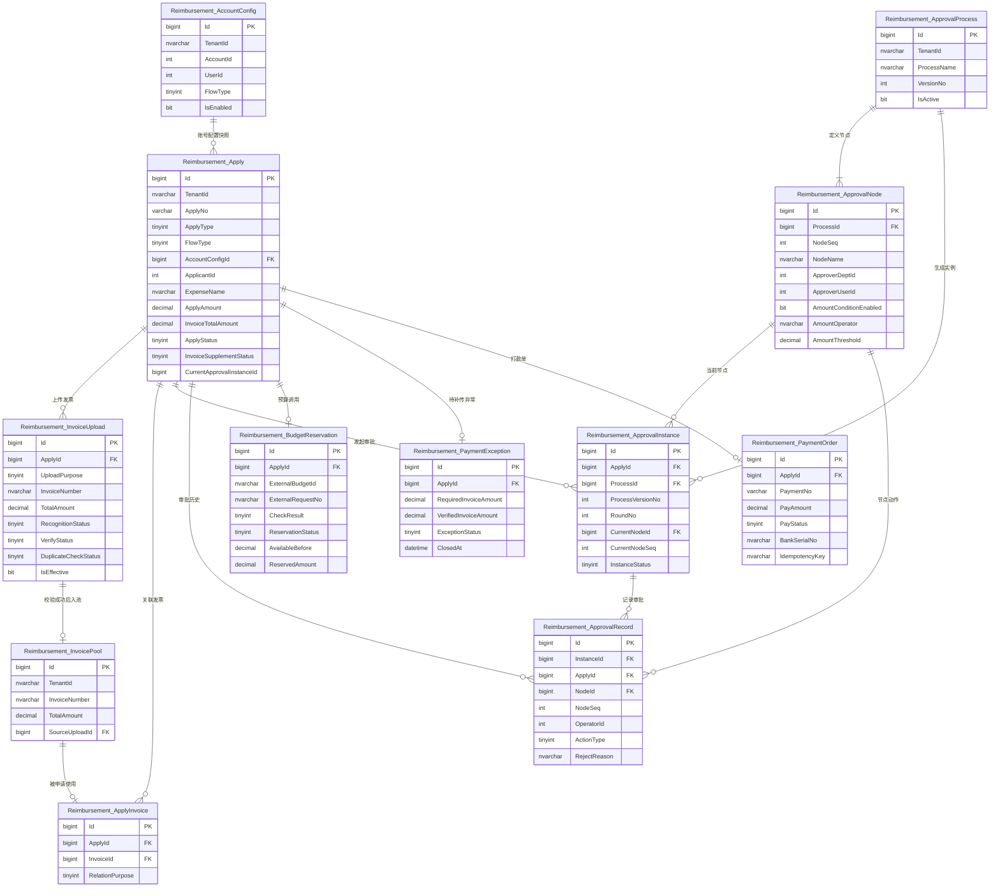

### 5.2 表关联字段明细

| 主表                               | 主表关联字段 | 从表/依赖表                            | 从表关联字段            | 关系       | 级联策略      | 说明                                |
| -------------------------------- | ------ | --------------------------------- | ----------------- | -------- | ---------:| --------------------------------- |
| `Reimbursement_AccountConfig`    | `Id`   | `Reimbursement_Apply`             | `AccountConfigId` | 1 : N    | NO ACTION | 申请提交时固化使用的账号配置记录                  |
| `Reimbursement_Apply`            | `Id`   | `Reimbursement_InvoiceUpload`     | `ApplyId`         | 1 : N    | NO ACTION | 一张申请可有多条上传尝试；首次上传时允许 `ApplyId` 为空 |
| `Reimbursement_InvoiceUpload`    | `Id`   | `Reimbursement_InvoicePool`       | `SourceUploadId`  | 1 : 0..1 | NO ACTION | 只有识别、验真、查重全部通过的上传记录才进入发票池         |
| `Reimbursement_Apply`            | `Id`   | `Reimbursement_ApplyInvoice`      | `ApplyId`         | 1 : N    | NO ACTION | 一张申请可关联多张有效发票                     |
| `Reimbursement_InvoicePool`      | `Id`   | `Reimbursement_ApplyInvoice`      | `InvoiceId`       | 1 : 0..1 | NO ACTION | 同一发票号码全局只能关联一个申请                  |
| `Reimbursement_ApprovalProcess`  | `Id`   | `Reimbursement_ApprovalNode`      | `ProcessId`       | 1 : N    | NO ACTION | 一个流程版本包含多个动态节点                    |
| `Reimbursement_ApprovalProcess`  | `Id`   | `Reimbursement_ApprovalInstance`  | `ProcessId`       | 1 : N    | NO ACTION | 在途实例固定使用启动时的流程版本                  |
| `Reimbursement_Apply`            | `Id`   | `Reimbursement_ApprovalInstance`  | `ApplyId`         | 1 : N    | NO ACTION | 驳回重提会新增审批实例，保留历史轮次                |
| `Reimbursement_ApprovalNode`     | `Id`   | `Reimbursement_ApprovalInstance`  | `CurrentNodeId`   | 1 : N    | NO ACTION | 指向当前待处理节点；无审批流程时可为空               |
| `Reimbursement_ApprovalInstance` | `Id`   | `Reimbursement_ApprovalRecord`    | `InstanceId`      | 1 : N    | NO ACTION | 审批动作流水                            |
| `Reimbursement_Apply`            | `Id`   | `Reimbursement_ApprovalRecord`    | `ApplyId`         | 1 : N    | NO ACTION | 便于按申请直接查询全部审批历史                   |
| `Reimbursement_ApprovalNode`     | `Id`   | `Reimbursement_ApprovalRecord`    | `NodeId`          | 1 : N    | NO ACTION | 每次通过/驳回记录所属节点                     |
| `Reimbursement_Apply`            | `Id`   | `Reimbursement_BudgetReservation` | `ApplyId`         | 1 : 0..1 | NO ACTION | 每张申请最多一条预算调用审计记录                  |
| `Reimbursement_Apply`            | `Id`   | `Reimbursement_PaymentException`  | `ApplyId`         | 1 : 0..1 | NO ACTION | 仅付款申请且无票/发票不足时生成                  |
| `Reimbursement_Apply`            | `Id`   | `Reimbursement_PaymentOrder`      | `ApplyId`         | 1 : 0..1 | NO ACTION | 首版每张申请只允许一张全额打款单                  |

### 5.3 外部引用字段

以下关系是逻辑引用，不建立跨数据库或跨服务外键：

| 本服务字段                                        | 外部对象   | 设计处理                             |
| -------------------------------------------- | ------ | -------------------------------- |
| `TenantId`                                   | 租户     | 只作为隔离键，不由报销库维护租户主数据              |
| `UserId`、`ApplicantId`、`OperatorId`、`PaidBy` | 用户     | 从现有登录上下文获取，本地保存 ID 和名称快照         |
| `AccountId`                                  | 账号     | 总后台账号配置的关联键                      |
| `ApproverDeptId`                             | 部门     | 审批流程节点配置时保存 ID 和名称快照             |
| `ApproverUserId`                             | 审批人    | 审批流程节点配置时保存 ID 和名称快照             |
| `LegalEntityId`                              | 法人主体   | 从现有基础数据取得并保存快照                   |
| `CostTypeId`                                 | 成本类型   | 从现有基础数据取得并保存快照                   |
| `ExternalBudgetId`                           | 现有预算对象 | 由 `IBudgetProvider` 返回，不在本库建立预算表 |

---

## 6. 实体类设计

### 6.1 命名空间与实体约定

```csharp
namespace LZ.Model.Enums.Reimbursement;          // 枚举
namespace LZ.Model.Model.Reimbursement;         // EF Core 实体
namespace LZ.Model.Dtos.Reimbursement;          // DTO
namespace LZ.Reimbursement.Service;             // 业务服务接口和实现
namespace LZ.Reimbursement.API.Controllers;     // 控制器
```

命名要求：

- 实体类名与表名保持一致，延续项目现有风格。
- 实体只表达数据结构和导航关系，不写业务流程。
- 状态判断统一使用枚举，不在业务代码散落魔法数字。
- DTO 不直接复用实体，尤其银行卡号不得返回完整值。

### 6.2 枚举定义

```csharp
namespace LZ.Model.Enums.Reimbursement;

public enum ReimbursementApplyType
{
    Reimbursement = 1,
    Payment = 2
}

public enum ReimbursementFlowType
{
    Audit = 1,
    Budget = 2
}

public enum ReimbursementApplyStatus
{
    PendingReview = 10,
    ReviewReturned = 20,
    PendingPayment = 30,
    Paid = 40
}

public enum InvoiceSupplementStatus
{
    NotApplicable = 0,
    PendingInvoice = 1,
    Closed = 2
}

public enum InvoiceUploadPurpose
{
    Initial = 1,
    Supplement = 2
}

public enum InvoiceRecognitionStatus
{
    Pending = 0,
    Success = 1,
    Failed = 2
}

public enum InvoiceVerifyStatus
{
    Pending = 0,
    Success = 1,
    Failed = 2
}

public enum InvoiceDuplicateCheckStatus
{
    Pending = 0,
    Passed = 1,
    Duplicate = 2
}

public enum ApprovalInstanceStatus
{
    InProgress = 1,
    Approved = 2,
    Returned = 3
}

public enum ApprovalActionType
{
    Approve = 1,
    Reject = 2
}

public enum PaymentOrderStatus
{
    Pending = 1,
    Processing = 2,
    Success = 3,
    Failed = 4
}

public enum PaymentExceptionStatus
{
    PendingInvoice = 1,
    Closed = 2
}

public enum BudgetCheckResult
{
    InBudget = 1,
    OverBudget = 2,
    Failed = 3
}

public enum BudgetReservationStatus
{
    None = 0,
    Reserved = 1,
    Committed = 2,
    Released = 3
}
```

### 6.3 EF Core 实体

以下实体使用 Entity Framework Core 风格。字段精度和索引仍以第 4 章 SQL 脚本为准。

```csharp
using System.ComponentModel.DataAnnotations;
using System.ComponentModel.DataAnnotations.Schema;
using LZ.Model.Enums.Reimbursement;

namespace LZ.Model.Model.Reimbursement;

[Table("Reimbursement_AccountConfig")]
public class Reimbursement_AccountConfig
{
    [Key]
    public long Id { get; set; }
    [MaxLength(50)]
    public string TenantId { get; set; } = string.Empty;
    public int AccountId { get; set; }
    public int UserId { get; set; }
    public ReimbursementFlowType FlowType { get; set; }
    public bool IsEnabled { get; set; } = true;
    public int? CreatedBy { get; set; }
    public DateTime CreatedAt { get; set; }
    public int? UpdatedBy { get; set; }
    public DateTime? UpdatedAt { get; set; }
    [Timestamp]
    public byte[] RowVersion { get; set; } = Array.Empty<byte>();
}

[Table("Reimbursement_Apply")]
public class Reimbursement_Apply
{
    [Key]
    public long Id { get; set; }
    [MaxLength(50)]
    public string TenantId { get; set; } = string.Empty;
    [MaxLength(32)]
    public string ApplyNo { get; set; } = string.Empty;
    public ReimbursementApplyType ApplyType { get; set; }
    public ReimbursementFlowType FlowType { get; set; }
    public long AccountConfigId { get; set; }
    public int ApplicantId { get; set; }
    [MaxLength(100)]
    public string ApplicantName { get; set; } = string.Empty;
    public int? ApplicantDeptId { get; set; }
    [MaxLength(100)]
    public string? ApplicantDeptName { get; set; }

    public int LegalEntityId { get; set; }
    [MaxLength(200)]
    public string LegalEntityName { get; set; } = string.Empty;
    public int CostTypeId { get; set; }
    [MaxLength(100)]
    public string CostTypeName { get; set; } = string.Empty;
    [MaxLength(200)]
    public string ExpenseName { get; set; } = string.Empty;

    [MaxLength(200)]
    public string PayeeName { get; set; } = string.Empty;
    [MaxLength(200)]
    public string PayeeBankName { get; set; } = string.Empty;
    public byte[] PayeeBankCardNoEncrypted { get; set; } = Array.Empty<byte>();
    [MaxLength(32)]
    public string PayeeBankCardNoMasked { get; set; } = string.Empty;

    [MaxLength(500)]
    public string ExpensePurpose { get; set; } = string.Empty;
    [MaxLength(1000)]
    public string? Remark { get; set; }
    public decimal ApplyAmount { get; set; }
    public decimal InvoiceTotalAmount { get; set; }

    public ReimbursementApplyStatus ApplyStatus { get; set; }
    public InvoiceSupplementStatus InvoiceSupplementStatus { get; set; }
    public long? CurrentApprovalInstanceId { get; set; }

    public DateTime SubmittedAt { get; set; }
    public int CreatedBy { get; set; }
    public DateTime CreatedAt { get; set; }
    public int? UpdatedBy { get; set; }
    public DateTime? UpdatedAt { get; set; }
    [Timestamp]
    public byte[] RowVersion { get; set; } = Array.Empty<byte>();

    public virtual Reimbursement_AccountConfig AccountConfig { get; set; } = null!;
    public virtual ICollection<Reimbursement_InvoiceUpload> InvoiceUploads { get; set; } = new List<Reimbursement_InvoiceUpload>();
    public virtual ICollection<Reimbursement_ApplyInvoice> ApplyInvoices { get; set; } = new List<Reimbursement_ApplyInvoice>();
    public virtual ICollection<Reimbursement_ApprovalInstance> ApprovalInstances { get; set; } = new List<Reimbursement_ApprovalInstance>();
    public virtual ICollection<Reimbursement_ApprovalRecord> ApprovalRecords { get; set; } = new List<Reimbursement_ApprovalRecord>();
    public virtual Reimbursement_BudgetReservation? BudgetReservation { get; set; }
    public virtual Reimbursement_PaymentException? PaymentException { get; set; }
    public virtual Reimbursement_PaymentOrder? PaymentOrder { get; set; }
}

[Table("Reimbursement_InvoiceUpload")]
public class Reimbursement_InvoiceUpload
{
    [Key]
    public long Id { get; set; }
    [MaxLength(50)]
    public string TenantId { get; set; } = string.Empty;
    public long? ApplyId { get; set; }
    public InvoiceUploadPurpose UploadPurpose { get; set; }
    [MaxLength(1000)]
    public string FileUrl { get; set; } = string.Empty;
    [MaxLength(20)]
    public string FileType { get; set; } = string.Empty;
    [MaxLength(255)]
    public string? OriginalFileName { get; set; }

    public InvoiceRecognitionStatus RecognitionStatus { get; set; }
    [MaxLength(50)]
    public string? InvoiceNumber { get; set; }
    public decimal? TotalAmount { get; set; }
    public InvoiceVerifyStatus VerifyStatus { get; set; }
    public InvoiceDuplicateCheckStatus DuplicateCheckStatus { get; set; }
    public bool IsEffective { get; set; }
    [MaxLength(50)]
    public string? FailureCode { get; set; }
    [MaxLength(500)]
    public string? FailureMessage { get; set; }
    [MaxLength(100)]
    public string? ProviderRequestId { get; set; }

    public int UploadUserId { get; set; }
    public DateTime UploadedAt { get; set; }
    public DateTime? CallbackAt { get; set; }
    [Timestamp]
    public byte[] RowVersion { get; set; } = Array.Empty<byte>();

    public virtual Reimbursement_Apply? Apply { get; set; }
    public virtual Reimbursement_InvoicePool? InvoicePool { get; set; }
}

[Table("Reimbursement_InvoicePool")]
public class Reimbursement_InvoicePool
{
    [Key]
    public long Id { get; set; }
    [MaxLength(50)]
    public string TenantId { get; set; } = string.Empty;
    [MaxLength(50)]
    public string InvoiceNumber { get; set; } = string.Empty;
    public decimal TotalAmount { get; set; }
    public long SourceUploadId { get; set; }
    public DateTime CreatedAt { get; set; }

    public virtual Reimbursement_InvoiceUpload SourceUpload { get; set; } = null!;
    public virtual Reimbursement_ApplyInvoice? ApplyInvoice { get; set; }
}

[Table("Reimbursement_ApplyInvoice")]
public class Reimbursement_ApplyInvoice
{
    [Key]
    public long Id { get; set; }
    [MaxLength(50)]
    public string TenantId { get; set; } = string.Empty;
    public long ApplyId { get; set; }
    public long InvoiceId { get; set; }
    public InvoiceUploadPurpose RelationPurpose { get; set; }
    public DateTime RelatedAt { get; set; }

    public virtual Reimbursement_Apply Apply { get; set; } = null!;
    public virtual Reimbursement_InvoicePool Invoice { get; set; } = null!;
}

[Table("Reimbursement_ApprovalProcess")]
public class Reimbursement_ApprovalProcess
{
    [Key]
    public long Id { get; set; }
    [MaxLength(50)]
    public string TenantId { get; set; } = string.Empty;
    [MaxLength(100)]
    public string ProcessName { get; set; } = string.Empty;
    public int VersionNo { get; set; }
    public bool IsActive { get; set; } = true;
    public int CreatedBy { get; set; }
    public DateTime CreatedAt { get; set; }
    public DateTime? PublishedAt { get; set; }
    [Timestamp]
    public byte[] RowVersion { get; set; } = Array.Empty<byte>();

    public virtual ICollection<Reimbursement_ApprovalNode> Nodes { get; set; } = new List<Reimbursement_ApprovalNode>();
    public virtual ICollection<Reimbursement_ApprovalInstance> Instances { get; set; } = new List<Reimbursement_ApprovalInstance>();
}

[Table("Reimbursement_ApprovalNode")]
public class Reimbursement_ApprovalNode
{
    [Key]
    public long Id { get; set; }
    [MaxLength(50)]
    public string TenantId { get; set; } = string.Empty;
    public long ProcessId { get; set; }
    public int NodeSeq { get; set; }
    [MaxLength(100)]
    public string NodeName { get; set; } = string.Empty;
    public int ApproverDeptId { get; set; }
    [MaxLength(100)]
    public string ApproverDeptName { get; set; } = string.Empty;
    public int ApproverUserId { get; set; }
    [MaxLength(100)]
    public string ApproverUserName { get; set; } = string.Empty;
    public bool AmountConditionEnabled { get; set; }
    [MaxLength(20)]
    public string AmountOperator { get; set; } = "GreaterThan";
    public decimal AmountThreshold { get; set; } = 5000m;
    public bool IsEnabled { get; set; } = true;
    public DateTime CreatedAt { get; set; }

    public virtual Reimbursement_ApprovalProcess Process { get; set; } = null!;
    public virtual ICollection<Reimbursement_ApprovalInstance> CurrentInstances { get; set; } = new List<Reimbursement_ApprovalInstance>();
    public virtual ICollection<Reimbursement_ApprovalRecord> Records { get; set; } = new List<Reimbursement_ApprovalRecord>();
}

[Table("Reimbursement_ApprovalInstance")]
public class Reimbursement_ApprovalInstance
{
    [Key]
    public long Id { get; set; }
    [MaxLength(50)]
    public string TenantId { get; set; } = string.Empty;
    public long ApplyId { get; set; }
    public long ProcessId { get; set; }
    public int ProcessVersionNo { get; set; }
    public int RoundNo { get; set; }
    public long? CurrentNodeId { get; set; }
    public int? CurrentNodeSeq { get; set; }
    public ApprovalInstanceStatus InstanceStatus { get; set; }
    public DateTime StartedAt { get; set; }
    public DateTime? EndedAt { get; set; }
    [Timestamp]
    public byte[] RowVersion { get; set; } = Array.Empty<byte>();

    public virtual Reimbursement_Apply Apply { get; set; } = null!;
    public virtual Reimbursement_ApprovalProcess Process { get; set; } = null!;
    public virtual Reimbursement_ApprovalNode? CurrentNode { get; set; }
    public virtual ICollection<Reimbursement_ApprovalRecord> Records { get; set; } = new List<Reimbursement_ApprovalRecord>();
}

[Table("Reimbursement_ApprovalRecord")]
public class Reimbursement_ApprovalRecord
{
    [Key]
    public long Id { get; set; }
    [MaxLength(50)]
    public string TenantId { get; set; } = string.Empty;
    public long InstanceId { get; set; }
    public long ApplyId { get; set; }
    public long NodeId { get; set; }
    public int NodeSeq { get; set; }
    public int OperatorId { get; set; }
    [MaxLength(100)]
    public string OperatorName { get; set; } = string.Empty;
    public ApprovalActionType ActionType { get; set; }
    [MaxLength(1000)]
    public string? RejectReason { get; set; }
    [MaxLength(1000)]
    public string? Comment { get; set; }
    public DateTime OperatedAt { get; set; }

    public virtual Reimbursement_ApprovalInstance Instance { get; set; } = null!;
    public virtual Reimbursement_Apply Apply { get; set; } = null!;
    public virtual Reimbursement_ApprovalNode Node { get; set; } = null!;
}

[Table("Reimbursement_BudgetReservation")]
public class Reimbursement_BudgetReservation
{
    [Key]
    public long Id { get; set; }
    [MaxLength(50)]
    public string TenantId { get; set; } = string.Empty;
    public long ApplyId { get; set; }
    [MaxLength(100)]
    public string? ExternalBudgetId { get; set; }
    [MaxLength(100)]
    public string ExternalRequestNo { get; set; } = string.Empty;
    public BudgetCheckResult CheckResult { get; set; }
    public BudgetReservationStatus ReservationStatus { get; set; }
    public decimal? AvailableBefore { get; set; }
    public decimal ReservedAmount { get; set; }
    public string? ResponseSnapshot { get; set; }
    public DateTime CreatedAt { get; set; }
    public DateTime? UpdatedAt { get; set; }
    [Timestamp]
    public byte[] RowVersion { get; set; } = Array.Empty<byte>();

    public virtual Reimbursement_Apply Apply { get; set; } = null!;
}

[Table("Reimbursement_PaymentException")]
public class Reimbursement_PaymentException
{
    [Key]
    public long Id { get; set; }
    [MaxLength(50)]
    public string TenantId { get; set; } = string.Empty;
    public long ApplyId { get; set; }
    public decimal RequiredInvoiceAmount { get; set; }
    public decimal VerifiedInvoiceAmount { get; set; }
    public PaymentExceptionStatus ExceptionStatus { get; set; }
    public DateTime CreatedAt { get; set; }
    public DateTime? LastEvaluatedAt { get; set; }
    public DateTime? ClosedAt { get; set; }
    [Timestamp]
    public byte[] RowVersion { get; set; } = Array.Empty<byte>();

    public virtual Reimbursement_Apply Apply { get; set; } = null!;
}

[Table("Reimbursement_PaymentOrder")]
public class Reimbursement_PaymentOrder
{
    [Key]
    public long Id { get; set; }
    [MaxLength(50)]
    public string TenantId { get; set; } = string.Empty;
    [MaxLength(32)]
    public string PaymentNo { get; set; } = string.Empty;
    public long ApplyId { get; set; }
    public decimal PayAmount { get; set; }
    public PaymentOrderStatus PayStatus { get; set; }
    [MaxLength(200)]
    public string PayeeName { get; set; } = string.Empty;
    [MaxLength(200)]
    public string PayeeBankName { get; set; } = string.Empty;
    [MaxLength(32)]
    public string PayeeBankCardNoMasked { get; set; } = string.Empty;
    public int? PaidBy { get; set; }
    [MaxLength(100)]
    public string? BankSerialNo { get; set; }
    [MaxLength(1000)]
    public string? ReceiptUrl { get; set; }
    [MaxLength(100)]
    public string IdempotencyKey { get; set; } = string.Empty;
    public DateTime? PaidAt { get; set; }
    [MaxLength(500)]
    public string? FailureReason { get; set; }
    public DateTime CreatedAt { get; set; }
    public DateTime? UpdatedAt { get; set; }
    [Timestamp]
    public byte[] RowVersion { get; set; } = Array.Empty<byte>();

    public virtual Reimbursement_Apply Apply { get; set; } = null!;
}
```

### 6.4 EF Core 映射要求

`ReimbursementDbContext` 必须配置：

1. 所有 `decimal` 字段使用 `HasPrecision(18, 2)`。
2. 所有枚举按 `TINYINT` 或 `INT` 持久化，建议显式 `HasConversion<byte>()`。
3. 唯一索引、过滤索引和外键名称与第 4 章 SQL 保持一致。
4. 所有查询默认加 `TenantId` 过滤条件；不要依赖全局过滤器替代权限校验。
5. 银行卡号加密由应用层实现，实体只保存密文和掩码。
6. 使用 `RowVersion` 处理审批、补传、打款等并发更新。

实体与表映射关系：

| 实体类                               | 数据库表                              |
| --------------------------------- | --------------------------------- |
| `Reimbursement_AccountConfig`     | `Reimbursement_AccountConfig`     |
| `Reimbursement_Apply`             | `Reimbursement_Apply`             |
| `Reimbursement_InvoiceUpload`     | `Reimbursement_InvoiceUpload`     |
| `Reimbursement_InvoicePool`       | `Reimbursement_InvoicePool`       |
| `Reimbursement_ApplyInvoice`      | `Reimbursement_ApplyInvoice`      |
| `Reimbursement_ApprovalProcess`   | `Reimbursement_ApprovalProcess`   |
| `Reimbursement_ApprovalNode`      | `Reimbursement_ApprovalNode`      |
| `Reimbursement_ApprovalInstance`  | `Reimbursement_ApprovalInstance`  |
| `Reimbursement_ApprovalRecord`    | `Reimbursement_ApprovalRecord`    |
| `Reimbursement_BudgetReservation` | `Reimbursement_BudgetReservation` |
| `Reimbursement_PaymentException`  | `Reimbursement_PaymentException`  |
| `Reimbursement_PaymentOrder`      | `Reimbursement_PaymentOrder`      |

---

## 7. DTO、服务接口与接口设计

### 7.1 请求 DTO

```csharp
namespace LZ.Model.Dtos.Reimbursement;

public class ReimbursementApplicationCreateRequest
{
    public ReimbursementApplyType ApplyType { get; set; }

    public int LegalEntityId { get; set; }
    public string LegalEntityName { get; set; } = string.Empty;
    public int CostTypeId { get; set; }
    public string CostTypeName { get; set; } = string.Empty;
    public string ExpenseName { get; set; } = string.Empty;

    public string PayeeName { get; set; } = string.Empty;
    public string PayeeBankName { get; set; } = string.Empty;
    public string PayeeBankCardNo { get; set; } = string.Empty;

    public string ExpensePurpose { get; set; } = string.Empty;
    public string? Remark { get; set; }
    public decimal ApplyAmount { get; set; }

    public List<long> InvoiceUploadIds { get; set; } = new();
}

public class ReimbursementApplicationResubmitRequest
{
    public int LegalEntityId { get; set; }
    public string LegalEntityName { get; set; } = string.Empty;
    public int CostTypeId { get; set; }
    public string CostTypeName { get; set; } = string.Empty;
    public string ExpenseName { get; set; } = string.Empty;
    public string PayeeName { get; set; } = string.Empty;
    public string PayeeBankName { get; set; } = string.Empty;
    public string PayeeBankCardNo { get; set; } = string.Empty;
    public string ExpensePurpose { get; set; } = string.Empty;
    public string? Remark { get; set; }
    public decimal ApplyAmount { get; set; }
    public List<long> InvoiceUploadIds { get; set; } = new();
}

public class ApplicationQuery : PagedQuery
{
    public ReimbursementApplyStatus? ApplyStatus { get; set; }
    public InvoiceSupplementStatus? InvoiceSupplementStatus { get; set; }
    public string? ExpenseName { get; set; }
    public DateTime? ApplyTimeStart { get; set; }
    public DateTime? ApplyTimeEnd { get; set; }
}

public class ApproveApplicationRequest
{
    public string? Comment { get; set; }
}

public class RejectApplicationRequest
{
    public string RejectReason { get; set; } = string.Empty;
}

public class SupplementInvoiceRequest
{
    public List<long> InvoiceUploadIds { get; set; } = new();
}

public class CompletePaymentRequest
{
    public string IdempotencyKey { get; set; } = string.Empty;
    public string BankSerialNo { get; set; } = string.Empty;
    public string? ReceiptUrl { get; set; }
}

public class InvoiceUploadRequest
{
    public long? ApplyId { get; set; }
    public InvoiceUploadPurpose UploadPurpose { get; set; }
    public IFormFile File { get; set; } = null!;
}

public class InvoicePluginCallbackRequest
{
    public string ProviderRequestId { get; set; } = string.Empty;
    public string UploadToken { get; set; } = string.Empty;
    public bool RecognitionSucceeded { get; set; }
    public string? InvoiceNumber { get; set; }
    public decimal? TotalAmount { get; set; }
    public bool VerifySucceeded { get; set; }
    public string? FailureCode { get; set; }
    public string? FailureMessage { get; set; }
}

public class ApprovalProcessSaveRequest
{
    public string ProcessName { get; set; } = "报销审批流程";
    public List<ApprovalNodeSaveRequest> Nodes { get; set; } = new();
}

public class ApprovalNodeSaveRequest
{
    public int NodeSeq { get; set; }
    public string NodeName { get; set; } = string.Empty;
    public int ApproverDeptId { get; set; }
    public string ApproverDeptName { get; set; } = string.Empty;
    public int ApproverUserId { get; set; }
    public string ApproverUserName { get; set; } = string.Empty;
    public bool AmountConditionEnabled { get; set; }
    public string AmountOperator { get; set; } = "GreaterThan";
    public decimal AmountThreshold { get; set; } = 5000m;
}

public class AccountConfigSaveRequest
{
    public ReimbursementFlowType FlowType { get; set; }
}
```

### 7.2 响应 DTO

```csharp
public class ReimbursementApplicationListItemDto
{
    public long Id { get; set; }
    public string ApplyNo { get; set; } = string.Empty;
    public ReimbursementApplyType ApplyType { get; set; }
    public string ApplyTypeName { get; set; } = string.Empty;
    public string ApplicantName { get; set; } = string.Empty;
    public string ExpenseName { get; set; } = string.Empty;
    public decimal ApplyAmount { get; set; }
    public decimal InvoiceTotalAmount { get; set; }
    public ReimbursementApplyStatus ApplyStatus { get; set; }
    public string ApplyStatusName { get; set; } = string.Empty;
    public InvoiceSupplementStatus InvoiceSupplementStatus { get; set; }
    public string InvoiceSupplementStatusName { get; set; } = string.Empty;
    public DateTime SubmittedAt { get; set; }
}

public class ReimbursementApplicationDetailDto : ReimbursementApplicationListItemDto
{
    public ReimbursementFlowType FlowType { get; set; }
    public string LegalEntityName { get; set; } = string.Empty;
    public string CostTypeName { get; set; } = string.Empty;
    public string PayeeName { get; set; } = string.Empty;
    public string PayeeBankName { get; set; } = string.Empty;
    public string PayeeBankCardNoMasked { get; set; } = string.Empty;
    public string ExpensePurpose { get; set; } = string.Empty;
    public string? Remark { get; set; }
    public List<ApplicationInvoiceDto> Invoices { get; set; } = new();
    public List<ApprovalHistoryDto> ApprovalHistory { get; set; } = new();
    public PaymentExceptionDto? PaymentException { get; set; }
    public PaymentOrderDto? PaymentOrder { get; set; }
}

public class ApplicationInvoiceDto
{
    public long InvoiceId { get; set; }
    public string InvoiceNumber { get; set; } = string.Empty;
    public decimal TotalAmount { get; set; }
    public InvoiceUploadPurpose RelationPurpose { get; set; }
    public DateTime RelatedAt { get; set; }
}

public class ApprovalHistoryDto
{
    public int RoundNo { get; set; }
    public int NodeSeq { get; set; }
    public string NodeName { get; set; } = string.Empty;
    public string OperatorName { get; set; } = string.Empty;
    public ApprovalActionType ActionType { get; set; }
    public string? RejectReason { get; set; }
    public string? Comment { get; set; }
    public DateTime OperatedAt { get; set; }
}

public class InvoiceUploadResponse
{
    public long UploadId { get; set; }
    public InvoiceRecognitionStatus RecognitionStatus { get; set; }
    public InvoiceVerifyStatus VerifyStatus { get; set; }
    public InvoiceDuplicateCheckStatus DuplicateCheckStatus { get; set; }
    public bool IsEffective { get; set; }
    public string? InvoiceNumber { get; set; }
    public decimal? TotalAmount { get; set; }
    public string? FailureMessage { get; set; }
}

public class PaymentExceptionDto
{
    public long Id { get; set; }
    public decimal RequiredInvoiceAmount { get; set; }
    public decimal VerifiedInvoiceAmount { get; set; }
    public PaymentExceptionStatus ExceptionStatus { get; set; }
    public string ExceptionStatusName { get; set; } = string.Empty;
    public DateTime CreatedAt { get; set; }
    public DateTime? ClosedAt { get; set; }
}

public class PaymentOrderDto
{
    public string PaymentNo { get; set; } = string.Empty;
    public decimal PayAmount { get; set; }
    public PaymentOrderStatus PayStatus { get; set; }
    public string? BankSerialNo { get; set; }
    public DateTime? PaidAt { get; set; }
}

public class AccountConfigDto
{
    public int AccountId { get; set; }
    public int UserId { get; set; }
    public ReimbursementFlowType FlowType { get; set; }
    public string FlowTypeName { get; set; } = string.Empty;
    public bool IsEnabled { get; set; }
}

public class ApprovalProcessDto
{
    public long Id { get; set; }
    public string ProcessName { get; set; } = string.Empty;
    public int VersionNo { get; set; }
    public bool IsActive { get; set; }
    public List<ApprovalNodeDto> Nodes { get; set; } = new();
}

public class ApprovalNodeDto
{
    public long Id { get; set; }
    public int NodeSeq { get; set; }
    public string NodeName { get; set; } = string.Empty;
    public int ApproverDeptId { get; set; }
    public string ApproverDeptName { get; set; } = string.Empty;
    public int ApproverUserId { get; set; }
    public string ApproverUserName { get; set; } = string.Empty;
    public bool AmountConditionEnabled { get; set; }
    public string AmountOperator { get; set; } = "GreaterThan";
    public decimal AmountThreshold { get; set; }
}

public class InvoiceValidationResult
{
    public bool IsValid { get; set; }
    public decimal ValidInvoiceTotalAmount { get; set; }
    public List<long> ValidUploadIds { get; set; } = new();
    public List<long> InvalidUploadIds { get; set; } = new();
    public string? Message { get; set; }
}

public class BudgetCheckRequest
{
    public string TenantId { get; set; } = string.Empty;
    public int LegalEntityId { get; set; }
    public int CostTypeId { get; set; }
    public string ExpenseName { get; set; } = string.Empty;
    public decimal ApplyAmount { get; set; }
    public string ApplyNo { get; set; } = string.Empty;
}

public class BudgetCheckDto
{
    public BudgetCheckResult CheckResult { get; set; }
    public string? ExternalBudgetId { get; set; }
    public string ExternalRequestNo { get; set; } = string.Empty;
    public decimal? AvailableBefore { get; set; }
}

public class BudgetReserveRequest
{
    public string TenantId { get; set; } = string.Empty;
    public string ApplyNo { get; set; } = string.Empty;
    public string ExternalBudgetId { get; set; } = string.Empty;
    public decimal ReserveAmount { get; set; }
}

public class BudgetReservationDto
{
    public string ExternalRequestNo { get; set; } = string.Empty;
    public string ExternalBudgetId { get; set; } = string.Empty;
    public bool Succeeded { get; set; }
}

public class PagedResult<T>
{
    public int PageIndex { get; set; }
    public int PageSize { get; set; }
    public long TotalCount { get; set; }
    public List<T> Items { get; set; } = new();
}
```

### 7.3 业务服务接口

```csharp
namespace LZ.Reimbursement.Service;

public interface IReimbursementApplicationService
{
    Task<PagedResult<ReimbursementApplicationListItemDto>> GetPagedAsync(
        ApplicationQuery query,
        CancellationToken cancellationToken = default);

    Task<ReimbursementApplicationDetailDto> GetDetailAsync(
        long applyId,
        CancellationToken cancellationToken = default);

    Task<long> SubmitAsync(
        ReimbursementApplicationCreateRequest request,
        CancellationToken cancellationToken = default);

    Task ResubmitAsync(
        long applyId,
        ReimbursementApplicationResubmitRequest request,
        CancellationToken cancellationToken = default);

    Task ApproveAsync(
        long applyId,
        ApproveApplicationRequest request,
        CancellationToken cancellationToken = default);

    Task RejectAsync(
        long applyId,
        RejectApplicationRequest request,
        CancellationToken cancellationToken = default);
}

public interface IInvoiceProcessingService
{
    Task<InvoiceUploadResponse> CreateUploadAsync(
        InvoiceUploadRequest request,
        CancellationToken cancellationToken = default);

    Task<InvoiceUploadResponse> GetUploadAsync(
        long uploadId,
        CancellationToken cancellationToken = default);

    Task HandlePluginCallbackAsync(
        InvoicePluginCallbackRequest request,
        CancellationToken cancellationToken = default);

    Task<InvoiceValidationResult> ValidateUploadsForSubmitAsync(
        ReimbursementApplyType applyType,
        ReimbursementFlowType flowType,
        decimal applyAmount,
        IReadOnlyCollection<long> uploadIds,
        CancellationToken cancellationToken = default);

    Task<InvoiceValidationResult> SupplementAndReevaluateAsync(
        long applyId,
        IReadOnlyCollection<long> uploadIds,
        CancellationToken cancellationToken = default);
}

public interface IApprovalProcessConfigService
{
    Task<ApprovalProcessDto> GetActiveAsync(
        CancellationToken cancellationToken = default);

    Task<ApprovalProcessDto> SaveAndPublishAsync(
        ApprovalProcessSaveRequest request,
        CancellationToken cancellationToken = default);
}

public interface IApprovalWorkflowService
{
    Task StartAsync(
        Reimbursement_Apply apply,
        CancellationToken cancellationToken = default);

    Task ApproveAsync(
        Reimbursement_Apply apply,
        ApproveApplicationRequest request,
        CancellationToken cancellationToken = default);

    Task RejectAsync(
        Reimbursement_Apply apply,
        RejectApplicationRequest request,
        CancellationToken cancellationToken = default);
}

public interface IPaymentExceptionService
{
    Task CreateForPaymentApplyAsync(
        Reimbursement_Apply apply,
        CancellationToken cancellationToken = default);

    Task<PagedResult<PaymentExceptionDto>> GetPagedAsync(
        ApplicationQuery query,
        CancellationToken cancellationToken = default);

    Task ReevaluateAsync(
        long applyId,
        CancellationToken cancellationToken = default);
}

public interface IPaymentService
{
    Task CompleteAsync(
        long applyId,
        CompletePaymentRequest request,
        CancellationToken cancellationToken = default);
}

public interface IAccountConfigService
{
    Task<AccountConfigDto> GetAsync(
        int accountId,
        CancellationToken cancellationToken = default);

    Task<AccountConfigDto> SaveAsync(
        int accountId,
        AccountConfigSaveRequest request,
        CancellationToken cancellationToken = default);
}

public interface IBudgetProvider
{
    Task<BudgetCheckDto> CheckAsync(
        BudgetCheckRequest request,
        CancellationToken cancellationToken = default);

    Task<BudgetReservationDto> ReserveAsync(
        BudgetReserveRequest request,
        CancellationToken cancellationToken = default);

    Task CommitAsync(
        string externalRequestNo,
        CancellationToken cancellationToken = default);

    Task ReleaseAsync(
        string externalRequestNo,
        CancellationToken cancellationToken = default);
}

public interface INumberGenerator
{
    Task<string> NextApplyNoAsync(
        ReimbursementApplyType applyType,
        CancellationToken cancellationToken = default);

    Task<string> NextPaymentNoAsync(
        CancellationToken cancellationToken = default);
}
```

接口实现要求：

- `SubmitAsync` 负责申请创建、发票校验/绑定、预算调用协作、审批实例启动和异常生成的编排。
- `IInvoiceProcessingService` 不直接修改申请主状态。
- `IApprovalWorkflowService` 不处理发票绑定。
- `IPaymentExceptionService` 只处理待补传发票状态和金额，不计算财务统计。
- `IBudgetProvider` 的实现由现有预算系统适配器完成。
- 所有服务必须接收当前租户、当前用户上下文，不允许只靠传入 ID 判断权限。

### 7.4 控制器与 API 清单

所有接口统一使用 `ApiResponse<T>`，路由前缀为 `/api/reimbursement/v1`。

#### 7.4.1 申请接口

| 方法   | 路径                                    | 用途        | 主要请求                                      | 主要响应                                               | 权限        |
| ---- | ------------------------------------- | --------- | ----------------------------------------- | -------------------------------------------------- | --------- |
| GET  | `/applications`                       | 申请列表      | `ApplicationQuery`                        | `PagedResult<ReimbursementApplicationListItemDto>` | 分后台申请查看权限 |
| GET  | `/applications/{id}`                  | 申请详情      | `id`                                      | `ReimbursementApplicationDetailDto`                | 分后台申请查看权限 |
| POST | `/applications`                       | 提交申请      | `ReimbursementApplicationCreateRequest`   | `applyId`                                          | 分后台申请提交权限 |
| PUT  | `/applications/{id}/resubmit`         | 审核退回后修改重提 | `ReimbursementApplicationResubmitRequest` | 空                                                  | 分后台申请提交权限 |
| POST | `/applications/{id}/approve`          | 审批通过      | `ApproveApplicationRequest`               | 空                                                  | 当前节点审批人   |
| POST | `/applications/{id}/reject`           | 审批驳回      | `RejectApplicationRequest`                | 空                                                  | 当前节点审批人   |
| POST | `/applications/{id}/payment/complete` | 财务确认打款成功  | `CompletePaymentRequest`                  | 空                                                  | 分后台财务打款权限 |

申请列表固定支持筛选：

- `ApplyStatus`
- `ExpenseName`
- `ApplyTimeStart`、`ApplyTimeEnd`

`InvoiceSupplementStatus` 仅作为附加筛选字段用于异常视图，不改变 PRD 的三项主筛选口径。

#### 7.4.2 发票接口

| 方法   | 路径                                       | 用途           | 主要请求                                                  | 主要响应                      |
| ---- | ---------------------------------------- | ------------ | ----------------------------------------------------- | ------------------------- |
| POST | `/invoice-uploads`                       | 上传发票文件并发起识别  | multipart/form-data：`ApplyId?`、`UploadPurpose`、`File` | `InvoiceUploadResponse`   |
| GET  | `/invoice-uploads/{uploadId}`            | 查询识别、验真、查重结果 | `uploadId`                                            | `InvoiceUploadResponse`   |
| POST | `/applications/{id}/invoices/supplement` | 提交补传发票并重新校验  | `SupplementInvoiceRequest`                            | `InvoiceValidationResult` |
| POST | `/integrations/invoice/callback`         | 第三方发票插件回调    | `InvoicePluginCallbackRequest`                        | 空或处理结果                    |

第三方回调要求：

- 必须验证插件签名或共享密钥。
- 必须按 `ProviderRequestId` 幂等。
- 只处理回调中的发票号码、价税合计金额、识别结果和验真结果。
- 回调不得直接改变申请审批状态。

#### 7.4.3 审核流程配置接口

| 方法  | 路径                         | 用途         | 权限        |
| --- | -------------------------- | ---------- | --------- |
| GET | `/approval-process/active` | 查询当前生效流程   | 分后台审核流程查看 |
| PUT | `/approval-process`        | 保存并发布新流程版本 | 分后台审核流程配置 |

保存校验：

1. 节点数量至少 1。
2. 节点序号必须从 1 开始连续。
3. 每个节点必须有部门和审批人。
4. 首节点必须为无条件进入。
5. 金额条件开启时，运算符只能是 `GreaterThan` 或 `GreaterThanOrEqual`，阈值不能小于 0。
6. 保存后旧版本停用，新版本启用；在途实例引用旧版本。

#### 7.4.4 异常统计接口

| 方法  | 路径                    | 用途             | 筛选           | 权限      |
| --- | --------------------- | -------------- | ------------ | ------- |
| GET | `/payment-exceptions` | 按状态展示待补传发票付款申请 | 状态、费用名称、申请时间 | 分后台异常查看 |

响应只返回清单和状态，不返回数量统计、金额汇总、趋势。

#### 7.4.5 总后台账号配置接口

| 方法  | 路径                                   | 用途       | 权限        |
| --- | ------------------------------------ | -------- | --------- |
| GET | `/admin/account-configs/{accountId}` | 查询账号报销类型 | 总后台账号配置查看 |
| PUT | `/admin/account-configs/{accountId}` | 配置审核/预算  | 总后台账号配置权限 |

### 7.5 错误码建议

| 错误码                                                | HTTP | 场景         | 用户提示               |
| -------------------------------------------------- | ----:| ---------- | ------------------ |
| `REIMBURSEMENT_ACCOUNT_CONFIG_NOT_FOUND`           | 400  | 账号未配置报销类型  | 账号未配置报销类型，请先完成账号配置 |
| `REIMBURSEMENT_INVOICE_INVALID`                    | 400  | 识别/真伪/重复失败 | 再次上传即可             |
| `REIMBURSEMENT_INVOICE_AMOUNT_INSUFFICIENT_AUDIT`  | 400  | 审核版报销金额不足  | 发票金额不足，请点击付款申请，作废  |
| `REIMBURSEMENT_INVOICE_AMOUNT_INSUFFICIENT_BUDGET` | 400  | 预算版报销金额不足  | 发票金额不足，请点击付款申请     |
| `REIMBURSEMENT_APPROVAL_NOT_CURRENT_APPROVER`      | 403  | 非当前节点审批人   | 无权审批当前申请           |
| `REIMBURSEMENT_APPROVAL_REJECT_REASON_REQUIRED`    | 400  | 驳回未填原因     | 请填写驳回原因            |
| `REIMBURSEMENT_APPROVAL_STATUS_INVALID`            | 409  | 当前状态不允许审批  | 当前申请状态不允许执行该操作     |
| `REIMBURSEMENT_PAYMENT_STATUS_INVALID`             | 409  | 当前状态不允许打款  | 当前申请状态不允许打款        |
| `REIMBURSEMENT_BUDGET_SERVICE_FAILED`              | 503  | 预算能力调用失败   | 预算校验暂不可用，请稍后重试     |
| `REIMBURSEMENT_CONCURRENCY_CONFLICT`               | 409  | 并发更新冲突     | 数据已被处理，请刷新后重试      |

---

## 8. 关键业务算法与事务边界

### 8.1 提交申请总流程

`IReimbursementApplicationService.SubmitAsync` 必须按以下顺序编排：

1. 从当前上下文取得 `TenantId`、`UserId`、申请人、部门和权限。
2. 校验 9 项字段和 `ApplyAmount > 0`。
3. 根据当前用户读取 `Reimbursement_AccountConfig`。
4. 账号配置不存在或停用时返回 `REIMBURSEMENT_ACCOUNT_CONFIG_NOT_FOUND`。
5. 将账号配置的 `FlowType` 作为本次申请快照。
6. 校验 `InvoiceUploadIds` 的租户、上传人、用途和状态。
7. 只把识别、真伪、查重全部通过的上传记录视为有效发票。
8. 计算有效发票合计金额。
9. 报销申请：合计金额必须 ≥ `ApplyAmount`，否则按流程版本返回指定提示。
10. 付款申请：允许合计金额不足；不足时生成待补传发票异常。
11. 生成申请号，格式建议：
    - 报销申请：`BXyyyyMMdd` + 6 位序号。
    - 付款申请：`FKyyyyMMdd` + 6 位序号。
12. 预算版调用 `IBudgetProvider.CheckAsync`：
    - 预算内：调用 `ReserveAsync`。
    - 超预算：不直接通过，进入审批。
    - 调用失败：提交失败，不生成半成品申请。
13. 开启本地数据库事务。
14. 写入申请主表。
15. 对有效发票执行入池和关联：
    - 插入 `Reimbursement_InvoicePool`。
    - 插入 `Reimbursement_ApplyInvoice`。
    - 唯一索引冲突转换为重复上传业务错误。
16. 付款申请且有效发票金额不足时，写入 `Reimbursement_PaymentException`。
17. 决定后续状态：
    - 审核版：启动审批实例，`ApplyStatus=待审核`。
    - 预算版且预算内：`ApplyStatus=待打款`，不启动审批实例。
    - 预算版且超预算：启动审批实例，`ApplyStatus=待审核`。
18. 写预算预留审计记录。
19. 提交事务。
20. 若提交事务失败且预算已预留，必须调用 `ReleaseAsync` 补偿；补偿失败必须记录高优先级日志并按运维告警处理。

事务边界要求：

- 数据库事务只覆盖本地表写入。
- `IBudgetProvider` 调用不放入数据库事务。
- 发票文件上传和 OCR/验真不在提交事务内执行。
- 提交接口必须可重复调用防护；同一 `IdempotencyKey` 不得生成两张申请（建议在网关或应用层增加请求幂等记录）。

### 8.2 发票校验算法

```text
输入：TenantId, UploaderId, ApplyType, FlowType, ApplyAmount, UploadIds

1. 校验 UploadIds 非空；付款申请允许后续金额不足，但上传列表仍按调用方实际内容处理。
2. 查询上传记录，必须满足：
   - TenantId 一致；
   - UploadUserId 为当前申请人；
   - ApplyId 为空或属于当前申请；
   - 尚未关联其他申请。
3. 对每条上传记录判断：
   - RecognitionStatus == Success；
   - VerifyStatus == Success；
   - DuplicateCheckStatus == Passed；
   - IsEffective == true。
4. 无效记录不计入有效金额，按“未上传发票”处理。
5. 对有效上传记录按 InvoiceNumber 做最终防重检查。
6. 计算有效发票金额 SUM(TotalAmount)。
7. 返回 ValidUploads、ValidInvoiceTotalAmount、InvalidUploads。
```

金额判断：

| 申请类型 | 阶段    | 规则                           |
| ---- | ----- | ---------------------------- |
| 报销申请 | 提交/重提 | 有效发票合计 ≥ 申请金额，否则退回           |
| 付款申请 | 提交    | 不强制满足金额；不足时生成异常              |
| 付款申请 | 补传    | 累计有效发票合计 ≥ 申请金额则关闭异常，否则继续待补传 |

### 8.3 预算版算法

`IBudgetProvider` 的输入必须至少包含：

- `TenantId`
- `LegalEntityId`
- `CostTypeId`
- `ExpenseName`
- `ApplyAmount`
- `ApplyNo` 作为幂等业务单号

调用结果：

```text
InBudget:
    1. 调用 ReserveAsync。
    2. 保存 ExternalBudgetId、ExternalRequestNo、CheckResult=InBudget。
    3. 申请直接进入待打款。

OverBudget:
    1. 不直接通过。
    2. 保存 CheckResult=OverBudget。
    3. 启动配置的审批流程。

Failed:
    1. 本次提交失败。
    2. 不生成申请、审批实例或异常记录。
    3. 返回“预算校验暂不可用，请稍后重试”。
```

预算状态变化：

- 预算内预留后：预留有效。
- 申请发生退回且不再重提：释放预留。
- 重提后仍走预算版：复用原预算调用结果；金额或关键预算字段变化时必须重新调用预算能力。
- 打款成功后：调用 `CommitAsync` 将预留提交为实际消耗。
- 本服务不得自行计算预算余额和预算口径。

### 8.4 审批启动算法

```text
StartAsync(apply):
1. 查询当前租户 IsActive=true 的流程版本。
2. 若不存在流程或流程无有效节点，返回配置错误。
3. 读取节点并按 NodeSeq 升序排列。
4. RoundNo = 当前申请已有实例的最大 RoundNo + 1。
5. 首个节点必须启用且无条件进入。
6. 创建 ApprovalInstance，InstanceStatus=InProgress，CurrentNodeSeq=1，CurrentNodeId=首节点。
7. 更新 Apply.ApplyStatus=待审核，CurrentApprovalInstanceId=实例 ID。
```

审批人校验：

```text
当前用户必须同时满足：
- 当前用户 ID == 当前节点 ApproverUserId；
- 当前用户所属部门 ID == 当前节点 ApproverDeptId；
- 当前用户具备分后台审批权限；
- 申请为待审核状态；
- 审批实例为进行中状态。
```

### 8.5 审批通过算法

```text
ApproveAsync(apply, comment):
1. 校验当前用户、当前节点、实例状态。
2. 写入 ApprovalRecord：ActionType=Approve, Comment=comment。
3. 从当前 NodeSeq + 1 开始查找下一个启用节点。
4. 对每个候选节点判断金额条件：
   - 条件关闭：节点进入；
   - 条件开启且满足运算符阈值：节点进入；
   - 条件开启但不满足：跳过；
   - 节点停用：跳过。
5. 若存在下一节点：
   - 更新实例 CurrentNodeId/CurrentNodeSeq；
   - 申请保持待审核。
6. 若不存在下一节点：
   - 实例 InstanceStatus=Approved，EndedAt=当前时间；
   - 申请 ApplyStatus=待打款；
   - 付款申请保留 InvoiceSupplementStatus。
```

审批通过不直接打款。

### 8.6 审批驳回算法

```text
RejectAsync(apply, rejectReason):
1. 校验驳回原因非空。
2. 校验当前用户、当前节点、实例状态。
3. 写入 ApprovalRecord：ActionType=Reject, RejectReason=rejectReason。
4. 审批实例 InstanceStatus=Returned，EndedAt=当前时间。
5. 申请 ApplyStatus=审核退回。
6. 若预算预留已存在且本次不再重提，释放预留。
```

驳回不会：

- 自动作废发票。
- 自动删除申请。
- 自动创建新申请。
- 自动跳过节点。
- 自动通知外部端侧。

### 8.7 审核退回后重新提交算法

```text
ResubmitAsync(applyId, request):
1. 申请必须存在且 ApplyStatus=审核退回。
2. 当前用户必须是原申请人。
3. 更新 9 项业务字段。
4. 校验新增加的发票上传记录并关联到当前申请。
5. 报销申请必须重新满足发票金额条件。
6. 预算字段或金额发生变化时，重新调用预算能力。
7. 新建 ApprovalInstance，RoundNo 继续递增。
8. 新实例从 NodeSeq=1 首节点开始。
9. 更新申请为待审核。
```

本版边界：

- 不允许删除已经进入发票池的历史发票。
- 可以新增有效发票以满足金额条件。
- 旧审批实例和审批记录永久保留。
- 不新增申请号，不创建新申请。

### 8.8 付款申请补传发票算法

```text
SupplementAndReevaluateAsync(applyId, uploadIds):
1. 申请必须为付款申请。
2. 申请必须存在 PaymentException。
3. 校验上传记录为补传用途，且通过识别、真伪、查重。
4. 在本地事务中：
   - 有效上传记录进入 InvoicePool；
   - 建立 ApplyInvoice 关联，RelationPurpose=Supplement；
   - 重新汇总该申请全部有效发票金额；
   - 更新 Apply.InvoiceTotalAmount；
   - 更新 PaymentException.VerifiedInvoiceAmount 和 LastEvaluatedAt。
5. 若累计金额 >= 申请金额：
   - PaymentException.ExceptionStatus=已关闭；
   - ClosedAt=当前时间；
   - Apply.InvoiceSupplementStatus=已关闭。
6. 否则：
   - PaymentException.ExceptionStatus 保持待补传发票；
   - Apply.InvoiceSupplementStatus 保持待补传发票；
   - 返回继续上传的结果。
```

不实现：

- 补传截止日期。
- 超期状态。
- 催缴次数。
- 逾期锁定。
- 信誉扣分。

### 8.9 打款算法

```text
CompleteAsync(applyId, request):
1. 申请状态必须为待打款。
2. 当前用户必须具有分后台财务打款权限。
3. 按 IdempotencyKey 查询打款单；已成功则直接返回幂等结果。
4. 创建或更新 PaymentOrder：
   - PayAmount = Apply.ApplyAmount；
   - PayStatus = 打款成功；
   - BankSerialNo、ReceiptUrl、PaidAt、PaidBy。
5. 更新 Apply.ApplyStatus=已打款。
6. 如果存在预算预留，调用 CommitAsync。
7. 付款申请的 PaymentException 不因打款而关闭，必须等补传金额满足。
```

### 8.10 列表查询规则

申请列表和审核申请管理列表必须支持：

| 维度   | 字段                                      | 匹配方式         |
| ---- | --------------------------------------- | ------------ |
| 状态   | `ApplyStatus`、`InvoiceSupplementStatus` | 精确匹配         |
| 费用名称 | `ExpenseName`                           | 模糊匹配         |
| 申请时间 | `SubmittedAt`                           | 起止时间范围       |
| 租户   | `TenantId`                              | 强制条件         |
| 权限范围 | 申请人/审批人/财务范围                            | 由现有角色和菜单权限决定 |

排序建议：

- 默认 `SubmittedAt DESC`。
- 不提供“再次申请”接口，因为该功能归属小程序，本次不开发小程序。

### 8.11 当前实现边界与外部契约

以下内容不是业务规则变更，而是接入前必须由现有系统提供的技术契约：

| 外部能力 | 必需输入                          | 必需输出                          |
| ---- | ----------------------------- | ----------------------------- |
| 预算能力 | 租户、法人主体、成本类型、费用名称、申请金额、幂等业务单号 | 是否预算内、可用预算、预算对象 ID、预留/提交/释放结果 |
| 发票插件 | 文件或文件 URL、上传令牌                | 识别状态、发票号码、价税合计金额、验真状态         |
| 身份认证 | 网关令牌                          | 租户、用户、部门、角色权限                 |
| 文件服务 | 文件流、业务类型                      | 文件 URL                        |

---

## 9. 流程图、时序图与状态机

### 9.1 报销申请（审核版）关键时序

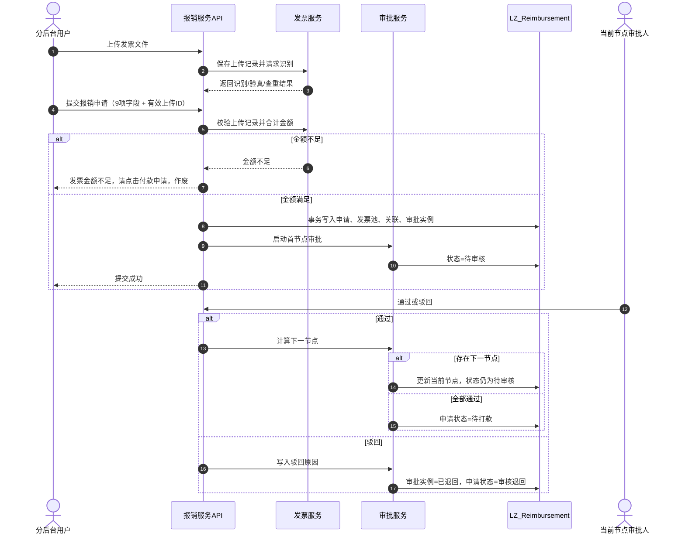

### 9.2 报销申请（预算版）关键时序

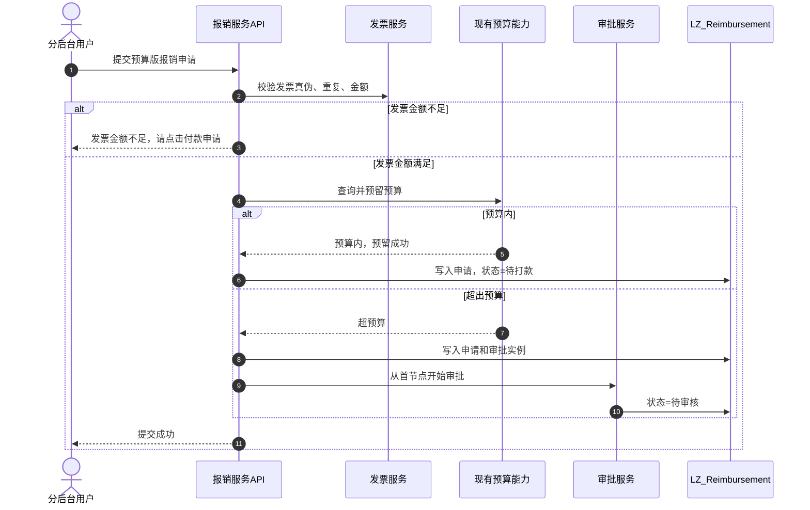

### 9.3 付款申请与补传发票时序

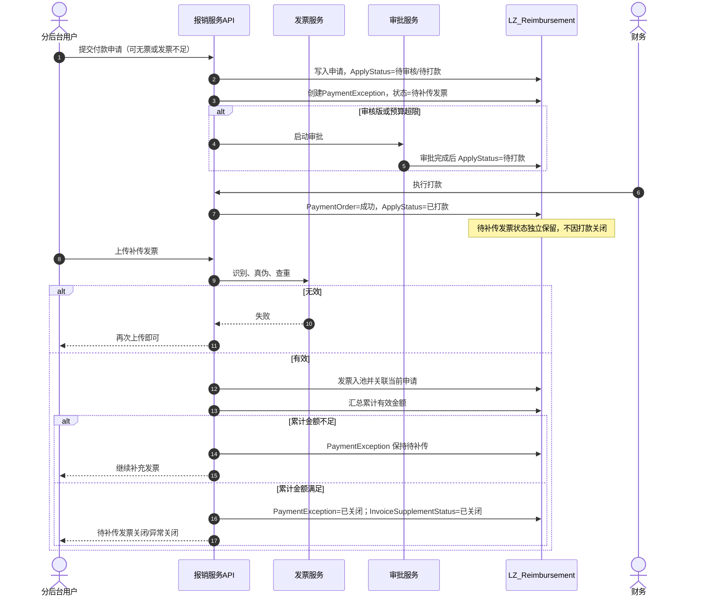

说明：审批后的打款与补传发票是两个独立处理环节。PRD 未将补传设定为打款前置条件，因此打款成功不自动关闭待补传状态，补传通过也不回滚已经完成的打款。

### 9.4 主状态机

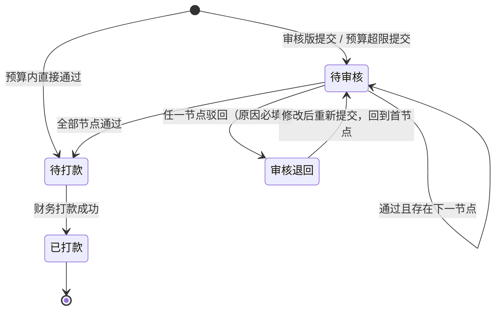

约束：

- 不存在“待主管审核、待经理审核、待总经理审核”等状态。
- 通过后是否进入下一节点由配置动态计算。
- 驳回后不保留原节点，重新提交从首节点开始。
- 已打款是主流程终态。

### 9.5 待补传发票状态机

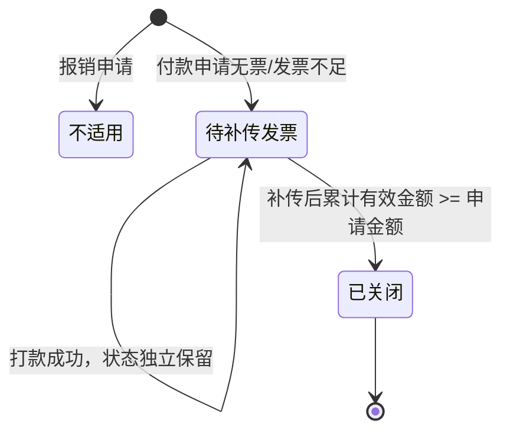

约束：

- 没有补票截止时间。
- 没有超期状态。
- 没有逾期锁定。
- 没有催缴次数和信誉处罚。

### 9.6 状态与业务操作矩阵

| 当前主状态 | 可提交 | 可审批 | 可打款 | 可补传发票   | 可修改重提 |
| ----- | ---:| ---:| ---:| -------:| -----:|
| 待审核   | 否   | 是   | 否   | 付款申请可补传 | 否     |
| 审核退回  | 否   | 否   | 否   | 付款申请可补传 | 是     |
| 待打款   | 否   | 否   | 是   | 付款申请可补传 | 否     |
| 已打款   | 否   | 否   | 否   | 付款申请可补传 | 否     |

补充规则：

- 付款申请的待补传发票状态独立于主状态。
- 主状态为审核退回时，原审批实例已经结束；重提后创建新实例。
- 报销申请不存在待补传发票状态。

---

## 10. 测试与验收要点

### 10.1 提单与字段

| 用例           | 预期          |
| ------------ | ----------- |
| 报销申请 9 项字段完整 | 提交成功        |
| 付款申请 9 项字段完整 | 提交成功        |
| 费用名称为空       | 校验失败        |
| 报销金额小于等于 0   | 校验失败        |
| 收款卡号超过格式限制   | 校验失败        |
| 账号未配置报销类型    | 提交失败，提示先配置  |
| 账号配置为审核      | 申请流程版本快照为审核 |
| 账号配置为预算      | 申请流程版本快照为预算 |

### 10.2 发票校验

| 用例                 | 预期                    |
| ------------------ | --------------------- |
| 单张有效发票金额等于申请金额     | 通过                    |
| 单张有效发票金额大于申请金额     | 通过                    |
| 多张有效发票合计金额大于等于申请金额 | 通过                    |
| 多张有效发票合计金额小于申请金额   | 报销申请退回；付款申请允许并生成待补传异常 |
| 发票识别失败             | 按未上传发票处理，提示“再次上传即可”   |
| 发票验真失败             | 按未上传发票处理，提示“再次上传即可”   |
| 重复发票号码             | 按未上传发票处理，提示“再次上传即可”   |
| 两张上传并发同一发票号码       | 只成功一张，另一张返回重复上传       |
| 发票已关联其他申请          | 不允许再次关联               |
| 补传后累计金额不足          | 保持待补传发票               |
| 补传后累计金额满足          | 关闭待补传发票/异常关闭          |

### 10.3 审核流程

| 用例           | 预期                 |
| ------------ | ------------------ |
| 流程配置 1 个节点   | 完成该节点后进入待打款        |
| 流程配置多个动态节点   | 按 NodeSeq 顺序流转     |
| 金额条件关闭       | 节点始终进入             |
| 金额条件开启且金额满足  | 节点进入               |
| 金额条件开启且金额不满足 | 节点跳过               |
| 驳回原因为空       | 审批失败，提示必填          |
| 驳回成功         | 申请状态为审核退回          |
| 驳回后重提        | 新建审批实例并回到首节点       |
| 非当前节点人员审批    | 返回无权审批             |
| 重复点击通过       | 只产生一条有效审批结果，避免重复流转 |
| 修改流程配置       | 在途申请仍使用原流程版本       |

### 10.4 付款与补传

| 用例          | 预期                       |
| ----------- | ------------------------ |
| 付款申请提交时无发票  | 允许提交并生成待补传异常             |
| 付款申请提交时发票不足 | 允许提交并生成待补传异常             |
| 付款申请提交时发票充足 | 允许提交，不生成待补传异常            |
| 审批完成        | 主状态进入待打款，待补传状态保留         |
| 打款成功        | 主状态为已打款，待补传状态不自动关闭       |
| 补传第一张仍不足    | 异常保持待补传                  |
| 补传达到金额      | 异常关闭                     |
| 重复调用补传接口    | 不重复关联同一发票，不重复扣减预算        |
| 异常视图查询      | 只按状态、费用名称、申请时间筛选，不返回汇总数字 |

### 10.5 权限与租户

| 用例            | 预期       |
| ------------- | -------- |
| 分后台用户查看其他租户数据 | 无数据或 403 |
| 总后台访问申请审批接口   | 拒绝       |
| 非财务人员调用打款接口   | 拒绝       |
| 非流程配置管理员保存流程  | 拒绝       |
| 当前审批人调用通过     | 成功       |
| 非当前审批人调用通过    | 拒绝       |

### 10.6 数据一致性

| 用例            | 预期               |
| ------------- | ---------------- |
| 提交事务中途失败      | 不产生半成品申请         |
| 预算预留后本地事务失败   | 释放预算预留           |
| 预算调用失败        | 不创建申请            |
| 回调重复推送        | 只处理一次            |
| 打款接口重复调用同一幂等键 | 返回原结果，不重复打款      |
| 并发审批同一节点      | 只有一个请求成功，另一个返回冲突 |

### 10.7 必须交付的自动化测试

1. 所有枚举值与 SQL 检查约束一致。
2. 所有金额字段精度为两位小数。
3. 唯一索引和过滤索引存在。
4. 发票金额合计算法有单元测试。
5. 审批节点条件计算有单元测试。
6. 提交、预算、审批、补传、打款有集成测试。
7. 第三方回调幂等有测试。
8. 租户隔离和角色权限有测试。
9. 数据库迁移可以从空库完整执行。
10. 在不修改其他服务代码的前提下，报销服务可独立启动和测试。

---

## 11. AI 开发执行边界

### 11.1 总原则

后续将本文件交给 AI 开发时，必须附加以下约束：

1. **只新增报销功能模块。**
2. 不得修改用户、企业、财务、基础数据、发票、订单、薪资等既有模块的业务逻辑。
3. 不得修改既有模块的数据库表结构和接口契约。
4. 所有开发规范遵循当前 LZ-SaaS 项目约定：项目命名、控制器命名、服务命名、响应格式、异常处理、日志、认证、租户隔离。
5. 本文件没有写出的业务规则，不得根据个人经验自行补全。
6. 遇到影响业务结果的歧义，必须先停下并列出问题，不得直接实现猜测逻辑。
7. 不得引入小程序端代码、页面、路由或权限。
8. 不得把 PRD 中五个状态拆成新的业务状态。
9. 不得删除或覆盖现有文档中的历史设计，除非有明确需求版本记录。

### 11.2 允许修改和新增的路径

允许新增：

```text
Apis/LZ.Reimbursement.API/
Services/LZ.Reimbursement.Service/
Common/LZ.Model/Model/Reimbursement/
Common/LZ.Model/Dtos/Reimbursement/
Common/LZ.Model/Enums/Reimbursement/
部署配置中的 LZ.Reimbursement.API 路由和容器配置
LZ_Reimbursement 数据库迁移文件
报销模块相关测试项目
```

允许在现有网关和部署配置中增加新路由，但不得改变现有路由行为。

### 11.3 禁止改写或扩展的业务规则

禁止实现以下内容：

1. 补票 30 天期限、截止日期、超期状态、逾期锁定。
2. 员工信誉扣分或暂停后续申请。
3. 补票催缴次数、短信、公众号、站内信通知。
4. 固定主管、部门经理、总经理三级审批。
5. 审批人自动跳过、离职自动转派、主管为空自动转管理员。
6. 驳回到中间节点、指定节点重审。
7. 多费用明细、费用分摊、部分报销、部分打款。
8. 发票代码、购销方、税号、税额、开票日期等 PRD 未要求字段参与业务判断。
9. 独立预算账户、预算额度配置、预算计算口径重建。
10. 总后台除账号报销类型配置之外的其他菜单或接口。
11. 申请草稿、暂存、重新申请、复制申请。
12. 小程序端补传发票入口和接口。
13. 自动关闭待补传发票状态的非金额条件。
14. 自动把付款申请打款作为待补传发票关闭条件。
15. 任意扩展状态名称和状态值。
16. 将本服务审批引擎抽取为公共组件、共享包或修改其他服务的审批实现；本版只在 `LZ.Reimbursement.Service` 内实现。

### 11.4 必须严格保留的提示语

| 场景        | 提示语               |
| --------- | ----------------- |
| 发票识别失败    | 再次上传即可            |
| 发票真伪校验失败  | 再次上传即可            |
| 发票重复上传    | 再次上传即可            |
| 审核版报销金额不足 | 发票金额不足，请点击付款申请，作废 |
| 预算版报销金额不足 | 发票金额不足，请点击付款申请    |
| 补传金额不足    | 继续上传发票            |
| 补传金额满足    | 待补传发票关闭/异常关闭      |

提示语不得自行改写、删字或增加标点。

### 11.5 状态实现约束

必须使用以下状态名称：

| 状态组  | 状态               |
| ---- | ---------------- |
| 主状态  | 待审核、审核退回、待打款、已打款 |
| 补传状态 | 待补传发票、已关闭        |

禁止新增：

- 待直属主管审核
- 待部门经理审核
- 待总经理审核
- 补传校验中
- 超期未补传
- 部分打款
- 已撤回
- 草稿
- 已作废

如果代码内部需要中间状态，只能使用事务内的临时变量，不能作为数据库状态值或 API 状态值。

### 11.6 数据库实现约束

1. 使用 EF Core Migration 管理结构，同时保留第 4 章 SQL 作为核对基线。
2. 所有金额字段必须使用 `decimal(18,2)`。
3. 所有租户查询必须带 `TenantId`。
4. 所有唯一防重必须在数据库中建立唯一索引，不能只依赖应用层查询。
5. 发票号码唯一索引为 `TenantId + InvoiceNumber`。
6. 申请号唯一索引为 `TenantId + ApplyNo`。
7. 只允许一张申请对应一张打款单。
8. 所有状态变更必须有并发保护。
9. 不得使用级联删除删除业务历史。
10. 不允许跨数据库外键或跨服务事务。

### 11.7 服务实现约束

1. 控制器只做参数校验、权限校验和调用服务，不写业务规则。
2. 申请提交必须使用事务。
3. 预算调用必须在数据库事务外，并做好幂等和补偿。
4. 审批通过、驳回必须校验当前节点审批人。
5. 驳回原因必须由服务层再次校验，不能只依赖前端。
6. 发票校验必须在服务层完成，不能由前端传入金额或校验结果。
7. 只允许后端从回调结果中读取“发票号码、价税合计金额”作为业务字段。
8. 银行卡号只能加密保存和掩码返回。
9. 所有外部调用必须设置超时、重试和熔断策略。
10. 所有写操作必须记录结构化日志、操作人和请求追踪 ID。

### 11.8 API 实现约束

1. 统一使用 `ApiResponse<T>`。
2. 分页统一使用 `PagedQuery`。
3. 接口路由统一使用 `/api/reimbursement/v1`。
4. 总后台只暴露 `/admin/account-configs` 相关接口。
5. 分后台才暴露申请、审批、流程配置、异常、补传、打款接口。
6. 第三方回调接口不得暴露业务查询接口。
7. 所有查询接口必须按租户和角色权限过滤。
8. 列表查询必须支持状态、费用名称、申请时间。
9. 异常统计接口只返回按状态区分的数据列表，不返回汇总数字。
10. API 文档中必须明确标注角色权限和错误码。

### 11.9 日志与安全约束

必须记录：

- 申请提交、审批、驳回、补传、打款、预算调用、回调处理的操作日志。
- 操作人、租户、申请号、接入追踪 ID、结果和错误码。

禁止记录：

- 完整银行卡号。
- 完整发票文件内容。
- 认证令牌。
- 第三方插件密钥。

日志中的银行卡号、发票号码按项目安全规范脱敏。

### 11.10 AI 交付顺序

建议按以下顺序开发：

1. 新建服务项目和数据库迁移。
2. 实现枚举、实体、DbContext 和索引。
3. 实现申请提交与发票校验。
4. 实现审批流程配置与审批流转。
5. 实现预算适配接口和现有预算服务对接。
6. 实现付款申请异常与补传发票。
7. 实现财务打款。
8. 实现总后台账号配置。
9. 实现 API 控制器、Swagger、权限和错误码。
10. 补齐单元测试、集成测试和并发测试。
11. 输出数据库迁移、部署配置和上线检查清单。

### 11.11 停止条件

AI 遇到以下情况必须停止并请求确认，不得自行决定：

1. 现有项目实际使用 SqlSugar 或不同 ORM，与架构文档不一致。
2. 现有项目已有报销、付款、审批或预算模块，需要确认复用方式。
3. 预算能力的实际接口协议未提供。
4. 发票插件回调字段与本文档不一致。
5. 当前系统中“账号”主键和权限模型无法确定。
6. 需要修改其他服务的数据库或接口才能继续。
7. 用户提出本文档未定义的新业务规则。
8. 发现文档与 PRD 第 2～5 部分冲突。

---

## 12. 附录：需求追踪矩阵

| PRD 章节  | 需求内容             | 本设计位置         | 实现对象                                       |
| ------- | ---------------- | ------------- | ------------------------------------------ |
| 2.1     | 新增报销申请、付款申请      | 2.1、7.1       | `Reimbursement_Apply`、申请接口                 |
| 2.2     | 两类申请共同依赖发票、审批、状态 | 2.1～2.9       | 全部核心服务                                     |
| 3.1～3.2 | 分后台、总后台能力归属      | 1.3、1.4、7.4   | 控制器权限                                      |
| 3.3     | 双端提交差异           | 1.2           | 本次只实现分后台后端                                 |
| 3.4     | 参与角色             | 1.3、1.4、2.7   | 权限和审批校验                                    |
| 3.5     | 账号配置决定审核/预算      | 2.3、3.4、7.4.5 | `Reimbursement_AccountConfig`              |
| 4.1     | 模块依赖             | 3.4           | 应用、发票、审批、预算、异常服务                           |
| 4.2     | 9 项申请字段          | 2.2、6.3       | `Reimbursement_Apply`                      |
| 4.3     | 发票识别、真伪、重复、金额    | 2.6、8.2       | `IInvoiceProcessingService`                |
| 4.3.5   | 多张发票合计比对         | 2.6、8.2       | `InvoiceTotalAmount`                       |
| 4.4.1   | 审核流程动态配置         | 2.7、8.4       | `Reimbursement_ApprovalProcess`            |
| 4.4.2   | 部门 + 人员          | 2.7、4.4       | `Reimbursement_ApprovalNode`               |
| 4.4.3   | 金额条件默认关闭、默认 5000 | 2.7、4.4       | `AmountConditionEnabled`、`AmountThreshold` |
| 4.4.4   | 通过/驳回、驳回原因必填     | 8.5、8.6       | `IApprovalWorkflowService`                 |
| 4.4.5   | 自动流转、全部通过待打款     | 8.5           | `ApprovalInstance`                         |
| 4.4.6   | 状态实时同步           | 2.8           | 状态字段、接口响应                                  |
| 4.5     | 上传多张 PDF/图片      | 2.6、7.4.2     | `InvoiceUpload`                            |
| 4.6.1   | 五个状态名称           | 2.8、9.4、9.5   | 状态枚举                                       |
| 4.6.2   | 审核版、预算版、付款状态流转   | 2.4、2.5、9.4   | 申请和审批服务                                    |
| 4.7     | 补传发票链路           | 2.5、8.8       | `PaymentException`                         |
| 4.8     | 申请记录、再次申请        | 1.2、8.10      | 本次仅实现申请记录，再次申请不实现                          |
| 4.9     | 审核申请管理           | 7.4.1         | 申请查询和审批接口                                  |
| 4.10    | 异常统计仅按状态展示       | 2.9、7.4.4     | `PaymentException` 查询                      |
| 4.11    | 总后台账号配置          | 1.3、7.4.5     | `AccountConfigController`                  |
| 5.1     | 审核版流程图           | 2.4、9.1       | 审核版流程                                      |
| 5.2     | 预算版流程图           | 2.4、9.2       | 预算版流程                                      |
| 5.3     | 流程版本选择机制         | 2.3           | FlowType 快照                                |

---

## 结论

本开发文档已将 PRD 第 2～5 部分的业务规则、审核版与预算版、分后台与总后台边界、数据库表、实体类、服务接口、接口清单、状态机、事务边界和 AI 执行约束统一到同一套设计中。

后续开发应以本文件为准。若与旧版开发稿、个人经验或未确认推断冲突，以本文件和 PRD 第 2～5 部分为准；若本文件仍无法覆盖实际项目接口契约，必须先停止开发并向需求方或架构负责人确认。
