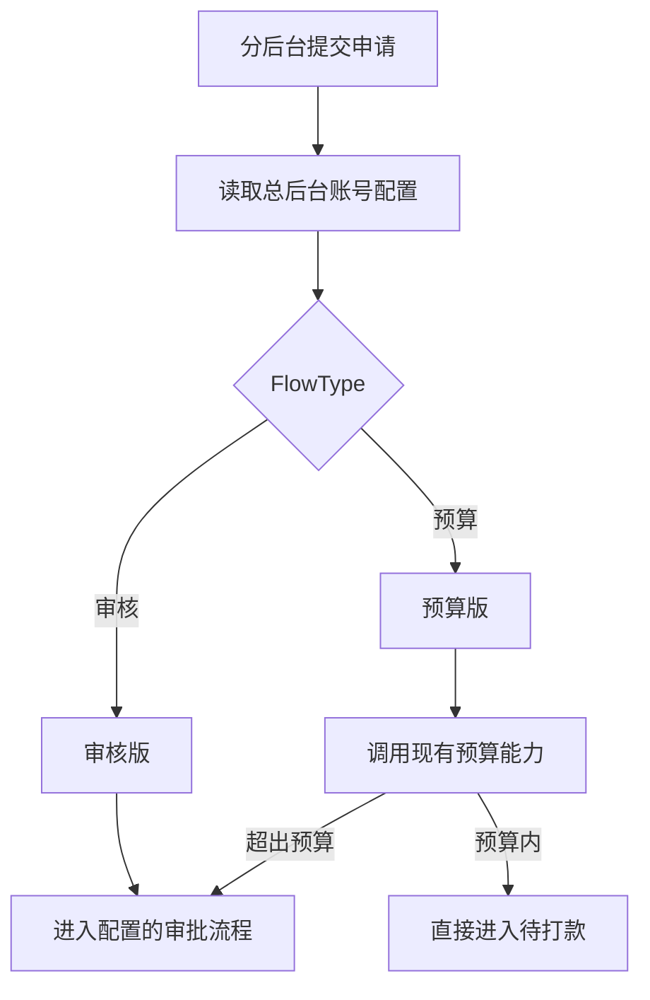
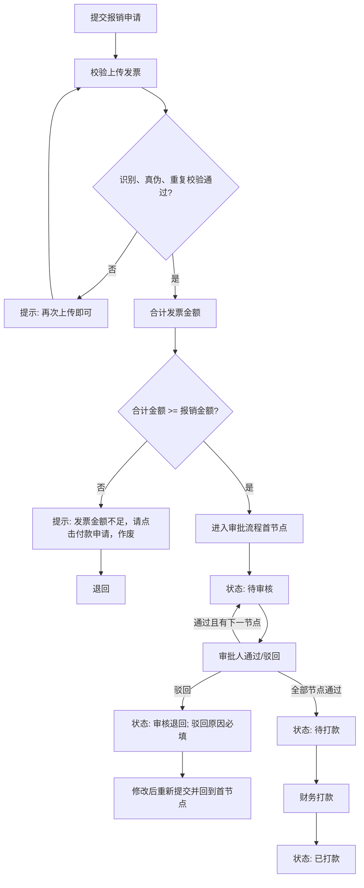
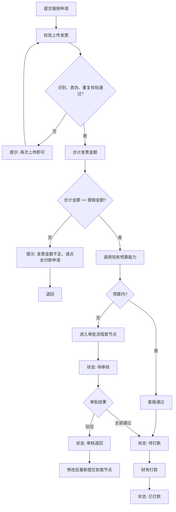
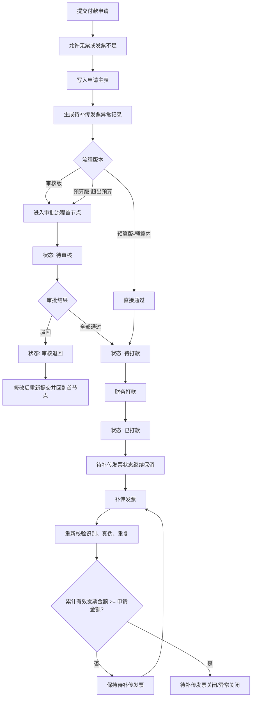
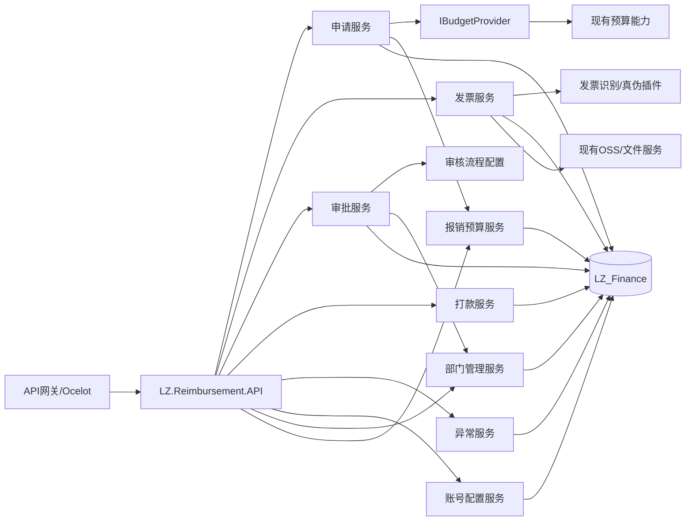
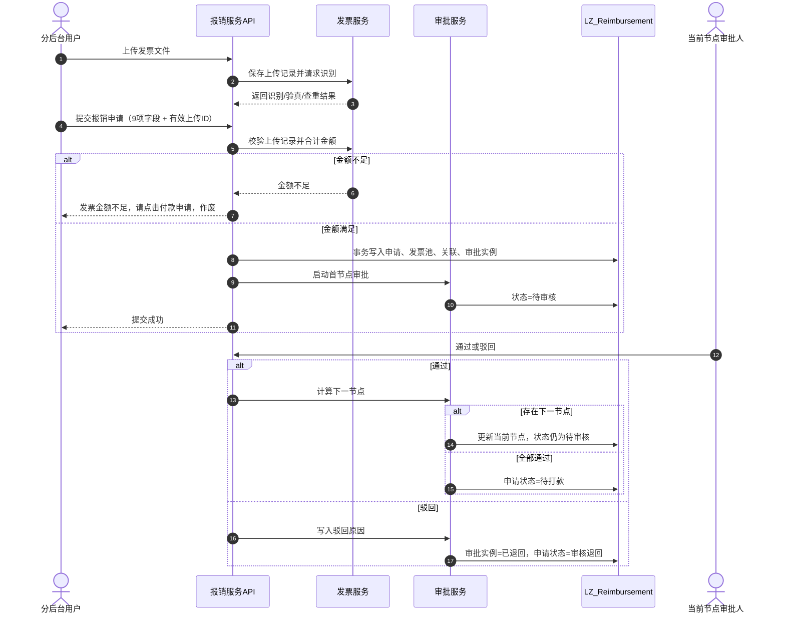
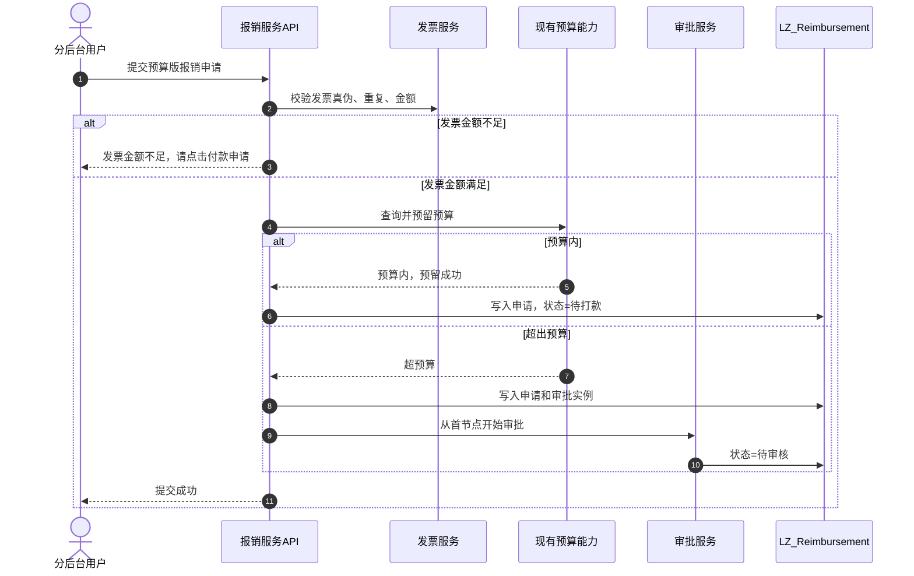
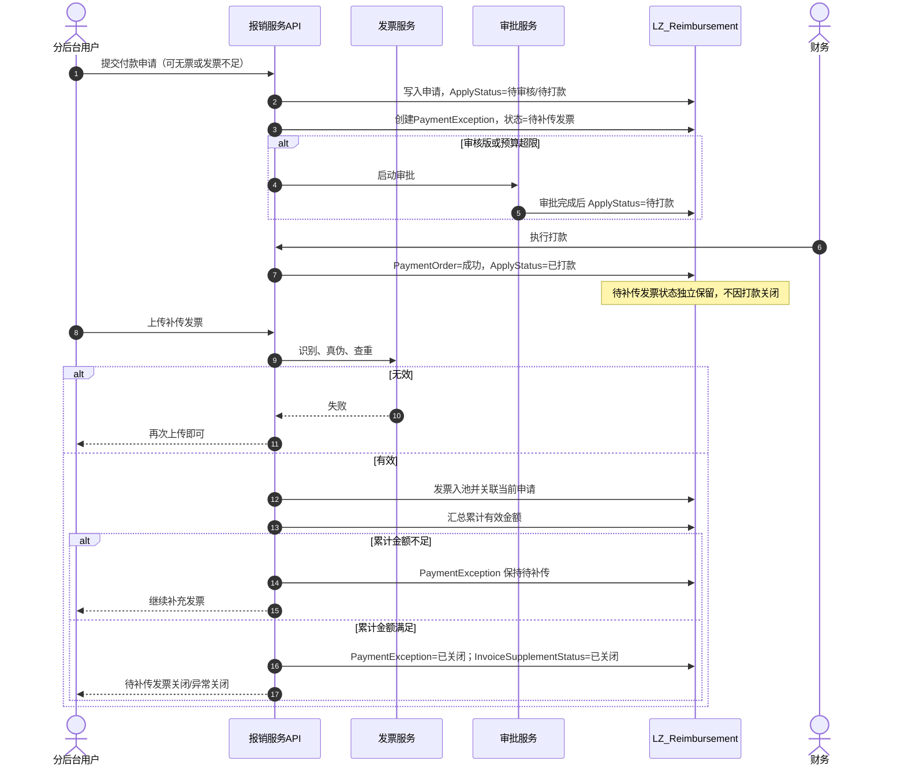
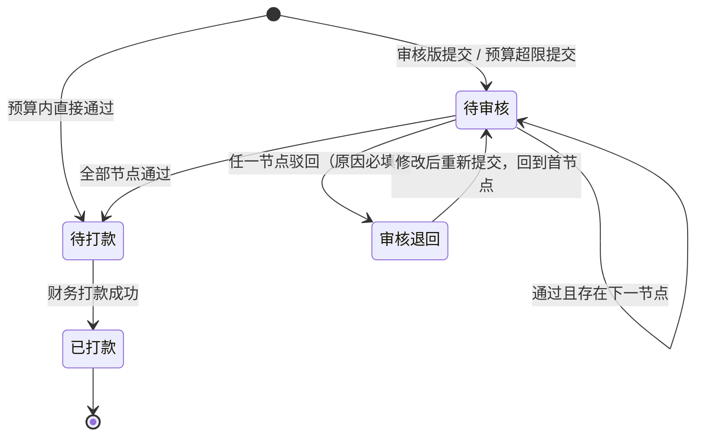
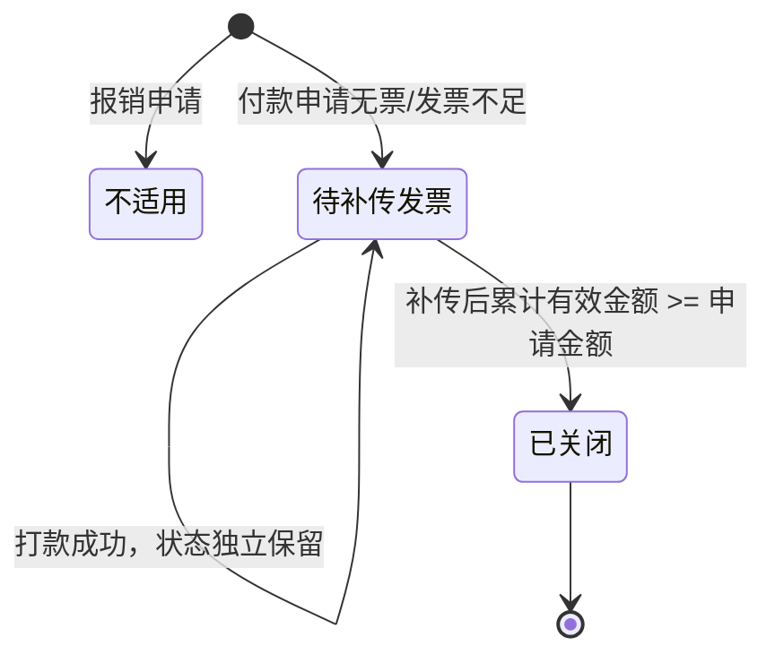

# 费用报销与付款申请服务开发设计文档

## 文档信息

| 项目   | 内容                                                                                                                                                                                |
| ---- | --------------------------------------------------------------------------------------------------------------------------------------------------------------------------------- |
| 文档名称 | 费用报销与付款申请服务开发设计文档                                                                                                                                                                 |
| 文档版本 | v1.1                                                                                                                                                                              |
| 编制日期 | 2026-10-20                                                                                                                                                                        |
| 业务依据 | 《付款报销审核流程产品需求文档》第 2～5 部分                                                                                                                                                          |
| 架构依据 | 《LZ-SaaS项目架构分析文档》                                                                                                                                                                 |
| 开发范围 | 后端分后台、总后台；不包含职喜智能体小程序前端                                                                                                                                                           |
| 服务形态 | 独立微服务，共用财务数据库 `LZ_Finance`                                                                                                                                                        |
| 核心原则 | 本文件是开发落地基线；未写入本文件的业务规则不得自行扩展                                                                                                                                                      |
| 变更说明 | v1.1：表名前缀改为 FIN_Reimb_、数据库改为 LZ_Finance、主键统一改用 UNIQUEIDENTIFIER 并按表改名（原 ReimbGuid，现分别为 ConfigGuid/ApplyGuid/UploadGuid 等，详见 4.1 主键规范）、删除索引定义、新增部门管理模块（SYS_Department）、预算接口标注待重新设计 |
| 变更说明 | v1.1 合并《报销开发文档修改补充说明》：表名前缀改 FIN_Reimb_、数据库归并 LZ_Finance、主键统一改用 UNIQUEIDENTIFIER 并按表改名（原 ReimbGuid）、新增部门管理模块                                                                       |
| 变更说明 | v1.2 补齐《报销开发文档修改补充说明》剩余内容：修正 3.1 服务定位与目录结构、替换遗留独立数据库描述、新增第 13 章部门管理模块（SYS_Department）、新增第 14 章报销预算模块（FIN_Rembi_* 四表 + RembiBudget* 实体/服务/控制器）、更新需求追踪矩阵                            |
| 变更说明 | v1.4 依据《付款报销审核流程产品需求文档》v2.4 与墨刀「报销需求原型」新增第 15 章「小程序端开发接口」：梳理小程序端 7 页、分后台 5 页、总后台账号配置的全部后端接口；登记原型与 PRD 在流程版本判定上的口径差异（15.1）与需回填第 7 章的 7 个新增接口（15.5）                                 |

> 本文档已经按 PRD v2.4 的业务结论重新梳理。原开发稿中与 PRD 不一致的“补票 30 天期限、超期惩罚、固定三级审批、预算账户自建、多费用明细、复杂发票字段、自动跳过审批人”等内容不作为本次开发需求。

---

## 目录

1. [范围、边界与已确认规则](#1-范围边界与已确认规则)
2. [业务分析与流程闭环](#2-业务分析与流程闭环)
3. [服务架构与项目结构](#3-服务架构与项目结构)
4. [数据库设计（SQL Server）](#4-数据库设计sql-server)
5. [表关系图与关联字段](#5-表关系图与关联字段)
6. [实体类设计](#6-实体类设计)
7. [DTO、服务接口与接口设计](#7-dto服务接口与接口设计)
8. [关键业务算法与事务边界](#8-关键业务算法与事务边界)
9. [流程图、时序图与状态机](#9-流程图时序图与状态机)
10. [测试与验收要点](#10-测试与验收要点)
11. [AI 开发执行边界](#11-ai-开发执行边界)
12. [附录：需求追踪矩阵](#12-附录需求追踪矩阵)
13. [部门管理模块（SYS_Department）](#13-部门管理模块sys_department)
14. [报销预算模块（FIN_Rembi_*）](#14-报销预算模块fin_rembi_)
15. [小程序端开发接口（职喜智能体小程序）](#15-小程序端开发接口职喜智能体小程序)

---

## 1. 范围、边界与已确认规则

### 1.1 本次开发范围

本次新增“费用报销与付款申请”独立微服务，报销相关数据表建在现有财务数据库 `LZ_Finance` 中（不新建独立数据库），支持以下后端能力：

1. 分后台提交报销申请。
2. 分后台提交付款申请。
3. 分后台配置审核流程：审批层级、节点顺序、每层审批人、每层金额触发条件。
4. 分后台审批报销申请与付款申请。
5. 分后台查看申请记录、申请详情和当前状态。
6. 分后台上传发票、补传发票、查看补传状态。
7. 分后台按状态展示需要补传发票的付款申请异常清单。
8. 财务执行打款并记录打款结果。
9. 总后台配置账号的报销类型：`审核` 或 `预算`。
10. 预算版预算能力：原依赖现有预算模块的方案已废弃，需重新设计（与部门管理模块联动），详见第 13 章。当前版本预算相关接口设计保留占位，开发前须另行确认。

### 1.2 明确不包含的内容

| 不包含项             | 说明                                            |
| ---------------- | --------------------------------------------- |
| 职喜智能体小程序前端       | 本次只设计后端接口；小程序端不纳入开发范围                         |
| 申请草稿/暂存          | PRD 明确本版不引入草稿、暂存                              |
| 补票期限             | 不设置截止日期、不提醒、不逾期、不处罚                           |
| 员工信誉扣分           | 不在本版范围                                        |
| 部分报销、部分打款        | PRD 未定义；本设计按单笔全额申请、全额打款处理                     |
| 多费用明细            | PRD 只定义 9 项提交字段，不增加主表 + 明细表结构                 |
| 发票代码、购销方、税额等扩展字段 | PRD 明确只提取“发票号码、价税合计金额”用于业务校验                  |
| 固定审批层级           | 不固定为主管、部门经理、总经理三级；节点数量和顺序均可配置                 |
| 审批人自动跳过、离职兜底     | 不在 PRD 确认范围内，不擅自实现                            |
| 直接驳回至任意中间节点      | 驳回后只进入“审核退回”；再次提交必须从首节点重新审批                   |
| 通知方式             | PRD 暂未确定，本版只维护数据状态，不擅自接入短信、公众号等通知             |
| “再次申请”功能         | PRD 归属小程序；本次不考虑小程序，因此不设计该接口                   |
| 独立预算账户配置         | 原依赖现有预算系统方案已废弃；新预算方案（与部门管理模块联动）待重新设计，详见第 13 章 |
| 修改其他业务模块         | 不允许改动用户、企业、财务、基础数据等既有模块的业务逻辑和数据库              |

### 1.3 总后台边界

总后台在本需求中只有一项能力：

| 能力   | 可选值       | 作用                       |
| ---- | --------- | ------------------------ |
| 账号配置 | `审核`、`预算` | 决定该账号的报销申请与付款申请走审核版还是预算版 |

“审核”和“预算”是账号配置字段的枚举值，不是两个独立菜单，也不是可以在总后台执行的业务流程。

总后台不得提供、修改或代替以下能力：

- 审核流程配置。
- 报销申请或付款申请提交。
- 报销申请或付款申请审批。
- 发票上传、补传。
- 审核申请管理。
- 补传状态查看。
- 异常统计。

### 1.4 分后台边界

分后台承载：

- 报销申请/付款申请**管理**（查看、审批、打款、补传、异常统计）。
- **注意**：分后台与总后台均不具备申请提交能力；申请提交入口仅在小程序端（职喜智能体），后台代码除审核流程外不提供任何提交接口。
- 审批操作。
- 审核流程配置。
- 发票上传与补传。
- 补传状态查看。
- 异常统计清单。
- 财务打款操作。

### 1.5 已确认业务规则汇总

| 规则主题        | 最终结论                      |
| ----------- | ------------------------- |
| 两类申请字段      | 报销申请与付款申请均使用同一组 9 项字段     |
| 流程版本决定人     | 由总后台账号配置决定，不按申请类型单独选择     |
| 报销申请前置条件    | 发票有效金额合计必须 ≥ 报销金额         |
| 付款申请容错      | 允许无发票或发票不足，审批完成后保留待补传发票   |
| 发票提取字段      | 只提取“发票号码、价税合计金额”          |
| 多张发票        | 采用合计金额与申请金额比对             |
| 识别失败        | 统一提示“再次上传即可”，并按未上传发票处理    |
| 真伪校验失败      | 统一提示“再次上传即可”，并按未上传发票处理    |
| 重复上传失败      | 统一提示“再次上传即可”，并按未上传发票处理    |
| 审核版报销金额不足提示 | “发票金额不足，请点击付款申请，作废”       |
| 预算版报销金额不足提示 | “发票金额不足，请点击付款申请”          |
| 付款申请补传校验    | 补传后重新执行真伪校验、重复校验、金额合计校验   |
| 补传金额不足      | 保持待补传发票状态，继续上传            |
| 补传金额满足      | 关闭待补传发票状态/异常关闭            |
| 审批节点        | 动态配置，无固定数量、无固定顺序          |
| 审批人绑定       | 每个节点绑定“部门 + 人员”           |
| 金额条件        | 可配置是否开启，默认关闭；开启后默认阈值 5000 |
| 驳回          | 驳回原因必填                    |
| 驳回重提        | 修改后重新提交，从审批流程首节点重新开始      |
| 状态名称        | 待审核、审核退回、待打款、已打款、待补传发票    |
| 审批层级状态      | 不拆分为待主管、待经理、待总经理；统一为“待审核” |
| 列表筛选        | 状态、费用名称、申请时间              |
| 异常统计        | 只按状态区分展示，不计算数量、金额、占比、趋势   |
| 状态同步        | 所有端侧状态实时一致；本次只建设后端数据状态    |
| 表单项来源       | 法人主体、成本类型等参考现有项目字段规范      |

---

## 2. 业务分析与流程闭环

### 2.1 两类申请

| 申请类型 | 代码  | 适用条件        | 发票要求         | 审批后处理                   |
| ---- | ---:| ----------- | ------------ | ----------------------- |
| 报销申请 | 1   | 发票金额 ≥ 报销金额 | 提交时必须满足金额条件  | 审批完成后进入待打款              |
| 付款申请 | 2   | 无发票或发票不足    | 允许提交时不满足金额条件 | 审批完成后仍保留待补传发票，后续补传并重新校验 |

两类申请共用：

- 同一组 9 项字段。
- 同一套发票上传能力。
- 同一套审核流程配置。
- 同一套状态体系和审批记录规则。
- 同一套列表筛选规则。

### 2.2 9 项提交字段

| 序号  | 字段名称    | 数据含义         | 必填  |
| ---:| ------- | ------------ | --- |
| 1   | 法人主体    | 报销或付款归属的法人主体 | 是   |
| 2   | 成本类型    | 费用所属成本类型     | 是   |
| 3   | 费用名称    | 本次费用名称       | 是   |
| 4   | 收款单位    | 收款方名称或户名     | 是   |
| 5   | 收款单位所属行 | 收款单位开户银行     | 是   |
| 6   | 收款单位卡号  | 收款单位银行账号     | 是   |
| 7   | 费用用途    | 费用使用用途       | 是   |
| 8   | 备注      | 补充说明         | 否   |
| 9   | 报销金额    | 与发票价税合计金额比对  | 是   |

实现要求：

- `报销金额` 必须大于 0，最多保留两位小数。
- 法人主体、成本类型、费用名称从现有基础数据或现有业务规范取值；本服务保存业务 ID 和名称快照。
- 收款单位卡号属于敏感字段，数据库只保存加密值，接口返回只返回掩码。
- 付款申请也使用“报销金额”字段名，不新增“付款金额”字段，避免两端语义漂移。

### 2.3 流程版本选择



关键约束：

1. 账号配置必须在提交时存在且启用。
2. 找不到账号配置时，提交失败，不默认落入审核版或预算版。
3. 提交时将 `FlowType` 快照写入申请主表；后续修改账号配置不影响已提交的在途单据。
4. 预算额度来源、判定口径不在本服务实现；本服务只调用现有预算能力并记录本地预留流水。

### 2.4 报销申请流程

> **边界说明**：本流程中"提交报销申请"步骤由小程序端（职喜智能体）触发，分后台与总后台代码不提供申请提交入口；后台仅负责发票校验、审批流转、打款确认等后续环节。

#### 2.4.1 审核版



#### 2.4.2 预算版



> **边界说明**：同 2.4 节，付款申请的提交入口仅在小程序端，分后台与总后台不提供提交能力。

### 2.5 付款申请流程



付款申请的核心不是“审批完就一定没有异常”，而是：

- 审批流程和付款流程可以正常结束。
- 发票补充状态作为独立状态继续保留。
- 只有补传金额满足后，待补传发票状态才关闭。

### 2.6 发票上传与校验

#### 2.6.1 第三方回调

发票识别、真伪校验依赖第三方识别插件回调。本服务不承担 OCR 插件算法，只负责：

1. 保存上传文件。
2. 调用插件或接收插件回调。
3. 校验回调签名和幂等性。
4. 提取并保存以下两个业务字段：
   - 发票号码。
   - 价税合计金额。
5. 执行真伪校验和重复上传校验。
6. 计算同一申请下全部有效发票的价税合计金额。

#### 2.6.2 校验失败处理

| 场景       | 用户提示                                     | 业务处理            |
| -------- | ---------------------------------------- | --------------- |
| 识别失败     | 再次上传即可                                   | 认定为未上传发票        |
| 真伪校验失败   | 再次上传即可                                   | 认定为未上传发票        |
| 重复上传     | 再次上传即可                                   | 认定为未上传发票        |
| 报销申请金额不足 | 审核版：发票金额不足，请点击付款申请，作废；预算版：发票金额不足，请点击付款申请 | 退回，阻断进入审批/预算判定  |
| 付款申请金额不足 | 不提示“作废”                                  | 允许提交，生成待补传发票异常  |
| 补传后金额仍不足 | 保持待补传发票状态                                | 允许继续上传          |
| 补传后金额满足  | 待补传发票关闭/异常关闭                             | 更新申请发票合计金额并关闭异常 |

#### 2.6.3 发票唯一性与并发

- 以“租户 + 发票号码”建立唯一索引。
- 同一发票号码一旦成功进入发票池，不得再次关联到其他申请。
- 并发上传、重复提交时，依赖数据库唯一约束兜底。
- 捕获唯一索引冲突后转为“重复上传”，提示“再次上传即可”。

### 2.7 审批流程配置与执行

审批流程配置是分后台的基础配置能力，适用于本服务内的报销申请和付款申请。

配置内容：

1. 审批层级数量。
2. 节点顺序。
3. 每层审批人。
4. 每层金额触发条件。

审批人规则：

- 每个节点绑定“部门 + 人员”。
- 审批操作时，当前用户必须匹配当前节点的审批人。
- 不在本版实现自动跳过、离职自动转派、申请人本人自动跳过。

金额触发规则：

- `AmountConditionEnabled = false` 时，节点始终进入。
- `AmountConditionEnabled = true` 时，按配置的运算符和阈值判断是否进入。
- 默认关闭。
- 开启后默认阈值 5000。
- 建议首个节点必须无条件进入，避免提交后无审批人可处理。

审批操作：

| 操作   | 必填项           | 结果                              |
| ---- | ------------- | ------------------------------- |
| 通过   | 审批意见可选        | 若存在满足条件的下一节点，流转下一节点；否则申请状态改为待打款 |
| 驳回   | 驳回原因必填        | 申请状态改为审核退回；原审批实例结束              |
| 驳回重提 | 按原业务字段修改后重新提交 | 新建一轮审批实例，从首节点重新开始               |

### 2.8 状态模型

PRD 的 5 个状态名称必须完全保留：

1. 待审核。
2. 审核退回。
3. 待打款。
4. 已打款。
5. 待补传发票。

为同时表达“付款申请已打款但仍待补传发票”，本设计使用两个状态字段：

| 字段                      | 作用      | 枚举               |
| ----------------------- | ------- | ---------------- |
| ApplyStatus             | 申请主流程状态 | 待审核、审核退回、待打款、已打款 |
| InvoiceSupplementStatus | 补传发票状态  | 不适用、待补传发票、已关闭    |

展示规则：

- 两个状态分别返回中文字段名称。
- 当付款申请的 `InvoiceSupplementStatus = 待补传发票` 时，列表和详情必须同时展示该状态。
- 不新增“待主管审核、待经理审核”等状态。
- 不新增“超期未补传”状态。

### 2.9 异常统计

本版“异常统计”是分后台的待补传发票清单视图，不是报表能力。

固定口径：

- 数据范围：存在待补传发票异常的付款申请。
- 展示方式：按 `InvoiceSupplementStatus` 区分展示。
- 筛选条件：状态、费用名称、申请时间。
- 数据逻辑：无数量统计、无金额汇总、无占比、无趋势、无报表导出要求。

### 2.10 现有能力依赖

| 依赖能力        | 本服务使用方式                       | 禁止事项                     |
| ----------- | ----------------------------- | ------------------------ |
| 用户、部门、角色    | 通过当前登录上下文和外部 ID 引用            | 不在报销库重复建设用户/部门/权限主数据     |
| 账号报销类型配置    | 总后台维护，本服务读取                   | 不在总后台增加预算额度配置            |
| 预算查询与占用     | 通过 `IBudgetProvider` 适配现有预算能力 | 不在本服务重建预算计算口径            |
| 发票 OCR/真伪插件 | 通过回调适配器接收结果                   | 不修改插件算法，不扩展 PRD 未要求的提取字段 |
| 文件存储        | 使用现有 OSS/文件服务                 | 不在报销库存二进制文件              |
| 登录认证        | 使用现有网关/身份体系                   | 不新增独立账号体系                |
| 财务打款        | 本服务记录打款结果和流水号                 | 不直连银行，除非后续单独确认           |

### 2.11 需求覆盖核对

| PRD 主题           | 本设计覆盖位置     |
| ---------------- | ----------- |
| 账号配置决定审核版/预算版    | 2.3、3.4、7.4 |
| 两类申请字段一致         | 2.1、2.2、6.2 |
| 发票真伪、重复、金额校验     | 2.6、8.4     |
| 多张发票合计           | 2.6、8.4     |
| 审核流程动态配置         | 2.7、6.2、7.3 |
| 审批人=部门+人员        | 2.7、4.4、6.2 |
| 金额条件默认关闭、默认 5000 | 1.5、2.7、4.4 |
| 状态名称统一           | 2.8、9.3     |
| 付款申请补传闭环         | 2.5、8.5     |
| 异常统计仅按状态展示       | 2.9、7.4     |
| 申请列表筛选           | 7.4         |
| 总后台仅账号配置         | 1.3、3.4、7.4 |
| 不设补票期限           | 1.2、2.5、8.5 |

---

## 3. 服务架构与项目结构

### 3.1 服务定位

新增独立服务：

| 项目     | 建议名称                           | 说明                                                                            |
| ------ | ------------------------------ | ----------------------------------------------------------------------------- |
| API 服务 | `LZ.Reimbursement.API`         | 分后台、总后台接口入口                                                                   |
| 业务服务   | `LZ.Reimbursement.Service`     | 报销、发票、审批、付款、异常业务逻辑                                                            |
| 数据模型   | `LZ.Model.Model.Reimbursement` | Sqlsugar实体                                                                    |
| DTO    | `LZ.Model.Dtos.Reimbursement`  | 请求、响应、查询 DTO                                                                  |
| 枚举     | `LZ.Model.Enums.Reimbursement` | 状态、类型、动作枚举                                                                    |
| 数据库    | `LZ_Finance`                   | 共用财务数据库（不新建独立数据库；部门表 `SYS_Department` 与报销预算表 `FIN_Rembi_*` 亦建于此库，详见第 13、14 章） |

建议网关路由前缀：

```text
/api/reimbursement/{**catch-all}
```

建议容器端口：

```text
8867
```

端口如与最终部署方案冲突，以部署配置为准，但业务服务不得与其他服务共用数据库。

### 3.2 分层与目录结构

```text
Apis/
└── LZ.Reimbursement.API/
    ├── Controllers/
    │   ├── ReimbursementApplicationController.cs
    │   ├── DepartmentController.cs                    # 部门管理
    │   ├── RembiBudgetConfigController.cs             # 预算配置
    │   ├── RembiBudgetManageController.cs             # 预算管理
    │   ├── RembiBudgetApplyRecordController.cs        # 预算应用记录
    │   ├── InvoiceUploadController.cs
    │   ├── InvoiceCallbackController.cs
    │   ├── ApprovalProcessController.cs
    │   ├── PaymentExceptionController.cs
    │   └── AccountConfigController.cs
    ├── Program.cs
    └── appsettings.json

Services/
└── LZ.Reimbursement.Service/
    ├── Applications/
    ├── Departments/                                           # 部门管理（第 13 章）
    ├── RembiBudgets/                                          # 报销预算配置/管理/应用记录（第 14 章）
    ├── Invoices/
    ├── Approvals/
    ├── Payments/
    ├── Exceptions/
    ├── AccountConfigs/
    └── Budgets/

Common/
└── LZ.Model/
    ├── Model/Reimbursement/
    ├── Model/Reimbursement/Budget/                            # 预算实体 RembiBudget*（第 14 章）
    ├── Dtos/Reimbursement/
    └── Enums/Reimbursement/
```

### 3.3 技术约束

| 项目   | 约定                                                        |
| ---- | --------------------------------------------------------- |
| .NET | .NET 8.0                                                  |
| Web  | ASP.NET Core 8.0                                          |
| ORM  | SqlSugar，遵循架构文档既有 ORM 约定；                                 |
| 数据库  | SQL Server 2019+                                          |
| 服务发现 | Consul                                                    |
| 网关   | Ocelot                                                    |
| 弹性   | HttpClient + Polly 或现有 Dapr 调用方式                          |
| 响应   | 统一 `ApiResponse<T>`                                       |
| 分页   | 统一 `PagedQuery`                                           |
| 日志   | `ILogger<T>`，沿用项目结构化日志规范                                  |
| 异常   | 统一全局异常过滤器，业务错误返回业务错误码                                     |
| 认证   | 使用现有身份认证和网关校验                                             |
| 多租户  | 所有业务表必须有 `CompanyId`，查询必须强制带 `CompanyId` 条件（TenantId 已移除） |

### 3.4 组件关系



### 3.5 事务和一致性原则

1. 同一数据库内使用 SqlSugar 显式事务。
2. 不在数据库事务中同步调用外部预算服务、插件或 OSS。
3. 跨服务调用使用幂等键：建议使用各表 GUID 主键（如 `ApplyGuid`、`UploadGuid` 等，见 4.1 主键规范）、`ApplyNo`、`UploadId`、`ExternalRequestNo`。
4. 审批状态更新必须使用乐观并发或条件更新，防止同一节点重复审批。
5. 发票唯一性使用数据库唯一索引兜底，不能只在应用层查重。
6. 发票插件回调必须按 `ProviderRequestId` 幂等。
7. 打款接口必须按 `IdempotencyKey` 幂等。
8. 配置变更只影响新提交的申请；在途申请使用已快照的流程版本。
9. 不建立任何物理外键约束（含库内表间关联），表间一致性由程序主键关联与业务逻辑保证。

### 3.6 服务职责拆分

| 服务                                 | 主要职责                                               |
| ---------------------------------- | -------------------------------------------------- |
| `IReimbursementApplicationService` | 提交、详情、列表、审核退回后的修改重提                                |
| `IInvoiceProcessingService`        | 上传、回调、识别、真伪、防重、金额汇总                                |
| `IApprovalProcessConfigService`    | 审批流程版本与节点配置                                        |
| `IApprovalWorkflowService`         | 启动审批实例、通过、驳回、计算下一节点                                |
| `IPaymentService`                  | 财务打款、支付单和支付状态                                      |
| `IPaymentExceptionService`         | 生成待补传发票异常、重算补传金额、关闭异常、异常清单                         |
| `IAccountConfigService`            | 总后台账号报销类型配置                                        |
| `IBudgetProvider`                  | 适配现有预算系统，不实现预算口径                                   |
| `IDepartmentService`               | 部门管理：部门树查询、增删改、启用状态维护（第 13 章）                      |
| `IRembiBudgetConfigService`        | 报销预算规则配置 CRUD（第 14 章，参照 `IBudgetConfigService` 风格） |
| `IRembiBudgetManageService`        | 报销预算额度管理（总额/锁定/已用/可用，第 14 章）                       |
| `IRembiBudgetApplyRecordService`   | 报销预算应用记录与明细（第 14 章）                                |
| `INumberGenerator`                 | 生成申请号、支付单号                                         |

---

## 4. 数据库设计（SQL Server）

### 4.1 数据库命名与规则

- **数据库名称**：`LZ_Finance`（现有财务数据库，报销模块表在此库内新建，不创建独立数据库）；部门表 `SYS_Department` 与预算表 `FIN_Rembi_*` 亦建于此库，详见第 13、14 章。
- **外键规范**：本模块所有表**不定义物理外键约束**（系统统一约定）；表间关联键一律使用被引用表的物理 GUID 主键字段（`UNIQUEIDENTIFIER`）做关联，由程序逻辑保证引用完整性；`FIN_Rembi_*` 与 `SYS_Department`（跨库，`LZ_Saas` 主库）之间仅逻辑关联（`PartnerGID = DeptGID`），无外键。
- **表名前缀**：`FIN_Reimb_{业务对象}`（原 `Reimbursement_` 前缀统一改为 `FIN_Reimb_`）。
- **字段命名**：PascalCase 规范。
- **主键规范**：各表物理主键统一使用 `UNIQUEIDENTIFIER NOT NULL DEFAULT NEWID()`，并按表命名（见名知意）：账号配置表 `ConfigGuid`、申请主表 `ApplyGuid`、发票上传表 `UploadGuid`、发票池 `InvoiceGuid`、申请发票关联表 `RelGuid`、审核流程版本表 `ProcessGuid`、审核节点表 `NodeGuid`、审批实例表 `InstanceGuid`、审批记录表 `RecordGuid`、预算预留表 `ReservationGuid`、待补传异常表 `ExceptionGuid`、打款单表 `OrderGuid`；保留 `Id BIGINT IDENTITY(1,1)` 标识列但不作主键，仅用于内部排序参考。外部关联 ID（如用户、企业、部门、账号）按系统既有规范使用 `INT`。表间关联键（逻辑外键）统一使用被引用表的物理 GUID 主键字段做关联，字段名与被引用表物理主键同名：账号配置表 `ConfigGuid`、申请主表 `ApplyGuid`、发票上传表 `UploadGuid`、发票池 `InvoiceGuid`、流程版本表 `ProcessGuid`、审核节点表 `NodeGuid`、审批实例表 `InstanceGuid`；C# 实体类属性名与 DDL 列名完全一致（均为 `Guid` 类型）。既有表例外：`SYS_Department` 与 `FIN_Rembi_*` 预算四表按说明文档既有结构映射，主键沿用原字段（预算表为 `ID int IDENTITY(1,1)`），不新增 GUID 主键，也不改写双下划线表名。
- **企业多租户隔离**：所有业务表必须包含 `CompanyId INT NOT NULL`（公司/租户ID，即租户隔离字段）。**不使用 `TenantId` 字段，`CompanyId` 即为租户标识。** 所有业务增删改查必须强制携带 `CompanyId` 作为安全隔离条件。
- **金额精度**：统一使用 `DECIMAL(18,2)`。
- **日期时间**：统一使用 `DATETIME`，默认值约束为 `GETDATE()`。
- **乐观并发锁**：关键业务表（申请主表、审批实例表、异常跟踪表、打款单表等）采用 `ROWVERSION` 字段实现防并发覆盖。
- **数据软删除与历史留痕**：业务表不进行物理硬删除，历史单据与审批记录永久归档。
- **索引策略**：本次开发不在建表脚本中定义额外索引，如后续性能调优需要，由 DBA 单独评估后补建。

---

### 4.2 表清单概要与核心业务职责

| 序号  | 表名                            | 中文名称       | 用途说明                             | 核心补全与增强字段                                                            | 是否本服务主数据    |
|:---:|:----------------------------- |:---------- |:-------------------------------- |:-------------------------------------------------------------------- |:-----------:|
|     |                               |            |                                  |                                                                      |             |
| 2   | `FIN_Reimb_Apply`             | 报销与付款申请主表  | 申请核心业务主表，两类申请共用同一组 9 项提交字段       | 补充 `CompanyId`, `InvoiceCount`, `IsBudgetPassed`, `LastRejectReason` | 是           |
| 3   | `FIN_Reimb_InvoiceUpload`     | 发票上传记录表    | 发票拍照/相册/PDF/图片上传流水，记录插件验真查重      | 补充 `CompanyId`, `FileMd5`, `RawResultJson`                           | 是           |
| 4   | `FIN_Reimb_InvoicePool`       | 成功发票全局防重池  | 全系统发票防重核心池，三验合一（识别+验真+查重）后入池     | 补充 `CompanyId`, `VerifiedAt`                                         | 是           |
| 5   | `FIN_Reimb_ApplyInvoice`      | 申请与发票关联表   | 申请与发票多对多挂接关系，区分首传发票与后续补传发票       | 补充 `CompanyId`, `IsActive`, `UnlinkReason`                           | 是           |
| 6   | `FIN_Reimb_ApprovalProcess`   | 审核流程定义版本表  | 分后台配置专属能力，定义审批流程版本（支持多版本平滑切换）    | 补充 `CompanyId`, `Description`                                        | 是           |
| 7   | `FIN_Reimb_ApprovalNode`      | 审核节点与金额条件表 | 审批节点层级顺序、审批人（部门+人员强绑定）、金额触发条件    | 补充 `CompanyId`, `ApproverRoleName`                                   | 是           |
| 8   | `FIN_Reimb_ApprovalInstance`  | 申请审批流转实例表  | 单据执行流转实例，记录轮次号 RoundNo，驳回重提回到首节点 | 补充 `CompanyId`, `ApplicantId`                                        | 是           |
| 9   | `FIN_Reimb_ApprovalRecord`    | 节点审批操作记录表  | 节点具体审批操作明细流水（通过/驳回，驳回必须填写驳回原因）   | 补充 `CompanyId`, `OperatorDeptName`                                   | 是           |
| 10  | `FIN_Reimb_BudgetReservation` | 预算调用与预留流水表 | 预算版申请在提交时与外部系统预算交互审计流水，记录预留状态    | 补充 `CompanyId`, `CostTypeName`                                       | 否（预算源在现有系统） |
| 11  | `FIN_Reimb_PaymentException`  | 待补传发票异常跟踪表 | 付款申请无票或票不足时生成，供分后台异常统计清单展示与闭环    | 补充 `CompanyId`, `SupplementCount`, `LastSupplementTime`              | 是           |
| 12  | `FIN_Reimb_PaymentOrder`      | 财务打款单表     | 终审通过或预算直接放行后生成的财务全额打款凭证（单笔单付）    | 补充 `CompanyId`, `PaymentType`, `BatchNo`                             | 是           |

---

### 4.3 数据库表详细信息表（详尽字段定义、数据类型、长度精度与业务列注解）

以下为全部 11 张报销核心业务表的逐表详尽信息表格定义，包含了字段物理名称、数据类型、长度精度、空值规则、默认值约束、约束索引类型以及完整的业务列中文注解，为后端编码与 AI 开发提供绝对精准的字段契约：

---

#### 4.3.2 `FIN_Reimb_Apply`（报销与付款申请主表）

- **物理表名**：`FIN_Reimb_Apply`
- **业务说明**：报销与付款申请的核心业务主表。两类申请完全共用同一组 9 项提交字段（法人主体、成本类型、费用名称、收款单位、收款所属行、收款卡号、费用用途、备注、金额）。
- **主键说明**：`ApplyGuid`（`UNIQUEIDENTIFIER NOT NULL`，默认 `NEWID()`，物理主键）；`Id`（`BIGINT IDENTITY(1,1)`，原标识列，不再作为主键，仅用于内部排序参考）
- **索引说明**：本次开发不在建表脚本中定义额外索引，程序通过 `ApplyGuid` 主键关联即可；原唯一索引约束由应用层业务逻辑保证，`CompanyId` 作为租户隔离字段强制参与查询条件。

| 序号  | 字段名称 (Column)                   | 数据类型 (Type)        | 长度/精度  | 允许空      | 默认值 (Default) | 约束/索引          | 业务列注解与字段说明 (Description)                                       |
|:---:|:------------------------------- |:------------------ |:------:|:--------:|:------------- |:-------------- |:-------------------------------------------------------------- |
| 1   | **Id**                          | `BIGINT`           | 8 字节   | NOT NULL | IDENTITY(1,1) | IDENTITY (标识列) | 申请单标识列                                                         |
| 2   | **ApplyGuid**                   | `UNIQUEIDENTIFIER` | 16 字节  | NOT NULL | NEWID()       | PK (主键)        | 物理主键，程序关联一律使用此字段；原 `Id` 标识列保留但不作为主键                            |
| 3   | **CompanyId**                   | `INT`              | 4 字节   | NOT NULL | 无             | 复合索引列          | 所属企业/分公司编号，用于数据隔离安全过滤                                          |
| 4   | **ApplyNo**                     | `VARCHAR`          | 32     | NOT NULL | 无             | UK (唯一)        | 申请单号: 报销以 BX 开头，付款以 FK 开头，全局唯一                                 |
| 5   | **ApplyType**                   | `TINYINT`          | 1 字节   | NOT NULL | 无             | CHECK (1,2)    | 申请类型: 1-报销申请, 2-付款申请                                           |
| 6   | **FlowType**                    | `TINYINT`          | 1 字节   | NOT NULL | 无             | CHECK (1,2)    | 流程类型快照: 1-审核版, 2-预算版（提交时固化快照）                                  |
| 7   | **ConfigGuid**                  | `UNIQUEIDENTIFIER` | 16 字节  | NOT NULL | 无             | 逻辑关联           | 提交时所依据的账号配置表物理主键（关联 `FIN_Reimb_AccountConfig.ConfigGuid`）      |
| 8   | **ApplicantId**                 | `INT`              | 4 字节   | NOT NULL | 无             | 复合索引列          | 申请人员用户编号                                                       |
| 9   | **ApplicantName**               | `NVARCHAR`         | 100    | NOT NULL | 无             | -              | 申请人员姓名快照                                                       |
| 10  | **ApplicantDeptId**             | `INT`              | 4 字节   | NULL     | NULL          | -              | 申请人所属部门编号                                                      |
| 11  | **ApplicantDeptName**           | `NVARCHAR`         | 100    | NULL     | NULL          | -              | 申请人所属部门名称快照                                                    |
| 12  | **LegalEntityId**               | `INT`              | 4 字节   | NOT NULL | 无             | -              | 【第1项】法人主体编号                                                    |
| 13  | **LegalEntityName**             | `NVARCHAR`         | 200    | NOT NULL | 无             | -              | 【第1项】法人主体名称快照                                                  |
| 14  | **CostTypeId**                  | `INT`              | 4 字节   | NOT NULL | 无             | -              | 【第2项】成本类型编号                                                    |
| 15  | **CostTypeName**                | `NVARCHAR`         | 100    | NOT NULL | 无             | -              | 【第2项】成本类型名称快照                                                  |
| 16  | **ExpenseName**                 | `NVARCHAR`         | 200    | NOT NULL | 无             | 复合索引列          | 【第3项】费用名称（列表检索筛选关键维度）                                          |
| 17  | **PayeeName**                   | `NVARCHAR`         | 200    | NOT NULL | 无             | -              | 【第4项】收款单位/收款人名称                                                |
| 18  | **PayeeBankName**               | `NVARCHAR`         | 200    | NOT NULL | 无             | -              | 【第5项】收款单位开户所属银行                                                |
| 19  | **PayeeBankCardNoEncrypted**    | `VARBINARY`        | 512    | NOT NULL | 无             | -              | 【第6项】收款卡号 AES 加密存储密文 (数据库物理安全)                                 |
| 20  | **PayeeBankCardNoMasked**       | `VARCHAR`          | 32     | NOT NULL | 无             | -              | 【第6项】收款卡号脱敏掩码 (前4后4，API与界面展示)                                  |
| 21  | **ExpensePurpose**              | `NVARCHAR`         | 500    | NOT NULL | 无             | -              | 【第7项】费用使用具体用途说明                                                |
| 22  | **Remark**                      | `NVARCHAR`         | 1000   | NULL     | NULL          | -              | 【第8项】补充说明/备注信息                                                 |
| 23  | **ApplyAmount**                 | `DECIMAL`          | (18,2) | NOT NULL | 无             | CHECK > 0      | 【第9项】报销/付款申请金额（与发票价税合计比对依据）                                    |
| 24  | **InvoiceCount**                | `INT`              | 4 字节   | NOT NULL | 0             | -              | 当前关联的有效发票总张数（统计冗余列）                                            |
| 25  | **InvoiceTotalAmount**          | `DECIMAL`          | (18,2) | NOT NULL | 0             | CHECK >= 0     | 关联有效发票的价税合计总金额                                                 |
| 26  | **IsBudgetPassed**              | `BIT`              | 1 位    | NOT NULL | 0             | -              | 预算版专属标识: 1-预算额度内直接放行, 0-超额度走审批                                 |
| 27  | **ApplyStatus**                 | `TINYINT`          | 1 字节   | NOT NULL | 10            | 复合索引列          | 申请主状态: 10-待审核, 20-审核退回, 30-待打款, 40-已打款                         |
| 28  | **InvoiceSupplementStatus**     | `TINYINT`          | 1 字节   | NOT NULL | 0             | 复合索引列          | 补传发票状态: 0-不适用, 1-待补传发票, 2-已关闭                                  |
| 29  | **CurrentApprovalInstanceGuid** | `UNIQUEIDENTIFIER` | 16 字节  | NULL     | NULL          | -              | 当前进行中的审批实例物理主键指针（关联 `FIN_Reimb_ApprovalInstance.InstanceGuid`） |
| 30  | **LastRejectReason**            | `NVARCHAR`         | 500    | NULL     | NULL          | -              | 最新一次审批驳回的原因快照（退回重提时展示）                                         |
| 31  | **LastRejectTime**              | `DATETIME`         | 8 字节   | NULL     | NULL          | -              | 最新一次被审批驳回的时间                                                   |
| 32  | **SubmittedAt**                 | `DATETIME`         | 8 字节   | NOT NULL | GETDATE()     | 复合索引列          | 单据提交发起时间（列表时间范围检索筛选维度）                                         |
| 33  | **CreatedBy**                   | `INT`              | 4 字节   | NOT NULL | 无             | -              | 创建人用户编号                                                        |
| 34  | **CreatedAt**                   | `DATETIME`         | 8 字节   | NOT NULL | GETDATE()     | -              | 创建记录时间                                                         |
| 35  | **UpdatedBy**                   | `INT`              | 4 字节   | NULL     | NULL          | -              | 更新人用户编号                                                        |
| 36  | **UpdatedAt**                   | `DATETIME`         | 8 字节   | NULL     | NULL          | -              | 更新时间                                                           |
| 37  | **RowVersion**                  | `ROWVERSION`       | 8 字节   | NOT NULL | 自动生成          | -              | 乐观并发版本控制时间戳                                                    |

---

#### 4.3.3 `FIN_Reimb_InvoiceUpload`（发票上传记录表）

- **物理表名**：`FIN_Reimb_InvoiceUpload`
- **业务说明**：记录每次发票上传尝试，支持拍照/相册/PDF/图片上传，承接第三方插件识别、验真与查重回调。
- **主键说明**：`UploadGuid`（`UNIQUEIDENTIFIER NOT NULL`，默认 `NEWID()`，物理主键）；`Id`（`BIGINT IDENTITY(1,1)`，原标识列，不再作为主键，仅用于内部排序参考）
- **索引说明**：本次开发不在建表脚本中定义额外索引，程序通过 `UploadGuid` 主键关联即可；原唯一索引约束由应用层业务逻辑保证，`CompanyId` 作为租户隔离字段强制参与查询条件。

| 序号  | 字段名称 (Column)            | 数据类型 (Type)        | 长度/精度  | 允许空      | 默认值 (Default) | 约束/索引          | 业务列注解与字段说明 (Description)                                  |
|:---:|:------------------------ |:------------------ |:------:|:--------:|:------------- |:-------------- |:--------------------------------------------------------- |
| 1   | **Id**                   | `BIGINT`           | 8 字节   | NOT NULL | IDENTITY(1,1) | IDENTITY (标识列) | 上传记录自增主键                                                  |
| 2   | **UploadGuid**           | `UNIQUEIDENTIFIER` | 16 字节  | NOT NULL | NEWID()       | PK (主键)        | 物理主键，程序关联一律使用此字段；原 `Id` 标识列保留但不作为主键                       |
| 3   | **CompanyId**            | `INT`              | 4 字节   | NOT NULL | 无             | 复合索引列          | 所属企业编号                                                    |
| 4   | **ApplyGuid**            | `UNIQUEIDENTIFIER` | 16 字节  | NULL     | NULL          | 逻辑关联, 索引列      | 关联申请单物理主键（关联 `FIN_Reimb_Apply.ApplyGuid`，允许先上传发票，提交时回填关联） |
| 5   | **UploadPurpose**        | `TINYINT`          | 1 字节   | NOT NULL | 无             | CHECK (1,2)    | 上传阶段用途: 1-首次提交申请上传, 2-后续补传发票                              |
| 6   | **FileUrl**              | `NVARCHAR`         | 1000   | NOT NULL | 无             | -              | 发票原文件在阿里云 OSS 等对象存储的绝对访问路径                                |
| 7   | **FileType**             | `NVARCHAR`         | 20     | NOT NULL | 无             | -              | 文件格式拓展名: PDF, JPG, PNG 等                                  |
| 8   | **OriginalFileName**     | `NVARCHAR`         | 255    | NULL     | NULL          | -              | 上传时的原始本地文件名                                               |
| 9   | **FileMd5**              | `VARCHAR`          | 64     | NULL     | NULL          | -              | 文件二进制哈希值，防止重复文件并发上传                                       |
| 10  | **InvoiceNumber**        | `NVARCHAR`         | 50     | NULL     | NULL          | -              | 【严格提取字段1】发票号码（验真与防重比对核心键）                                 |
| 11  | **TotalAmount**          | `DECIMAL`          | (18,2) | NULL     | NULL          | CHECK >= 0     | 【严格提取字段2】价税合计金额（发票金额合计比对依据）                               |
| 12  | **RecognitionStatus**    | `TINYINT`          | 1 字节   | NOT NULL | 0             | CHECK (0,1,2)  | 识别状态: 0-待识别, 1-识别成功, 2-识别失败                               |
| 13  | **VerifyStatus**         | `TINYINT`          | 1 字节   | NOT NULL | 0             | CHECK (0,1,2)  | 验真状态: 0-待验真, 1-验真成功, 2-验真失败                               |
| 14  | **DuplicateCheckStatus** | `TINYINT`          | 1 字节   | NOT NULL | 0             | CHECK (0,1,2)  | 查重状态: 0-待查重, 1-查重通过, 2-重复上传                               |
| 15  | **IsEffective**          | `BIT`              | 1 位    | NOT NULL | 0             | -              | 最终有效标识: 1-有效 (三验合一通过), 0-无效                               |
| 16  | **FailureCode**          | `NVARCHAR`         | 50     | NULL     | NULL          | -              | 校验失败分类编码                                                  |
| 17  | **FailureMessage**       | `NVARCHAR`         | 500    | NULL     | NULL          | -              | 校验失败提示文案（按PRD统一提示“再次上传即可”）                                |
| 18  | **ProviderRequestId**    | `NVARCHAR`         | 100    | NULL     | NULL          | UK (过滤)        | 第三方插件异步识别请求流水号（防重复回调幂等）                                   |
| 19  | **RawResultJson**        | `NVARCHAR`         | MAX    | NULL     | NULL          | -              | 第三方识别验真插件回调的原生 JSON 报文留档                                  |
| 20  | **UploadUserId**         | `INT`              | 4 字节   | NOT NULL | 无             | -              | 发票上传人员用户编号                                                |
| 21  | **UploadedAt**           | `DATETIME`         | 8 字节   | NOT NULL | GETDATE()     | 复合索引列          | 发票上传发起时间                                                  |
| 22  | **CallbackAt**           | `DATETIME`         | 8 字节   | NULL     | NULL          | -              | 插件回调处理完成时间                                                |
| 23  | **RowVersion**           | `ROWVERSION`       | 8 字节   | NOT NULL | 自动生成          | -              | 乐观并发版本控制时间戳                                               |

---

#### 4.3.4 `FIN_Reimb_InvoicePool`（成功发票全局防重池表）

- **物理表名**：`FIN_Reimb_InvoicePool`
- **业务说明**：全系统发票唯一防重池。只有通过“识别成功 + 验真成功 + 查重通过”的发票才进入该表，防止重复报销。
- **主键说明**：`InvoiceGuid`（`UNIQUEIDENTIFIER NOT NULL`，默认 `NEWID()`，物理主键）；`Id`（`BIGINT IDENTITY(1,1)`，原标识列，不再作为主键，仅用于内部排序参考）
- **索引说明**：本次开发不在建表脚本中定义额外索引，程序通过 `InvoiceGuid` 主键关联即可；原唯一索引约束由应用层业务逻辑保证，`CompanyId` 作为租户隔离字段强制参与查询条件。

| 序号  | 字段名称 (Column)        | 数据类型 (Type)        | 长度/精度  | 允许空      | 默认值 (Default) | 约束/索引          | 业务列注解与字段说明 (Description)                            |
|:---:|:-------------------- |:------------------ |:------:|:--------:|:------------- |:-------------- |:--------------------------------------------------- |
| 1   | **Id**               | `BIGINT`           | 8 字节   | NOT NULL | IDENTITY(1,1) | IDENTITY (标识列) | 发票池自增标识列，不再作为主键                                     |
| 2   | **InvoiceGuid**      | `UNIQUEIDENTIFIER` | 16 字节  | NOT NULL | NEWID()       | PK (主键)        | 物理主键，程序关联一律使用此字段；原 `Id` 标识列保留但不作为主键                 |
| 3   | **CompanyId**        | `INT`              | 4 字节   | NOT NULL | 无             | -              | 所属企业编号                                              |
| 4   | **InvoiceNumber**    | `NVARCHAR`         | 50     | NOT NULL | 无             | UK (唯一防重)      | 发票号码（全局唯一核心防重字段）                                    |
| 5   | **TotalAmount**      | `DECIMAL`          | (18,2) | NOT NULL | 无             | CHECK >= 0     | 价税合计金额（发票票面金额）                                      |
| 6   | **SourceUploadGuid** | `UNIQUEIDENTIFIER` | 16 字节  | NOT NULL | 无             | 逻辑关联, UK       | 来源上传记录物理主键（关联 `FIN_Reimb_InvoiceUpload.UploadGuid`） |
| 7   | **VerifiedAt**       | `DATETIME`         | 8 字节   | NOT NULL | GETDATE()     | -              | 最终验真成功入池时间                                          |
| 8   | **CreatedAt**        | `DATETIME`         | 8 字节   | NOT NULL | GETDATE()     | -              | 记录入库创建时间                                            |

---

#### 4.3.5 `FIN_Reimb_ApplyInvoice`（申请单与有效发票多对多关联表）

- **物理表名**：`FIN_Reimb_ApplyInvoice`
- **业务说明**：申请单与有效发票的关联桥接表。支持一次申请关联多张发票，支持区分首传发票与后续补传发票。
- **主键说明**：`RelGuid`（`UNIQUEIDENTIFIER NOT NULL`，默认 `NEWID()`，物理主键）；`Id`（`BIGINT IDENTITY(1,1)`，原标识列，不再作为主键，仅用于内部排序参考）
- **索引说明**：本次开发不在建表脚本中定义额外索引，程序通过 `RelGuid` 主键关联即可；原唯一索引约束由应用层业务逻辑保证，`CompanyId` 作为租户隔离字段强制参与查询条件。

| 序号  | 字段名称 (Column)       | 数据类型 (Type)        | 长度/精度 | 允许空      | 默认值 (Default) | 约束/索引          | 业务列注解与字段说明 (Description)                                              |
|:---:|:------------------- |:------------------ |:-----:|:--------:|:------------- |:-------------- |:--------------------------------------------------------------------- |
| 1   | **Id**              | `BIGINT`           | 8 字节  | NOT NULL | IDENTITY(1,1) | IDENTITY (标识列) | 关联记录主键                                                                |
| 2   | **RelGuid**         | `UNIQUEIDENTIFIER` | 16 字节 | NOT NULL | NEWID()       | PK (主键)        | 物理主键，程序关联一律使用此字段；原 `Id` 标识列保留但不作为主键                                   |
| 3   | **CompanyId**       | `INT`              | 4 字节  | NOT NULL | 无             | 复合索引列          | 所属企业编号                                                                |
| 4   | **ApplyGuid**       | `UNIQUEIDENTIFIER` | 16 字节 | NOT NULL | 无             | 逻辑关联, 复合索引     | 关联的申请单物理主键（关联 `FIN_Reimb_Apply.ApplyGuid`）                            |
| 5   | **InvoiceGuid**     | `UNIQUEIDENTIFIER` | 16 字节 | NOT NULL | 无             | 逻辑关联, 过滤UK     | 关联的发票池物理主键（关联 `FIN_Reimb_InvoicePool.InvoiceGuid`，一张发票全租户下只能有效绑定一张单据） |
| 6   | **RelationPurpose** | `TINYINT`          | 1 字节  | NOT NULL | 无             | CHECK (1,2)    | 关联阶段: 1-首次提交申请关联, 2-付款后补传发票关联                                         |
| 7   | **IsActive**        | `BIT`              | 1 位   | NOT NULL | 1             | 过滤UK列          | 关联是否有效: 1-生效中, 0-已解绑作废                                                |
| 8   | **UnlinkReason**    | `NVARCHAR`         | 200   | NULL     | NULL          | -              | 解绑/作废原因说明                                                             |
| 9   | **RelatedAt**       | `DATETIME`         | 8 字节  | NOT NULL | GETDATE()     | -              | 关联绑定发生时间                                                              |

---

#### 4.3.6 `FIN_Reimb_ApprovalProcess`（审核流程定义版本主表）

- **物理表名**：`FIN_Reimb_ApprovalProcess`
- **业务说明**：分后台专属配置能力，定义审批流程版本（支持多版本平滑升级，在途单据锁定原版本）。
- **主键说明**：`ProcessGuid`（`UNIQUEIDENTIFIER NOT NULL`，默认 `NEWID()`，物理主键）；`Id`（`BIGINT IDENTITY(1,1)`，原标识列，不再作为主键，仅用于内部排序参考）
- **索引说明**：本次开发不在建表脚本中定义额外索引，程序通过 `ProcessGuid` 主键关联即可；原唯一索引约束由应用层业务逻辑保证，`CompanyId` 作为租户隔离字段强制参与查询条件。

| 序号  | 字段名称 (Column)   | 数据类型 (Type)        | 长度/精度 | 允许空      | 默认值 (Default) | 约束/索引          | 业务列注解与字段说明 (Description)            |
|:---:|:--------------- |:------------------ |:-----:|:--------:|:------------- |:-------------- |:----------------------------------- |
| 1   | **Id**          | `BIGINT`           | 8 字节  | NOT NULL | IDENTITY(1,1) | IDENTITY (标识列) | 流程定义主键                              |
| 2   | **ProcessGuid** | `UNIQUEIDENTIFIER` | 16 字节 | NOT NULL | NEWID()       | PK (主键)        | 物理主键，程序关联一律使用此字段；原 `Id` 标识列保留但不作为主键 |
| 3   | **CompanyId**   | `INT`              | 4 字节  | NOT NULL | 无             | 过滤UK列          | 所属企业编号（每个企业同时只能有1个激活生效版本）           |
| 4   | **ProcessName** | `NVARCHAR`         | 100   | NOT NULL | 无             | -              | 流程名称（如“标准报销付款审批流”）                  |
| 5   | **VersionNo**   | `INT`              | 4 字节  | NOT NULL | 无             | UK, CHECK > 0  | 递增版本号 (1, 2, 3...)                  |
| 6   | **Description** | `NVARCHAR`         | 255   | NULL     | NULL          | -              | 本版本发布变更说明                           |
| 7   | **IsActive**    | `BIT`              | 1 位   | NOT NULL | 1             | 过滤UK列          | 是否当前激活生效版本: 1-生效, 0-历史停用            |
| 8   | **CreatedBy**   | `INT`              | 4 字节  | NOT NULL | 无             | -              | 配置发布人用户编号                           |
| 9   | **CreatedAt**   | `DATETIME`         | 8 字节  | NOT NULL | GETDATE()     | -              | 配置创建时间                              |
| 10  | **PublishedAt** | `DATETIME`         | 8 字节  | NULL     | NULL          | -              | 正式发布生效时间                            |
| 11  | **RowVersion**  | `ROWVERSION`       | 8 字节  | NOT NULL | 自动生成          | -              | 乐观并发版本控制时间戳                         |

---

#### 4.3.7 `FIN_Reimb_ApprovalNode`（审核流程节点明细与金额条件表）

- **物理表名**：`FIN_Reimb_ApprovalNode`
- **业务说明**：定义审批流中包含的具体审核节点（执行顺序、审批人“部门+人员”强绑定、金额阈值触发条件）。
- **主键说明**：`NodeGuid`（`UNIQUEIDENTIFIER NOT NULL`，默认 `NEWID()`，物理主键）；`Id`（`BIGINT IDENTITY(1,1)`，原标识列，不再作为主键，仅用于内部排序参考）
- **索引说明**：本次开发不在建表脚本中定义额外索引，程序通过 `NodeGuid` 主键关联即可；原唯一索引约束由应用层业务逻辑保证，`CompanyId` 作为租户隔离字段强制参与查询条件。

| 序号  | 字段名称 (Column)              | 数据类型 (Type)        | 长度/精度  | 允许空      | 默认值 (Default) | 约束/索引          | 业务列注解与字段说明 (Description)                                                    |
|:---:|:-------------------------- |:------------------ |:------:|:--------:|:------------- |:-------------- |:--------------------------------------------------------------------------- |
| 1   | **Id**                     | `BIGINT`           | 8 字节   | NOT NULL | IDENTITY(1,1) | IDENTITY (标识列) | 节点自增主键                                                                      |
| 2   | **NodeGuid**               | `UNIQUEIDENTIFIER` | 16 字节  | NOT NULL | NEWID()       | PK (主键)        | 物理主键，程序关联一律使用此字段；原 `Id` 标识列保留但不作为主键                                         |
| 3   | **CompanyId**              | `INT`              | 4 字节   | NOT NULL | 无             | -              | 所属企业编号                                                                      |
| 4   | **ProcessGuid**            | `UNIQUEIDENTIFIER` | 16 字节  | NOT NULL | 无             | 逻辑关联, UK 复合列   | 所属流程定义版本物理主键（关联 `FIN_Reimb_ApprovalProcess.ProcessGuid`；本表物理主键为 `NodeGuid`） |
| 5   | **NodeSeq**                | `INT`              | 4 字节   | NOT NULL | 无             | UK, CHECK > 0  | 节点审批顺序序号 (从1开始连续递增，严禁断号)                                                    |
| 6   | **NodeName**               | `NVARCHAR`         | 100    | NOT NULL | 无             | -              | 节点展示名称（如“直属主管审批”、“总经理审批”）                                                   |
| 7   | **ApproverDeptId**         | `INT`              | 4 字节   | NOT NULL | 无             | -              | 审批人所属部门ID（规则：部门+人员绑定）                                                       |
| 8   | **ApproverDeptName**       | `NVARCHAR`         | 100    | NOT NULL | 无             | -              | 审批人所属部门名称快照                                                                 |
| 9   | **ApproverUserId**         | `INT`              | 4 字节   | NOT NULL | 无             | -              | 审批人用户编号（规则：部门+人员绑定）                                                         |
| 10  | **ApproverUserName**       | `NVARCHAR`         | 100    | NOT NULL | 无             | -              | 审批人姓名快照                                                                     |
| 11  | **ApproverRoleName**       | `NVARCHAR`         | 100    | NULL     | NULL          | -              | 审批人角色/头衔备注                                                                  |
| 12  | **AmountConditionEnabled** | `BIT`              | 1 位    | NOT NULL | 0             | -              | 是否开启金额触发条件: 0-关闭(默认), 1-开启                                                  |
| 13  | **AmountOperator**         | `NVARCHAR`         | 20     | NOT NULL | 'GreaterThan' | CHECK          | 比较运算符: GreaterThan (>), GreaterThanOrEqual (>=)                             |
| 14  | **AmountThreshold**        | `DECIMAL`          | (18,2) | NOT NULL | 5000.00       | CHECK >= 0     | 金额触发阈值 (默认5000，功能开启后展示并判断)                                                  |
| 15  | **IsEnabled**              | `BIT`              | 1 位    | NOT NULL | 1             | -              | 该节点是否启用: 1-启用, 0-停用跳过                                                       |
| 16  | **CreatedAt**              | `DATETIME`         | 8 字节   | NOT NULL | GETDATE()     | -              | 节点创建时间                                                                      |

---

#### 4.3.8 `FIN_Reimb_ApprovalInstance`（申请审批流转实例表）

- **物理表名**：`FIN_Reimb_ApprovalInstance`
- **业务说明**：单据实际发起的审批流程流转实例。初次提交生成第 1 轮（RoundNo=1）；审批驳回后修改重提生成新一轮实例（RoundNo+1），严格回到首节点重新流转。
- **主键说明**：`InstanceGuid`（`UNIQUEIDENTIFIER NOT NULL`，默认 `NEWID()`，物理主键）；`Id`（`BIGINT IDENTITY(1,1)`，原标识列，不再作为主键，仅用于内部排序参考）
- **索引说明**：本次开发不在建表脚本中定义额外索引，程序通过 `InstanceGuid` 主键关联即可；原唯一索引约束由应用层业务逻辑保证，`CompanyId` 作为租户隔离字段强制参与查询条件。

| 序号  | 字段名称 (Column)        | 数据类型 (Type)        | 长度/精度 | 允许空      | 默认值 (Default) | 约束/索引          | 业务列注解与字段说明 (Description)                                       |
|:---:|:-------------------- |:------------------ |:-----:|:--------:|:------------- |:-------------- |:-------------------------------------------------------------- |
| 1   | **Id**               | `BIGINT`           | 8 字节  | NOT NULL | IDENTITY(1,1) | IDENTITY (标识列) | 审批实例主键                                                         |
| 2   | **InstanceGuid**     | `UNIQUEIDENTIFIER` | 16 字节 | NOT NULL | NEWID()       | PK (主键)        | 物理主键，程序关联一律使用此字段；原 `Id` 标识列保留但不作为主键                            |
| 3   | **CompanyId**        | `INT`              | 4 字节  | NOT NULL | 无             | 复合索引列          | 所属企业编号                                                         |
| 4   | **ApplyGuid**        | `UNIQUEIDENTIFIER` | 16 字节 | NOT NULL | 无             | 逻辑关联, 复合索引     | 关联的申请单物理主键（关联 `FIN_Reimb_Apply.ApplyGuid`）                     |
| 5   | **ApplicantId**      | `INT`              | 4 字节  | NOT NULL | 无             | -              | 申请人员用户编号                                                       |
| 6   | **ProcessGuid**      | `UNIQUEIDENTIFIER` | 16 字节 | NOT NULL | 无             | 逻辑关联           | 启动时所引用的流程版本物理主键（关联 `FIN_Reimb_ApprovalProcess.ProcessGuid`）    |
| 7   | **ProcessVersionNo** | `INT`              | 4 字节  | NOT NULL | 无             | CHECK > 0      | 所引用的流程版本号快照                                                    |
| 8   | **RoundNo**          | `INT`              | 4 字节  | NOT NULL | 无             | CHECK > 0      | 审批轮次 (第1次提交=1, 驳回重提递增)                                         |
| 9   | **CurrentNodeGuid**  | `UNIQUEIDENTIFIER` | 16 字节 | NULL     | NULL          | 逻辑关联           | 当前正在等待处理的审核节点物理主键（关联 `FIN_Reimb_ApprovalNode.NodeGuid`，流程结束置空） |
| 10  | **CurrentNodeSeq**   | `INT`              | 4 字节  | NULL     | NULL          | -              | 当前正在等待处理的节点序号                                                  |
| 11  | **InstanceStatus**   | `TINYINT`          | 1 字节  | NOT NULL | 1             | CHECK (1,2,3)  | 实例状态: 1-进行中, 2-已通过(终审完毕), 3-已退回                                |
| 12  | **StartedAt**        | `DATETIME`         | 8 字节  | NOT NULL | GETDATE()     | -              | 本轮审批启动发起时间                                                     |
| 13  | **EndedAt**          | `DATETIME`         | 8 字节  | NULL     | NULL          | -              | 本轮审批结束时间 (终审通过或发生驳回)                                           |
| 14  | **RowVersion**       | `ROWVERSION`       | 8 字节  | NOT NULL | 自动生成          | -              | 乐观并发版本控制时间戳                                                    |

---

#### 4.3.9 `FIN_Reimb_ApprovalRecord`（节点审批操作记录明细表）

- **物理表名**：`FIN_Reimb_ApprovalRecord`
- **业务说明**：记录各节点审批人对单据的每一次具体操作明细流水（通过、驳回、驳回原因、审批意见）。
- **主键说明**：`RecordGuid`（`UNIQUEIDENTIFIER NOT NULL`，默认 `NEWID()`，物理主键）；`Id`（`BIGINT IDENTITY(1,1)`，原标识列，不再作为主键，仅用于内部排序参考）

| 序号  | 字段名称 (Column)        | 数据类型 (Type)        | 长度/精度 | 允许空      | 默认值 (Default) | 约束/索引          | 业务列注解与字段说明 (Description)                                  |
|:---:|:-------------------- |:------------------ |:-----:|:--------:|:------------- |:-------------- |:--------------------------------------------------------- |
| 1   | **Id**               | `BIGINT`           | 8 字节  | NOT NULL | IDENTITY(1,1) | IDENTITY (标识列) | 操作明细流水主键                                                  |
| 2   | **RecordGuid**       | `UNIQUEIDENTIFIER` | 16 字节 | NOT NULL | NEWID()       | PK (主键)        | 物理主键，程序关联一律使用此字段；原 `Id` 标识列保留但不作为主键                       |
| 3   | **CompanyId**        | `INT`              | 4 字节  | NOT NULL | 无             | 复合索引列          | 所属企业编号                                                    |
| 4   | **InstanceGuid**     | `UNIQUEIDENTIFIER` | 16 字节 | NOT NULL | 无             | 逻辑关联, 索引列      | 所属审批实例物理主键（关联 `FIN_Reimb_ApprovalInstance.InstanceGuid`）  |
| 5   | **ApplyGuid**        | `UNIQUEIDENTIFIER` | 16 字节 | NOT NULL | 无             | 逻辑关联, 复合索引     | 申请单物理主键（关联 `FIN_Reimb_Apply.ApplyGuid`，冗余列，便于单据快速检索历史时间轴） |
| 6   | **NodeGuid**         | `UNIQUEIDENTIFIER` | 16 字节 | NOT NULL | 无             | 逻辑关联           | 审批发生的审核节点物理主键（关联 `FIN_Reimb_ApprovalNode.NodeGuid`）       |
| 7   | **NodeSeq**          | `INT`              | 4 字节  | NOT NULL | 无             | 索引列            | 发生审批的节点序号                                                 |
| 8   | **NodeName**         | `NVARCHAR`         | 100   | NOT NULL | 无             | -              | 发生审批的节点名称快照                                               |
| 9   | **OperatorId**       | `INT`              | 4 字节  | NOT NULL | 无             | -              | 审批操作人用户编号                                                 |
| 10  | **OperatorName**     | `NVARCHAR`         | 100   | NOT NULL | 无             | -              | 审批操作人姓名快照                                                 |
| 11  | **OperatorDeptName** | `NVARCHAR`         | 100   | NULL     | NULL          | -              | 审批操作人部门名称快照                                               |
| 12  | **ActionType**       | `TINYINT`          | 1 字节  | NOT NULL | 无             | CHECK (1,2)    | 操作动作: 1-通过, 2-驳回                                          |
| 13  | **RejectReason**     | `NVARCHAR`         | 1000  | NULL     | NULL          | CHECK 必填       | 驳回原因 (ActionType=2 时必须非空且有实质内容)                           |
| 14  | **Comment**          | `NVARCHAR`         | 1000  | NULL     | NULL          | -              | 审批意见/附言备注 (ActionType=1 时可选)                              |
| 15  | **OperatedAt**       | `DATETIME`         | 8 字节  | NOT NULL | GETDATE()     | 复合索引列          | 操作具体发生时间                                                  |

---

#### 4.3.10 `FIN_Reimb_BudgetReservation`（预算调用与本地预留流水审计表）

- **物理表名**：`FIN_Reimb_BudgetReservation`
- **业务说明**：预算版申请单在提交时，调用现有系统预算能力的交互记录与预留流水（预算账户源在现有系统，本表不自建预算主数据）。
- **主键说明**：`ReservationGuid`（`UNIQUEIDENTIFIER NOT NULL`，默认 `NEWID()`，物理主键）；`Id`（`BIGINT IDENTITY(1,1)`，原标识列，不再作为主键，仅用于内部排序参考）
- **索引说明**：本次开发不在建表脚本中定义额外索引，程序通过 `ReservationGuid` 主键关联即可；原唯一索引约束由应用层业务逻辑保证，`CompanyId` 作为租户隔离字段强制参与查询条件。

| 序号  | 字段名称 (Column)         | 数据类型 (Type)        | 长度/精度  | 允许空      | 默认值 (Default) | 约束/索引          | 业务列注解与字段说明 (Description)                         |
|:---:|:--------------------- |:------------------ |:------:|:--------:|:------------- |:-------------- |:------------------------------------------------ |
| 1   | **Id**                | `BIGINT`           | 8 字节   | NOT NULL | IDENTITY(1,1) | IDENTITY (标识列) | 预留流水主键                                           |
| 2   | **ReservationGuid**   | `UNIQUEIDENTIFIER` | 16 字节  | NOT NULL | NEWID()       | PK (主键)        | 物理主键，程序关联一律使用此字段；原 `Id` 标识列保留但不作为主键              |
| 3   | **CompanyId**         | `INT`              | 4 字节   | NOT NULL | 无             | UK 列           | 所属企业编号                                           |
| 4   | **ApplyGuid**         | `UNIQUEIDENTIFIER` | 16 字节  | NOT NULL | 无             | 逻辑关联, UK 列     | 关联的申请单物理主键（关联 `FIN_Reimb_Apply.ApplyGuid`，1对1关系） |
| 5   | **CostTypeName**      | `NVARCHAR`         | 100    | NULL     | NULL          | -              | 成本类型名称快照                                         |
| 6   | **ExternalBudgetId**  | `NVARCHAR`         | 100    | NULL     | NULL          | -              | 外部预算系统中的账户/额度主键ID                                |
| 7   | **ExternalRequestNo** | `NVARCHAR`         | 100    | NOT NULL | 无             | UK (唯一)        | 交互幂等请求流水号 (防外部预算重复扣减)                            |
| 8   | **CheckResult**       | `TINYINT`          | 1 字节   | NOT NULL | 无             | CHECK (1,2,3)  | 预算判定结果: 1-预算内(直接放行), 2-超预算, 3-调用异常               |
| 9   | **ReservationStatus** | `TINYINT`          | 1 字节   | NOT NULL | 0             | CHECK (0..3)   | 预留状态: 0-未预留, 1-已预留, 2-已提交确认消耗, 3-已释放             |
| 10  | **AvailableBefore**   | `DECIMAL`          | (18,2) | NULL     | NULL          | -              | 扣减前外部预算的可用余额快照                                   |
| 11  | **ReservedAmount**    | `DECIMAL`          | (18,2) | NOT NULL | 无             | CHECK >= 0     | 本次申请请求占用的预算额度                                    |
| 12  | **ResponseSnapshot**  | `NVARCHAR`         | MAX    | NULL     | NULL          | -              | 外部预算服务返回的完整原始响应报文快照                              |
| 13  | **CreatedAt**         | `DATETIME`         | 8 字节   | NOT NULL | GETDATE()     | -              | 预留流水创建时间                                         |
| 14  | **UpdatedAt**         | `DATETIME`         | 8 字节   | NULL     | NULL          | -              | 状态更新时间                                           |
| 15  | **RowVersion**        | `ROWVERSION`       | 8 字节   | NOT NULL | 自动生成          | -              | 乐观并发版本控制时间戳                                      |

---

#### 4.3.11 `FIN_Reimb_PaymentException`（付款申请待补传发票异常跟踪表）

- **物理表名**：`FIN_Reimb_PaymentException`
- **业务说明**：付款申请专属。当没有发票或发票金额不足时生成，用于分后台“异常统计”清单展示；员工补传发票后金额达标则自动闭环关闭。
- **主键说明**：`ExceptionGuid`（`UNIQUEIDENTIFIER NOT NULL`，默认 `NEWID()`，物理主键）；`Id`（`BIGINT IDENTITY(1,1)`，原标识列，不再作为主键，仅用于内部排序参考）
- **索引说明**：本次开发不在建表脚本中定义额外索引，程序通过 `ExceptionGuid` 主键关联即可；原唯一索引约束由应用层业务逻辑保证，`CompanyId` 作为租户隔离字段强制参与查询条件。

| 序号  | 字段名称 (Column)             | 数据类型 (Type)        | 长度/精度  | 允许空      | 默认值 (Default) | 约束/索引          | 业务列注解与字段说明 (Description)                     |
|:---:|:------------------------- |:------------------ |:------:|:--------:|:------------- |:-------------- |:-------------------------------------------- |
| 1   | **Id**                    | `BIGINT`           | 8 字节   | NOT NULL | IDENTITY(1,1) | IDENTITY (标识列) | 异常记录主键                                       |
| 2   | **ExceptionGuid**         | `UNIQUEIDENTIFIER` | 16 字节  | NOT NULL | NEWID()       | PK (主键)        | 物理主键，程序关联一律使用此字段；原 `Id` 标识列保留但不作为主键          |
| 3   | **CompanyId**             | `INT`              | 4 字节   | NOT NULL | 无             | UK, 复合索引       | 所属企业编号                                       |
| 4   | **ApplyGuid**             | `UNIQUEIDENTIFIER` | 16 字节  | NOT NULL | 无             | 逻辑关联, UK 列     | 关联的付款申请单物理主键（关联 `FIN_Reimb_Apply.ApplyGuid`） |
| 5   | **RequiredInvoiceAmount** | `DECIMAL`          | (18,2) | NOT NULL | 无             | CHECK > 0      | 应补传发票总金额（等于付款申请单金额）                          |
| 6   | **VerifiedInvoiceAmount** | `DECIMAL`          | (18,2) | NOT NULL | 0             | CHECK >= 0     | 当前已累计成功补传的有效发票金额合计                           |
| 7   | **ExceptionStatus**       | `TINYINT`          | 1 字节   | NOT NULL | 1             | CHECK (1,2)    | 异常状态: 1-待补传发票, 2-已关闭（严格限定2个状态）               |
| 8   | **SupplementCount**       | `INT`              | 4 字节   | NOT NULL | 0             | -              | 累计执行补传发票的操作次数                                |
| 9   | **LastSupplementTime**    | `DATETIME`         | 8 字节   | NULL     | NULL          | -              | 最近一次执行补传发票的时间                                |
| 10  | **CreatedAt**             | `DATETIME`         | 8 字节   | NOT NULL | GETDATE()     | 复合索引列          | 异常生成时间                                       |
| 11  | **LastEvaluatedAt**       | `DATETIME`         | 8 字节   | NULL     | NULL          | -              | 最近一次补传发票后重新核算比对的时间                           |
| 12  | **ClosedAt**              | `DATETIME`         | 8 字节   | NULL     | NULL          | -              | 异常闭环关闭时间 (补传有效发票总额 >= 申请金额时自动写入)             |
| 13  | **RowVersion**            | `ROWVERSION`       | 8 字节   | NOT NULL | 自动生成          | -              | 乐观并发版本控制时间戳                                  |

---

#### 4.3.12 `FIN_Reimb_PaymentOrder`（财务打款单表）

- **物理表名**：`FIN_Reimb_PaymentOrder`
- **业务说明**：单据终审通过或预算直接放行进入“待打款”后，财务人员执行全额打款的凭证记录（单笔申请对应一张全额打款单，单笔单付）。
- **主键说明**：`OrderGuid`（`UNIQUEIDENTIFIER NOT NULL`，默认 `NEWID()`，物理主键）；`Id`（`BIGINT IDENTITY(1,1)`，原标识列，不再作为主键，仅用于内部排序参考）
- **索引说明**：本次开发不在建表脚本中定义额外索引，程序通过 `OrderGuid` 主键关联即可；原唯一索引约束由应用层业务逻辑保证，`CompanyId` 作为租户隔离字段强制参与查询条件。

| 序号  | 字段名称 (Column)             | 数据类型 (Type)        | 长度/精度  | 允许空      | 默认值 (Default) | 约束/索引          | 业务列注解与字段说明 (Description)                             |
|:---:|:------------------------- |:------------------ |:------:|:--------:|:------------- |:-------------- |:---------------------------------------------------- |
| 1   | **Id**                    | `BIGINT`           | 8 字节   | NOT NULL | IDENTITY(1,1) | IDENTITY (标识列) | 打款单主键                                                |
| 2   | **OrderGuid**             | `UNIQUEIDENTIFIER` | 16 字节  | NOT NULL | NEWID()       | PK (主键)        | 物理主键，程序关联一律使用此字段；原 `Id` 标识列保留但不作为主键                  |
| 3   | **CompanyId**             | `INT`              | 4 字节   | NOT NULL | 无             | UK, 复合索引       | 所属企业编号                                               |
| 4   | **PaymentNo**             | `VARCHAR`          | 32     | NOT NULL | 无             | UK (唯一)        | 打款单号 (以 DK 开头，全局唯一)                                  |
| 5   | **ApplyGuid**             | `UNIQUEIDENTIFIER` | 16 字节  | NOT NULL | 无             | 逻辑关联, UK       | 关联的申请单物理主键（关联 `FIN_Reimb_Apply.ApplyGuid`，单笔单付，唯一约束） |
| 6   | **PayAmount**             | `DECIMAL`          | (18,2) | NOT NULL | 无             | CHECK > 0      | 实际打款金额（必须全额打款，等于申请金额）                                |
| 7   | **PaymentType**           | `TINYINT`          | 1 字节   | NOT NULL | 1             | -              | 打款渠道方式: 1-企业网银对公/对私转账, 2-财务记账线下打款                    |
| 8   | **BatchNo**               | `VARCHAR`          | 64     | NULL     | NULL          | -              | 银行批量打款批次号                                            |
| 9   | **PayStatus**             | `TINYINT`          | 1 字节   | NOT NULL | 1             | CHECK (1..4)   | 打款状态: 1-待打款, 2-打款中, 3-打款成功, 4-打款失败                   |
| 10  | **PayeeName**             | `NVARCHAR`         | 200    | NOT NULL | 无             | -              | 收款人/收款单位名称快照                                         |
| 11  | **PayeeBankName**         | `NVARCHAR`         | 200    | NOT NULL | 无             | -              | 收款开户银行名称快照                                           |
| 12  | **PayeeBankCardNoMasked** | `VARCHAR`          | 32     | NOT NULL | 无             | -              | 收款银行账号掩码快照（安全展示）                                     |
| 13  | **PaidBy**                | `INT`              | 4 字节   | NULL     | NULL          | -              | 执行打款确认的财务人员用户编号                                      |
| 14  | **BankSerialNo**          | `NVARCHAR`         | 100    | NULL     | NULL          | -              | 银行转账交易流水号                                            |
| 15  | **ReceiptUrl**            | `NVARCHAR`         | 1000   | NULL     | NULL          | -              | 银行电子回单图片在 OSS 上的访问 URL                               |
| 16  | **IdempotencyKey**        | `NVARCHAR`         | 100    | NOT NULL | 无             | UK (唯一)        | 财务打款操作防重幂等键                                          |
| 17  | **PaidAt**                | `DATETIME`         | 8 字节   | NULL     | NULL          | -              | 银行打款完成时间                                             |
| 18  | **FailureReason**         | `NVARCHAR`         | 500    | NULL     | NULL          | -              | 银行打款失败退回原因说明                                         |
| 19  | **CreatedAt**             | `DATETIME`         | 8 字节   | NOT NULL | GETDATE()     | 复合索引列          | 打款单创建时间                                              |
| 20  | **UpdatedAt**             | `DATETIME`         | 8 字节   | NULL     | NULL          | -              | 打款单最后修改时间                                            |
| 21  | **RowVersion**            | `ROWVERSION`       | 8 字节   | NOT NULL | 自动生成          | -              | 乐观并发版本控制时间戳                                          |

---

### 4.4 状态枚举字典

#### 4.4.1 ApplyType：申请类型

| 枚举值 | 英文标识          | 中文名称 | 说明                      |
|:---:|:------------- |:---- |:----------------------- |
| 1   | Reimbursement | 报销申请 | 发票金额 ≥ 报销金额，前置强校验发票     |
| 2   | Payment       | 付款申请 | 无发票或发票不足，审批通过后保留待补传发票状态 |

#### 4.4.2 FlowType：流程版本（总后台账号配置决定）

| 枚举值 | 英文标识   | 中文名称 | 说明                               |
|:---:|:------ |:---- |:-------------------------------- |
| 1   | Audit  | 审核版  | 报销流程（一）：必须经配置的多级逐级领导审批           |
| 2   | Budget | 预算版  | 报销流程（二）：先走预算判定，额度内直接通过，超额度进入多级审批 |

#### 4.4.3 ApplyStatus：申请主流程状态（PRD 统一规范，禁止私自拆分）

| 枚举值 | 英文标识           | 中文名称 | 状态说明                                     |
|:---:|:-------------- |:---- |:---------------------------------------- |
| 10  | PendingReview  | 待审核  | 申请处于审批链路中，等待当前节点审批人处理（全流程唯一审批中状态，不按层级拆分） |
| 20  | ReviewReturned | 审核退回 | 任一节点审批人驳回，必填驳回原因，退回员工修改后重新提交（回到首节点重新流转）  |
| 30  | PendingPayment | 待打款  | 审核版全部审批通过，或预算版在预算额度内直接通过，等待财务人员执行打款      |
| 40  | Paid           | 已打款  | 财务打款完成，打款单处理成功                           |

#### 4.4.4 InvoiceSupplementStatus：待补传发票状态（付款申请专用）

| 枚举值 | 英文标识           | 中文名称  | 状态说明                                |
|:---:|:-------------- |:----- |:----------------------------------- |
| 0   | NotApplicable  | 不适用   | 报销申请无需补传发票                          |
| 1   | PendingInvoice | 待补传发票 | 付款申请无票或发票不足，流程结束（或进行中）保留的补票异常状态     |
| 2   | Closed         | 已关闭   | 员工补传发票后重新校验通过（发票金额之和 ≥ 申请金额），异常闭环收口 |

#### 4.4.5 发票处理与校验状态

| 字段名称                       | 枚举值   | 含义说明                                            |
|:-------------------------- |:-----:|:----------------------------------------------- |
| RecognitionStatus（识别状态）    | 0/1/2 | 0: 待识别, 1: 识别成功, 2: 识别失败（提示“再次上传即可”，直接认定为未上传发票） |
| VerifyStatus（验真状态）         | 0/1/2 | 0: 待验真, 1: 验真成功, 2: 验真失败（提示“再次上传即可”，认定为未上传发票）   |
| DuplicateCheckStatus（查重状态） | 0/1/2 | 0: 待查重, 1: 查重通过, 2: 重复上传（发票号码已存在，提示“再次上传即可”）    |
| IsEffective（有效标识）          | 0/1   | 0: 无效发票, 1: 有效发票（只有识别、验真、查重全部通过才为有效）            |

#### 4.4.6 ApprovalInstanceStatus（审批实例状态）

| 枚举值 | 英文标识       | 中文名称        |
|:---:|:---------- |:----------- |
| 1   | InProgress | 进行中         |
| 2   | Approved   | 已通过（终审通过）   |
| 3   | Returned   | 已退回（任一节点驳回） |

#### 4.4.7 ApprovalActionType（审批动作）

| 枚举值 | 英文标识    | 中文名称 | 业务约束                              |
|:---:|:------- |:---- |:--------------------------------- |
| 1   | Approve | 通过   | 审批意见可选；流转下一节点或完成审批                |
| 2   | Reject  | 驳回   | **驳回原因必填**；申请进入“审核退回”，修改重提必须回到首节点 |

#### 4.4.8 PaymentOrderStatus（打款单状态）

| 枚举值 | 英文标识       | 中文名称 |
|:---:|:---------- |:---- |
| 1   | Pending    | 待打款  |
| 2   | Processing | 打款中  |
| 3   | Success    | 打款成功 |
| 4   | Failed     | 打款失败 |

---

### 4.5 SQL Server 完整建库建表脚本（生产级 DDL）

以下脚本为完整无缺失的 SQL Server 脚本，包含了建库检查、文件组大小、字符集排序规则、扩展属性注释、所有补全字段与主键约束。外键约束不在本模块 DDL 中定义（本系统不允许物理外键，表间关联键一律使用被引用表的物理 GUID 主键字段（`UNIQUEIDENTIFIER`）做关联，由程序逻辑保证引用完整性：`ConfigGuid`→账号配置表、`ApplyGuid`→申请主表、`SourceUploadGuid`→发票上传表、`InvoiceGuid`→发票池、`ProcessGuid`→流程版本表（`FIN_Reimb_ApprovalNode` 与 `FIN_Reimb_ApprovalInstance` 均以此关联流程版本表）、`CurrentNodeGuid`/`NodeGuid`→审核节点表、`InstanceGuid`→审批实例表）。

```sql
/*******************************************************************************
 蓝招SaaS - 费用报销与付款申请模块表结构初始化脚本（建于 LZ_Finance 财务数据库）
 数据库名称: LZ_Finance（共用财务库）
 适用版本: SQL Server 2019 / 2022 / Azure SQL
 字符排序: Chinese_PRC_CI_AS (支持中文简繁检索与拼音排序，大小写不敏感)
*******************************************************************************/

SET ANSI_NULLS ON;
SET QUOTED_IDENTIFIER ON;
GO

-- 报销模块表建于现有财务数据库 LZ_Finance，不新建独立数据库
-- 请在 LZ_Finance 数据库上下文中执行以下建表脚本
USE [LZ_Finance];
GO

PRINT '当前已切换至 [LZ_Finance] 数据库上下文，开始初始化报销模块（FIN_Reimb_ 前缀）表结构...';
GO

/* =============================================================================
   1. 总后台账号报销类型配置表: dbo.FIN_Reimb_AccountConfig
   ============================================================================= */
IF OBJECT_ID('dbo.FIN_Reimb_AccountConfig', 'U') IS NOT NULL
    DROP TABLE dbo.FIN_Reimb_AccountConfig;
GO

CREATE TABLE dbo.FIN_Reimb_AccountConfig
(
    ConfigGuid       UNIQUEIDENTIFIER NOT NULL CONSTRAINT DF_FIN_Reimb_AccountConfig_ConfigGuid DEFAULT(NEWID()),
    Id              BIGINT IDENTITY(1,1) NOT NULL,
CompanyId       INT NOT NULL,                           -- 所属企业/分公司编号
    AccountId       INT NOT NULL,                           -- 账号编号 (总后台账号管理主键)
    UserId          INT NOT NULL,                           -- 用户编号
    FlowType        TINYINT NOT NULL,                       -- 报销类型: 1-审核, 2-预算
    IsEnabled       BIT NOT NULL CONSTRAINT DF_AccountConfig_IsEnabled DEFAULT(1),
    ConfiguredBy    INT NULL,                               -- 配置操作人编号
    ConfiguredTime  DATETIME NOT NULL CONSTRAINT DF_AccountConfig_ConfiguredTime DEFAULT(GETDATE()),
    CreatedBy       INT NULL,                               -- 创建人编号
    CreatedAt       DATETIME NOT NULL CONSTRAINT DF_AccountConfig_CreatedAt DEFAULT(GETDATE()),
    UpdatedBy       INT NULL,                               -- 更新人编号
    UpdatedAt       DATETIME NULL,                          -- 更新时间
    RowVersion      ROWVERSION NOT NULL,                    -- 乐观并发时间戳
    CONSTRAINT PK_FIN_Reimb_AccountConfig PRIMARY KEY CLUSTERED (ConfigGuid),
    CONSTRAINT CK_AccountConfig_FlowType CHECK (FlowType IN (1, 2))
);
GO


/* =============================================================================
   2. 报销/付款申请主表: dbo.FIN_Reimb_Apply
   ============================================================================= */
IF OBJECT_ID('dbo.FIN_Reimb_Apply', 'U') IS NOT NULL
    DROP TABLE dbo.FIN_Reimb_Apply;
GO

CREATE TABLE dbo.FIN_Reimb_Apply
(
    ApplyGuid       UNIQUEIDENTIFIER NOT NULL CONSTRAINT DF_FIN_Reimb_Apply_ApplyGuid DEFAULT(NEWID()),
    Id              BIGINT IDENTITY(1,1) NOT NULL,
CompanyId                   INT NOT NULL,                               -- 所属企业/分公司编号
    ApplyNo                     VARCHAR(32) NOT NULL,                       -- 申请单号 (BX/FK + 日期 + 流水号)
    ApplyType                   TINYINT NOT NULL,                           -- 申请类型: 1-报销申请, 2-付款申请
    FlowType                    TINYINT NOT NULL,                           -- 流程版本快照: 1-审核版, 2-预算版
    ConfigGuid                UNIQUEIDENTIFIER NOT NULL,                  -- 关联账号配置表物理主键（FIN_Reimb_AccountConfig.ConfigGuid）快照
    ApplicantId                 INT NOT NULL,                               -- 申请人用户ID
    ApplicantName               NVARCHAR(100) NOT NULL,                     -- 申请人姓名快照
    ApplicantDeptId             INT NULL,                                   -- 申请人部门ID
    ApplicantDeptName           NVARCHAR(100) NULL,                         -- 申请人部门名称快照

    -- 9项业务提交字段
    LegalEntityId               INT NOT NULL,                               -- 1. 法人主体编号
    LegalEntityName             NVARCHAR(200) NOT NULL,                     -- 法人主体名称
    CostTypeId                  INT NOT NULL,                               -- 2. 成本类型编号
    CostTypeName                NVARCHAR(100) NOT NULL,                     -- 成本类型名称
    ExpenseName                 NVARCHAR(200) NOT NULL,                     -- 3. 费用名称
    PayeeName                   NVARCHAR(200) NOT NULL,                     -- 4. 收款单位
    PayeeBankName               NVARCHAR(200) NOT NULL,                     -- 5. 收款单位所属行
    PayeeBankCardNoEncrypted    VARBINARY(512) NOT NULL,                    -- 6. 收款单位卡号 (AES加密存储)
    PayeeBankCardNoMasked       VARCHAR(32) NOT NULL,                       -- 收款单位卡号 (脱敏掩码: 前4后4)
    ExpensePurpose              NVARCHAR(500) NOT NULL,                     -- 7. 费用用途
    Remark                      NVARCHAR(1000) NULL,                        -- 8. 备注
    ApplyAmount                 DECIMAL(18,2) NOT NULL,                     -- 9. 报销/付款金额

    -- 发票与金额核算
    InvoiceCount                INT NOT NULL CONSTRAINT DF_Apply_InvoiceCount DEFAULT(0),                -- 关联有效发票张数
    InvoiceTotalAmount          DECIMAL(18,2) NOT NULL CONSTRAINT DF_Apply_InvoiceTotalAmount DEFAULT(0), -- 有效发票价税合计总金额
    IsBudgetPassed              BIT NOT NULL CONSTRAINT DF_Apply_IsBudgetPassed DEFAULT(0),              -- 预算版是否在额度内直接通过

    -- 状态体系 (PRD规范)
    ApplyStatus                 TINYINT NOT NULL CONSTRAINT DF_Apply_ApplyStatus DEFAULT(10),            -- 申请主状态: 10-待审核, 20-审核退回, 30-待打款, 40-已打款
    InvoiceSupplementStatus     TINYINT NOT NULL CONSTRAINT DF_Apply_InvoiceSupplementStatus DEFAULT(0), -- 待补传发票状态: 0-不适用, 1-待补传发票, 2-已关闭
    CurrentApprovalInstanceGuid UNIQUEIDENTIFIER NULL,                      -- 当前进行中的审批实例物理主键（FIN_Reimb_ApprovalInstance.InstanceGuid）

    -- 驳回重提追踪
    LastRejectReason            NVARCHAR(500) NULL,                         -- 最新一次审批驳回原因快照
    LastRejectTime              DATETIME NULL,                              -- 最新一次驳回时间

    SubmittedAt                 DATETIME NOT NULL CONSTRAINT DF_Apply_SubmittedAt DEFAULT(GETDATE()),
    CreatedBy                   INT NOT NULL,
    CreatedAt                   DATETIME NOT NULL CONSTRAINT DF_Apply_CreatedAt DEFAULT(GETDATE()),
    UpdatedBy                   INT NULL,
    UpdatedAt                   DATETIME NULL,
    RowVersion                  ROWVERSION NOT NULL,

    CONSTRAINT PK_FIN_Reimb_Apply PRIMARY KEY CLUSTERED (ApplyGuid),
    CONSTRAINT CK_Apply_ApplyType CHECK (ApplyType IN (1, 2)),
    CONSTRAINT CK_Apply_FlowType CHECK (FlowType IN (1, 2)),
    CONSTRAINT CK_Apply_Amount CHECK (ApplyAmount > 0),
    CONSTRAINT CK_Apply_InvoiceTotalAmount CHECK (InvoiceTotalAmount >= 0),
    CONSTRAINT CK_Apply_ApplyStatus CHECK (ApplyStatus IN (10, 20, 30, 40)),
    CONSTRAINT CK_Apply_InvoiceSupplementStatus CHECK (InvoiceSupplementStatus IN (0, 1, 2))
);
GO


-- 列表核心复合索引 (支持: 状态, 费用名称, 申请时间 筛选维度)


/* =============================================================================
   3. 发票上传尝试记录表: dbo.FIN_Reimb_InvoiceUpload
   ============================================================================= */
IF OBJECT_ID('dbo.FIN_Reimb_InvoiceUpload', 'U') IS NOT NULL
    DROP TABLE dbo.FIN_Reimb_InvoiceUpload;
GO

CREATE TABLE dbo.FIN_Reimb_InvoiceUpload
(
    UploadGuid       UNIQUEIDENTIFIER NOT NULL CONSTRAINT DF_FIN_Reimb_InvoiceUpload_UploadGuid DEFAULT(NEWID()),
    Id              BIGINT IDENTITY(1,1) NOT NULL,
CompanyId               INT NOT NULL,                               -- 所属企业编号
    ApplyGuid               UNIQUEIDENTIFIER NULL,                      -- 关联申请单物理主键（FIN_Reimb_Apply.ApplyGuid，允许先上传后提交绑定）
    UploadPurpose           TINYINT NOT NULL,                           -- 上传阶段: 1-首次提交上传, 2-后续补传发票
    FileUrl                 NVARCHAR(1000) NOT NULL,                    -- OSS存储路径
    FileType                NVARCHAR(20) NOT NULL,                      -- 文件类型 (PDF / JPG / PNG 等)
    OriginalFileName        NVARCHAR(255) NULL,                         -- 原始文件名
    FileMd5                 VARCHAR(64) NULL,                           -- 文件哈希 (防并发重复上传)

    -- 严格限定识别提取字段 (仅限两项业务字段)
    InvoiceNumber           NVARCHAR(50) NULL,                          -- 提取字段1: 发票号码
    TotalAmount             DECIMAL(18,2) NULL,                         -- 提取字段2: 价税合计金额

    -- 状态与校验
    RecognitionStatus       TINYINT NOT NULL CONSTRAINT DF_InvoiceUpload_RecognitionStatus DEFAULT(0),   -- 识别状态: 0-待识别, 1-识别成功, 2-识别失败
    VerifyStatus            TINYINT NOT NULL CONSTRAINT DF_InvoiceUpload_VerifyStatus DEFAULT(0),        -- 验真状态: 0-待验真, 1-验真成功, 2-验真失败
    DuplicateCheckStatus    TINYINT NOT NULL CONSTRAINT DF_InvoiceUpload_DuplicateCheckStatus DEFAULT(0), -- 查重状态: 0-待查重, 1-查重通过, 2-重复上传
    IsEffective             BIT NOT NULL CONSTRAINT DF_InvoiceUpload_IsEffective DEFAULT(0),            -- 最终有效判定 (1=有效)
    FailureCode             NVARCHAR(50) NULL,                          -- 失败错误码
    FailureMessage          NVARCHAR(500) NULL,                         -- 失败提示文案 (统一提示“再次上传即可”)
    ProviderRequestId       NVARCHAR(100) NULL,                         -- 第三方插件请求唯一流水号 (幂等凭据)
    RawResultJson           NVARCHAR(MAX) NULL,                         -- 插件回调原生报文备份

    UploadUserId            INT NOT NULL,                               -- 上传人用户ID
    UploadedAt              DATETIME NOT NULL CONSTRAINT DF_InvoiceUpload_UploadedAt DEFAULT(GETDATE()),
    CallbackAt              DATETIME NULL,                              -- 插件回调完成时间
    RowVersion              ROWVERSION NOT NULL,

    CONSTRAINT PK_FIN_Reimb_InvoiceUpload PRIMARY KEY CLUSTERED (UploadGuid),
    CONSTRAINT CK_InvoiceUpload_Purpose CHECK (UploadPurpose IN (1, 2)),
    CONSTRAINT CK_InvoiceUpload_RecognitionStatus CHECK (RecognitionStatus IN (0, 1, 2)),
    CONSTRAINT CK_InvoiceUpload_VerifyStatus CHECK (VerifyStatus IN (0, 1, 2)),
    CONSTRAINT CK_InvoiceUpload_DuplicateCheckStatus CHECK (DuplicateCheckStatus IN (0, 1, 2)),
    CONSTRAINT CK_InvoiceUpload_TotalAmount CHECK (TotalAmount IS NULL OR TotalAmount >= 0)
);
GO


/* =============================================================================
   4. 成功发票全局防重池: dbo.FIN_Reimb_InvoicePool
   ============================================================================= */
IF OBJECT_ID('dbo.FIN_Reimb_InvoicePool', 'U') IS NOT NULL
    DROP TABLE dbo.FIN_Reimb_InvoicePool;
GO

CREATE TABLE dbo.FIN_Reimb_InvoicePool
(
    InvoiceGuid       UNIQUEIDENTIFIER NOT NULL CONSTRAINT DF_FIN_Reimb_InvoicePool_InvoiceGuid DEFAULT(NEWID()),
    Id              BIGINT IDENTITY(1,1) NOT NULL,
CompanyId           INT NOT NULL,                                   -- 所属企业编号
    InvoiceNumber       NVARCHAR(50) NOT NULL,                          -- 发票号码 (全局防重唯一标识)
    TotalAmount         DECIMAL(18,2) NOT NULL,                         -- 价税合计金额
    SourceUploadGuid    UNIQUEIDENTIFIER NOT NULL,                      -- 来源上传记录物理主键（FIN_Reimb_InvoiceUpload.UploadGuid）
    VerifiedAt          DATETIME NOT NULL CONSTRAINT DF_InvoicePool_VerifiedAt DEFAULT(GETDATE()),
    CreatedAt           DATETIME NOT NULL CONSTRAINT DF_InvoicePool_CreatedAt DEFAULT(GETDATE()),

    CONSTRAINT PK_FIN_Reimb_InvoicePool PRIMARY KEY CLUSTERED (InvoiceGuid),
    CONSTRAINT CK_InvoicePool_TotalAmount CHECK (TotalAmount >= 0)
);
GO


/* =============================================================================
   5. 申请与有效发票多对多关联表: dbo.FIN_Reimb_ApplyInvoice
   ============================================================================= */
IF OBJECT_ID('dbo.FIN_Reimb_ApplyInvoice', 'U') IS NOT NULL
    DROP TABLE dbo.FIN_Reimb_ApplyInvoice;
GO

CREATE TABLE dbo.FIN_Reimb_ApplyInvoice
(
    RelGuid       UNIQUEIDENTIFIER NOT NULL CONSTRAINT DF_FIN_Reimb_ApplyInvoice_RelGuid DEFAULT(NEWID()),
    Id              BIGINT IDENTITY(1,1) NOT NULL,
CompanyId           INT NOT NULL,
    ApplyGuid         UNIQUEIDENTIFIER NOT NULL,                        -- 申请单物理主键（FIN_Reimb_Apply.ApplyGuid）
    InvoiceGuid       UNIQUEIDENTIFIER NOT NULL,                        -- 发票池物理主键（FIN_Reimb_InvoicePool.InvoiceGuid）
    RelationPurpose     TINYINT NOT NULL,                               -- 关联时机: 1-首次提交, 2-补传发票
    IsActive            BIT NOT NULL CONSTRAINT DF_ApplyInvoice_IsActive DEFAULT(1), -- 是否生效
    UnlinkReason        NVARCHAR(200) NULL,                             -- 解绑/作废原因
    RelatedAt           DATETIME NOT NULL CONSTRAINT DF_ApplyInvoice_RelatedAt DEFAULT(GETDATE()),

    CONSTRAINT PK_FIN_Reimb_ApplyInvoice PRIMARY KEY CLUSTERED (RelGuid),
    CONSTRAINT CK_ApplyInvoice_Purpose CHECK (RelationPurpose IN (1, 2))
);
GO


/* =============================================================================
   6. 审核流程版本主表: dbo.FIN_Reimb_ApprovalProcess
   ============================================================================= */
IF OBJECT_ID('dbo.FIN_Reimb_ApprovalProcess', 'U') IS NOT NULL
    DROP TABLE dbo.FIN_Reimb_ApprovalProcess;
GO

CREATE TABLE dbo.FIN_Reimb_ApprovalProcess
(
    ProcessGuid       UNIQUEIDENTIFIER NOT NULL CONSTRAINT DF_FIN_Reimb_ApprovalProcess_ProcessGuid DEFAULT(NEWID()),
    Id              BIGINT IDENTITY(1,1) NOT NULL,
CompanyId       INT NOT NULL,                                   -- 所属企业编号
    ProcessName     NVARCHAR(100) NOT NULL,                         -- 流程定义名称
    VersionNo       INT NOT NULL,                                   -- 递增版本号 (1, 2, 3...)
    Description     NVARCHAR(255) NULL,                             -- 版本说明
    IsActive        BIT NOT NULL CONSTRAINT DF_ApprovalProcess_IsActive DEFAULT(1), -- 是否当前激活版本
    CreatedBy       INT NOT NULL,
    CreatedAt       DATETIME NOT NULL CONSTRAINT DF_ApprovalProcess_CreatedAt DEFAULT(GETDATE()),
    PublishedAt     DATETIME NULL,
    RowVersion      ROWVERSION NOT NULL,

    CONSTRAINT PK_FIN_Reimb_ApprovalProcess PRIMARY KEY CLUSTERED (ProcessGuid),
    CONSTRAINT CK_ApprovalProcess_VersionNo CHECK (VersionNo > 0)
);
GO


/* =============================================================================
   7. 审核节点明细与金额条件表: dbo.FIN_Reimb_ApprovalNode
   ============================================================================= */
IF OBJECT_ID('dbo.FIN_Reimb_ApprovalNode', 'U') IS NOT NULL
    DROP TABLE dbo.FIN_Reimb_ApprovalNode;
GO

CREATE TABLE dbo.FIN_Reimb_ApprovalNode
(
    NodeGuid       UNIQUEIDENTIFIER NOT NULL CONSTRAINT DF_FIN_Reimb_ApprovalNode_NodeGuid DEFAULT(NEWID()),
    Id              BIGINT IDENTITY(1,1) NOT NULL,
CompanyId               INT NOT NULL,
    ProcessGuid             UNIQUEIDENTIFIER NOT NULL,                       -- 所属流程版本物理主键（FIN_Reimb_ApprovalProcess.ProcessGuid）
    NodeSeq                 INT NOT NULL,                           -- 审批顺序 (1, 2, 3...)
    NodeName                NVARCHAR(100) NOT NULL,                 -- 节点名称 (如: 主管审批、经理审批)
    ApproverDeptId          INT NOT NULL,                           -- 审批人关联部门ID
    ApproverDeptName        NVARCHAR(100) NOT NULL,                 -- 审批人部门名称快照
    ApproverUserId          INT NOT NULL,                           -- 审批人用户ID (部门+人员绑定)
    ApproverUserName        NVARCHAR(100) NOT NULL,                 -- 审批人姓名快照
    ApproverRoleName        NVARCHAR(100) NULL,                     -- 审批人角色/头衔备注
    AmountConditionEnabled  BIT NOT NULL CONSTRAINT DF_ApprovalNode_AmountConditionEnabled DEFAULT(0), -- 是否开启金额触发条件 (默认关闭)
    AmountOperator          NVARCHAR(20) NOT NULL CONSTRAINT DF_ApprovalNode_AmountOperator DEFAULT('GreaterThan'), -- 比较运算符: GreaterThan, GreaterThanOrEqual
    AmountThreshold         DECIMAL(18,2) NOT NULL CONSTRAINT DF_ApprovalNode_AmountThreshold DEFAULT(5000),      -- 金额阈值 (默认5000)
    IsEnabled               BIT NOT NULL CONSTRAINT DF_ApprovalNode_IsEnabled DEFAULT(1),
    CreatedAt               DATETIME NOT NULL CONSTRAINT DF_ApprovalNode_CreatedAt DEFAULT(GETDATE()),

    CONSTRAINT PK_FIN_Reimb_ApprovalNode PRIMARY KEY CLUSTERED (NodeGuid),
    CONSTRAINT CK_ApprovalNode_NodeSeq CHECK (NodeSeq > 0),
    CONSTRAINT CK_ApprovalNode_AmountOperator CHECK (AmountOperator IN ('GreaterThan', 'GreaterThanOrEqual')),
    CONSTRAINT CK_ApprovalNode_AmountThreshold CHECK (AmountThreshold >= 0)
);
GO


/* =============================================================================
   8. 申请审批流转实例表: dbo.FIN_Reimb_ApprovalInstance
   ============================================================================= */
IF OBJECT_ID('dbo.FIN_Reimb_ApprovalInstance', 'U') IS NOT NULL
    DROP TABLE dbo.FIN_Reimb_ApprovalInstance;
GO

CREATE TABLE dbo.FIN_Reimb_ApprovalInstance
(
    InstanceGuid       UNIQUEIDENTIFIER NOT NULL CONSTRAINT DF_FIN_Reimb_ApprovalInstance_InstanceGuid DEFAULT(NEWID()),
    Id              BIGINT IDENTITY(1,1) NOT NULL,
CompanyId           INT NOT NULL,
    ApplyGuid         UNIQUEIDENTIFIER NOT NULL,                    -- 关联申请单物理主键（FIN_Reimb_Apply.ApplyGuid）
    ApplicantId         INT NOT NULL,                               -- 申请人ID
    ProcessGuid       UNIQUEIDENTIFIER NOT NULL,                    -- 所引用的流程版本物理主键（FIN_Reimb_ApprovalProcess.ProcessGuid）
    ProcessVersionNo    INT NOT NULL,                               -- 流程版本号快照
    RoundNo             INT NOT NULL,                               -- 审批轮次 (初次提交=1, 驳回重提递增)
    CurrentNodeGuid   UNIQUEIDENTIFIER NULL,                        -- 当前处于的节点物理主键（FIN_Reimb_ApprovalNode.NodeGuid）
    CurrentNodeSeq      INT NULL,                                   -- 当前节点序号
    InstanceStatus      TINYINT NOT NULL CONSTRAINT DF_ApprovalInstance_InstanceStatus DEFAULT(1), -- 实例状态: 1-进行中, 2-已通过, 3-已退回
    StartedAt           DATETIME NOT NULL CONSTRAINT DF_ApprovalInstance_StartedAt DEFAULT(GETDATE()),
    EndedAt             DATETIME NULL,
    RowVersion          ROWVERSION NOT NULL,

    CONSTRAINT PK_FIN_Reimb_ApprovalInstance PRIMARY KEY CLUSTERED (InstanceGuid),
    CONSTRAINT CK_ApprovalInstance_ProcessVersionNo CHECK (ProcessVersionNo > 0),
    CONSTRAINT CK_ApprovalInstance_RoundNo CHECK (RoundNo > 0),
    CONSTRAINT CK_ApprovalInstance_Status CHECK (InstanceStatus IN (1, 2, 3))
);
GO


/* =============================================================================
   9. 节点审批操作记录表: dbo.FIN_Reimb_ApprovalRecord
   ============================================================================= */
IF OBJECT_ID('dbo.FIN_Reimb_ApprovalRecord', 'U') IS NOT NULL
    DROP TABLE dbo.FIN_Reimb_ApprovalRecord;
GO

CREATE TABLE dbo.FIN_Reimb_ApprovalRecord
(
    RecordGuid       UNIQUEIDENTIFIER NOT NULL CONSTRAINT DF_FIN_Reimb_ApprovalRecord_RecordGuid DEFAULT(NEWID()),
    Id              BIGINT IDENTITY(1,1) NOT NULL,
CompanyId           INT NOT NULL,
    InstanceGuid      UNIQUEIDENTIFIER NOT NULL,                    -- 审批实例物理主键（FIN_Reimb_ApprovalInstance.InstanceGuid）
    ApplyGuid         UNIQUEIDENTIFIER NOT NULL,                    -- 冗余申请单物理主键便于直接检索历史（FIN_Reimb_Apply.ApplyGuid）
    NodeGuid          UNIQUEIDENTIFIER NOT NULL,                    -- 审核节点物理主键（FIN_Reimb_ApprovalNode.NodeGuid）
    NodeSeq             INT NOT NULL,                               -- 节点序号
    NodeName            NVARCHAR(100) NOT NULL,                     -- 节点名称快照
    OperatorId          INT NOT NULL,                               -- 操作人用户ID
    OperatorName        NVARCHAR(100) NOT NULL,                     -- 操作人姓名快照
    OperatorDeptName    NVARCHAR(100) NULL,                         -- 操作人部门快照
    ActionType          TINYINT NOT NULL,                           -- 操作动作: 1-通过, 2-驳回
    RejectReason        NVARCHAR(1000) NULL,                        -- 驳回原因 (ActionType=2 时必须非空)
    Comment             NVARCHAR(1000) NULL,                        -- 审批意见/备注
    OperatedAt          DATETIME NOT NULL CONSTRAINT DF_ApprovalRecord_OperatedAt DEFAULT(GETDATE()),

    CONSTRAINT PK_FIN_Reimb_ApprovalRecord PRIMARY KEY CLUSTERED (RecordGuid),
    CONSTRAINT CK_ApprovalRecord_ActionType CHECK (ActionType IN (1, 2)),
    CONSTRAINT CK_ApprovalRecord_RejectReason CHECK
    (
        ActionType <> 2
        OR (RejectReason IS NOT NULL AND LEN(LTRIM(RTRIM(RejectReason))) > 0)
    )
);
GO


/* =============================================================================
   10. 预算调用与本地预留流水审计表: dbo.FIN_Reimb_BudgetReservation
   ============================================================================= */
IF OBJECT_ID('dbo.FIN_Reimb_BudgetReservation', 'U') IS NOT NULL
    DROP TABLE dbo.FIN_Reimb_BudgetReservation;
GO

CREATE TABLE dbo.FIN_Reimb_BudgetReservation
(
    ReservationGuid       UNIQUEIDENTIFIER NOT NULL CONSTRAINT DF_FIN_Reimb_BudgetReservation_ReservationGuid DEFAULT(NEWID()),
    Id              BIGINT IDENTITY(1,1) NOT NULL,
CompanyId           INT NOT NULL,
    ApplyGuid         UNIQUEIDENTIFIER NOT NULL,                    -- 申请单物理主键（FIN_Reimb_Apply.ApplyGuid）
    CostTypeName        NVARCHAR(100) NULL,                         -- 成本类型名称
    ExternalBudgetId    NVARCHAR(100) NULL,                         -- 外部预算账户ID
    ExternalRequestNo   NVARCHAR(100) NOT NULL,                     -- 调用外部预算幂等流水号
    CheckResult         TINYINT NOT NULL,                           -- 判定结果: 1-预算内, 2-超预算, 3-调用失败
    ReservationStatus   TINYINT NOT NULL CONSTRAINT DF_BudgetReservation_Status DEFAULT(0), -- 0-未预留, 1-已预留, 2-已提交消耗, 3-已释放
    AvailableBefore     DECIMAL(18,2) NULL,                         -- 占用前可用预算额度
    ReservedAmount      DECIMAL(18,2) NOT NULL,                     -- 申请占用金额
    ResponseSnapshot    NVARCHAR(MAX) NULL,                         -- 外部响应快照 (JSON)
    CreatedAt           DATETIME NOT NULL CONSTRAINT DF_BudgetReservation_CreatedAt DEFAULT(GETDATE()),
    UpdatedAt           DATETIME NULL,
    RowVersion          ROWVERSION NOT NULL,

    CONSTRAINT PK_FIN_Reimb_BudgetReservation PRIMARY KEY CLUSTERED (ReservationGuid),
    CONSTRAINT CK_BudgetReservation_CheckResult CHECK (CheckResult IN (1, 2, 3)),
    CONSTRAINT CK_BudgetReservation_Status CHECK (ReservationStatus IN (0, 1, 2, 3)),
    CONSTRAINT CK_BudgetReservation_Amount CHECK (ReservedAmount >= 0)
);
GO


/* =============================================================================
   11. 付款申请待补传发票异常跟踪表: dbo.FIN_Reimb_PaymentException
   ============================================================================= */
IF OBJECT_ID('dbo.FIN_Reimb_PaymentException', 'U') IS NOT NULL
    DROP TABLE dbo.FIN_Reimb_PaymentException;
GO

CREATE TABLE dbo.FIN_Reimb_PaymentException
(
    ExceptionGuid       UNIQUEIDENTIFIER NOT NULL CONSTRAINT DF_FIN_Reimb_PaymentException_ExceptionGuid DEFAULT(NEWID()),
    Id              BIGINT IDENTITY(1,1) NOT NULL,
CompanyId               INT NOT NULL,                               -- 所属企业编号
    ApplyGuid               UNIQUEIDENTIFIER NOT NULL,                -- 付款申请单物理主键（FIN_Reimb_Apply.ApplyGuid）
    RequiredInvoiceAmount   DECIMAL(18,2) NOT NULL,                     -- 需补传总金额 (即申请金额)
    VerifiedInvoiceAmount   DECIMAL(18,2) NOT NULL CONSTRAINT DF_PaymentException_VerifiedAmount DEFAULT(0), -- 已累计补传有效金额
    ExceptionStatus         TINYINT NOT NULL CONSTRAINT DF_PaymentException_Status DEFAULT(1), -- 1-待补传发票, 2-已关闭
    SupplementCount         INT NOT NULL CONSTRAINT DF_PaymentException_SupplementCount DEFAULT(0), -- 累计补传发票次数
    LastSupplementTime      DATETIME NULL,                              -- 最近一次补传时间
    CreatedAt               DATETIME NOT NULL CONSTRAINT DF_PaymentException_CreatedAt DEFAULT(GETDATE()),
    LastEvaluatedAt         DATETIME NULL,                              -- 最近一次重新核算时间
    ClosedAt                DATETIME NULL,                              -- 异常关闭时间
    RowVersion              ROWVERSION NOT NULL,

    CONSTRAINT PK_FIN_Reimb_PaymentException PRIMARY KEY CLUSTERED (ExceptionGuid),
    CONSTRAINT CK_PaymentException_Status CHECK (ExceptionStatus IN (1, 2)),
    CONSTRAINT CK_PaymentException_RequiredAmount CHECK (RequiredInvoiceAmount > 0),
    CONSTRAINT CK_PaymentException_VerifiedAmount CHECK (VerifiedInvoiceAmount >= 0)
);
GO


/* =============================================================================
   12. 财务打款单表: dbo.FIN_Reimb_PaymentOrder
   ============================================================================= */
IF OBJECT_ID('dbo.FIN_Reimb_PaymentOrder', 'U') IS NOT NULL
    DROP TABLE dbo.FIN_Reimb_PaymentOrder;
GO

CREATE TABLE dbo.FIN_Reimb_PaymentOrder
(
    OrderGuid       UNIQUEIDENTIFIER NOT NULL CONSTRAINT DF_FIN_Reimb_PaymentOrder_OrderGuid DEFAULT(NEWID()),
    Id              BIGINT IDENTITY(1,1) NOT NULL,
CompanyId               INT NOT NULL,                               -- 所属企业编号
    PaymentNo               VARCHAR(32) NOT NULL,                       -- 打款单号 (DK + 日期 + 流水号)
    ApplyGuid               UNIQUEIDENTIFIER NOT NULL,                  -- 关联申请单物理主键（FIN_Reimb_Apply.ApplyGuid，单笔单付）
    PayAmount               DECIMAL(18,2) NOT NULL,                     -- 打款金额 (等于申请全额)
    PaymentType             TINYINT NOT NULL CONSTRAINT DF_PaymentOrder_PaymentType DEFAULT(1), -- 打款方式: 1-企业网银公对私/对公, 2-财务记账线下打款
    BatchNo                 VARCHAR(64) NULL,                           -- 批次号
    PayStatus               TINYINT NOT NULL CONSTRAINT DF_PaymentOrder_PayStatus DEFAULT(1),   -- 1-待打款, 2-打款中, 3-打款成功, 4-打款失败
    PayeeName               NVARCHAR(200) NOT NULL,                     -- 收款人/单位快照
    PayeeBankName           NVARCHAR(200) NOT NULL,                     -- 收款银行快照
    PayeeBankCardNoMasked   VARCHAR(32) NOT NULL,                       -- 银行卡号掩码快照
    PaidBy                  INT NULL,                                   -- 打款财务操作人
    BankSerialNo            NVARCHAR(100) NULL,                         -- 银行转账流水号
    ReceiptUrl              NVARCHAR(1000) NULL,                        -- 打款电子回单OSS地址
    IdempotencyKey          NVARCHAR(100) NOT NULL,                     -- 打款防重幂等键
    PaidAt                  DATETIME NULL,                              -- 实际打款成功时间
    FailureReason           NVARCHAR(500) NULL,                         -- 失败原因
    CreatedAt               DATETIME NOT NULL CONSTRAINT DF_PaymentOrder_CreatedAt DEFAULT(GETDATE()),
    UpdatedAt               DATETIME NULL,
    RowVersion              ROWVERSION NOT NULL,

    CONSTRAINT PK_FIN_Reimb_PaymentOrder PRIMARY KEY CLUSTERED (OrderGuid),
    CONSTRAINT CK_PaymentOrder_PayStatus CHECK (PayStatus IN (1, 2, 3, 4)),
    CONSTRAINT CK_PaymentOrder_PayAmount CHECK (PayAmount > 0)
);
GO


PRINT '=============================================================================';
PRINT '恭喜! [LZ_Finance]（报销模块） 数据库及 12 张报销核心业务表结构与索引全部初始化完毕!';
PRINT '=============================================================================';
GO
```

---

### 4.6 数据库设计与建表总结要点

1. **建库规范完备**：建库脚本包含自动检查、字符排序规则配置（`Chinese_PRC_CI_AS`）、自动切换数据库上下文。
2. **多租户数据隔离无死角**：12 张表全部强制携带 `CompanyId`，不仅从物理层面避免租户数据交叉污染，而且在分后台列表分页查询时直接使用包含 `CompanyId` 的前缀索引。
3. **单笔全额打款与幂等锁**：通过在 `FIN_Reimb_PaymentOrder` 上对 `CompanyId + ApplyGuid` 建立物理唯一索引，在数据库层面彻底阻断重复打款漏洞。
4. **两阶段发票核验闭环**：上传与入池严格拆分为 `FIN_Reimb_InvoiceUpload`（所有尝试）与 `FIN_Reimb_InvoicePool`（有效发票防重池），只有“识别成功 + 验真成功 + 查重通过”的三验合一发票才能进入防重池，且以 `CompanyId + InvoiceNumber` 建立业务唯一索引，防止多单重复报销。
5. **关联键统一使用物理 GUID 主键**：各表间逻辑外键字段与被引用表物理主键同名同型（`UNIQUEIDENTIFIER`）：`FIN_Reimb_Apply.ConfigGuid`→账号配置表 `ConfigGuid`、`FIN_Reimb_Apply.CurrentApprovalInstanceGuid`→审批实例表 `InstanceGuid`、`FIN_Reimb_InvoiceUpload.ApplyGuid`→申请主表 `ApplyGuid`、`FIN_Reimb_InvoicePool.SourceUploadGuid`→发票上传表 `UploadGuid`、`FIN_Reimb_ApplyInvoice.ApplyGuid` / `InvoiceGuid`→申请主表 / 发票池、`FIN_Reimb_ApprovalInstance.ApplyGuid` / `ProcessGuid` / `CurrentNodeGuid`→申请主表 / 流程版本表 / 审核节点表、`FIN_Reimb_ApprovalRecord.InstanceGuid` / `ApplyGuid` / `NodeGuid`→审批实例表 / 申请主表 / 审核节点表、`FIN_Reimb_ApprovalNode.ProcessGuid`→流程版本表 `ProcessGuid`、`FIN_Reimb_BudgetReservation.ApplyGuid`、`FIN_Reimb_PaymentException.ApplyGuid`、`FIN_Reimb_PaymentOrder.ApplyGuid`→申请主表 `ApplyGuid`。C# 实体类属性名与 DDL 列名完全一致（均为 `Guid` 类型）。

---

## 5. 表关系图与关联字段明细

### 5.1 表关系 ER 依赖图

```mermaid
erDiagram
    FIN_Reimb_AccountConfig ||--o{ FIN_Reimb_Apply : "1:N (固化账号报销类型)"
    FIN_Reimb_Apply ||--o{ FIN_Reimb_InvoiceUpload : "1:N (发票上传流水)"
    FIN_Reimb_InvoiceUpload ||--o| FIN_Reimb_InvoicePool : "1:0..1 (三验合一入池)"
    FIN_Reimb_Apply ||--o{ FIN_Reimb_ApplyInvoice : "1:N (关联有效发票)"
    FIN_Reimb_InvoicePool ||--o| FIN_Reimb_ApplyInvoice : "1:0..1 (全局唯一防重)"

    FIN_Reimb_ApprovalProcess ||--|{ FIN_Reimb_ApprovalNode : "1:N (节点配置)"
    FIN_Reimb_ApprovalProcess ||--o{ FIN_Reimb_ApprovalInstance : "1:N (生成实例)"
    FIN_Reimb_Apply ||--o{ FIN_Reimb_ApprovalInstance : "1:N (多轮审批实例)"
    FIN_Reimb_ApprovalNode ||--o{ FIN_Reimb_ApprovalInstance : "1:N (当前待审节点)"
    FIN_Reimb_ApprovalInstance ||--o{ FIN_Reimb_ApprovalRecord : "1:N (审批动作记录)"
    FIN_Reimb_Apply ||--o{ FIN_Reimb_ApprovalRecord : "1:N (审批历史时间轴)"
    FIN_Reimb_ApprovalNode ||--o{ FIN_Reimb_ApprovalRecord : "1:N (节点操作流水)"

    FIN_Reimb_Apply ||--o| FIN_Reimb_BudgetReservation : "1:0..1 (预算调用流水)"
    FIN_Reimb_Apply ||--o| FIN_Reimb_PaymentException : "1:0..1 (待补传发票异常)"
    FIN_Reimb_Apply ||--o| FIN_Reimb_PaymentOrder : "1:0..1 (财务全额打款单)"

    FIN_Reimb_AccountConfig {
        uniqueidentifier ConfigGuid PK
        int CompanyId
        int AccountId
        tinyint FlowType
        bit IsEnabled
    }
}

    FIN_Reimb_Apply {
        uniqueidentifier ApplyGuid PK
        int CompanyId
        varchar ApplyNo
        tinyint ApplyType
        tinyint FlowType
        uniqueidentifier ConfigGuid FK
        int ApplicantId
        nvarchar ExpenseName
        decimal ApplyAmount
        decimal InvoiceTotalAmount
        tinyint ApplyStatus
        tinyint InvoiceSupplementStatus
        uniqueidentifier CurrentApprovalInstanceGuid
    }

    FIN_Reimb_InvoiceUpload {
        uniqueidentifier UploadGuid PK
        int CompanyId
        uniqueidentifier ApplyGuid FK
        tinyint UploadPurpose
        nvarchar InvoiceNumber
        decimal TotalAmount
        tinyint RecognitionStatus
        tinyint VerifyStatus
        tinyint DuplicateCheckStatus
        bit IsEffective
    }

    FIN_Reimb_InvoicePool {
        uniqueidentifier InvoiceGuid PK
        int CompanyId
        nvarchar InvoiceNumber UK
        decimal TotalAmount
        uniqueidentifier SourceUploadGuid FK
    }

    FIN_Reimb_ApplyInvoice {
        uniqueidentifier RelGuid PK
        int CompanyId
        uniqueidentifier ApplyGuid FK
        uniqueidentifier InvoiceGuid FK
        tinyint RelationPurpose
        bit IsActive
    }

    FIN_Reimb_ApprovalProcess {
        uniqueidentifier ProcessGuid PK
        int CompanyId
        nvarchar ProcessName
        int VersionNo
        bit IsActive
    }

    FIN_Reimb_ApprovalNode {
        uniqueidentifier NodeGuid PK
        int CompanyId
        uniqueidentifier ProcessGuid FK
        int NodeSeq
        nvarchar NodeName
        int ApproverDeptId
        int ApproverUserId
        bit AmountConditionEnabled
        nvarchar AmountOperator
        decimal AmountThreshold
    }

    FIN_Reimb_ApprovalInstance {
        uniqueidentifier InstanceGuid PK
        int CompanyId
        uniqueidentifier ApplyGuid FK
        uniqueidentifier ProcessGuid FK
        int ProcessVersionNo
        int RoundNo
        uniqueidentifier CurrentNodeGuid FK
        int CurrentNodeSeq
        tinyint InstanceStatus
    }

    FIN_Reimb_ApprovalRecord {
        uniqueidentifier RecordGuid PK
        int CompanyId
        uniqueidentifier InstanceGuid FK
        uniqueidentifier ApplyGuid FK
        uniqueidentifier NodeGuid FK
        int NodeSeq
        int OperatorId
        tinyint ActionType
        nvarchar RejectReason
    }

    FIN_Reimb_BudgetReservation {
        uniqueidentifier ReservationGuid PK
        int CompanyId
        uniqueidentifier ApplyGuid FK
        nvarchar ExternalBudgetId
        nvarchar ExternalRequestNo UK
        tinyint CheckResult
        tinyint ReservationStatus
        decimal ReservedAmount
    }

    FIN_Reimb_PaymentException {
        uniqueidentifier ExceptionGuid PK
        int CompanyId
        uniqueidentifier ApplyGuid FK
        decimal RequiredInvoiceAmount
        decimal VerifiedInvoiceAmount
        tinyint ExceptionStatus
        int SupplementCount
    }

    FIN_Reimb_PaymentOrder {
        uniqueidentifier OrderGuid PK
        int CompanyId
        uniqueidentifier ApplyGuid FK
        varchar PaymentNo UK
        decimal PayAmount
        tinyint PayStatus
        nvarchar BankSerialNo
        nvarchar IdempotencyKey UK
    }
```

### 5.2 核心表依赖关联明细表格

| 序号     | 主表名称                         | 主表主键           | 从表/依赖表名称                      | 关联字段（逻辑）           | 关联基数       | 级联/约束规则               | 业务关联说明与完整约束                                                                                      |
|:------:|:---------------------------- |:-------------- |:----------------------------- |:------------------ |:----------:|:--------------------- |:------------------------------------------------------------------------------------------------ |
| **1**  | `FIN_Reimb_AccountConfig`    | `ConfigGuid`   | `FIN_Reimb_Apply`             | `ConfigGuid`       | `1 : N`    | `NO ACTION`           | 申请单提交时固化绑定该账号当前配置记录（`FIN_Reimb_Apply.ConfigGuid` → 账号配置表 `ConfigGuid`），后续配置变更不影响在途单据。            |
| **2**  | `FIN_Reimb_Apply`            | `ApplyGuid`    | `FIN_Reimb_InvoiceUpload`     | `ApplyGuid`        | `1 : N`    | `NO ACTION`           | 一张申请单可关联多次发票上传记录；首次上传时 `ApplyGuid` 可为空，提交时回填关联。                                                  |
| **3**  | `FIN_Reimb_InvoiceUpload`    | `UploadGuid`   | `FIN_Reimb_InvoicePool`       | `SourceUploadGuid` | `1 : 0..1` | `NO ACTION`           | 仅当识别成功、验真成功、查重通过的发票才被持久化至发票池（`SourceUploadGuid` → `FIN_Reimb_InvoiceUpload.UploadGuid`）。         |
| **4**  | `FIN_Reimb_Apply`            | `ApplyGuid`    | `FIN_Reimb_ApplyInvoice`      | `ApplyGuid`        | `1 : N`    | `NO ACTION`           | 申请与发票关联表；一张申请可关联多张有效发票，采用价税合计总金额进行比对。                                                            |
| **5**  | `FIN_Reimb_InvoicePool`      | `InvoiceGuid`  | `FIN_Reimb_ApplyInvoice`      | `InvoiceGuid`      | `1 : 0..1` | `NO ACTION`           | 一张有效发票在全租户下只能有效绑定一张申请单（`FIN_Reimb_ApplyInvoice.InvoiceGuid` → 发票池 `InvoiceGuid`），防重复报销核心闭环。      |
| **6**  | `FIN_Reimb_ApprovalProcess`  | `ProcessGuid`  | `FIN_Reimb_ApprovalNode`      | `ProcessGuid`      | `1 : N`    | `CASCADE / NO ACTION` | 一个流程版本包含按 `NodeSeq` 严格排序的多个动态审核节点（部门+人员）；节点表流程引用列 `ProcessGuid` 关联流程版本表物理主键 `ProcessGuid`。       |
| **7**  | `FIN_Reimb_ApprovalProcess`  | `ProcessGuid`  | `FIN_Reimb_ApprovalInstance`  | `ProcessGuid`      | `1 : N`    | `NO ACTION`           | 审批实例启动时引用固定的流程定义（`FIN_Reimb_ApprovalInstance.ProcessGuid` → 流程版本表 `ProcessGuid`），修改或发布新版本不影响旧实例。 |
| **8**  | `FIN_Reimb_Apply`            | `ApplyGuid`    | `FIN_Reimb_ApprovalInstance`  | `ApplyGuid`        | `1 : N`    | `NO ACTION`           | 申请发起审批实例；初次提交为第 1 轮，驳回重提产生新轮次（`RoundNo` 递增）。                                                     |
| **9**  | `FIN_Reimb_ApprovalNode`     | `NodeGuid`     | `FIN_Reimb_ApprovalInstance`  | `CurrentNodeGuid`  | `1 : N`    | `NO ACTION`           | 审批实例当前待处理节点指针（`FIN_Reimb_ApprovalInstance.CurrentNodeGuid` → 节点表 `NodeGuid`）；全部通过或驳回时置为空。        |
| **10** | `FIN_Reimb_ApprovalInstance` | `InstanceGuid` | `FIN_Reimb_ApprovalRecord`    | `InstanceGuid`     | `1 : N`    | `NO ACTION`           | 记录某轮审批实例下各节点操作明细（通过或驳回，`FIN_Reimb_ApprovalRecord.InstanceGuid` → 实例表 `InstanceGuid`）。            |
| **11** | `FIN_Reimb_Apply`            | `ApplyGuid`    | `FIN_Reimb_ApprovalRecord`    | `ApplyGuid`        | `1 : N`    | `NO ACTION`           | 申请单冗余关联键（`FIN_Reimb_ApprovalRecord.ApplyGuid` → 申请主表 `ApplyGuid`），便于按单号极速检索全流程历史审批意见。            |
| **12** | `FIN_Reimb_ApprovalNode`     | `NodeGuid`     | `FIN_Reimb_ApprovalRecord`    | `NodeGuid`         | `1 : N`    | `NO ACTION`           | 记录操作发生的具体审批节点（`FIN_Reimb_ApprovalRecord.NodeGuid` → 节点表 `NodeGuid`）。                             |
| **13** | `FIN_Reimb_Apply`            | `ApplyGuid`    | `FIN_Reimb_BudgetReservation` | `ApplyGuid`        | `1 : 0..1` | `NO ACTION`           | 预算版申请单对应的预算占用流水记录（`FIN_Reimb_BudgetReservation.ApplyGuid` → 申请主表 `ApplyGuid`），记录外部系统调用审计快照。      |
| **14** | `FIN_Reimb_Apply`            | `ApplyGuid`    | `FIN_Reimb_PaymentException`  | `ApplyGuid`        | `1 : 0..1` | `NO ACTION`           | 付款申请无票或票不足时建立的待补传发票记录（`FIN_Reimb_PaymentException.ApplyGuid` → 申请主表 `ApplyGuid`），金额达标后闭环关闭。      |
| **15** | `FIN_Reimb_Apply`            | `ApplyGuid`    | `FIN_Reimb_PaymentOrder`      | `ApplyGuid`        | `1 : 0..1` | `NO ACTION`           | 申请通过进入“待打款”后生成的全额打款单（`FIN_Reimb_PaymentOrder.ApplyGuid` → 申请主表 `ApplyGuid`），单笔单付。                |

### 5.3 外部主数据逻辑引用字段

本微服务遵循独立数据库设计原则，**不建立任何物理外键**（跨微服务、跨库及库内表间均不定义 FK 约束），以下字段通过业务逻辑保证数据一致性：

| 本服务字段                                | 外部主数据对象  | 来源服务与获取方式                                  | 设计处理与快照策略                                       |
|:------------------------------------ |:-------- |:------------------------------------------ |:----------------------------------------------- |
| `CompanyId`                          | 所属公司/租户  | 网关解析 JWT Token -> `ICurrentUser.CompanyID` | 作为强隔离过滤条件，本地所有业务表强制存储                           |
| `ApplicantId` / `OperatorId`         | 用户基本信息   | 网关解析 JWT Token -> `ICurrentUser.UserID`    | 本地保存用户 ID，同时快照存储 `UserName`，避免频繁跨库查询            |
| `ApplicantDeptId` / `ApproverDeptId` | 组织架构部门   | `LZ.Company.Service` 接口                    | 保存 `DeptId` 并快照存储 `DeptName`                    |
| `LegalEntityId`                      | 法人主体     | 现有基础数据服务                                   | 表单下拉选择，本地保存 `LegalEntityId` 与 `LegalEntityName` |
| `CostTypeId`                         | 成本类型     | 现有基础数据服务                                   | 表单下拉选择，本地保存 `CostTypeId` 与 `CostTypeName`       |
| `ExternalBudgetId`                   | 现有系统预算账户 | `IBudgetProvider` 适配接口返回                   | 外部引用字符串，不自建预算账户主数据                              |

## 6. 实体类设计（对齐项目 SqlSugar 规范）

### 6.1 命名空间与实体约定

报销模块代码组织完全遵循当前解决方案的命名空间与目录组织契约：

```csharp
namespace LZ.Model.Enums.Reimbursement;          // 枚举类型定义
namespace LZ.Model.Model.Reimbursement;         // SqlSugar 实体类定义
namespace LZ.Model.Dtos.Reimbursement;          // 请求/响应/查询 DTO
namespace LZ.Reimbursement.Service.Interface;   // 业务服务接口
namespace LZ.Reimbursement.Service.Services;    // 业务服务实现（继承 ServicesBase<T>）
namespace LZ.Reimbursement.API.Controllers;     // API 控制器（继承 ApiControllerBase）
```

**项目实体核心契约**：

1. 实体类必须标注 `[Serializable]` 与 `[Tenant("Finance")]`，指定使用共用财务数据库 `LZ_Finance`（不新建独立数据库；`DatabaseNames.Finance` 指向该库）。
2. 表名使用 `[SugarTable("{业务表名}")]`，业务表名与 DDL 保持一致（报销核心表前缀 `FIN_Reimb_`，预算表前缀 `FIN_Rembi_`，部门表为 `SYS_Department`）。
3. 主键使用 `[SugarColumn(IsPrimaryKey = true, IsIdentity = true)]`。
4. 并发控制使用 `[SugarColumn(IsEnableUpdateVersionValidation = true)]` 或 `RowVersion`。
5. 敏感字段（如银行卡号密文）使用 `[SugarColumn(ColumnDataType = "varbinary(512)")]`。

### 6.2 核心枚举定义

```csharp
namespace LZ.Model.Enums.Reimbursement
{
    /// <summary>
    /// 申请类型: 1-报销申请, 2-付款申请
    /// </summary>
    public enum ReimbursementApplyType : byte
    {
        [System.ComponentModel.Description("报销申请")]
        Reimbursement = 1,

        [System.ComponentModel.Description("付款申请")]
        Payment = 2
    }

    /// <summary>
    /// 流程版本: 1-审核, 2-预算 (由总后台账号配置决定)
    /// </summary>
    public enum ReimbursementFlowType : byte
    {
        [System.ComponentModel.Description("审核")]
        Audit = 1,

        [System.ComponentModel.Description("预算")]
        Budget = 2
    }

    /// <summary>
    /// 申请主流程状态 (PRD 唯一标准 4 个主状态)
    /// </summary>
    public enum ReimbursementApplyStatus : byte
    {
        [System.ComponentModel.Description("待审核")]
        PendingReview = 10,

        [System.ComponentModel.Description("审核退回")]
        ReviewReturned = 20,

        [System.ComponentModel.Description("待打款")]
        PendingPayment = 30,

        [System.ComponentModel.Description("已打款")]
        Paid = 40
    }

    /// <summary>
    /// 待补传发票状态 (付款申请专用)
    /// </summary>
    public enum InvoiceSupplementStatus : byte
    {
        [System.ComponentModel.Description("不适用")]
        NotApplicable = 0,

        [System.ComponentModel.Description("待补传发票")]
        PendingInvoice = 1,

        [System.ComponentModel.Description("已关闭")]
        Closed = 2
    }

    /// <summary>
    /// 上传用途
    /// </summary>
    public enum InvoiceUploadPurpose : byte
    {
        [System.ComponentModel.Description("首次提交")]
        Initial = 1,

        [System.ComponentModel.Description("补传发票")]
        Supplement = 2
    }

    /// <summary>
    /// 发票识别状态
    /// </summary>
    public enum InvoiceRecognitionStatus : byte
    {
        Pending = 0,
        Success = 1,
        Failed = 2
    }

    /// <summary>
    /// 发票真伪核验状态
    /// </summary>
    public enum InvoiceVerifyStatus : byte
    {
        Pending = 0,
        Success = 1,
        Failed = 2
    }

    /// <summary>
    /// 发票查重状态
    /// </summary>
    public enum InvoiceDuplicateCheckStatus : byte
    {
        Pending = 0,
        Passed = 1,
        Duplicate = 2
    }

    /// <summary>
    /// 审批实例状态
    /// </summary>
    public enum ApprovalInstanceStatus : byte
    {
        [System.ComponentModel.Description("进行中")]
        InProgress = 1,

        [System.ComponentModel.Description("已通过")]
        Approved = 2,

        [System.ComponentModel.Description("已退回")]
        Returned = 3
    }

    /// <summary>
    /// 审批操作类型
    /// </summary>
    public enum ApprovalActionType : byte
    {
        [System.ComponentModel.Description("通过")]
        Approve = 1,

        [System.ComponentModel.Description("驳回")]
        Reject = 2
    }

    /// <summary>
    /// 打款单状态
    /// </summary>
    public enum PaymentOrderStatus : byte
    {
        [System.ComponentModel.Description("待打款")]
        Pending = 1,

        [System.ComponentModel.Description("打款中")]
        Processing = 2,

        [System.ComponentModel.Description("打款成功")]
        Success = 3,

        [System.ComponentModel.Description("打款失败")]
        Failed = 4
    }

    /// <summary>
    /// 异常跟踪状态
    /// </summary>
    public enum PaymentExceptionStatus : byte
    {
        [System.ComponentModel.Description("待补传发票")]
        PendingInvoice = 1,

        [System.ComponentModel.Description("已关闭")]
        Closed = 2
    }

    /// <summary>
    /// 预算校验结果
    /// </summary>
    public enum BudgetCheckResult : byte
    {
        InBudget = 1,
        OverBudget = 2,
        Failed = 3
    }

    /// <summary>
    /// 预算预留状态
    /// </summary>
    public enum BudgetReservationStatus : byte
    {
        None = 0,
        Reserved = 1,
        Committed = 2,
        Released = 3
    }
}
```

### 6.3 SqlSugar 实体类定义（完全遵循项目契约）

```csharp
using System;
using SqlSugar;
using LZ.Model.Enums.Reimbursement;

namespace LZ.Model.Model.Reimbursement
{
    /// <summary>
    /// 报销/付款申请主表
    /// </summary>
    [Serializable]
    [Tenant("Finance")]
    [SugarTable("FIN_Reimb_Apply")]
    public class FIN_Reimb_Apply
    {
        [SugarColumn(IsPrimaryKey = true, IsIdentity = true)]
        public long Id { get; set; }

        // TenantId 已移除，租户隔离使用 CompanyId

        [SugarColumn(IsNullable = false)]
        public int CompanyId { get; set; }

        [SugarColumn(Length = 32, IsNullable = false)]
        public string ApplyNo { get; set; } = string.Empty;

        [SugarColumn(IsNullable = false)]
        public ReimbursementApplyType ApplyType { get; set; }

        [SugarColumn(IsNullable = false)]
        public ReimbursementFlowType FlowType { get; set; }

        [SugarColumn(IsNullable = false)]
        public Guid ConfigGuid { get; set; }

        [SugarColumn(IsNullable = false)]
        public int ApplicantId { get; set; }

        [SugarColumn(Length = 100, IsNullable = false)]
        public string ApplicantName { get; set; } = string.Empty;

        public int? ApplicantDeptId { get; set; }

        [SugarColumn(Length = 100, IsNullable = true)]
        public string ApplicantDeptName { get; set; }

        // 9项业务提交字段
        [SugarColumn(IsNullable = false)]
        public int LegalEntityId { get; set; }

        [SugarColumn(Length = 200, IsNullable = false)]
        public string LegalEntityName { get; set; } = string.Empty;

        [SugarColumn(IsNullable = false)]
        public int CostTypeId { get; set; }

        [SugarColumn(Length = 100, IsNullable = false)]
        public string CostTypeName { get; set; } = string.Empty;

        [SugarColumn(Length = 200, IsNullable = false)]
        public string ExpenseName { get; set; } = string.Empty;

        [SugarColumn(Length = 200, IsNullable = false)]
        public string PayeeName { get; set; } = string.Empty;

        [SugarColumn(Length = 200, IsNullable = false)]
        public string PayeeBankName { get; set; } = string.Empty;

        [SugarColumn(ColumnDataType = "varbinary(512)", IsNullable = false)]
        public byte[] PayeeBankCardNoEncrypted { get; set; } = Array.Empty<byte>();

        [SugarColumn(Length = 32, IsNullable = false)]
        public string PayeeBankCardNoMasked { get; set; } = string.Empty;

        [SugarColumn(Length = 500, IsNullable = false)]
        public string ExpensePurpose { get; set; } = string.Empty;

        [SugarColumn(Length = 1000, IsNullable = true)]
        public string Remark { get; set; }

        [SugarColumn(DecimalDigits = 2, Length = 18, IsNullable = false)]
        public decimal ApplyAmount { get; set; }

        // 发票与金额
        [SugarColumn(IsNullable = false)]
        public int InvoiceCount { get; set; } = 0;

        [SugarColumn(DecimalDigits = 2, Length = 18, IsNullable = false)]
        public decimal InvoiceTotalAmount { get; set; } = 0;

        [SugarColumn(IsNullable = false)]
        public bool IsBudgetPassed { get; set; } = false;

        // 状态与实例
        [SugarColumn(IsNullable = false)]
        public ReimbursementApplyStatus ApplyStatus { get; set; } = ReimbursementApplyStatus.PendingReview;

        [SugarColumn(IsNullable = false)]
        public InvoiceSupplementStatus InvoiceSupplementStatus { get; set; } = InvoiceSupplementStatus.NotApplicable;

        public Guid? CurrentApprovalInstanceGuid { get; set; }

        // 驳回信息快照
        [SugarColumn(Length = 500, IsNullable = true)]
        public string LastRejectReason { get; set; }

        public DateTime? LastRejectTime { get; set; }

        [SugarColumn(IsNullable = false)]
        public DateTime SubmittedAt { get; set; } = DateTime.Now;

        [SugarColumn(IsNullable = false)]
        public int CreatedBy { get; set; }

        [SugarColumn(IsNullable = false)]
        public DateTime CreatedAt { get; set; } = DateTime.Now;

        public int? UpdatedBy { get; set; }
        public DateTime? UpdatedAt { get; set; }

        [SugarColumn(IsNullable = false, IsEnableUpdateVersionValidation = true)]
        public byte[] RowVersion { get; set; } = Array.Empty<byte>();
    }

    /// <summary>
    /// 发票上传尝试记录表
    /// </summary>
    [Serializable]
    [Tenant("Finance")]
    [SugarTable("FIN_Reimb_InvoiceUpload")]
    public class FIN_Reimb_InvoiceUpload
    {
        [SugarColumn(IsPrimaryKey = true, IsIdentity = true)]
        public long Id { get; set; }

        // TenantId 已移除，租户隔离使用 CompanyId

        [SugarColumn(IsNullable = false)]
        public int CompanyId { get; set; }

        public Guid? ApplyGuid { get; set; }

        [SugarColumn(IsNullable = false)]
        public InvoiceUploadPurpose UploadPurpose { get; set; }

        [SugarColumn(Length = 1000, IsNullable = false)]
        public string FileUrl { get; set; } = string.Empty;

        [SugarColumn(Length = 20, IsNullable = false)]
        public string FileType { get; set; } = string.Empty;

        [SugarColumn(Length = 255, IsNullable = true)]
        public string OriginalFileName { get; set; }

        [SugarColumn(Length = 64, IsNullable = true)]
        public string FileMd5 { get; set; }

        // 提取字段 (仅限两项)
        [SugarColumn(Length = 50, IsNullable = true)]
        public string InvoiceNumber { get; set; }

        [SugarColumn(DecimalDigits = 2, Length = 18, IsNullable = true)]
        public decimal? TotalAmount { get; set; }

        [SugarColumn(IsNullable = false)]
        public InvoiceRecognitionStatus RecognitionStatus { get; set; } = InvoiceRecognitionStatus.Pending;

        [SugarColumn(IsNullable = false)]
        public InvoiceVerifyStatus VerifyStatus { get; set; } = InvoiceVerifyStatus.Pending;

        [SugarColumn(IsNullable = false)]
        public InvoiceDuplicateCheckStatus DuplicateCheckStatus { get; set; } = InvoiceDuplicateCheckStatus.Pending;

        [SugarColumn(IsNullable = false)]
        public bool IsEffective { get; set; } = false;

        [SugarColumn(Length = 50, IsNullable = true)]
        public string FailureCode { get; set; }

        [SugarColumn(Length = 500, IsNullable = true)]
        public string FailureMessage { get; set; }

        [SugarColumn(Length = 100, IsNullable = true)]
        public string ProviderRequestId { get; set; }

        [SugarColumn(ColumnDataType = "nvarchar(max)", IsNullable = true)]
        public string RawResultJson { get; set; }

        [SugarColumn(IsNullable = false)]
        public int UploadUserId { get; set; }

        [SugarColumn(IsNullable = false)]
        public DateTime UploadedAt { get; set; } = DateTime.Now;

        public DateTime? CallbackAt { get; set; }

        [SugarColumn(IsNullable = false, IsEnableUpdateVersionValidation = true)]
        public byte[] RowVersion { get; set; } = Array.Empty<byte>();
    }

    /// <summary>
    /// 成功发票防重池
    /// </summary>
    [Serializable]
    [Tenant("Finance")]
    [SugarTable("FIN_Reimb_InvoicePool")]
    public class FIN_Reimb_InvoicePool
    {
        [SugarColumn(IsPrimaryKey = true, IsIdentity = true)]
        public long Id { get; set; }

        // TenantId 已移除，租户隔离使用 CompanyId

        [SugarColumn(IsNullable = false)]
        public int CompanyId { get; set; }

        [SugarColumn(Length = 50, IsNullable = false)]
        public string InvoiceNumber { get; set; } = string.Empty;

        [SugarColumn(DecimalDigits = 2, Length = 18, IsNullable = false)]
        public decimal TotalAmount { get; set; }

        [SugarColumn(IsNullable = false)]
        public Guid SourceUploadGuid { get; set; }

        [SugarColumn(IsNullable = false)]
        public DateTime VerifiedAt { get; set; } = DateTime.Now;

        [SugarColumn(IsNullable = false)]
        public DateTime CreatedAt { get; set; } = DateTime.Now;
    }

    /// <summary>
    /// 申请与发票关联表
    /// </summary>
    [Serializable]
    [Tenant("Finance")]
    [SugarTable("FIN_Reimb_ApplyInvoice")]
    public class FIN_Reimb_ApplyInvoice
    {
        [SugarColumn(IsPrimaryKey = true, IsIdentity = true)]
        public long Id { get; set; }

        // TenantId 已移除，租户隔离使用 CompanyId

        [SugarColumn(IsNullable = false)]
        public int CompanyId { get; set; }

        [SugarColumn(IsNullable = false)]
        public Guid ApplyGuid { get; set; }

        [SugarColumn(IsNullable = false)]
        public Guid InvoiceGuid { get; set; }

        [SugarColumn(IsNullable = false)]
        public InvoiceUploadPurpose RelationPurpose { get; set; }

        [SugarColumn(IsNullable = false)]
        public bool IsActive { get; set; } = true;

        [SugarColumn(Length = 200, IsNullable = true)]
        public string UnlinkReason { get; set; }

        [SugarColumn(IsNullable = false)]
        public DateTime RelatedAt { get; set; } = DateTime.Now;
    }

    /// <summary>
    /// 审批流程版本主表
    /// </summary>
    [Serializable]
    [Tenant("Finance")]
    [SugarTable("FIN_Reimb_ApprovalProcess")]
    public class FIN_Reimb_ApprovalProcess
    {
        [SugarColumn(IsPrimaryKey = true, IsIdentity = true)]
        public long Id { get; set; }

        // TenantId 已移除，租户隔离使用 CompanyId

        [SugarColumn(IsNullable = false)]
        public int CompanyId { get; set; }

        [SugarColumn(Length = 100, IsNullable = false)]
        public string ProcessName { get; set; } = string.Empty;

        [SugarColumn(IsNullable = false)]
        public int VersionNo { get; set; }

        [SugarColumn(Length = 255, IsNullable = true)]
        public string Description { get; set; }

        [SugarColumn(IsNullable = false)]
        public bool IsActive { get; set; } = true;

        [SugarColumn(IsNullable = false)]
        public int CreatedBy { get; set; }

        [SugarColumn(IsNullable = false)]
        public DateTime CreatedAt { get; set; } = DateTime.Now;

        public DateTime? PublishedAt { get; set; }

        [SugarColumn(IsNullable = false, IsEnableUpdateVersionValidation = true)]
        public byte[] RowVersion { get; set; } = Array.Empty<byte>();
    }

    /// <summary>
    /// 审批流程节点表
    /// </summary>
    [Serializable]
    [Tenant("Finance")]
    [SugarTable("FIN_Reimb_ApprovalNode")]
    public class FIN_Reimb_ApprovalNode
    {
        [SugarColumn(IsPrimaryKey = true, IsIdentity = true)]
        public long Id { get; set; }

        // TenantId 已移除，租户隔离使用 CompanyId

        [SugarColumn(IsNullable = false)]
        public int CompanyId { get; set; }

        [SugarColumn(IsNullable = false)]
        public Guid ProcessGuid { get; set; }

        [SugarColumn(IsNullable = false)]
        public int NodeSeq { get; set; }

        [SugarColumn(Length = 100, IsNullable = false)]
        public string NodeName { get; set; } = string.Empty;

        [SugarColumn(IsNullable = false)]
        public int ApproverDeptId { get; set; }

        [SugarColumn(Length = 100, IsNullable = false)]
        public string ApproverDeptName { get; set; } = string.Empty;

        [SugarColumn(IsNullable = false)]
        public int ApproverUserId { get; set; }

        [SugarColumn(Length = 100, IsNullable = false)]
        public string ApproverUserName { get; set; } = string.Empty;

        [SugarColumn(Length = 100, IsNullable = true)]
        public string ApproverRoleName { get; set; }

        [SugarColumn(IsNullable = false)]
        public bool AmountConditionEnabled { get; set; } = false;

        [SugarColumn(Length = 20, IsNullable = false)]
        public string AmountOperator { get; set; } = "GreaterThan";

        [SugarColumn(DecimalDigits = 2, Length = 18, IsNullable = false)]
        public decimal AmountThreshold { get; set; } = 5000m;

        [SugarColumn(IsNullable = false)]
        public bool IsEnabled { get; set; } = true;

        [SugarColumn(IsNullable = false)]
        public DateTime CreatedAt { get; set; } = DateTime.Now;
    }

    /// <summary>
    /// 申请审批流转实例表
    /// </summary>
    [Serializable]
    [Tenant("Finance")]
    [SugarTable("FIN_Reimb_ApprovalInstance")]
    public class FIN_Reimb_ApprovalInstance
    {
        [SugarColumn(IsPrimaryKey = true, IsIdentity = true)]
        public long Id { get; set; }

        // TenantId 已移除，租户隔离使用 CompanyId

        [SugarColumn(IsNullable = false)]
        public int CompanyId { get; set; }

        [SugarColumn(IsNullable = false)]
        public Guid ApplyGuid { get; set; }

        [SugarColumn(IsNullable = false)]
        public int ApplicantId { get; set; }

        [SugarColumn(IsNullable = false)]
        public Guid ProcessGuid { get; set; }

        [SugarColumn(IsNullable = false)]
        public int ProcessVersionNo { get; set; }

        [SugarColumn(IsNullable = false)]
        public int RoundNo { get; set; }

        public Guid? CurrentNodeGuid { get; set; }
        public int? CurrentNodeSeq { get; set; }

        [SugarColumn(IsNullable = false)]
        public ApprovalInstanceStatus InstanceStatus { get; set; } = ApprovalInstanceStatus.InProgress;

        [SugarColumn(IsNullable = false)]
        public DateTime StartedAt { get; set; } = DateTime.Now;

        public DateTime? EndedAt { get; set; }

        [SugarColumn(IsNullable = false, IsEnableUpdateVersionValidation = true)]
        public byte[] RowVersion { get; set; } = Array.Empty<byte>();
    }

    /// <summary>
    /// 节点审批操作记录表
    /// </summary>
    [Serializable]
    [Tenant("Finance")]
    [SugarTable("FIN_Reimb_ApprovalRecord")]
    public class FIN_Reimb_ApprovalRecord
    {
        [SugarColumn(IsPrimaryKey = true, IsIdentity = true)]
        public long Id { get; set; }

        // TenantId 已移除，租户隔离使用 CompanyId

        [SugarColumn(IsNullable = false)]
        public int CompanyId { get; set; }

        [SugarColumn(IsNullable = false)]
        public Guid InstanceGuid { get; set; }

        [SugarColumn(IsNullable = false)]
        public Guid ApplyGuid { get; set; }

        [SugarColumn(IsNullable = false)]
        public Guid NodeGuid { get; set; }

        [SugarColumn(IsNullable = false)]
        public int NodeSeq { get; set; }

        [SugarColumn(Length = 100, IsNullable = false)]
        public string NodeName { get; set; } = string.Empty;

        [SugarColumn(IsNullable = false)]
        public int OperatorId { get; set; }

        [SugarColumn(Length = 100, IsNullable = false)]
        public string OperatorName { get; set; } = string.Empty;

        [SugarColumn(Length = 100, IsNullable = true)]
        public string OperatorDeptName { get; set; }

        [SugarColumn(IsNullable = false)]
        public ApprovalActionType ActionType { get; set; }

        [SugarColumn(Length = 1000, IsNullable = true)]
        public string RejectReason { get; set; }

        [SugarColumn(Length = 1000, IsNullable = true)]
        public string Comment { get; set; }

        [SugarColumn(IsNullable = false)]
        public DateTime OperatedAt { get; set; } = DateTime.Now;
    }

    /// <summary>
    /// 预算预留流水审计表
    /// </summary>
    [Serializable]
    [Tenant("Finance")]
    [SugarTable("FIN_Reimb_BudgetReservation")]
    public class FIN_Reimb_BudgetReservation
    {
        [SugarColumn(IsPrimaryKey = true, IsIdentity = true)]
        public long Id { get; set; }

        // TenantId 已移除，租户隔离使用 CompanyId

        [SugarColumn(IsNullable = false)]
        public int CompanyId { get; set; }

        [SugarColumn(IsNullable = false)]
        public Guid ApplyGuid { get; set; }

        [SugarColumn(Length = 100, IsNullable = true)]
        public string CostTypeName { get; set; }

        [SugarColumn(Length = 100, IsNullable = true)]
        public string ExternalBudgetId { get; set; }

        [SugarColumn(Length = 100, IsNullable = false)]
        public string ExternalRequestNo { get; set; } = string.Empty;

        [SugarColumn(IsNullable = false)]
        public BudgetCheckResult CheckResult { get; set; }

        [SugarColumn(IsNullable = false)]
        public BudgetReservationStatus ReservationStatus { get; set; } = BudgetReservationStatus.None;

        [SugarColumn(DecimalDigits = 2, Length = 18, IsNullable = true)]
        public decimal? AvailableBefore { get; set; }

        [SugarColumn(DecimalDigits = 2, Length = 18, IsNullable = false)]
        public decimal ReservedAmount { get; set; }

        [SugarColumn(ColumnDataType = "nvarchar(max)", IsNullable = true)]
        public string ResponseSnapshot { get; set; }

        [SugarColumn(IsNullable = false)]
        public DateTime CreatedAt { get; set; } = DateTime.Now;

        public DateTime? UpdatedAt { get; set; }

        [SugarColumn(IsNullable = false, IsEnableUpdateVersionValidation = true)]
        public byte[] RowVersion { get; set; } = Array.Empty<byte>();
    }

    /// <summary>
    /// 付款申请待补传发票异常跟踪表
    /// </summary>
    [Serializable]
    [Tenant("Finance")]
    [SugarTable("FIN_Reimb_PaymentException")]
    public class FIN_Reimb_PaymentException
    {
        [SugarColumn(IsPrimaryKey = true, IsIdentity = true)]
        public long Id { get; set; }

        // TenantId 已移除，租户隔离使用 CompanyId

        [SugarColumn(IsNullable = false)]
        public int CompanyId { get; set; }

        [SugarColumn(IsNullable = false)]
        public Guid ApplyGuid { get; set; }

        [SugarColumn(DecimalDigits = 2, Length = 18, IsNullable = false)]
        public decimal RequiredInvoiceAmount { get; set; }

        [SugarColumn(DecimalDigits = 2, Length = 18, IsNullable = false)]
        public decimal VerifiedInvoiceAmount { get; set; } = 0;

        [SugarColumn(IsNullable = false)]
        public PaymentExceptionStatus ExceptionStatus { get; set; } = PaymentExceptionStatus.PendingInvoice;

        [SugarColumn(IsNullable = false)]
        public int SupplementCount { get; set; } = 0;

        public DateTime? LastSupplementTime { get; set; }

        [SugarColumn(IsNullable = false)]
        public DateTime CreatedAt { get; set; } = DateTime.Now;

        public DateTime? LastEvaluatedAt { get; set; }
        public DateTime? ClosedAt { get; set; }

        [SugarColumn(IsNullable = false, IsEnableUpdateVersionValidation = true)]
        public byte[] RowVersion { get; set; } = Array.Empty<byte>();
    }

    /// <summary>
    /// 财务打款单表
    /// </summary>
    [Serializable]
    [Tenant("Finance")]
    [SugarTable("FIN_Reimb_PaymentOrder")]
    public class FIN_Reimb_PaymentOrder
    {
        [SugarColumn(IsPrimaryKey = true, IsIdentity = true)]
        public long Id { get; set; }

        // TenantId 已移除，租户隔离使用 CompanyId

        [SugarColumn(IsNullable = false)]
        public int CompanyId { get; set; }

        [SugarColumn(Length = 32, IsNullable = false)]
        public string PaymentNo { get; set; } = string.Empty;

        [SugarColumn(IsNullable = false)]
        public Guid ApplyGuid { get; set; }

        [SugarColumn(DecimalDigits = 2, Length = 18, IsNullable = false)]
        public decimal PayAmount { get; set; }

        [SugarColumn(IsNullable = false)]
        public byte PaymentType { get; set; } = 1;

        [SugarColumn(Length = 64, IsNullable = true)]
        public string BatchNo { get; set; }

        [SugarColumn(IsNullable = false)]
        public PaymentOrderStatus PayStatus { get; set; } = PaymentOrderStatus.Pending;

        [SugarColumn(Length = 200, IsNullable = false)]
        public string PayeeName { get; set; } = string.Empty;

        [SugarColumn(Length = 200, IsNullable = false)]
        public string PayeeBankName { get; set; } = string.Empty;

        [SugarColumn(Length = 32, IsNullable = false)]
        public string PayeeBankCardNoMasked { get; set; } = string.Empty;

        public int? PaidBy { get; set; }

        [SugarColumn(Length = 100, IsNullable = true)]
        public string BankSerialNo { get; set; }

        [SugarColumn(Length = 1000, IsNullable = true)]
        public string ReceiptUrl { get; set; }

        [SugarColumn(Length = 100, IsNullable = false)]
        public string IdempotencyKey { get; set; } = string.Empty;

        public DateTime? PaidAt { get; set; }

        [SugarColumn(Length = 500, IsNullable = true)]
        public string FailureReason { get; set; }

        [SugarColumn(IsNullable = false)]
        public DateTime CreatedAt { get; set; } = DateTime.Now;

        public DateTime? UpdatedAt { get; set; }

        [SugarColumn(IsNullable = false, IsEnableUpdateVersionValidation = true)]
        public byte[] RowVersion { get; set; } = Array.Empty<byte>();
    }
}
```

### 6.4 SqlSugar 映射与项目仓储服务集成方式

在业务服务层（`LZ.Reimbursement.Service`），所有业务服务直接继承 `ServicesBase<T>` 并挂载生命周期标记：

```csharp
using LZ.Core;
using LZ.Core.Interface;
using LZ.Model.Model.Reimbursement;
using LZ.Reimbursement.Service.Interface;
using SqlSugar;

namespace LZ.Reimbursement.Service.Services
{
    /// <summary>
    /// 申请单业务服务实现示例
    /// 自动注入 ITenant 事务与多库客户端，生命周期自动注册为 Scoped
    /// </summary>
    public class ReimbursementApplicationService : ServicesBase<FIN_Reimb_Apply>, IReimbursementApplicationService, IScopedDependency
    {
        private readonly ICurrentUser _currentUser;

        public ReimbursementApplicationService(ICurrentUser currentUser)
        {
            _currentUser = currentUser;
        }

        // 业务方法中直接通过 base.Context 访问 SqlSugarClient
        // 事务中通过 base.itenant.BeginTran() 执行跨表事务
    }
}
```

```
### 6.5 部门管理实体（SYS_Department，第 13 章）

```csharp
namespace LZ.Model.Model.Reimbursement
{
    /// <summary>
    /// 部门表（SYS_Department），与预算模块联动
    /// 注意：该表为既有表，不在本次报销 DDL 中创建，实体仅做映射
    /// </summary>
    [Serializable]
    [Tenant("Finance")]
    [SugarTable("SYS_Department")]
    public class SYS_Department
    {
        [SugarColumn(IsPrimaryKey = true)]
        public Guid DeptGID { get; set; }

        [SugarColumn(IsIdentity = true)]
        public int DeptID { get; set; }

        public int? CompanyID { get; set; }

        public Guid? CompanyGID { get; set; }   // 公司组ID（租户ID）

        public Guid? PID { get; set; }            // 父部门ID（0 或 NULL 表示顶级）

        [SugarColumn(Length = 50)]
        public string? DeptName { get; set; }

        public int? DeptType { get; set; }

        public bool? Enabled { get; set; }        // 是否启用预算

        public DateTime? CreateTime { get; set; }

        public int? Sort { get; set; }

        public Guid? ExpReportID { get; set; }    // 报销单号（关联报销申请）
    }
```

## 7. DTO、服务接口与接口设计

    /// <summary>
    /// 预算配置表
    /// </summary>
    [Serializable]
    [Tenant("Finance")]
    [SugarTable("FIN_Rembi_BudgetConfig")]
    public class RembiBudgetConfig
    {
        [SugarColumn(IsPrimaryKey = true, IsIdentity = true)]
        public int ID { get; set; }
    
        public Guid GID { get; set; }
    
        public int? CompanyID { get; set; }
    
        public Guid? CompanyGID { get; set; }
    
        [SugarColumn(Length = 200)]
        public string? Title { get; set; }
    
        public int? CostType { get; set; }
    
        public int? GenerateType { get; set; }
    
        public decimal Percentage { get; set; } = 0m;   // DECIMAL(18,4)
    
        public bool? Enable { get; set; }
    
        public Guid? PartnerGID { get; set; }
    
        public bool? DirectlyPass { get; set; }
    
        public bool? PublicUse { get; set; }
    
        public DateTime? CreateTime { get; set; }
    
        public bool? IsRelate { get; set; }
    
        [SugarColumn(ColumnDataType = "varchar(max)")]
        public string? PartnerIDS { get; set; }
    
        [SugarColumn(ColumnDataType = "varchar(max)")]
        public string? PartnerNames { get; set; }
    }
    
    /// <summary>
    /// 预算应用记录表
    /// </summary>
    [Serializable]
    [Tenant("Finance")]
    [SugarTable("FIN_Rembi__BudgetApplyRecord")]   // 表名双下划线，与 DDL 保持一致
    public class RembiBudgetApplyRecord
    {
        [SugarColumn(IsPrimaryKey = true, IsIdentity = true)]
        public int ID { get; set; }
    
        public int? CompanyID { get; set; }
    
        public Guid? CompanyGID { get; set; }
    
        public int? Year { get; set; }
    
        [SugarColumn(Length = 200)]
        public string? ExpensesTitle { get; set; }
    
        public int? CostType { get; set; }
    
        public int? ReceivePaymentCompanyID { get; set; }
    
        public int? PartnerID { get; set; }
    
        public Guid? PartnerGID { get; set; }
    
        public Guid? UserGID { get; set; }
    
        [SugarColumn(Length = 50)]
        public string? UserName { get; set; }
    
        [SugarColumn(Length = 200)]
        public string? SysDepartmentName { get; set; }
    
        public decimal TotalAmount { get; set; } = 0m;
    
        public decimal ApplyAmount { get; set; } = 0m;
    
        public decimal AvailableAmount { get; set; } = 0m;
    
        public int? BudgetManageID { get; set; }
    
        public DateTime? CreateTime { get; set; }
    
        [SugarColumn(Length = 200)]
        public string? ReceivePaymentCompanyName { get; set; }
    
        [SugarColumn(Length = 200)]
        public string? PartnerName { get; set; }
    
        [SugarColumn(ColumnDataType = "varchar(max)")]
        public string? Remark { get; set; }
    
        [SugarColumn(ColumnDataType = "varchar(max)")]
        public string? Description { get; set; }
    
        [SugarColumn(Length = 200)]
        public string? Bank { get; set; }
    
        [SugarColumn(Length = 200)]
        public string? BankNo { get; set; }
    
        [SugarColumn(Length = 50, ColumnDataType = "nvarchar(50)")]
        public string? PayType { get; set; }
    
        public Guid? PayerID { get; set; }
    
        [SugarColumn(Length = 200)]
        public string? Payer { get; set; }
    
        public int? ProcessStatus { get; set; }
    
        [SugarColumn(ColumnDataType = "varchar(max)")]
        public string? Message { get; set; }
    
        public int? RollBackBudgetManageRecordID { get; set; }
    
        public DateTime? PayTime { get; set; }
    
        public int? RechargeLogID { get; set; }
    
        public Guid? SalaryGID { get; set; }
    }
    
    /// <summary>
    /// 预算应用记录明细表
    /// </summary>
    [Serializable]
    [Tenant("Finance")]
    [SugarTable("FIN_Rembi__BudgetApplyRecordDetail")]   // 表名双下划线，与 DDL 保持一致
    public class RembiBudgetApplyRecordDetail
    {
        [SugarColumn(IsPrimaryKey = true, IsIdentity = true)]
        public int ID { get; set; }
    
        public int? BudgetApplyRecordID { get; set; }
    
        public decimal Money { get; set; } = 0m;
    
        public Guid? PartnerGID { get; set; }
    
        [SugarColumn(Length = 200)]
        public string? PartnerName { get; set; }
    
        [SugarColumn(ColumnDataType = "varchar(max)")]
        public string? Remark { get; set; }
    
        public DateTime? CreateTime { get; set; }
    
        public int? CompanyID { get; set; }
    }
    
    /// <summary>
    /// 预算管理表
    /// </summary>
    [Serializable]
    [Tenant("Finance")]
    [SugarTable("FIN_Rembi__BudgetManage")]   // 表名双下划线，与 DDL 保持一致
    public class RembiBudgetManage
    {
        [SugarColumn(IsPrimaryKey = true, IsIdentity = true)]
        public int ID { get; set; }
    
        public int? CompanyID { get; set; }
    
        public Guid? CompanyGID { get; set; }
    
        public int? Year { get; set; }
    
        public int? PartnerID { get; set; }
    
        public Guid? PartnerGID { get; set; }
    
        public int? CostType { get; set; }
    
        public int? GenerateType { get; set; }
    
        [SugarColumn(Length = 200)]
        public string? ExpensesTitle { get; set; }
    
        public decimal Percentage { get; set; } = 0m;
    
        public decimal TotalAmount { get; set; } = 0m;
    
        public decimal LockAmount { get; set; } = 0m;
    
        public decimal UsedAmount { get; set; } = 0m;
    
        public decimal AvailableAmount { get; set; } = 0m;
    
        public decimal MonthTargetAmount { get; set; } = 0m;
    
        public decimal HeadOfficeUsedAmount { get; set; } = 0m;
    
        public DateTime? CreateTime { get; set; }
    
        public bool? DirectlyPass { get; set; }
    
        public bool? Hidden { get; set; }
    
        public bool? PublicUse { get; set; }
    }

```
### 6.6 报销预算实体（FIN_Rembi_*，第 14 章）

实体类命名规则：表名去除 `FIN` 前缀及下划线，如 `FIN_Rembi_BudgetConfig` -> `RembiBudgetConfig`，属性名与字段名一一对应。

```csharp
namespace LZ.Model.Model.Reimbursement.Budget
{
    /// <summary>
    /// 预算配置表
    /// </summary>
    [Serializable]
    [Tenant("Finance")]
    [SugarTable("FIN_Rembi_BudgetConfig")]
    public class RembiBudgetConfig
    {
        [SugarColumn(IsPrimaryKey = true, IsIdentity = true)]
        public int ID { get; set; }

        public Guid GID { get; set; }

        public int? CompanyID { get; set; }

        public Guid? CompanyGID { get; set; }

        [SugarColumn(Length = 200)]
        public string? Title { get; set; }

        public int? CostType { get; set; }

        public int? GenerateType { get; set; }

        public decimal Percentage { get; set; } = 0m;   // DECIMAL(18,4)

        public bool? Enable { get; set; }

        public Guid? PartnerGID { get; set; }

        public bool? DirectlyPass { get; set; }

        public bool? PublicUse { get; set; }

        public DateTime? CreateTime { get; set; }

        public bool? IsRelate { get; set; }

        [SugarColumn(ColumnDataType = "varchar(max)")]
        public string? PartnerIDS { get; set; }

        [SugarColumn(ColumnDataType = "varchar(max)")]
        public string? PartnerNames { get; set; }
    }

    /// <summary>
    /// 预算应用记录表
    /// </summary>
    [Serializable]
    [Tenant("Finance")]
    [SugarTable("FIN_Rembi__BudgetApplyRecord")]   // 表名双下划线，与 DDL 保持一致
    public class RembiBudgetApplyRecord
    {
        [SugarColumn(IsPrimaryKey = true, IsIdentity = true)]
        public int ID { get; set; }

        public int? CompanyID { get; set; }

        public Guid? CompanyGID { get; set; }

        public int? Year { get; set; }

        [SugarColumn(Length = 200)]
        public string? ExpensesTitle { get; set; }

        public int? CostType { get; set; }

        public int? ReceivePaymentCompanyID { get; set; }

        public int? PartnerID { get; set; }

        public Guid? PartnerGID { get; set; }

        public Guid? UserGID { get; set; }

        [SugarColumn(Length = 50)]
        public string? UserName { get; set; }

        [SugarColumn(Length = 200)]
        public string? SysDepartmentName { get; set; }

        public decimal TotalAmount { get; set; } = 0m;

        public decimal ApplyAmount { get; set; } = 0m;

        public decimal AvailableAmount { get; set; } = 0m;

        public int? BudgetManageID { get; set; }

        public DateTime? CreateTime { get; set; }

        [SugarColumn(Length = 200)]
        public string? ReceivePaymentCompanyName { get; set; }

        [SugarColumn(Length = 200)]
        public string? PartnerName { get; set; }

        [SugarColumn(ColumnDataType = "varchar(max)")]
        public string? Remark { get; set; }

        [SugarColumn(ColumnDataType = "varchar(max)")]
        public string? Description { get; set; }

        [SugarColumn(Length = 200)]
        public string? Bank { get; set; }

        [SugarColumn(Length = 200)]
        public string? BankNo { get; set; }

        [SugarColumn(Length = 50, ColumnDataType = "nvarchar(50)")]
        public string? PayType { get; set; }

        public Guid? PayerID { get; set; }

        [SugarColumn(Length = 200)]
        public string? Payer { get; set; }

        public int? ProcessStatus { get; set; }

        [SugarColumn(ColumnDataType = "varchar(max)")]
        public string? Message { get; set; }

        public int? RollBackBudgetManageRecordID { get; set; }

        public DateTime? PayTime { get; set; }

        public int? RechargeLogID { get; set; }

        public Guid? SalaryGID { get; set; }
    }

    /// <summary>
    /// 预算应用记录明细表
    /// </summary>
    [Serializable]
    [Tenant("Finance")]
    [SugarTable("FIN_Rembi__BudgetApplyRecordDetail")]   // 表名双下划线，与 DDL 保持一致
    public class RembiBudgetApplyRecordDetail
    {
        [SugarColumn(IsPrimaryKey = true, IsIdentity = true)]
        public int ID { get; set; }

        public int? BudgetApplyRecordID { get; set; }

        public decimal Money { get; set; } = 0m;

        public Guid? PartnerGID { get; set; }

        [SugarColumn(Length = 200)]
        public string? PartnerName { get; set; }

        [SugarColumn(ColumnDataType = "varchar(max)")]
        public string? Remark { get; set; }

        public DateTime? CreateTime { get; set; }

        public int? CompanyID { get; set; }
    }

    /// <summary>
    /// 预算管理表
    /// </summary>
    [Serializable]
    [Tenant("Finance")]
    [SugarTable("FIN_Rembi__BudgetManage")]   // 表名双下划线，与 DDL 保持一致
    public class RembiBudgetManage
    {
        [SugarColumn(IsPrimaryKey = true, IsIdentity = true)]
        public int ID { get; set; }

        public int? CompanyID { get; set; }

        public Guid? CompanyGID { get; set; }

        public int? Year { get; set; }

        public int? PartnerID { get; set; }

        public Guid? PartnerGID { get; set; }

        public int? CostType { get; set; }

        public int? GenerateType { get; set; }

        [SugarColumn(Length = 200)]
        public string? ExpensesTitle { get; set; }

        public decimal Percentage { get; set; } = 0m;

        public decimal TotalAmount { get; set; } = 0m;

        public decimal LockAmount { get; set; } = 0m;

        public decimal UsedAmount { get; set; } = 0m;

        public decimal AvailableAmount { get; set; } = 0m;

        public decimal MonthTargetAmount { get; set; } = 0m;

        public decimal HeadOfficeUsedAmount { get; set; } = 0m;

        public DateTime? CreateTime { get; set; }

        public bool? DirectlyPass { get; set; }

        public bool? Hidden { get; set; }

        public bool? PublicUse { get; set; }
    }
```

### 7.1 请求 DTO

```csharp
namespace LZ.Model.Dtos.Reimbursement;

public class ReimbursementApplicationCreateRequest
{
    public ReimbursementApplyType ApplyType { get; set; }

    public int LegalEntityId { get; set; }
    public string LegalEntityName { get; set; } = string.Empty;
    public int CostTypeId { get; set; }
    public string CostTypeName { get; set; } = string.Empty;
    public string ExpenseName { get; set; } = string.Empty;

    public string PayeeName { get; set; } = string.Empty;
    public string PayeeBankName { get; set; } = string.Empty;
    public string PayeeBankCardNo { get; set; } = string.Empty;

    public string ExpensePurpose { get; set; } = string.Empty;
    public string? Remark { get; set; }
    public decimal ApplyAmount { get; set; }

    public List<long> InvoiceUploadIds { get; set; } = new();
}

public class ReimbursementApplicationResubmitRequest
{
    public int LegalEntityId { get; set; }
    public string LegalEntityName { get; set; } = string.Empty;
    public int CostTypeId { get; set; }
    public string CostTypeName { get; set; } = string.Empty;
    public string ExpenseName { get; set; } = string.Empty;
    public string PayeeName { get; set; } = string.Empty;
    public string PayeeBankName { get; set; } = string.Empty;
    public string PayeeBankCardNo { get; set; } = string.Empty;
    public string ExpensePurpose { get; set; } = string.Empty;
    public string? Remark { get; set; }
    public decimal ApplyAmount { get; set; }
    public List<long> InvoiceUploadIds { get; set; } = new();
}

public class ApplicationQuery : PagedQuery
{
    public ReimbursementApplyStatus? ApplyStatus { get; set; }
    public InvoiceSupplementStatus? InvoiceSupplementStatus { get; set; }
    public string? ExpenseName { get; set; }
    public DateTime? ApplyTimeStart { get; set; }
    public DateTime? ApplyTimeEnd { get; set; }
}

public class ApproveApplicationRequest
{
    public string? Comment { get; set; }
}

public class RejectApplicationRequest
{
    public string RejectReason { get; set; } = string.Empty;
}

public class SupplementInvoiceRequest
{
    public List<long> InvoiceUploadIds { get; set; } = new();
}

public class CompletePaymentRequest
{
    public string IdempotencyKey { get; set; } = string.Empty;
    public string BankSerialNo { get; set; } = string.Empty;
    public string? ReceiptUrl { get; set; }
}

public class InvoiceUploadRequest
{
    public Guid? ApplyGuid { get; set; }
    public InvoiceUploadPurpose UploadPurpose { get; set; }
    public IFormFile File { get; set; } = null!;
}

public class InvoicePluginCallbackRequest
{
    public string ProviderRequestId { get; set; } = string.Empty;
    public string UploadToken { get; set; } = string.Empty;
    public bool RecognitionSucceeded { get; set; }
    public string? InvoiceNumber { get; set; }
    public decimal? TotalAmount { get; set; }
    public bool VerifySucceeded { get; set; }
    public string? FailureCode { get; set; }
    public string? FailureMessage { get; set; }
}

public class ApprovalProcessSaveRequest
{
    public string ProcessName { get; set; } = "报销审批流程";
    public List<ApprovalNodeSaveRequest> Nodes { get; set; } = new();
}

public class ApprovalNodeSaveRequest
{
    public int NodeSeq { get; set; }
    public string NodeName { get; set; } = string.Empty;
    public int ApproverDeptId { get; set; }
    public string ApproverDeptName { get; set; } = string.Empty;
    public int ApproverUserId { get; set; }
    public string ApproverUserName { get; set; } = string.Empty;
    public bool AmountConditionEnabled { get; set; }
    public string AmountOperator { get; set; } = "GreaterThan";
    public decimal AmountThreshold { get; set; } = 5000m;
}

public class AccountConfigSaveRequest
{
    public ReimbursementFlowType FlowType { get; set; }
}
```

### 7.2 响应 DTO

```csharp
public class ReimbursementApplicationListItemDto
{
    public long Id { get; set; }
    public string ApplyNo { get; set; } = string.Empty;
    public ReimbursementApplyType ApplyType { get; set; }
    public string ApplyTypeName { get; set; } = string.Empty;
    public string ApplicantName { get; set; } = string.Empty;
    public string ExpenseName { get; set; } = string.Empty;
    public decimal ApplyAmount { get; set; }
    public decimal InvoiceTotalAmount { get; set; }
    public ReimbursementApplyStatus ApplyStatus { get; set; }
    public string ApplyStatusName { get; set; } = string.Empty;
    public InvoiceSupplementStatus InvoiceSupplementStatus { get; set; }
    public string InvoiceSupplementStatusName { get; set; } = string.Empty;
    public DateTime SubmittedAt { get; set; }
}

public class ReimbursementApplicationDetailDto : ReimbursementApplicationListItemDto
{
    public ReimbursementFlowType FlowType { get; set; }
    public string LegalEntityName { get; set; } = string.Empty;
    public string CostTypeName { get; set; } = string.Empty;
    public string PayeeName { get; set; } = string.Empty;
    public string PayeeBankName { get; set; } = string.Empty;
    public string PayeeBankCardNoMasked { get; set; } = string.Empty;
    public string ExpensePurpose { get; set; } = string.Empty;
    public string? Remark { get; set; }
    public List<ApplicationInvoiceDto> Invoices { get; set; } = new();
    public List<ApprovalHistoryDto> ApprovalHistory { get; set; } = new();
    public PaymentExceptionDto? PaymentException { get; set; }
    public PaymentOrderDto? PaymentOrder { get; set; }
}

public class ApplicationInvoiceDto
{
    public Guid InvoiceGuid { get; set; }
    public string InvoiceNumber { get; set; } = string.Empty;
    public decimal TotalAmount { get; set; }
    public InvoiceUploadPurpose RelationPurpose { get; set; }
    public DateTime RelatedAt { get; set; }
}

public class ApprovalHistoryDto
{
    public int RoundNo { get; set; }
    public int NodeSeq { get; set; }
    public string NodeName { get; set; } = string.Empty;
    public string OperatorName { get; set; } = string.Empty;
    public ApprovalActionType ActionType { get; set; }
    public string? RejectReason { get; set; }
    public string? Comment { get; set; }
    public DateTime OperatedAt { get; set; }
}

public class InvoiceUploadResponse
{
    public long UploadId { get; set; }
    public InvoiceRecognitionStatus RecognitionStatus { get; set; }
    public InvoiceVerifyStatus VerifyStatus { get; set; }
    public InvoiceDuplicateCheckStatus DuplicateCheckStatus { get; set; }
    public bool IsEffective { get; set; }
    public string? InvoiceNumber { get; set; }
    public decimal? TotalAmount { get; set; }
    public string? FailureMessage { get; set; }
}

public class PaymentExceptionDto
{
    public long Id { get; set; }
    public decimal RequiredInvoiceAmount { get; set; }
    public decimal VerifiedInvoiceAmount { get; set; }
    public PaymentExceptionStatus ExceptionStatus { get; set; }
    public string ExceptionStatusName { get; set; } = string.Empty;
    public DateTime CreatedAt { get; set; }
    public DateTime? ClosedAt { get; set; }
}

public class PaymentOrderDto
{
    public string PaymentNo { get; set; } = string.Empty;
    public decimal PayAmount { get; set; }
    public PaymentOrderStatus PayStatus { get; set; }
    public string? BankSerialNo { get; set; }
    public DateTime? PaidAt { get; set; }
}

public class AccountConfigDto
{
    public int AccountId { get; set; }
    public int UserId { get; set; }
    public ReimbursementFlowType FlowType { get; set; }
    public string FlowTypeName { get; set; } = string.Empty;
    public bool IsEnabled { get; set; }
}

public class ApprovalProcessDto
{
    public long Id { get; set; }
    public string ProcessName { get; set; } = string.Empty;
    public int VersionNo { get; set; }
    public bool IsActive { get; set; }
    public List<ApprovalNodeDto> Nodes { get; set; } = new();
}

public class ApprovalNodeDto
{
    public long Id { get; set; }
    public int NodeSeq { get; set; }
    public string NodeName { get; set; } = string.Empty;
    public int ApproverDeptId { get; set; }
    public string ApproverDeptName { get; set; } = string.Empty;
    public int ApproverUserId { get; set; }
    public string ApproverUserName { get; set; } = string.Empty;
    public bool AmountConditionEnabled { get; set; }
    public string AmountOperator { get; set; } = "GreaterThan";
    public decimal AmountThreshold { get; set; }
}

public class InvoiceValidationResult
{
    public bool IsValid { get; set; }
    public decimal ValidInvoiceTotalAmount { get; set; }
    public List<long> ValidUploadIds { get; set; } = new();
    public List<long> InvalidUploadIds { get; set; } = new();
    public string? Message { get; set; }
}

public class BudgetCheckRequest
{
    public int LegalEntityId { get; set; }
    public int CostTypeId { get; set; }
    public string ExpenseName { get; set; } = string.Empty;
    public decimal ApplyAmount { get; set; }
    public string ApplyNo { get; set; } = string.Empty;
}

public class BudgetCheckDto
{
    public BudgetCheckResult CheckResult { get; set; }
    public string? ExternalBudgetId { get; set; }
    public string ExternalRequestNo { get; set; } = string.Empty;
    public decimal? AvailableBefore { get; set; }
}

public class BudgetReserveRequest
{
    public string ApplyNo { get; set; } = string.Empty;
    public string ExternalBudgetId { get; set; } = string.Empty;
    public decimal ReserveAmount { get; set; }
}

public class BudgetReservationDto
{
    public string ExternalRequestNo { get; set; } = string.Empty;
    public string ExternalBudgetId { get; set; } = string.Empty;
    public bool Succeeded { get; set; }
}

public class PagedResult<T>
{
    public int PageIndex { get; set; }
    public int PageSize { get; set; }
    public long TotalCount { get; set; }
    public List<T> Items { get; set; } = new();
}
```

### 7.3 业务服务接口

```csharp
namespace LZ.Reimbursement.Service;

public interface IReimbursementApplicationService
{
    Task<PagedResult<ReimbursementApplicationListItemDto>> GetPagedAsync(
        ApplicationQuery query,
        CancellationToken cancellationToken = default);

    Task<ReimbursementApplicationDetailDto> GetDetailAsync(
        Guid applyGuid,
        CancellationToken cancellationToken = default);

    Task<long> SubmitAsync(
        ReimbursementApplicationCreateRequest request,
        CancellationToken cancellationToken = default);

    Task ResubmitAsync(
        Guid applyGuid,
        ReimbursementApplicationResubmitRequest request,
        CancellationToken cancellationToken = default);

    Task ApproveAsync(
        Guid applyGuid,
        ApproveApplicationRequest request,
        CancellationToken cancellationToken = default);

    Task RejectAsync(
        Guid applyGuid,
        RejectApplicationRequest request,
        CancellationToken cancellationToken = default);
}

public interface IInvoiceProcessingService
{
    Task<InvoiceUploadResponse> CreateUploadAsync(
        InvoiceUploadRequest request,
        CancellationToken cancellationToken = default);

    Task<InvoiceUploadResponse> GetUploadAsync(
        long uploadId,
        CancellationToken cancellationToken = default);

    Task HandlePluginCallbackAsync(
        InvoicePluginCallbackRequest request,
        CancellationToken cancellationToken = default);

    Task<InvoiceValidationResult> ValidateUploadsForSubmitAsync(
        ReimbursementApplyType applyType,
        ReimbursementFlowType flowType,
        decimal applyAmount,
        IReadOnlyCollection<long> uploadIds,
        CancellationToken cancellationToken = default);

    Task<InvoiceValidationResult> SupplementAndReevaluateAsync(
        Guid applyGuid,
        IReadOnlyCollection<long> uploadIds,
        CancellationToken cancellationToken = default);
}

public interface IApprovalProcessConfigService
{
    Task<ApprovalProcessDto> GetActiveAsync(
        CancellationToken cancellationToken = default);

    Task<ApprovalProcessDto> SaveAndPublishAsync(
        ApprovalProcessSaveRequest request,
        CancellationToken cancellationToken = default);
}

public interface IApprovalWorkflowService
{
    Task StartAsync(
        FIN_Reimb_Apply apply,
        CancellationToken cancellationToken = default);

    Task ApproveAsync(
        FIN_Reimb_Apply apply,
        ApproveApplicationRequest request,
        CancellationToken cancellationToken = default);

    Task RejectAsync(
        FIN_Reimb_Apply apply,
        RejectApplicationRequest request,
        CancellationToken cancellationToken = default);
}

public interface IPaymentExceptionService
{
    Task CreateForPaymentApplyAsync(
        FIN_Reimb_Apply apply,
        CancellationToken cancellationToken = default);

    Task<PagedResult<PaymentExceptionDto>> GetPagedAsync(
        ApplicationQuery query,
        CancellationToken cancellationToken = default);

    Task ReevaluateAsync(
        Guid applyGuid,
        CancellationToken cancellationToken = default);
}

public interface IPaymentService
{
    Task CompleteAsync(
        Guid applyGuid,
        CompletePaymentRequest request,
        CancellationToken cancellationToken = default);
}

public interface IAccountConfigService
{
    Task<AccountConfigDto> GetAsync(
        int accountId,
        CancellationToken cancellationToken = default);

    Task<AccountConfigDto> SaveAsync(
        int accountId,
        AccountConfigSaveRequest request,
        CancellationToken cancellationToken = default);
}

public interface IBudgetProvider
{
    Task<BudgetCheckDto> CheckAsync(
        BudgetCheckRequest request,
        CancellationToken cancellationToken = default);

    Task<BudgetReservationDto> ReserveAsync(
        BudgetReserveRequest request,
        CancellationToken cancellationToken = default);

    Task CommitAsync(
        string externalRequestNo,
        CancellationToken cancellationToken = default);

    Task ReleaseAsync(
        string externalRequestNo,
        CancellationToken cancellationToken = default);
}

public interface INumberGenerator
{
    Task<string> NextApplyNoAsync(
        ReimbursementApplyType applyType,
        CancellationToken cancellationToken = default);

    Task<string> NextPaymentNoAsync(
        CancellationToken cancellationToken = default);
}
```

接口实现要求：

- `SubmitAsync` 负责申请创建、发票校验/绑定、预算调用协作、审批实例启动和异常生成的编排。
- `IInvoiceProcessingService` 不直接修改申请主状态。
- `IApprovalWorkflowService` 不处理发票绑定。
- `IPaymentExceptionService` 只处理待补传发票状态和金额，不计算财务统计。
- `IBudgetProvider` 的实现由现有预算系统适配器完成。
- 所有服务必须接收当前租户、当前用户上下文，不允许只靠传入 ID 判断权限。

### 7.4 控制器与 API 清单

所有接口统一使用 `IActionResult或IActionResult，路由前缀为 `/api/reimbursement/actionName`。

#### 7.4.1 申请接口

| 方法   | 路径                                    | 用途        | 主要请求                                      | 主要响应                                               | 权限        |
| ---- | ------------------------------------- | --------- | ----------------------------------------- | -------------------------------------------------- | --------- |
| GET  | `/applications`                       | 申请列表      | `ApplicationQuery`                        | `PagedResult<ReimbursementApplicationListItemDto>` | 分后台申请查看权限 |
| GET  | `/applications/{id}`                  | 申请详情      | `id`                                      | `ReimbursementApplicationDetailDto`                | 分后台申请查看权限 |
| POST | `/applications`                       | 提交申请      | `ReimbursementApplicationCreateRequest`   | `applyGuid`                                        | 分后台申请提交权限 |
| PUT  | `/applications/{id}/resubmit`         | 审核退回后修改重提 | `ReimbursementApplicationResubmitRequest` | 空                                                  | 分后台申请提交权限 |
| POST | `/applications/{id}/approve`          | 审批通过      | `ApproveApplicationRequest`               | 空                                                  | 当前节点审批人   |
| POST | `/applications/{id}/reject`           | 审批驳回      | `RejectApplicationRequest`                | 空                                                  | 当前节点审批人   |
| POST | `/applications/{id}/payment/complete` | 财务确认打款成功  | `CompletePaymentRequest`                  | 空                                                  | 分后台财务打款权限 |

申请列表固定支持筛选：

- `ApplyStatus`
- `ExpenseName`
- `ApplyTimeStart`、`ApplyTimeEnd`

`InvoiceSupplementStatus` 仅作为附加筛选字段用于异常视图，不改变 PRD 的三项主筛选口径。

 **注**：`POST /applications`（提交申请）与 `PUT /applications/{id}/resubmit`（审核退回后修改重提）两个接口由小程序端调用，分后台代码不直接暴露提交能力，仅供小程序后端服务转发使用。

#### 7.4.2 发票接口

| 方法   | 路径                                       | 用途           | 主要请求                                                    | 主要响应                      |
| ---- | ---------------------------------------- | ------------ | ------------------------------------------------------- | ------------------------- |
| POST | `/invoice-uploads`                       | 上传发票文件并发起识别  | multipart/form-data：`ApplyGuid?`、`UploadPurpose`、`File` | `InvoiceUploadResponse`   |
| GET  | `/invoice-uploads/{uploadId}`            | 查询识别、验真、查重结果 | `uploadId`                                              | `InvoiceUploadResponse`   |
| POST | `/applications/{id}/invoices/supplement` | 提交补传发票并重新校验  | `SupplementInvoiceRequest`                              | `InvoiceValidationResult` |
| POST | `/integrations/invoice/callback`         | 第三方发票插件回调    | `InvoicePluginCallbackRequest`                          | 空或处理结果                    |

第三方回调要求：

- 必须验证插件签名或共享密钥。
- 必须按 `ProviderRequestId` 幂等。
- 只处理回调中的发票号码、价税合计金额、识别结果和验真结果。
- 回调不得直接改变申请审批状态。

#### 7.4.3 审核流程配置接口

| 方法  | 路径                         | 用途         | 权限        |
| --- | -------------------------- | ---------- | --------- |
| GET | `/approval-process/active` | 查询当前生效流程   | 分后台审核流程查看 |
| PUT | `/approval-process`        | 保存并发布新流程版本 | 分后台审核流程配置 |

保存校验：

1. 节点数量至少 1。
2. 节点序号必须从 1 开始连续。
3. 每个节点必须有部门和审批人。
4. 首节点必须为无条件进入。
5. 金额条件开启时，运算符只能是 `GreaterThan` 或 `GreaterThanOrEqual`，阈值不能小于 0。
6. 保存后旧版本停用，新版本启用；在途实例引用旧版本。

#### 7.4.4 异常统计接口

| 方法  | 路径                    | 用途             | 筛选           | 权限      |
| --- | --------------------- | -------------- | ------------ | ------- |
| GET | `/payment-exceptions` | 按状态展示待补传发票付款申请 | 状态、费用名称、申请时间 | 分后台异常查看 |

响应只返回清单和状态，不返回数量统计、金额汇总、趋势。

#### 7.4.5 总后台账号配置接口

| 方法  | 路径                                   | 用途       | 权限        |
| --- | ------------------------------------ | -------- | --------- |
| GET | `/admin/account-configs/{accountId}` | 查询账号报销类型 | 总后台账号配置查看 |
| PUT | `/admin/account-configs/{accountId}` | 配置审核/预算  | 总后台账号配置权限 |

### 7.5 错误码建议

| 错误码                                                | HTTP | 场景         | 用户提示               |
| -------------------------------------------------- | ----:| ---------- | ------------------ |
| `REIMBURSEMENT_ACCOUNT_CONFIG_NOT_FOUND`           | 400  | 账号未配置报销类型  | 账号未配置报销类型，请先完成账号配置 |
| `REIMBURSEMENT_INVOICE_INVALID`                    | 400  | 识别/真伪/重复失败 | 再次上传即可             |
| `REIMBURSEMENT_INVOICE_AMOUNT_INSUFFICIENT_AUDIT`  | 400  | 审核版报销金额不足  | 发票金额不足，请点击付款申请，作废  |
| `REIMBURSEMENT_INVOICE_AMOUNT_INSUFFICIENT_BUDGET` | 400  | 预算版报销金额不足  | 发票金额不足，请点击付款申请     |
| `REIMBURSEMENT_APPROVAL_NOT_CURRENT_APPROVER`      | 403  | 非当前节点审批人   | 无权审批当前申请           |
| `REIMBURSEMENT_APPROVAL_REJECT_REASON_REQUIRED`    | 400  | 驳回未填原因     | 请填写驳回原因            |
| `REIMBURSEMENT_APPROVAL_STATUS_INVALID`            | 409  | 当前状态不允许审批  | 当前申请状态不允许执行该操作     |
| `REIMBURSEMENT_PAYMENT_STATUS_INVALID`             | 409  | 当前状态不允许打款  | 当前申请状态不允许打款        |
| `REIMBURSEMENT_BUDGET_SERVICE_FAILED`              | 503  | 预算能力调用失败   | 预算校验暂不可用，请稍后重试     |
| `REIMBURSEMENT_CONCURRENCY_CONFLICT`               | 409  | 并发更新冲突     | 数据已被处理，请刷新后重试      |

---

## 8. 关键业务算法与事务边界

### 8.1 提交申请总流程

`IReimbursementApplicationService.SubmitAsync` 必须按以下顺序编排：

1. 从当前上下文取得 `CompanyId`、`UserId`、申请人、部门和权限。
2. 校验 9 项字段和 `ApplyAmount > 0`。
3. 根据当前用户读取 `FIN_Reimb_AccountConfig`。
4. 账号配置不存在或停用时返回 `REIMBURSEMENT_ACCOUNT_CONFIG_NOT_FOUND`。
5. 将账号配置的 `FlowType` 作为本次申请快照。
6. 校验 `InvoiceUploadIds` 的租户、上传人、用途和状态。
7. 只把识别、真伪、查重全部通过的上传记录视为有效发票。
8. 计算有效发票合计金额。
9. 报销申请：合计金额必须 ≥ `ApplyAmount`，否则按流程版本返回指定提示。
10. 付款申请：允许合计金额不足；不足时生成待补传发票异常。
11. 生成申请号，格式建议：
    - 报销申请：`BXyyyyMMdd` + 6 位序号。
    - 付款申请：`FKyyyyMMdd` + 6 位序号。
12. 预算版调用 `IBudgetProvider.CheckAsync`：
    - 预算内：调用 `ReserveAsync`。
    - 超预算：不直接通过，进入审批。
    - 调用失败：提交失败，不生成半成品申请。
13. 开启本地数据库事务。
14. 写入申请主表。
15. 对有效发票执行入池和关联：
    - 插入 `FIN_Reimb_InvoicePool`。
    - 插入 `FIN_Reimb_ApplyInvoice`。
    - 唯一索引冲突转换为重复上传业务错误。
16. 付款申请且有效发票金额不足时，写入 `FIN_Reimb_PaymentException`。
17. 决定后续状态：
    - 审核版：启动审批实例，`ApplyStatus=待审核`。
    - 预算版且预算内：`ApplyStatus=待打款`，不启动审批实例。
    - 预算版且超预算：启动审批实例，`ApplyStatus=待审核`。
18. 写预算预留审计记录。
19. 提交事务。
20. 若提交事务失败且预算已预留，必须调用 `ReleaseAsync` 补偿；补偿失败必须记录高优先级日志并按运维告警处理。

事务边界要求：

- 数据库事务只覆盖本地表写入。
- `IBudgetProvider` 调用不放入数据库事务。
- 发票文件上传和 OCR/验真不在提交事务内执行。
- 提交接口必须可重复调用防护；同一 `IdempotencyKey` 不得生成两张申请（建议在网关或应用层增加请求幂等记录）。

### 8.2 发票校验算法

```text
输入：CompanyId, UploaderId, ApplyType, FlowType, ApplyAmount, UploadIds

1. 校验 UploadIds 非空；付款申请允许后续金额不足，但上传列表仍按调用方实际内容处理。
2. 查询上传记录，必须满足：
   - CompanyId 一致（替代 TenantId，作为租户隔离字段）；
   - UploadUserId 为当前申请人；
   - ApplyGuid 为空或属于当前申请；
   - 尚未关联其他申请。
3. 对每条上传记录判断：
   - RecognitionStatus == Success；
   - VerifyStatus == Success；
   - DuplicateCheckStatus == Passed；
   - IsEffective == true。
4. 无效记录不计入有效金额，按“未上传发票”处理。
5. 对有效上传记录按 InvoiceNumber 做最终防重检查。
6. 计算有效发票金额 SUM(TotalAmount)。
7. 返回 ValidUploads、ValidInvoiceTotalAmount、InvalidUploads。
```

金额判断：

| 申请类型 | 阶段    | 规则                           |
| ---- | ----- | ---------------------------- |
| 报销申请 | 提交/重提 | 有效发票合计 ≥ 申请金额，否则退回           |
| 付款申请 | 提交    | 不强制满足金额；不足时生成异常              |
| 付款申请 | 补传    | 累计有效发票合计 ≥ 申请金额则关闭异常，否则继续待补传 |

### 8.3 预算版算法

`IBudgetProvider` 的输入必须至少包含：

- `LegalEntityId`
- `CostTypeId`
- `ExpenseName`
- `ApplyAmount`
- `ApplyNo` 作为幂等业务单号

调用结果：

```text
InBudget:
    1. 调用 ReserveAsync。
    2. 保存 ExternalBudgetId、ExternalRequestNo、CheckResult=InBudget。
    3. 申请直接进入待打款。

OverBudget:
    1. 不直接通过。
    2. 保存 CheckResult=OverBudget。
    3. 启动配置的审批流程。

Failed:
    1. 本次提交失败。
    2. 不生成申请、审批实例或异常记录。
    3. 返回“预算校验暂不可用，请稍后重试”。
```

预算状态变化：

- 预算内预留后：预留有效。
- 申请发生退回且不再重提：释放预留。
- 重提后仍走预算版：复用原预算调用结果；金额或关键预算字段变化时必须重新调用预算能力。
- 打款成功后：调用 `CommitAsync` 将预留提交为实际消耗。
- 本服务不得自行计算预算余额和预算口径。

### 8.4 审批启动算法

```text
StartAsync(apply):
1. 查询当前租户 IsActive=true 的流程版本。
2. 若不存在流程或流程无有效节点，返回配置错误。
3. 读取节点并按 NodeSeq 升序排列。
4. RoundNo = 当前申请已有实例的最大 RoundNo + 1。
5. 首个节点必须启用且无条件进入。
6. 创建 ApprovalInstance，InstanceStatus=InProgress，CurrentNodeSeq=1，CurrentNodeGuid=首节点。
7. 更新 Apply.ApplyStatus=待审核，CurrentApprovalInstanceGuid=实例 GUID。
```

审批人校验：

```text
当前用户必须同时满足：
- 当前用户 ID == 当前节点 ApproverUserId；
- 当前用户所属部门 ID == 当前节点 ApproverDeptId；
- 当前用户具备分后台审批权限；
- 申请为待审核状态；
- 审批实例为进行中状态。
```

### 8.5 审批通过算法

```text
ApproveAsync(apply, comment):
1. 校验当前用户、当前节点、实例状态。
2. 写入 ApprovalRecord：ActionType=Approve, Comment=comment。
3. 从当前 NodeSeq + 1 开始查找下一个启用节点。
4. 对每个候选节点判断金额条件：
   - 条件关闭：节点进入；
   - 条件开启且满足运算符阈值：节点进入；
   - 条件开启但不满足：跳过；
   - 节点停用：跳过。
5. 若存在下一节点：
   - 更新实例 CurrentNodeGuid/CurrentNodeSeq；
   - 申请保持待审核。
6. 若不存在下一节点：
   - 实例 InstanceStatus=Approved，EndedAt=当前时间；
   - 申请 ApplyStatus=待打款；
   - 付款申请保留 InvoiceSupplementStatus。
```

审批通过不直接打款。

### 8.6 审批驳回算法

```text
RejectAsync(apply, rejectReason):
1. 校验驳回原因非空。
2. 校验当前用户、当前节点、实例状态。
3. 写入 ApprovalRecord：ActionType=Reject, RejectReason=rejectReason。
4. 审批实例 InstanceStatus=Returned，EndedAt=当前时间。
5. 申请 ApplyStatus=审核退回。
6. 若预算预留已存在且本次不再重提，释放预留。
```

驳回不会：

- 自动作废发票。
- 自动删除申请。
- 自动创建新申请。
- 自动跳过节点。
- 自动通知外部端侧。

### 8.7 审核退回后重新提交算法

```text
ResubmitAsync(applyGuid, request):
1. 申请必须存在且 ApplyStatus=审核退回。
2. 当前用户必须是原申请人。
3. 更新 9 项业务字段。
4. 校验新增加的发票上传记录并关联到当前申请。
5. 报销申请必须重新满足发票金额条件。
6. 预算字段或金额发生变化时，重新调用预算能力。
7. 新建 ApprovalInstance，RoundNo 继续递增。
8. 新实例从 NodeSeq=1 首节点开始。
9. 更新申请为待审核。
```

本版边界：

- 不允许删除已经进入发票池的历史发票。
- 可以新增有效发票以满足金额条件。
- 旧审批实例和审批记录永久保留。
- 不新增申请号，不创建新申请。

### 8.8 付款申请补传发票算法

```text
SupplementAndReevaluateAsync(applyGuid, uploadGuids):
1. 申请必须为付款申请。
2. 申请必须存在 PaymentException。
3. 校验上传记录为补传用途，且通过识别、真伪、查重。
4. 在本地事务中：
   - 有效上传记录进入 InvoicePool；
   - 建立 ApplyInvoice 关联，RelationPurpose=Supplement；
   - 重新汇总该申请全部有效发票金额；
   - 更新 Apply.InvoiceTotalAmount；
   - 更新 PaymentException.VerifiedInvoiceAmount 和 LastEvaluatedAt。
5. 若累计金额 >= 申请金额：
   - PaymentException.ExceptionStatus=已关闭；
   - ClosedAt=当前时间；
   - Apply.InvoiceSupplementStatus=已关闭。
6. 否则：
   - PaymentException.ExceptionStatus 保持待补传发票；
   - Apply.InvoiceSupplementStatus 保持待补传发票；
   - 返回继续上传的结果。
```

不实现：

- 补传截止日期。
- 超期状态。
- 催缴次数。
- 逾期锁定。
- 信誉扣分。

### 8.9 打款算法

```text
CompleteAsync(applyGuid, request):
1. 申请状态必须为待打款。
2. 当前用户必须具有分后台财务打款权限。
3. 按 IdempotencyKey 查询打款单；已成功则直接返回幂等结果。
4. 创建或更新 PaymentOrder：
   - PayAmount = Apply.ApplyAmount；
   - PayStatus = 打款成功；
   - BankSerialNo、ReceiptUrl、PaidAt、PaidBy。
5. 更新 Apply.ApplyStatus=已打款。
6. 如果存在预算预留，调用 CommitAsync。
7. 付款申请的 PaymentException 不因打款而关闭，必须等补传金额满足。
```

### 8.10 列表查询规则

申请列表和审核申请管理列表必须支持：

| 维度   | 字段                                           | 匹配方式         |
| ---- | -------------------------------------------- | ------------ |
| 状态   | `ApplyStatus`、`InvoiceSupplementStatus`      | 精确匹配         |
| 费用名称 | `ExpenseName`                                | 模糊匹配         |
| 申请时间 | `SubmittedAt`                                | 起止时间范围       |
| 租户   | `CompanyId`（TenantId 已移除，CompanyId 作为租户隔离字段） | 强制条件         |
| 权限范围 | 申请人/审批人/财务范围                                 | 由现有角色和菜单权限决定 |

排序建议：

- 默认 `SubmittedAt DESC`。
- 不提供“再次申请”接口，因为该功能归属小程序，本次不开发小程序。

### 8.11 当前实现边界与外部契约

以下内容不是业务规则变更，而是接入前必须由现有系统提供的技术契约：

| 外部能力 | 必需输入                          | 必需输出                          |
| ---- | ----------------------------- | ----------------------------- |
| 预算能力 | 租户、法人主体、成本类型、费用名称、申请金额、幂等业务单号 | 是否预算内、可用预算、预算对象 ID、预留/提交/释放结果 |
| 发票插件 | 文件或文件 URL、上传令牌                | 识别状态、发票号码、价税合计金额、验真状态         |
| 身份认证 | 网关令牌                          | 租户、用户、部门、角色权限                 |
| 文件服务 | 文件流、业务类型                      | 文件 URL                        |

---

## 9. 流程图、时序图与状态机

### 9.1 报销申请（审核版）关键时序



### 9.2 报销申请（预算版）关键时序



### 9.3 付款申请与补传发票时序



说明：审批后的打款与补传发票是两个独立处理环节。PRD 未将补传设定为打款前置条件，因此打款成功不自动关闭待补传状态，补传通过也不回滚已经完成的打款。

### 9.4 主状态机



约束：

- 不存在“待主管审核、待经理审核、待总经理审核”等状态。
- 通过后是否进入下一节点由配置动态计算。
- 驳回后不保留原节点，重新提交从首节点开始。
- 已打款是主流程终态。

### 9.5 待补传发票状态机



约束：

- 没有补票截止时间。
- 没有超期状态。
- 没有逾期锁定。
- 没有催缴次数和信誉处罚。

### 9.6 状态与业务操作矩阵

| 当前主状态 | 可提交 | 可审批 | 可打款 | 可补传发票   | 可修改重提 |
| ----- | ---:| ---:| ---:| -------:| -----:|
| 待审核   | 否   | 是   | 否   | 付款申请可补传 | 否     |
| 审核退回  | 否   | 否   | 否   | 付款申请可补传 | 是     |
| 待打款   | 否   | 否   | 是   | 付款申请可补传 | 否     |
| 已打款   | 否   | 否   | 否   | 付款申请可补传 | 否     |

补充规则：

- 付款申请的待补传发票状态独立于主状态。
- 主状态为审核退回时，原审批实例已经结束；重提后创建新实例。
- 报销申请不存在待补传发票状态。

---

## 10. 测试与验收要点

### 10.1 提单与字段

| 用例           | 预期          |
| ------------ | ----------- |
| 报销申请 9 项字段完整 | 提交成功        |
| 付款申请 9 项字段完整 | 提交成功        |
| 费用名称为空       | 校验失败        |
| 报销金额小于等于 0   | 校验失败        |
| 收款卡号超过格式限制   | 校验失败        |
| 账号未配置报销类型    | 提交失败，提示先配置  |
| 账号配置为审核      | 申请流程版本快照为审核 |
| 账号配置为预算      | 申请流程版本快照为预算 |

### 10.2 发票校验

| 用例                 | 预期                    |
| ------------------ | --------------------- |
| 单张有效发票金额等于申请金额     | 通过                    |
| 单张有效发票金额大于申请金额     | 通过                    |
| 多张有效发票合计金额大于等于申请金额 | 通过                    |
| 多张有效发票合计金额小于申请金额   | 报销申请退回；付款申请允许并生成待补传异常 |
| 发票识别失败             | 按未上传发票处理，提示“再次上传即可”   |
| 发票验真失败             | 按未上传发票处理，提示“再次上传即可”   |
| 重复发票号码             | 按未上传发票处理，提示“再次上传即可”   |
| 两张上传并发同一发票号码       | 只成功一张，另一张返回重复上传       |
| 发票已关联其他申请          | 不允许再次关联               |
| 补传后累计金额不足          | 保持待补传发票               |
| 补传后累计金额满足          | 关闭待补传发票/异常关闭          |

### 10.3 审核流程

| 用例           | 预期                 |
| ------------ | ------------------ |
| 流程配置 1 个节点   | 完成该节点后进入待打款        |
| 流程配置多个动态节点   | 按 NodeSeq 顺序流转     |
| 金额条件关闭       | 节点始终进入             |
| 金额条件开启且金额满足  | 节点进入               |
| 金额条件开启且金额不满足 | 节点跳过               |
| 驳回原因为空       | 审批失败，提示必填          |
| 驳回成功         | 申请状态为审核退回          |
| 驳回后重提        | 新建审批实例并回到首节点       |
| 非当前节点人员审批    | 返回无权审批             |
| 重复点击通过       | 只产生一条有效审批结果，避免重复流转 |
| 修改流程配置       | 在途申请仍使用原流程版本       |

### 10.4 付款与补传

| 用例          | 预期                       |
| ----------- | ------------------------ |
| 付款申请提交时无发票  | 允许提交并生成待补传异常             |
| 付款申请提交时发票不足 | 允许提交并生成待补传异常             |
| 付款申请提交时发票充足 | 允许提交，不生成待补传异常            |
| 审批完成        | 主状态进入待打款，待补传状态保留         |
| 打款成功        | 主状态为已打款，待补传状态不自动关闭       |
| 补传第一张仍不足    | 异常保持待补传                  |
| 补传达到金额      | 异常关闭                     |
| 重复调用补传接口    | 不重复关联同一发票，不重复扣减预算        |
| 异常视图查询      | 只按状态、费用名称、申请时间筛选，不返回汇总数字 |

### 10.5 权限与租户

| 用例            | 预期       |
| ------------- | -------- |
| 分后台用户查看其他租户数据 | 无数据或 403 |
| 总后台访问申请审批接口   | 拒绝       |
| 非财务人员调用打款接口   | 拒绝       |
| 非流程配置管理员保存流程  | 拒绝       |
| 当前审批人调用通过     | 成功       |
| 非当前审批人调用通过    | 拒绝       |

### 10.6 数据一致性

| 用例            | 预期               |
| ------------- | ---------------- |
| 提交事务中途失败      | 不产生半成品申请         |
| 预算预留后本地事务失败   | 释放预算预留           |
| 预算调用失败        | 不创建申请            |
| 回调重复推送        | 只处理一次            |
| 打款接口重复调用同一幂等键 | 返回原结果，不重复打款      |
| 并发审批同一节点      | 只有一个请求成功，另一个返回冲突 |

### 10.7 必须交付的自动化测试

1. 所有枚举值与 SQL 检查约束一致。
2. 所有金额字段精度为两位小数。
3. 唯一索引和过滤索引存在。
4. 发票金额合计算法有单元测试。
5. 审批节点条件计算有单元测试。
6. 提交、预算、审批、补传、打款有集成测试。
7. 第三方回调幂等有测试。
8. 租户隔离和角色权限有测试。
9. 数据库迁移可以从空库完整执行。
10. 在不修改其他服务代码的前提下，报销服务可独立启动和测试。

---

## 11. AI 开发执行边界

### 11.1 总原则

后续将本文件交给 AI 开发时，必须附加以下约束：

1. **只新增报销功能模块。**
2. 不得修改用户、企业、财务、基础数据、发票、订单、薪资等既有模块的业务逻辑。
3. 不得修改既有模块的数据库表结构和接口契约。
4. 所有开发规范遵循当前 LZ-SaaS 项目约定：项目命名、控制器命名、服务命名、响应格式、异常处理、日志、认证、租户隔离。
5. 本文件没有写出的业务规则，不得根据个人经验自行补全。
6. 遇到影响业务结果的歧义，必须先停下并列出问题，不得直接实现猜测逻辑。
7. 不得引入小程序端代码、页面、路由或权限。
8. 不得把 PRD 中五个状态拆成新的业务状态。
9. 不得删除或覆盖现有文档中的历史设计，除非有明确需求版本记录。

### 11.2 允许修改和新增的路径

允许新增：

```text
Apis/LZ.Reimbursement.API/
Services/LZ.Reimbursement.Service/
Common/LZ.Model/Model/Reimbursement/
Common/LZ.Model/Dtos/Reimbursement/
Common/LZ.Model/Enums/Reimbursement/
部署配置中的 LZ.Reimbursement.API 路由和容器配置
LZ_Finance 数据库中 FIN_Reimb_* 与 FIN_Rembi_* 表迁移文件
报销模块相关测试项目
```

允许在现有网关和部署配置中增加新路由，但不得改变现有路由行为。

### 11.3 禁止改写或扩展的业务规则

禁止实现以下内容：

1. 补票 30 天期限、截止日期、超期状态、逾期锁定。
2. 员工信誉扣分或暂停后续申请。
3. 补票催缴次数、短信、公众号、站内信通知。
4. 固定主管、部门经理、总经理三级审批。
5. 审批人自动跳过、离职自动转派、主管为空自动转管理员。
6. 驳回到中间节点、指定节点重审。
7. 多费用明细、费用分摊、部分报销、部分打款。
8. 发票代码、购销方、税号、税额、开票日期等 PRD 未要求字段参与业务判断。
9. 独立预算账户、预算额度配置、预算计算口径重建。
10. 总后台除账号报销类型配置之外的其他菜单或接口。
11. 申请草稿、暂存、重新申请、复制申请。
12. 小程序端补传发票入口和接口。
13. 自动关闭待补传发票状态的非金额条件。
14. 自动把付款申请打款作为待补传发票关闭条件。
15. 任意扩展状态名称和状态值。
16. 将本服务审批引擎抽取为公共组件、共享包或修改其他服务的审批实现；本版只在 `LZ.Reimbursement.Service` 内实现。

### 11.4 必须严格保留的提示语

| 场景        | 提示语               |
| --------- | ----------------- |
| 发票识别失败    | 再次上传即可            |
| 发票真伪校验失败  | 再次上传即可            |
| 发票重复上传    | 再次上传即可            |
| 审核版报销金额不足 | 发票金额不足，请点击付款申请，作废 |
| 预算版报销金额不足 | 发票金额不足，请点击付款申请    |
| 补传金额不足    | 继续上传发票            |
| 补传金额满足    | 待补传发票关闭/异常关闭      |

提示语不得自行改写、删字或增加标点。

### 11.5 状态实现约束

必须使用以下状态名称：

| 状态组  | 状态               |
| ---- | ---------------- |
| 主状态  | 待审核、审核退回、待打款、已打款 |
| 补传状态 | 待补传发票、已关闭        |

禁止新增：

- 待直属主管审核
- 待部门经理审核
- 待总经理审核
- 补传校验中
- 超期未补传
- 部分打款
- 已撤回
- 草稿
- 已作废

如果代码内部需要中间状态，只能使用事务内的临时变量，不能作为数据库状态值或 API 状态值。

### 11.6 数据库与 ORM 实现约束

1. 数据库采用现有财务数据库 **SQL Server (`LZ_Finance`)**（不新建独立数据库），执行第 4.5 节提供的建表 DDL 脚本完成建表（表前缀 `FIN_Reimb_`），部门表 `SYS_Department` 与报销预算表 `FIN_Rembi_*` 的 DDL 分别见第 13、14 章。
2. ORM 全面采用 **SqlSugar 5.x**（禁止引入 EF Core），实体标注 `[Tenant("Finance")]` 与 `[SugarTable]`。
3. 服务层继承 `LZ.Core.ServicesBase<T>`，通过 `base.Context` 访问当前分库上下文，事务使用 `base.itenant.BeginTran()`。
4. 所有金额字段必须使用 `DECIMAL(18,2)`。
5. 所有企业/租户数据增删改查必须强制携带 `CompanyId` 过滤条件，严格防范越权。
6. 全局防重必须依赖数据库物理唯一索引兜底（发票池 `CompanyId + InvoiceNumber`、申请单号 `CompanyId + ApplyNo`、打款单 `CompanyId + ApplyGuid`），不能只依赖应用层查重。
7. 单笔单付：一张申请单在全流程生命周期只允许对应一张全额打款单，严禁多次打款或拆分打款。
8. 乐观并发：关键表变更利用 `RowVersion` 乐观并发控制，防止高并发下状态被覆盖。
9. 历史留痕：不得物理删除历史单据、审批流转明细或发票核验记录。
10. 禁止跨物理数据库建立外键或分布式大事务，外部主数据通过业务快照保持独立性。

### 11.7 服务实现约束

1. 控制器只做参数校验、权限校验和调用服务，不写业务规则。
2. 申请提交必须使用事务。
3. 预算调用必须在数据库事务外，并做好幂等和补偿。
4. 审批通过、驳回必须校验当前节点审批人。
5. 驳回原因必须由服务层再次校验，不能只依赖前端。
6. 发票校验必须在服务层完成，不能由前端传入金额或校验结果。
7. 只允许后端从回调结果中读取“发票号码、价税合计金额”作为业务字段。
8. 银行卡号只能加密保存和掩码返回。
9. 所有外部调用必须设置超时、重试和熔断策略。
10. 所有写操作必须记录结构化日志、操作人和请求追踪 ID。

### 11.8 API 实现约束

1. 统一使用 `ApiResponse<T>`。
2. 分页统一使用 `PagedQuery`。
3. 接口路由统一使用 `/api/reimbursement/v1`。
4. 总后台只暴露 `/admin/account-configs` 相关接口。
5. 分后台才暴露申请、审批、流程配置、异常、补传、打款接口。
6. 第三方回调接口不得暴露业务查询接口。
7. 所有查询接口必须按租户和角色权限过滤。
8. 列表查询必须支持状态、费用名称、申请时间。
9. 异常统计接口只返回按状态区分的数据列表，不返回汇总数字。
10. API 文档中必须明确标注角色权限和错误码。

### 11.9 日志与安全约束

必须记录：

- 申请提交、审批、驳回、补传、打款、预算调用、回调处理的操作日志。
- 操作人、租户、申请号、接入追踪 ID、结果和错误码。

禁止记录：

- 完整银行卡号。
- 完整发票文件内容。
- 认证令牌。
- 第三方插件密钥。

日志中的银行卡号、发票号码按项目安全规范脱敏。

### 11.10 AI 交付顺序

建议按以下顺序开发：

1. 新建服务项目和数据库迁移。
2. 实现枚举、实体、DbContext 和索引。
3. 实现申请提交与发票校验。
4. 实现审批流程配置与审批流转。
5. 实现预算适配接口和现有预算服务对接。
6. 实现付款申请异常与补传发票。
7. 实现财务打款。
8. 实现总后台账号配置。
9. 实现 API 控制器、Swagger、权限和错误码。
10. 补齐单元测试、集成测试和并发测试。
11. 输出数据库迁移、部署配置和上线检查清单。

### 11.11 停止条件

AI 遇到以下情况必须停止并请求确认，不得自行决定：

1. 遇到需要修改 `LZ.Users.*`、`LZ.Company.*`、`LZ.Finance.*` 等已有模块的代码或数据库时（严禁自行改动原有模块）。
2. 发票插件回调的实际传参结构若与第 7.4.2 节设计的核心业务字段（发票号码、价税合计金额）不兼容时。
3. 对接预算系统时，外部预算服务实际协议需要额外入参或认证机制时。
4. 用户或前端提出任何超出本文档定义的第 6 种审批状态、补票惩罚机制或非本版功能时。
5. 发现文档与产品需求文档（PRD）第 2～5 部分的业务规则产生任何冲突时。
6. 遇到需要调整部门表 `SYS_Department` 或报销预算表 `FIN_Rembi_*` 的字段结构时（上述表结构以《报销开发文档修改补充说明》为准，严禁擅自扩展）。

---

## 12. 附录：需求追踪矩阵

| PRD 章节  | 需求内容             | 本设计位置         | 实现对象                                                         |
| ------- | ---------------- | ------------- | ------------------------------------------------------------ |
| 2.1     | 新增报销申请、付款申请      | 2.1、7.1       | `FIN_Reimb_Apply`、申请接口                                       |
| 2.2     | 两类申请共同依赖发票、审批、状态 | 2.1～2.9       | 全部核心服务                                                       |
| 3.1～3.2 | 分后台、总后台能力归属      | 1.3、1.4、7.4   | 控制器权限                                                        |
| 3.3     | 双端提交差异           | 1.2           | 本次只实现分后台后端                                                   |
| 3.4     | 参与角色             | 1.3、1.4、2.7   | 权限和审批校验                                                      |
| 3.5     | 账号配置决定审核/预算      | 2.3、3.4、7.4.5 | `FIN_Reimb_AccountConfig`                                    |
| 4.1     | 模块依赖             | 3.4           | 应用、发票、审批、预算、异常服务                                             |
| 4.2     | 9 项申请字段          | 2.2、6.3       | `FIN_Reimb_Apply`                                            |
| 4.3     | 发票识别、真伪、重复、金额    | 2.6、8.2       | `IInvoiceProcessingService`                                  |
| 4.3.5   | 多张发票合计比对         | 2.6、8.2       | `InvoiceTotalAmount`                                         |
| 4.4.1   | 审核流程动态配置         | 2.7、8.4       | `FIN_Reimb_ApprovalProcess`                                  |
| 4.4.2   | 部门 + 人员          | 2.7、4.4       | `FIN_Reimb_ApprovalNode`                                     |
| 4.4.3   | 金额条件默认关闭、默认 5000 | 2.7、4.4       | `AmountConditionEnabled`、`AmountThreshold`                   |
| 4.4.4   | 通过/驳回、驳回原因必填     | 8.5、8.6       | `IApprovalWorkflowService`                                   |
| 4.4.5   | 自动流转、全部通过待打款     | 8.5           | `ApprovalInstance`                                           |
| 4.4.6   | 状态实时同步           | 2.8           | 状态字段、接口响应                                                    |
| 4.5     | 上传多张 PDF/图片      | 2.6、7.4.2     | `InvoiceUpload`                                              |
| 4.6.1   | 五个状态名称           | 2.8、9.4、9.5   | 状态枚举                                                         |
| 4.6.2   | 审核版、预算版、付款状态流转   | 2.4、2.5、9.4   | 申请和审批服务                                                      |
| 4.7     | 补传发票链路           | 2.5、8.8       | `PaymentException`                                           |
| 4.8     | 申请记录、再次申请        | 1.2、8.10      | 本次仅实现申请记录，再次申请不实现                                            |
| 4.9     | 审核申请管理           | 7.4.1         | 申请查询和审批接口                                                    |
| 4.10    | 异常统计仅按状态展示       | 2.9、7.4.4     | `PaymentException` 查询                                        |
| 4.11    | 总后台账号配置          | 1.3、7.4.5     | `AccountConfigController`                                    |
| 5.1     | 审核版流程图           | 2.4、9.1       | 审核版流程                                                        |
| 5.2     | 预算版流程图           | 2.4、9.2       | 预算版流程                                                        |
| 5.3     | 流程版本选择机制         | 2.3           | FlowType 快照                                                  |
| 补充说明    | 部门管理模块           | 13            | `SYS_Department`、`IDepartmentService`、`DepartmentController` |
| 补充说明    | 报销预算模块           | 14            | `FIN_Rembi_*` 四表、`RembiBudget*` 实体/服务/控制器                    |

---

## 13. 部门管理模块（SYS_Department）

### 13.1 模块定位

部门管理是报销预算能力的前置基础数据模块。预算按“部门 + 成本类型 + 年度”维度配置额度，因此部门树的完整性直接影响预算可用额度计算。本模块在报销服务内单独实现，不改动既有用户/企业/财务模块代码。
此外，`SYS_Department.Enabled`（是否开启预算）是**流程版本判定的部门级依据**：原型（widget_11/12 部门管理页）明确「是否开启预算」配置已迁移至分后台部门管理，按部门关联配置——部门开启预算时，该部门下员工提交的申请走**预算版**流程，关闭时走**审核版**流程（默认关闭）；「部门类型」（`DeptType`）仅作部门属性记录，不参与流程版本判定与审批链路。流程版本判定优先级（部门预算开关 > 账号级配置）与 `GET /applications/flow-version` 接口见 15.1、15.3.7。

### 13.2 表结构（SYS_Department，既有表，仅映射，不重建）

```sql
-- 部门表（既有，本次不做 DDL 变更，实体类字段与表字段一一对应）
CREATE TABLE [dbo].[SYS_Department] (
  [DeptGID]    uniqueidentifier NOT NULL,   -- 部门ID（主键）
  [DeptID]     int IDENTITY(1,1) NOT NULL,  -- 标识列
  [CompanyID]  int NULL,                     -- 公司ID（租户）
  [CompanyGID] uniqueidentifier NULL,        -- 公司组ID（租户组）
  [PID]        uniqueidentifier NULL,        -- 父部门ID（NULL 或 0 表示顶级）
  [DeptName]   nvarchar(50) NULL,            -- 部门名称
  [DeptType]   int NULL,                     -- 部门类型
  [Enabled]    bit NULL,                      -- 是否启用预算
  [CreateTime] datetime NULL,                -- 创建时间
  [Sort]       int NULL,                      -- 排序号
  [ExpReportID] uniqueidentifier NULL,        -- 报销单号（关联报销申请）
  CONSTRAINT PK_SYS_Department PRIMARY KEY (DeptGID)
);
```

### 13.3 实体类

实体类 `SYS_Department` 定义见 [6.5 节](#65-部门管理实体sys_department第-13-章)。

### 13.4 服务接口（IDepartmentService）

```csharp
namespace LZ.Basic.Service.Interface;

public interface IDepartmentService
{
    /// <summary>部门树查询（按 CompanyID 过滤，返回扁平列表，前端自行组装树形）</summary>
    Task<List<SYS_Department>> GetDeptTreeAsync(int companyId, CancellationToken ct = default);

    /// <summary>新增部门</summary>
    Task<int> AddAsync(SYS_Department dept, CancellationToken ct = default);

    /// <summary>更新部门（按 DeptGID）</summary>
    Task<bool> UpdateAsync(SYS_Department dept, CancellationToken ct = default);

    /// <summary>逻辑删除部门（置 Enabled = 0，不物理删除）</summary>
    Task<bool> DisableAsync(Guid deptGID, CancellationToken ct = default);

    /// <summary>校验部门是否可删除（下挂子部门或关联预算记录时不可删）</summary>
    Task<bool> CanDeleteAsync(Guid deptGID, CancellationToken ct = default);
}
```

### 13.5 控制器 API 清单（DepartmentController）

路由前缀：`/api/basic/departments`

| 方法     | 路由                            | 说明                              |
| ------ | ----------------------------- | ------------------------------- |
| GET    | `/departments?companyId={id}` | 获取部门树（扁平列表，按 CompanyID 过滤）      |
| GET    | `/departments/{deptGid}`      | 获取单个部门详情                        |
| POST   | `/departments`                | 新增部门（必填：DeptName、PID、CompanyId） |
| PUT    | `/departments/{deptGid}`      | 更新部门                            |
| DELETE | `/departments/{deptGid}`      | 逻辑删除（置 Enabled=0）               |

### 13.6 业务规则

1. 部门删除必须做前置校验：`PID = 当前部门ID` 存在子部门，或 `RembiBudgetManage` 中 `PartnerID` 关联了该部门时，禁止删除。
2. 部门 `Enabled = 0` 时，该部门下所有预算记录视为不可用，不影响已提交报销单在途流转。
3. 部门表为既有表，本模块只读 + 写，不得修改表结构。

---

## 14. 报销预算模块（FIN_Rembi_*）

### 14.1 模块定位与背景

原报销预算能力依赖已有 `LZ.Finance.API` 中的 `Live_BudgetConfig` 系列模块，但旧模块仅面向一级供应商（公司内部），不满足报销版本给其它公司使用的诉求，故本次在报销服务内重新开发独立预算模块，表前缀为 `FIN_Rembi_`，实体类前缀为 `RembiBudget`。

### 14.2 表结构（DDL，建于 LZ_Finance 数据库）

```sql
-- 预算配置表
CREATE TABLE [dbo].[FIN_Rembi_BudgetConfig] (
  [ID]                int IDENTITY(1,1) NOT NULL PRIMARY KEY,
  [GID]               uniqueidentifier NOT NULL,
  [CompanyID]         int NULL,
  [CompanyGID]        uniqueidentifier NULL,
  [Title]             varchar(200) NULL,
  [CostType]          int NULL,
  [GenerateType]      int NULL,
  [Percentage]        decimal(18,4) NOT NULL DEFAULT 0,
  [Enable]            bit NULL,
  [PartnerGID]        uniqueidentifier NULL,
  [DirectlyPass]      bit NULL,
  [PublicUse]         bit NULL,
  [CreateTime]        datetime NULL,
  [IsRelate]          bit NULL,
  [PartnerIDS]        varchar(max) NULL,
  [PartnerNames]      varchar(max) NULL
);

-- 预算应用记录表（表名双下划线，与 DDL 保持完全一致）
CREATE TABLE [dbo].[FIN_Rembi__BudgetApplyRecord] (
  [ID]                          int IDENTITY(1,1) NOT NULL PRIMARY KEY,
  [CompanyID]                   int NULL,
  [CompanyGID]                  uniqueidentifier NULL,
  [Year]                        int NULL,
  [ExpensesTitle]               varchar(200) NULL,
  [CostType]                    int NULL,
  [ReceivePaymentCompanyID]     int NULL,
  [PartnerID]                   int NULL,
  [PartnerGID]                  uniqueidentifier NULL,
  [UserGID]                     uniqueidentifier NULL,
  [UserName]                    varchar(50) NULL,
  [SysDepartmentName]           varchar(200) NULL,
  [TotalAmount]                 decimal(18,2) NOT NULL DEFAULT 0,
  [ApplyAmount]                 decimal(18,2) NOT NULL DEFAULT 0,
  [AvailableAmount]             decimal(18,2) NOT NULL DEFAULT 0,
  [BudgetManageID]              int NULL,
  [CreateTime]                  datetime NULL,
  [ReceivePaymentCompanyName]   varchar(200) NULL,
  [PartnerName]                 varchar(200) NULL,
  [Remark]                      varchar(max) NULL,
  [Description]                 varchar(max) NULL,
  [Bank]                        varchar(200) NULL,
  [BankNo]                      varchar(200) NULL,
  [PayType]                     nvarchar(50) NULL,
  [PayerID]                     uniqueidentifier NULL,
  [Payer]                       varchar(200) NULL,
  [ProcessStatus]               int NULL,
  [Message]                     varchar(max) NULL,
  [RollBackBudgetManageRecordID] int NULL,
  [PayTime]                     datetime NULL,
  [RechargeLogID]               int NULL,
  [SalaryGID]                   uniqueidentifier NULL
);

-- 预算应用记录明细表
CREATE TABLE [dbo].[FIN_Rembi__BudgetApplyRecordDetail] (
  [ID]                    int IDENTITY(1,1) NOT NULL PRIMARY KEY,
  [BudgetApplyRecordID]   int NULL,
  [Money]                 decimal(18,2) NOT NULL DEFAULT 0,
  [PartnerGID]            uniqueidentifier NULL,
  [PartnerName]           varchar(200) NULL,
  [Remark]                varchar(max) NULL,
  [CreateTime]            datetime NULL,
  [CompanyID]             int NULL
);

-- 预算管理表
CREATE TABLE [dbo].[FIN_Rembi__BudgetManage] (
  [ID]                    int IDENTITY(1,1) NOT NULL PRIMARY KEY,
  [CompanyID]             int NULL,
  [CompanyGID]            uniqueidentifier NULL,
  [Year]                  int NULL,
  [PartnerID]             int NULL,
  [PartnerGID]            uniqueidentifier NULL,
  [CostType]              int NULL,
  [GenerateType]          int NULL,
  [ExpensesTitle]         varchar(200) NULL,
  [Percentage]            decimal(18,4) NOT NULL DEFAULT 0,
  [TotalAmount]           decimal(18,2) NOT NULL DEFAULT 0,
  [LockAmount]            decimal(18,2) NOT NULL DEFAULT 0,
  [UsedAmount]            decimal(18,2) NOT NULL DEFAULT 0,
  [AvailableAmount]       decimal(18,2) NOT NULL DEFAULT 0,
  [MonthTargetAmount]     decimal(18,2) NOT NULL DEFAULT 0,
  [HeadOfficeUsedAmount]  decimal(18,2) NOT NULL DEFAULT 0,
  [CreateTime]            datetime NULL,
  [DirectlyPass]          bit NULL,
  [Hidden]                bit NULL,
  [PublicUse]             bit NULL
);
```

### 14.3 实体类

实体类定义见 [6.6 节](#66-报销预算实体fin_rembi_第-14-章)，命名规则：表名去除 `FIN` 前缀及下划线，如 `FIN_Rembi_BudgetConfig` -> `RembiBudgetConfig`。

### 14.4 服务接口（参照 `IBudgetConfigService` 风格）

参照代码位置（只读参考，不修改）：

```text
D:\CodeSpace\LZ-Saas\Apis\LZ.Finance.API\Controllers\BudgetConfigController.cs
D:\CodeSpace\LZ-Saas\Apis\LZ.Finance.API\Controllers\BudgetManageController.cs
D:\CodeSpace\LZ-Saas\Apis\LZ.Finance.API\Controllers\BudgetApplyRecordController.cs
```

```csharp
namespace LZ.Reimbursement.Service.Interface;

// ---- 预算配置服务 ----
public interface IRembiBudgetConfigService
{
    /// <summary>预算配置列表（分页）</summary>
    Task<List<RembiBudgetConfig>> ListAsync(Expression<Func<RembiBudgetConfig, bool>> exp, PagedQuery query);

    /// <summary>新增预算配置</summary>
    Task<int> AddAsync(RembiBudgetConfig model);

    /// <summary>更新预算配置</summary>
    Task<bool> UpdateAsync(RembiBudgetConfig model);

    /// <summary>删除预算配置（按 GID）</summary>
    Task<bool> DeleteAsync(Guid gid);

    /// <summary>判断配置是否存在（按 GID）</summary>
    Task<bool> ExistAsync(Guid gid);

    /// <summary>判断配置是否存在（按表达式）</summary>
    Task<bool> ExistAsync(Expression<Func<RembiBudgetConfig, bool>> exp);

    /// <summary>获取单条（按 GID）</summary>
    Task<RembiBudgetConfig> GetAsync(Guid gid);
}

// ---- 预算管理（额度）服务 ----
public interface IRembiBudgetManageService
{
    /// <summary>预算额度列表（按年度/部门/成本类型过滤）</summary>
    Task<List<RembiBudgetManage>> ListAsync(Expression<Func<RembiBudgetManage, bool>> exp, PagedQuery query);

    /// <summary>新增预算额度</summary>
    Task<int> AddAsync(RembiBudgetManage model);

    /// <summary>更新预算额度（含 LockAmount / UsedAmount 并发控制）</summary>
    Task<bool> UpdateAsync(RembiBudgetManage model);

    /// <summary>校验可用额度是否充足</summary>
    Task<(bool sufficient, decimal availableAmount)> CheckAvailabilityAsync(int companyID, int costType, int year, decimal applyAmount);
}

// ---- 预算应用记录服务 ----
public interface IRembiBudgetApplyRecordService
{
    /// <summary>应用记录列表</summary>
    Task<List<RembiBudgetApplyRecord>> ListAsync(Expression<Func<RembiBudgetApplyRecord, bool>> exp, PagedQuery query);

    /// <summary>新增应用记录（报销提交时调用）</summary>
    Task<int> AddAsync(RembiBudgetApplyRecord model);

    /// <summary>查询单条（按 ID）</summary>
    Task<RembiBudgetApplyRecord> GetAsync(int id);

    /// <summary>写入明细</summary>
    Task<int> AddDetailAsync(RembiBudgetApplyRecordDetail model);
}
```

**与既有服务契约的对齐说明（第 14 章三个服务接口均适用）：**

1. **方法命名**：`LZ.Finance.Service` 既有服务（`IBudgetConfigService` 等）使用**无 `Async` 后缀**方法名（`List`、`Add`、`Update`、`Delete`、`Exist`、`Get`），返回值仍为 `Task<T>`；`LZ.Reimbursement.Service` 既有约定（7.3 节）使用带 `Async` 后缀。本服务内部沿用 7.3 节 `Async` 后缀约定，移植 `LZ.Finance.Service` 参照代码时须按本服务约定调整命名。
2. **分页参数类型**：既有财务服务使用 `LZ.Model.PagedModel.PagedModelBase`（`FinancePageModel` 为其派生类，`Page`/`PageSize`/`Count`，`Page == 0` 表示不分页取全量）；本服务的 `PagedQuery` 即对 `PagedModelBase` 的引用，开发时统一使用 `PagedModelBase` 或其派生类，禁止新造第三套分页模型。
3. **DI 注册**：服务实现类继承 `ServicesBase<T>`（`LZ.Core`）并实现 `IScopedDependency`（参照 `BudgetConfigService`），由项目既有 DI 扫描自动注册，无需手工 `AddScoped`。
4. **View 实体**：既有预算服务通过 `Live_V_BudgetConfig` 等 View 实体做列表查询；报销预算四表无既有 View，列表查询直接查主表，联表展示以 14.2 节 DDL 已冗余落库的字段为准，不另造 View 表。

### 14.5 控制器 API 清单

路由前缀：`/api/reimbursement/v1/budget`

| 控制器                                | 路由                     | 说明                                          |
| ---------------------------------- | ---------------------- | ------------------------------------------- |
| `RembiBudgetConfigController`      | `/budget/config`       | 预算规则配置 CRUD（参照 `BudgetConfigController`）    |
| `RembiBudgetManageController`      | `/budget/manage`       | 预算额度管理（参照 `BudgetManageController`）         |
| `RembiBudgetApplyRecordController` | `/budget/apply-record` | 预算应用记录与明细（参照 `BudgetApplyRecordController`） |

### 14.6 与报销主流程的集成点

1. **提交报销申请时**（预算版）：先经 15.3.7 流程版本判定（部门 `SYS_Department.Enabled` 开关或账号配置）确认走预算版后，调用 `IRembiBudgetManageService.CheckAvailabilityAsync` 校验可用额度（`PartnerGID` 取申请人所属部门 `DeptGID`，`CostType`/`ExpensesTitle`/`Year` 取申请单快照）；额度不足时提示"发票金额不足，请点击付款申请"，单据退回；额度充足时调用 `IRembiBudgetApplyRecordService.AddAsync` 写入应用记录，并更新 `RembiBudgetManage.LockAmount`（锁定额度）。
2. **审批通过时**（预算版）：将 `LockAmount` 转 `UsedAmount`，写 `ProcessStatus = 2`（已通过）。
3. **审批驳回时**（预算版）：释放 `LockAmount`，写 `ProcessStatus = 3`（已驳回）。
4. **财务打款成功后**：调用 `IRembiBudgetApplyRecordService` 更新记录状态，并回写 `RembiBudgetManage.UsedAmount`。

### 14.7 业务规则

1. 预算配置与部门表（`SYS_Department`）通过 `PartnerID`/`PartnerGID` 关联，`IsRelate = 1` 时表示该配置关联到具体部门，`PartnerIDS`/`PartnerNames` 为多值逗号分隔。
2. `DirectlyPass = 1` 时，预算内直接放行，不进入人工审批流程（仅适用于配置了该标志的部门）。
3. `PublicUse = 1` 表示该预算记录对外部公司开放，否则仅限本公司内部使用。
4. 额度计算：`AvailableAmount = TotalAmount - LockAmount - UsedAmount`。注意 `FIN_Rembi_*` 四表按说明文档既有结构映射，**不含 `RowVersion` 列**，并发控制采用「先查询当前值 + 带旧值条件更新（`WHERE AvailableAmount = 旧值`）」的 CAS 方式实现，或依赖数据库 `UPDLOCK` 行锁；不得自行给既有表结构追加 `RowVersion` 列（11.11 停止条件第 6 条）。
5. 预算模块控制器参照 `BudgetConfigController` 等既有控制器的基类模式：继承 `FinanceControllerBase`（`LZ.Clients.API` 命名空间，路由 `api/[controller]/[action]`，暴露 `CurrentUser`）或在报销服务内建立等效基类 `ReimbursementControllerBase : ApiControllerBase`；控制器以**构造函数注入**方式注入服务接口（实现类继承 `ServicesBase<T>` 并标注 `IScopedDependency`，参照 `BudgetConfigService`），并按需标注既有 `PlatformLimit` 平台限制特性（`Admin`/`LZMini`/`MiniAdmin`，参照 `BudgetConfigController`）；列表响应沿用既有 `Ok(new { items, count })` 契约。

### 14.8 与部门管理模块的联动

1. `RembiBudgetConfig.PartnerGID` 关联 `SYS_Department.DeptGID`；`IsRelate = 1` 时，`PartnerIDS`/`PartnerNames` 为逗号分隔的部门 ID/名称列表，新增或修改配置前必须校验部门存在且启用（`Enabled = 1`）。
2. `RembiBudgetManage.PartnerID`/`PartnerGID` 指代预算归属部门；部门停用或删除前，必须先解除或迁移未结预算（`LockAmount > 0` 或 `AvailableAmount > 0`）。
3. 部门新增/修改/删除入口集中在 `DepartmentController`，预算配置入口集中在 `RembiBudgetConfigController`，两者不得互相绕过（预算配置不得直接改部门表，部门管理不得直接改预算表）。

## 15. 小程序端开发接口（职喜智能体小程序）

> 依据：《付款报销审核流程产品需求文档》v2.4（端侧 3.1/3.2/3.3、4.2～4.8、5.1～5.3）与墨刀原型「报销需求原型」13 个页面（小程序端 7 页：报销申请、付款申请、补传发票、申请列表、申请详情、审核列表、审批详情、再次申请；分后台 5 页：审核流程配置、审核列表、审批处理、部门管理×2）联合梳理。
> 
> 本章列出小程序端页面所依赖的**全部后端接口**，以及由原型新增/强化的**分后台、总后台接口**。接口统一使用 `ApiResponse<T>`，路由前缀 `/api/reimbursement/v1`；命名与 DTO 沿用第 7 章既有契约，未在第 7 章出现的新增接口在 15.4 节登记，开发时须同步回填第 7 章。

### 15.1 端侧能力归属总表（与 PRD 3.2 一致）

| 能力               | 小程序端 | 分后台 | 总后台 |
| ---------------- |:----:|:---:|:---:|
| 提交报销/付款申请        | 支持   | 支持  | 不支持 |
| 审核（通过/驳回）        | 支持   | 支持  | 不支持 |
| 上传/补传发票          | 支持   | 支持  | 不支持 |
| 申请记录与「再次申请」      | 支持   | 不支持 | 不支持 |
| 审核流程配置           | 不支持  | 支持  | 不支持 |
| 部门管理（含部门级预算开关）   | 不支持  | 支持  | 不支持 |
| 异常统计（按状态区分展示）    | 不支持  | 支持  | 不支持 |
| 财务打款             | 不支持  | 支持  | 不支持 |
| 账号配置（报销类型：预算/审核） | 不支持  | 不支持 | 支持  |

原型与 PRD 的口径差异说明：PRD 3.5/4.11 表述流程版本由「总后台账号配置」决定；墨刀原型（widget_11/12 部门管理页）将「是否开启预算」配置**迁移至分后台部门管理，按部门维度配置**（部门开启预算 → 该部门员工申请走预算版，默认关闭走审核版）。本章按原型口径梳理接口（15.3.7），两套口径的接口形态兼容：账号配置与部门预算开关并行存在，**流程版本判定优先级为 部门级预算开关 > 账号级配置**，最终以与产品确认结果为准，接口层预留两种判定的入参透传。

### 15.2 小程序端接口清单（7 个页面）

#### 15.2.1 报销申请页（原型 widget_6：申请信息 + 发票必需 + 校验发票）

| 方法   | 路径                          | 用途                              | 主要请求                                    | 主要响应                        | 权限   |
| ---- | --------------------------- | ------------------------------- | --------------------------------------- | --------------------------- | ---- |
| GET  | `/data-dict/legal-entities` | 法人主体下拉数据                        | 无                                       | `List<DictItemDto>`         | 登录用户 |
| GET  | `/data-dict/cost-types`     | 成本类型下拉数据                        | 无                                       | `List<DictItemDto>`         | 登录用户 |
| GET  | `/data-dict/expense-names`  | 费用名称下拉数据                        | `costTypeId?`                           | `List<DictItemDto>`         | 登录用户 |
| POST | `/invoice-uploads`          | 上传发票（拍照/相册、多张、PDF/图片，multipart） | `UploadPurpose=Submit`、`File`           | `InvoiceUploadResponse`（逐张） | 登录用户 |
| POST | `/invoice-uploads/validate` | 「校验发票」：识别+验真+查重三验合一，返回合计金额比对结果  | `uploadIds[]`、`applyAmount`、`applyType` | `InvoiceValidationResult`   | 登录用户 |
| POST | `/applications`             | 提交报销申请（9 项字段 + 发票绑定）            | `ReimbursementApplicationCreateRequest` | `applyGuid`                 | 提交权限 |

提交前置规则：报销申请发票为**必需**，`InvoiceValidationResult` 不通过（识别失败按未上传处理、合计金额 < 报销金额）时前端阻断提交并展示 PRD 4.3.5 对应提示语（审核版含「作废」、预算版不含）。

#### 15.2.2 付款申请页（原型 widget_4：发票可缺失，不阻断提交）

| 方法   | 路径                 | 用途                    | 主要请求                                    | 主要响应                    | 权限   |
| ---- | ------------------ | --------------------- | --------------------------------------- | ----------------------- | ---- |
| POST | `/invoice-uploads` | 上传发票（可选）              | `UploadPurpose=Submit`、`File`           | `InvoiceUploadResponse` | 登录用户 |
| POST | `/applications`    | 提交付款申请（同 9 项字段，发票可缺失） | `ReimbursementApplicationCreateRequest` | `applyGuid`             | 提交权限 |

规则：未上传/识别失败按「无发票」情形提交，不阻断；审批通过后服务端生成 `FIN_Reimb_PaymentException`（待补传发票）。

#### 15.2.3 补传发票页（原型 widget_7：已有发票 + 补传多张 + 提交补传并重新校验）

| 方法   | 路径                                       | 用途               | 主要请求                                          | 主要响应                                | 权限    |
| ---- | ---------------------------------------- | ---------------- | --------------------------------------------- | ----------------------------------- | ----- |
| GET  | `/applications/{id}`                     | 申请详情（含已有发票、异常信息） | `id`                                          | `ReimbursementApplicationDetailDto` | 申请人本人 |
| POST | `/invoice-uploads`                       | 补传发票（多张）         | `UploadPurpose=Supplement`、`ApplyGuid`、`File` | `InvoiceUploadResponse`             | 申请人本人 |
| POST | `/applications/{id}/invoices/supplement` | 提交补传并重新校验        | `SupplementInvoiceRequest`（`uploadIds[]`）     | `InvoiceValidationResult`           | 申请人本人 |

校验通过 → 服务端关闭异常（`FIN_Reimb_PaymentException` 置已关闭）；不通过 → 维持「待补传发票」，继续补传。

#### 15.2.4 申请列表页（原型 widget_5：发起两类申请 + 再次申请 + 补传发票入口）

| 方法   | 路径                                    | 用途                               | 主要请求                                  | 主要响应                                               | 权限    |
| ---- | ------------------------------------- | -------------------------------- | ------------------------------------- | -------------------------------------------------- | ----- |
| GET  | `/applications`                       | 本人申请记录列表                         | `ApplicationQuery`（状态、费用名称、申请时间 + 分页） | `PagedResult<ReimbursementApplicationListItemDto>` | 申请人本人 |
| GET  | `/applications/{id}/resubmit-preload` | 「再次申请」原表单回显（只读发票）                | `id`                                  | `ReimbursementResubmitPreloadDto`                  | 申请人本人 |
| POST | `/applications/resubmit`              | 修改回显内容后重新提交（回到审批首节点；发票只读不重传、不重验） | `ReimbursementResubmitCreateRequest`  | `applyGuid`                                        | 申请人本人 |

说明：原型明确「再次申请」回显原表单、**发票只读展示、不重新校验、不要求补传**（PRD TBD-10）；若原申请为「审核退回」重提，审批从首节点重新流转（PRD 4.4.4）。

#### 15.2.5 申请详情页（原型 widget_3：字段 + 发票 + 状态时间轴）

| 方法  | 路径                   | 用途                             | 主要请求 | 主要响应                                | 权限        |
| --- | -------------------- | ------------------------------ | ---- | ----------------------------------- | --------- |
| GET | `/applications/{id}` | 申请详情（9 项字段、发票清单、审批时间轴、异常/打款信息） | `id` | `ReimbursementApplicationDetailDto` | 申请人本人/管理员 |

#### 15.2.6 审核列表页（原型 widget_2：全量审核数据，待审核可审批、其他状态查看；待补传由申请列表发起补传）

| 方法  | 路径                   | 用途         | 主要请求                     | 主要响应                                | 权限      |
| --- | -------------------- | ---------- | ------------------------ | ----------------------------------- | ------- |
| GET | `/approvals`         | 审批人待办/已办列表 | `ApprovalQuery`（状态筛选、分页） | `PagedResult<ApprovalTodoDto>`      | 当前节点审批人 |
| GET | `/applications/{id}` | 查看单条详情     | `id`                     | `ReimbursementApplicationDetailDto` | 审批人     |

#### 15.2.7 审批详情页（原型 widget_1：通过 / 驳回（驳回原因必填））

| 方法   | 路径                           | 用途                        | 主要请求                        | 主要响应 | 权限      |
| ---- | ---------------------------- | ------------------------- | --------------------------- | ---- | ------- |
| POST | `/applications/{id}/approve` | 审批通过（自动流转下一节点；全部通过 → 待打款） | `ApproveApplicationRequest` | 空    | 当前节点审批人 |
| POST | `/applications/{id}/reject`  | 审批驳回（原因必填；单据回到「审核退回」）     | `RejectApplicationRequest`  | 空    | 当前节点审批人 |

驳回后员工修改重新提交，回到审批流程**首节点**（原型弹窗文案与 PRD TBD-16 一致）。

### 15.3 分后台接口清单（原型 5 页）

#### 15.3.1 审核流程配置页（widget_8）

| 方法  | 路径                         | 用途                          | 主要请求                         | 主要响应                 | 权限        |
| --- | -------------------------- | --------------------------- | ---------------------------- | -------------------- | --------- |
| GET | `/approval-process/active` | 查询当前生效流程（节点 + 金额触发开关与阈值）    | 无                            | `ApprovalProcessDto` | 分后台审核流程查看 |
| PUT | `/approval-process`        | 保存并发布新流程版本（旧版本停用，在途实例引用旧版本） | `ApprovalProcessSaveRequest` | 空                    | 分后台审核流程配置 |

节点字段与原型一致：`NodeSeq`（顺序）、`NodeName`、审批人「部门 + 人员」（`ApproverDeptId/Name` + `ApproverUserId/Name`，对应 `SYS_Department` 与人员主数据）、`AmountConditionEnabled`（金额触发，默认关闭，开启后默认阈值 5000）、`AmountOperator`（仅 `GreaterThan`/`GreaterThanOrEqual`）、`AmountThreshold`。校验规则见 7.4.3。

#### 15.3.2 审核列表页（widget_10：待处理/已处理切换 + 状态、费用名称筛选）

| 方法  | 路径                   | 用途            | 主要请求                                               | 主要响应                                               | 权限      |
| --- | -------------------- | ------------- | -------------------------------------------------- | -------------------------------------------------- | ------- |
| GET | `/applications`      | 分后台申请/审核列表    | `ApplicationQuery`（状态含 5 态、费用名称、申请时间、待处理/已处理分组、分页） | `PagedResult<ReimbursementApplicationListItemDto>` | 分后台申请查看 |
| GET | `/applications/{id}` | 详情（进入审批处理前加载） | `id`                                               | `ReimbursementApplicationDetailDto`                | 分后台申请查看 |

注：原型说明「待补传发票」申请由**小程序端**申请列表发起补传并重新校验；分后台仅提供按状态区分展示的查看视图（PRD 4.10），不承接补传写操作。

#### 15.3.3 审批处理页（widget_9：通过 / 驳回弹窗）

接口与 15.2.7 相同（`/approve`、`/reject`），权限为分后台当前节点审批人。

#### 15.3.4 财务打款（分后台既有能力，原型未单独出页，按 7.4.1 保留）

| 方法   | 路径                                    | 用途                  | 主要请求                     | 主要响应 | 权限        |
| ---- | ------------------------------------- | ------------------- | ------------------------ | ---- | --------- |
| POST | `/applications/{id}/payment/complete` | 财务确认打款成功（待打款 → 已打款） | `CompletePaymentRequest` | 空    | 分后台财务打款权限 |

#### 15.3.5 异常统计（分后台既有能力，按状态区分展示）

| 方法  | 路径                    | 用途               | 主要请求              | 主要响应                               | 权限      |
| --- | --------------------- | ---------------- | ----------------- | ---------------------------------- | ------- |
| GET | `/payment-exceptions` | 待补传发票付款申请按状态区分展示 | 状态、费用名称、申请时间 + 分页 | `PagedResult<PaymentExceptionDto>` | 分后台异常查看 |

#### 15.3.6 部门管理页（widget_11/12：部门树 + 新增/编辑/删除 + 是否开启预算 + 部门类型）

| 方法     | 路径                       | 用途                                 | 主要请求                      | 主要响应                          | 权限        |
| ------ | ------------------------ | ---------------------------------- | ------------------------- | ----------------------------- | --------- |
| GET    | `/departments/tree`      | 部门树（含 `Enabled` 是否开启预算、`DeptType`） | 无                         | `List<DepartmentTreeNodeDto>` | 分后台部门管理   |
| POST   | `/departments`           | 新增部门（默认挂顶级公司下；`ParentId` 可改选）      | `DepartmentCreateRequest` | `DeptGID`                     | 分后台部门管理   |
| PUT    | `/departments/{deptGid}` | 编辑部门（上级部门、部门名称、是否开启预算、部门类型）        | `DepartmentUpdateRequest` | 空                             | 分后台部门管理   |
| DELETE | `/departments/{deptGid}` | 删除部门（前置校验：存在子部门或预算记录关联时禁止）         | 无                         | 空                             | 分后台部门管理   |
| GET    | `/departments`           | 部门列表（审核流程配置页审批人「部门」下拉数据源）          | 无                         | `List<DepartmentDto>`         | 分后台审核流程配置 |
| GET    | `/users/by-dept`         | 部门下人员列表（审批人「人员」下拉数据源）              | `deptGid`                 | `List<UserOptionDto>`         | 分后台审核流程配置 |

原型字段与 `SYS_Department`（第 13 章）映射：`部门名称 → DeptName`、`上级部门 → PID`（顶级为 `NULL`）、`是否开启预算 → Enabled`（默认关闭）、`部门类型 → DeptType`（1-分公司、2-普通部门，仅作属性记录，不参与流程版本判定与审批链路——原型文案「部门类型仅作部门属性记录」与 13.6 节规则对齐；**注意**：原型同时表述「部门开启预算时走预算版」，该判定口径在 15.1 差异说明中登记，接口层以 `Enabled` 字段承载，判定优先级待产品确认）。

#### 15.3.7 流程版本判定接口（原型与 PRD 双口径兼容）

| 方法  | 路径                           | 用途                  | 主要请求                 | 主要响应                                                                           | 权限   |
| --- | ---------------------------- | ------------------- | -------------------- | ------------------------------------------------------------------------------ | ---- |
| GET | `/applications/flow-version` | 提交前查询当前用户/部门适用的流程版本 | `UserId?`（缺省取当前登录用户） | `FlowVersionDto`（`FlowType`、`Source`：`DepartmentBudgetSwitch`/`AccountConfig`） | 登录用户 |

服务端判定顺序：申请人所属部门 `SYS_Department.Enabled = 1` → 预算版；否则按账号配置 `FIN_Reimb_AccountConfig.FlowType`。该接口在提交接口内部同样生效，`Source` 字段用于列表与详情回显判定依据。

### 15.4 总后台接口清单（账号配置）

总后台仅账号配置一项能力（PRD 4.11、原型未单独出总后台页面，按 7.4.5 既有清单保留并补充下拉数据源）：

| 方法  | 路径                                   | 用途                 | 主要请求                       | 主要响应                            | 权限        |
| --- | ------------------------------------ | ------------------ | -------------------------- | ------------------------------- | --------- |
| GET | `/admin/account-configs`             | 账号配置列表（按账号/报销类型筛选） | `AccountConfigQuery`       | `PagedResult<AccountConfigDto>` | 总后台账号配置查看 |
| GET | `/admin/account-configs/{accountId}` | 查询账号报销类型           | `accountId`                | `AccountConfigDto`              | 总后台账号配置查看 |
| PUT | `/admin/account-configs/{accountId}` | 配置报销类型（`审核`/`预算`）  | `AccountConfigSaveRequest` | 空                               | 总后台账号配置权限 |
| GET | `/admin/accounts`                    | 账号下拉数据源（配置列表用）     | `keyword?`                 | `List<AccountOptionDto>`        | 总后台账号配置查看 |

### 15.5 原型新增/强化接口登记（须回填第 7 章）

| 接口                                                                      | 所在章节   | 说明                                                                                                                                            |
| ----------------------------------------------------------------------- | ------ | --------------------------------------------------------------------------------------------------------------------------------------------- |
| `GET /data-dict/legal-entities`、`/cost-types`、`/expense-names`          | 15.2.1 | 9 项提交字段中「法人主体、成本类型、费用名称」的字典/主数据接口（PRD TBD-19：参考现有原项目对应字段规范执行）；数据来自主数据服务，报销服务透传                                                                |
| `POST /invoice-uploads/validate`                                        | 15.2.1 | 原型「校验发票」按钮的独立校验接口（不提交、只校验合计比对结果）；与 `SubmitAsync` 内部三验合一逻辑共用 `IInvoiceProcessingService.ValidateUploadsForSubmitAsync`                         |
| `GET /applications/{id}/resubmit-preload`、`POST /applications/resubmit` | 15.2.4 | 「再次申请」回显与无发票重提（区别于 `PUT /applications/{id}/resubmit` 的审核退回修改重提）；新增 DTO `ReimbursementResubmitPreloadDto`、`ReimbursementResubmitCreateRequest` |
| `GET /approvals`、`ApprovalQuery`、`ApprovalTodoDto`                      | 15.2.6 | 小程序端审批人视角待办/已办列表（7.4 既有清单仅有管理视角列表）                                                                                                            |
| `GET /departments`、`GET /users/by-dept`                                 | 15.3.6 | 审核流程配置「部门 + 人员」下拉数据源；13.5 节 DepartmentController 既有 CRUD 不变                                                                                   |
| `GET /applications/flow-version`                                        | 15.3.7 | 流程版本判定（部门预算开关优先，账号配置兜底）；`Source` 回显                                                                                                           |
| `GET /admin/account-configs`（列表）、`GET /admin/accounts`                  | 15.4   | 总后台账号配置列表与账号下拉数据源（7.4.5 既有仅单账号查询/配置）                                                                                                          |

### 15.6 端侧通用约束

1. 全端侧审核数据状态实时同步、各终端状态展示完全一致（PRD 4.4.6）；小程序端状态文案与 4.6.1 五态命名逐字一致（待审核、审核退回、待打款、已打款、待补传发票）。
2. 驳回操作双端均强制驳回原因（4.4.4）；重提（含再次申请）回到审批首节点（TBD-16）。
3. 识别失败统一提示「再次上传即可」并认定为未上传发票（TBD-12）；多张发票价税合计**之和**比对（TBD-11）。
4. 审核版退回提示「发票金额不足，请点击付款申请，作废」；预算版退回提示「发票金额不足，请点击付款申请」，文案逐字保留（4.3.5）。
5. 发票上传格式：拍照/相册、多张、PDF/图片（4.5）；补传不设期限（TBD-14）。
6. 本阶段仅实现数据层状态展示，通知能力不开发（TBD-17）；异常统计仅按状态区分展示，不做数量/金额汇总（TBD-09）。
7. 权限规则按业务场景匹配菜单，与原有角色功能一致（TBD-18）；接口鉴权沿用项目统一用户上下文（CompanyId 强制过滤，见 3.3 技术约束）。

### 15.7 变更说明

v1.4 新增第 15 章：依据《付款报销审核流程产品需求文档》v2.4 与墨刀「报销需求原型」（13 页面）梳理小程序端 7 页、分后台 5 页、总后台账号配置对应的全部后端接口，登记原型与 PRD 在「流程版本判定」上的口径差异（15.1），并登记 7 个需回填第 7 章的新增接口（15.5）。

## 结论

v1.3 合并《报销开发文档修改补充说明》与《报销开发文档修改补充说明》剩余内容：修正 3.1 服务定位与目录结构、替换遗留独立数据库描述、新增第 13 章部门管理模块（`SYS_Department`）、新增第 14 章报销预算模块（`FIN_Rembi_*` 四表 + `RembiBudget*` 实体/服务/控制器）、更新需求追踪矩阵。本开发文档已将 PRD 第 2～5 部分的业务规则、审核版与预算版、分后台与总后台边界、数据库表、实体类、服务接口、接口清单、状态机、事务边界和 AI 执行约束统一到同一套设计中。

v1.2 新增：部门管理模块（第 13 章，`SYS_Department`）与报销预算模块（第 14 章，`FIN_Rembi_*` 四表 + `RembiBudget*` 实体/服务/控制器），两个模块均建于 `LZ_Finance` 数据库，不新建独立库，表结构与实体类字段以《报销开发文档修改补充说明》为准。

后续开发应以本文件为准。若与旧版开发稿、个人经验或未确认推断冲突，以本文件和 PRD 第 2～5 部分为准；若本文件仍无法覆盖实际项目接口契约，必须先停止开发并向需求方或架构负责人确认。
